# AFD Plugin 仓库分析

分析基线：`7c58ca0`（2026-08-03）
分析范围：`afd_plugin/**`、`csrc/**`、`tests/**`、项目元数据、设计文档与 CI 配置。

## 1. 结论摘要

`afd-plugin` 是 vLLM 的外部插件，用来实现 Attention–FFN Disaggregation
（AFD）：Attention 侧保留请求调度、KV Cache、Attention 和采样，FFN 侧只加载并
执行所需的 MLP/MoE 组件；两个角色通过插件连接器逐层交换 hidden states 和 FFN
结果。

这个项目不是独立推理引擎，也不修改 vLLM 源码树。它依赖以下集成机制：

1. `vllm.general_plugins` 入口点完成模型注册和兼容补丁加载；
2. `VllmConfig.additional_config["afd"]` 激活 AFD；
3. 配置补丁把 vLLM 的默认 worker 替换成 Attention/FFN 角色 worker；
4. 角色 worker 注入插件 model runner；
5. DeepSeek 模型包装器在每个 decoder layer 的 Attention 和 FFN 边界调用连接器；
6. FFN EngineCore 被改造成无调度器、无 KV Cache 的连接器守护进程。

整体上，这是一个“薄插件边界、厚运行时适配”的项目。公共配置层较清晰，但主要
复杂度和升级风险集中在 worker/model runner、跨进程连接器、设备图执行以及对
vLLM/vLLM-Ascend 的全局 monkey patch。

## 2. 仓库规模与成熟度

| 项目 | 当前情况 |
| --- | --- |
| Python 生产代码 | 61 个文件，约 15,212 行 |
| Python 测试代码 | 62 个文件，约 11,421 行 |
| 测试函数 | 252 个 unit，53 个 E2E（不含参数化展开） |
| Python | 3.10–3.13 |
| vLLM | 精确支持 `0.19.1` |
| vLLM-Ascend 验证基线 | `0.19.1rc1`，但包元数据没有精确依赖约束 |
| 状态 | PyPI classifier 为 Pre-Alpha；README 明确标记 experimental |
| 发布标签 | 当前仓库没有 Git tag，版本由 `setuptools_scm` 从提交推导 |
| CI | 只有 CPU-only GitHub Actions；设备 E2E 为手工/外部环境执行 |

设计文档中只有 `plugin_boundary.md` 是 normative；Attention、FFN、连接器、模型、
平台和补丁文档目前仍是 draft。这与代码现状一致：激活方式和配置入口相对稳定，
运行时扩展接口仍会跟随上游版本变化。

## 3. 系统架构

```mermaid
flowchart LR
    Client[OpenAI API client] --> AEngine[Attention vLLM Engine]
    AEngine --> AWorker[AFD Attention Worker]
    AWorker --> ARunner[AFD Attention Model Runner]
    ARunner --> Model[AFD DeepSeek Model Wrapper]
    Model -->|Attention hidden states| ConnectorA[Attention Connector]
    ConnectorA -->|A2F data path| ConnectorF[FFN Connector]
    ConnectorF --> FLoop[FFN daemon loop]
    FLoop --> FRunner[AFD FFN Model Runner]
    FRunner --> FModel[Role-pruned FFN/MoE model]
    FModel -->|FFN output| ConnectorF
    ConnectorF -->|F2A data path| ConnectorA
    ConnectorA --> Model
    Model --> AEngine

    ARunner -. DP token metadata .-> Control[Optional control plane]
    Control -. drives FFN step .-> FLoop
```



### 3.1 插件边界

入口在 [`afd_plugin/__init__.py`](../afd_plugin/__init__.py)：

- 包导入保持 CPU-safe，不会立即加载 CUDA/NPU/vLLM worker；
- `register_afd()` 幂等执行版本检查、补丁加载、自定义 DBO op 注册和模型注册；
- 通过 `ModelRegistry` 注册 `AFDDeepseek*` 和 `AFDGlmMoeDsaForCausalLM` 架构；
- vLLM 不存在时只标记注册完成，便于 CPU-only 的配置与打包测试。

包入口点由 [`pyproject.toml`](../pyproject.toml) 声明：

```text
vllm.general_plugins: afd = afd_plugin:register_afd
```

项目没有 mandatory dependency。`vllm==0.19.1` 放在可选 extra 中，这让普通开发机
可以导入配置模块，但实际 GPU/NPU 运行环境需要调用方自己准备完整且匹配的栈。

### 3.2 配置与 worker 选择

配置实现在 [`afd_plugin/config.py`](../afd_plugin/config.py)，唯一激活信号是：

```python
vllm_config.additional_config["afd"]
```

核心字段包括角色、连接器、rendezvous 地址、Attention/FFN rank 数、角色内 rank、
异步模式和是否在 Attention 侧计算 gate。公共配置是 frozen dataclass，未知字段直接
拒绝；连接器特有字段必须放入 `connector_extra_config`，再由连接器解析为自己的
强类型配置。

[`compat/patches/config_validation.py`](../afd_plugin/compat/patches/config_validation.py)
承担两个关键适配：

- AFD 自己实现 ubatching，因此在上游校验期间临时绕过“必须使用 DeepEP backend”
  的限制，随后恢复真实 backend；
- `worker_cls="auto"` 时，根据设备平台和 `role` 选择对应 AFD worker。

[`afd_plugin/validation.py`](../afd_plugin/validation.py) 在设备初始化前再次核对角色、
连接器、worker 类和平台组合，避免错误配置进入通信初始化后才失败。

### 3.3 Attention 运行时

CUDA Attention worker 继承 vLLM `Worker`，NPU Attention worker 继承 vLLM-Ascend
`NPUWorker`。二者都保留上游的请求调度和 KV Cache 生命周期，只替换 model runner
与模型架构。

CUDA 主要实现位于
[`attention_model_runner.py`](../afd_plugin/v1/worker/attention_model_runner.py)：

- 初始化角色连接器；
- 把 AFD metadata 安装到 vLLM `ForwardContext.additional_kwargs`；
- 将 DP token 数、warmup 和 graph-capture 状态发送给 FFN 控制面；
- 为 DP=1 补齐上游不会生成的 DPMetadata；
- 接管两阶段 native ubatching 的 metadata 切分；
- 在图捕获前完成不可捕获的控制面发送。

角色内 rank 不是简单使用进程 rank，而是按
`((dp_rank * pcp_size + pcp_rank) * tp_size + tp_rank)` 推导，保证 DP/PCP/TP
组合下每个通信参与者都有唯一 AFD role rank。

### 3.4 FFN 运行时

FFN worker 不接收客户端请求，也不由 vLLM scheduler 驱动。它具有以下特征：

- 不分配 KV Cache；
- `execute_model()` 若被 scheduler 调用会直接报错；
- 初始化连接器后启动 daemon thread；
- 同步连接器由 DP metadata 控制面唤醒；
- NPU async CAM 没有控制面，由连接器收到 work item 后直接驱动一步计算。

CUDA FFN runner
[`ffn_model_runner.py`](../afd_plugin/v1/worker/ffn_model_runner.py) 是插件自有的最小
runner，不继承 `GPUModelRunner`。NPU FFN runner 则继承上游 `NPUModelRunner`，复用
Ascend 的模型加载、ACL Graph 和 workspace 机制。

FFN 每步的核心循环是：

```text
收到 DP metadata / connector work item
  -> 按 layer 和 ubatch 收取 Attention hidden states
  -> 设置最小 ForwardContext 与当前 MoE layer index
  -> model.compute_ffn_output(...)
  -> 将结果发回对应 Attention rank
```

[`compat/patches/engine_core.py`](../afd_plugin/compat/patches/engine_core.py) 进一步把
FFN 侧的 EngineCore 改造成 daemon：模型 executor 创建完成后跳过 KV Cache、
scheduler、structured output 等初始化，并用 FFN busy loop 替换普通请求循环。

### 3.5 模型集成

核心模型包装器在
[`model_executor/models/deepseek_v2.py`](../afd_plugin/model_executor/models/deepseek_v2.py)。

它不是在完整模型执行后切分，而是在每一个 decoder layer 内切分：

```text
Attention rank:
  layernorm -> self-attention -> post-attention norm
  -> send_attn_output
  -> recv_ffn_output
  -> 下一层

FFN rank:
  recv_attn_output
  -> 当前层 dense MLP / MoE
  -> send_ffn_output
```

构造模型时会按角色裁剪模块：

- Attention 角色构造 attention、必要的 norm、embedding/output 生命周期组件；
- FFN 角色构造 dense MLP 或 MoE；
- 权重加载器按角色跳过不属于本角色的权重；
- `compute_gate_on_attention=true` 时，NPU Attention 侧还构造 gate 并发送 top-k
  路由结果，dense 层可留在 Attention 侧执行。

注册映射覆盖 DeepSeek V2/V3/V3.2 兼容架构，并已加入 `GlmMoeDsaForCausalLM`。
README 的模型支持表目前仍主要描述 DeepSeek，因此 GLM 路径更像新增兼容入口，
不应在没有设备 E2E 证据时视为与 DeepSeek 同等成熟。

## 4. 连接器体系

统一契约位于 [`connectors/base.py`](../afd_plugin/connectors/base.py)：

- 生命周期：`init_afd_connector()` / `close()`；
- Attention 数据面：`send_attn_output()` / `recv_ffn_output()`；
- FFN 数据面：`recv_attn_output()` / `send_ffn_output()`；
- 可选控制面：DP metadata 的发送、接收和本地状态更新。

传输契约使用插件自有的 metadata/payload dataclass，减少对 vLLM 内部
`DPMetadata` wire format 的直接依赖。连接器 factory 使用惰性 import，避免 CPU
环境因为设备依赖而无法加载公共配置层。

| 连接器 | 平台 | 调度方式 | 数据面 | 图支持 | 主要限制 |
| --- | --- | --- | --- | --- | --- |
| `P2pNcclAFDConnector` | CUDA | DP metadata 控制面 | vLLM `PyNcclCommunicator` + 自定义 torch op | `FULL_DECODE_ONLY` | A ranks ≥ F ranks 且整除；跨节点未验证 |
| `CAMP2pAFDConnector` | Ascend | Gloo 控制面 | 插件自带 CANN A2E/E2A + HCCL | 当前 ACL Graph 路径 | 当前仅 `quant_mode=0`，gate-on-attention 不支持 |
| `CAMAsyncAFDConnector` | Ascend | connector work item | 外部 `umdk_cam_op_lib` dispatch/combine | 仅 eager | 必须 async；依赖外部 CAM ops；异步 MoE 两阶段限制多 |

### 4.1 CUDA P2P 拓扑

AFD world 排列为 `[F0, F1, ..., A0, A1, ...]`。每个 FFN rank 管理一个 subgroup，
其中 subgroup rank 0 是 FFN，后面是一个或多个连续 Attention rank。FFN 收到多个
Attention tensor 后按 token 维拼接，执行一次 FFN，再依据记录的 `seq_lens` 拆分并
发回原 Attention rank。

控制面使用独立 NCCL process group 传送 JSON 编码后的 token metadata；数据面使用
子组 `PyNcclCommunicator`。两者分开是为了让 tensor shape/buffer 在实际数据传输或
CUDA Graph capture 之前确定。

### 4.2 CAMP2P 拓扑与原生算子

CAMP2P 为每个 ubatch 创建 HCCL group，并建立额外的 FFN MoE group；DP metadata
使用较小的 Gloo group。A2E/E2A 原生算子位于 [`csrc/npu`](../csrc/npu)，通过 CANN
工程构建 vendor 包，再由 pybind 扩展注册到 `torch.ops.afd_ascend`。

构建只明确处理 Ascend 910C 系列 SOC。包导入不要求 NPU 扩展存在，但初始化
`CAMP2pAFDConnector` 时会强校验 A2E/E2A op 是否注册。

### 4.3 Async CAM

Async CAM 把 MoE gate/top-k 放到 Attention 侧，通过 async dispatch 将 routed/shared
激活送到 FFN，再用 async combine 返回结果。它没有 DP metadata 控制面；FFN daemon
阻塞接收连接器 work item，由 payload 中的 token/rank/layer 信息决定本次计算。

该路径与 native DBO 不是同一机制。它实现的是 request-boundary 的两阶段 MoE
流水，要求 eager execution，并依赖 `torch_npu` 与 `umdk_cam_op_lib` 的四个外部 op。

## 5. 图执行与 ubatching

CUDA 与 NPU 共享图策略/graph key 的概念，但实现彼此独立：

- eager 模式完全关闭图；
- 当前只接受 `FULL_DECODE_ONLY`；
- Attention 尽量复用上游 GPU/ACL graph 路径；
- FFN 自己维护按 stage token metadata 建立的 graph cache；
- 控制面状态更新必须在正式 capture 之前完成；
- native ubatching 只支持恰好两个 ubatch；
- CUDA graph + DBO 也只支持两个 ubatch；
- Async CAM 不支持 graph，也不走 native DBO。

CUDA 使用 [`AFDUBatchWrapper`](../afd_plugin/v1/worker/ubatch_wrapper.py)，NPU 使用独立
的 [`AscendUBatchWrapper`](../afd_plugin/v1/worker/npu/npu_ubatch_wrapper.py)。二者没有
交叉继承，避免把 CUDA Graph 假设带入 ACL Graph。

## 6. 兼容补丁与升级成本

当前补丁主要分成四类：

1. 配置校验与自动 worker 选择；
2. FFN EngineCore daemon 初始化、busy loop、shutdown 和 KV Cache bypass；
3. Async DP 的 engine launch、wave coordination、request 唤醒和 forward context；
4. vLLM-Ascend 平台配置与 forced load balance。

这是仓库最大的维护风险：补丁修改的是进程级全局符号，且多处复制了固定上游版本
的函数体。仓库规范要求升级 vLLM/vLLM-Ascend 时重新复制目标版本函数，再仅重放
带 `PATCH START/END` 标记的 AFD 差异。

值得重点关注的风险：

- 插件启动对补丁采用 best-effort 分组 import，早期失败可能造成部分补丁已应用、
  后续补丁未应用；
- vLLM 版本检查在插件注册阶段是非严格警告，但部分运行时补丁仅靠字符串版本 guard；
- process group 代码使用 PyTorch/vLLM 私有 API，例如 `_new_process_group_helper`、
  `_update_default_pg` 和 `_world`；
- `engine_core` 与部分 NPU patch 的幂等/version guard 仍被设计文档列为未解决问题；
- NPU 验证环境写在文档中，但 `pyproject.toml` 没有把 vLLM-Ascend/CANN/torch-npu
  组合编码成可机器校验的依赖。

因此，上游版本升级不应按普通依赖升级处理，而应视为一次专门的兼容迁移项目。

## 7. 测试与 CI

测试分层较完整：

| 区域 | unit test 函数数 |
| --- | ---: |
| compat | 58 |
| config | 26 |
| connectors | 46 |
| model_executor | 13 |
| package | 16 |
| v1 worker/runtime | 91 |

CPU CI 位于 [`.github/workflows/cpu-only-ci.yml`](../.github/workflows/cpu-only-ci.yml)：

- Python 3.10 执行 Ruff lint/format；
- Python 3.10–3.13 执行 `tests/unit`；
- 排除 `gpu` 和 `vllm_runtime` marker。

GPU/NPU E2E 覆盖 serving、TP、graph、profiler、GSM8K accuracy、CANN ops 和 async
CAM，但需要真实设备、模型权重和外部运行栈。仓库当前没有 GPU/NPU CI workflow，
因此设备路径的“最新提交持续可用”不能仅由公开 CI 推断。

本次本机环境有 Python 3.13 和 `uv`，但未安装 pytest/ruff。为避免在纯分析任务中
创建虚拟环境或安装依赖，本次没有执行测试；报告中的测试结论来自代码和 CI 配置，
不是本机测试结果。

## 8. 开发时最重要的边界

### 稳定度相对较高

- `additional_config["afd"]` 激活协议；
- `AFDConfig` 的公共字段与严格解析；
- Attention/FFN 两角色语义；
- connector 的四个数据面方法；
- CPU-safe import 和惰性设备依赖加载。

### 仍属内部/实验接口

- worker/model runner 的完整类路径；
- connector factory 第三方扩展面；
- graph cache key 与 ubatch 内部 metadata；
- EngineCore/async-DP monkey patch；
- vLLM-Ascend 私有 runtime 和 native op ABI；
- 非 DeepSeek 模型映射与跨节点部署。

## 9. 建议的开发路线

1. 先明确改动属于配置、模型、连接器、平台机制还是兼容补丁，不要跨层堆逻辑。
2. 新功能优先通过继承、组合或 connector contract 实现；只有上游没有扩展点时才加
   monkey patch。
3. 修改 DeepSeek 分层执行时，同时检查 Attention、FFN、权重裁剪和非 AFD 分支。
4. 修改 connector 时，分别验证控制面、数据面、rank topology、图捕获和 close 的
   资源所有权。
5. 修改补丁时记录精确上游 tag/符号/签名，并为 AFD 与非 AFD 分支都补测试。
6. 常规提交至少运行：

   ```bash
   uv sync --locked --group dev
   uv run ruff check .
   uv run ruff format --check .
   uv run pytest -q tests/unit -m "not gpu and not vllm_runtime"
   ```

7. 涉及设备路径时使用仓库的 `run-e2e` skill 和 `tests/e2e/runner.py`，在匹配的
   vLLM/vLLM-Ascend 环境中执行对应 GPU/NPU 用例。

## 10. 推荐阅读顺序

如果准备开始开发，建议按以下顺序阅读：

1. [`config.py`](../afd_plugin/config.py) 和
   [`validation.py`](../afd_plugin/validation.py)：理解激活与角色边界；
2. [`connectors/base.py`](../afd_plugin/connectors/base.py) 和
   [`connectors/metadata.py`](../afd_plugin/connectors/metadata.py)：理解角色间契约；
3. [`attention_model_runner.py`](../afd_plugin/v1/worker/attention_model_runner.py)
   与 [`ffn_worker.py`](../afd_plugin/v1/worker/ffn_worker.py)：理解两侧生命周期；
4. [`deepseek_v2.py`](../afd_plugin/model_executor/models/deepseek_v2.py)：理解逐层切分；
5. 目标 connector 的具体实现；
6. 最后阅读 [`compat/patches`](../afd_plugin/compat/patches)，因为这里最依赖上游细节。

## 11. 一句话定位各目录

| 目录 | 职责 |
| --- | --- |
| `afd_plugin/compat` | 上游版本检查、profiling、NPU runtime 适配和全局补丁 |
| `afd_plugin/connectors` | Attention/FFN 控制面与数据面通信 |
| `afd_plugin/distributed` | AFD rank topology 和独立 process group 创建 |
| `afd_plugin/model_executor` | 角色裁剪模型、逐层 AFD forward、权重过滤 |
| `afd_plugin/v1/worker` | GPU/NPU worker、model runner、graph、DBO/ubatching |
| `csrc/npu` | CAMP2P 使用的 A2E/E2A CANN 算子与 PyTorch 扩展 |
| `tests/unit` | CPU-safe 配置/契约/patch/runner 单测 |
| `tests/e2e` | 真实 GPU/NPU 服务、图、TP、性能工具与精度验证 |
| `recipe` | GPU/NPU 拓扑启动脚本和性能部署示例 |
