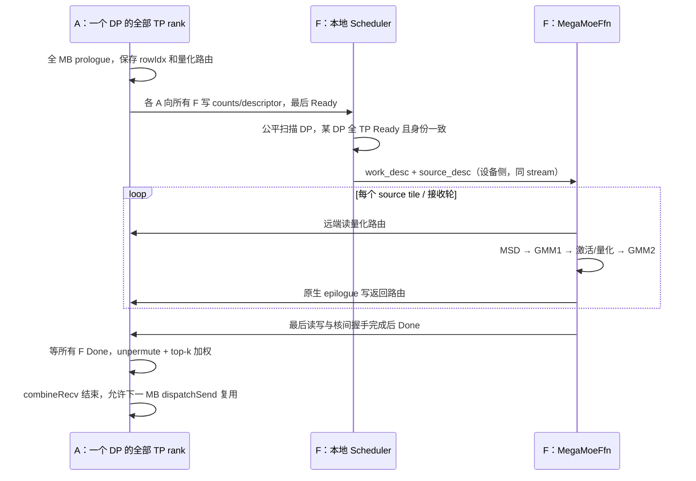

# A3 Prefill CAMAsync MegaMoE 改造设计

状态：**首版代码已生成，尚未通过 CANN 编译与设备验收**。日期：2026-10-29。范围为 A3、vLLM/AFD 0.26、DeepSeek V4 Flash 的 per-channel W4A8 prefill 路径。下文保留评审时的设计与固定源码分析；当前实现、运行入口和验证边界见 [实施说明](implementation.md)。静态检查不代表精度或性能验收。

## 1. 设计结论与阅读顺序

采用四个仓内自定义算子：`AfdMegaMoeDispatchSend`、`AfdMegaMoeScheduler`、`AfdMegaMoeFfn`、`AfdMegaMoeCombineRecv`。A 侧发布完整 microbatch；每个 F 独立轮询完整 DP，随后在一个混合核 FFN 算子内执行原生 MegaMoE 的拉取、MSD、GMM1、激活/再量化、GMM2、结果写回流水。A 侧等待所有 F 完成并还原 top-k 加权结果。

首版保留原生 top-k 复制、1024-token prologue tile、W4A8 计算模板与核间同步。协议层解除“所有 EP rank 同步参加一次 MegaMoE”的要求；计算核心不拆成多个小算子。只做 F 接收/计算工作区的第二层分轮，第一层通信窗口分轮仅保留接口。所有实现放入 afd-plugin；不要求运行时安装另一份 ops-transformer Python 扩展。

配套文档：

| 文档 | 内容 |
| --- | --- |
| [算子与协议接口](operators.md) | 四算子签名、张量/属性、共享 ABI、状态机、同步、错误与容量检查 |
| [仓库与框架接入](integration.md) | 原生代码引入、自定义算子构建/打包、0.26 connector/runner/权重接入 |
| [测试与验收](validation.md) | 单算子、多 rank 协议、精度、性能、DeepSeek V4 E2E |
| [知识证据](knowledge_evidence.md) | CANNBot 查询、A3 同步知识及其证明边界 |
| [实施说明](implementation.md) | 已生成文件、编译与测试命令、实现调整、当前验证结果 |
| [内网验证交接](handoff.md) | 代码包、已验证边界和内网 agent 的执行顺序 |
| [内网 agent 完整 prompt](internal_agent_prompt.md) | 可独立执行的背景、源码入口、边界、验证任务和交付要求 |

## 2. 固定源码与现有行为

| 来源 | 固定版本 | 使用范围 |
| --- | --- | --- |
| afd-plugin | `upstream/release/v0.26.0rc2`，`587e1a9b21c86c467d99b551fa2b5ddd61c9212e` | 目标 Python API、构建、CAMAsync、模型、测试 |
| ops-transformer | `8d46ac50deabb544f59f56f5b82a995159907c03` | 本文所称“原生 MegaMoE”是此检出的 arch22 实现，不泛指其他发布版本 |
| A5 参考设计 | `afd-five-operator-baseline`，`5ac3177c9a2fcade47051f251ba4b19a5954bbb4` | [A5 设计原文](https://github.com/puxiaokun3721/afd-plugin/blob/5ac3177c9a2fcade47051f251ba4b19a5954bbb4/docs/design/a5_async_afd_design.md)，只借鉴异步发布与未来去重思想 |
| 实施分支 | `codex/a3-camasync-megamoe`，基于 `587e1a9b21c86c467d99b551fa2b5ddd61c9212e` | 独立 0.26 worktree；原 main/0.30 和 A5 未跟踪工作保留 |

0.26 文件用 `git show 587e1a9b:<path>` 检查。以下源码行号均对应上述固定版本。仓内现有未跟踪的 `afd_mega_moe_native`、`compat/npu/mega_moe.py` 属于其他 A5 工作，不作为 A3 的实现基础，也不覆盖。

现有 CAMAsync 已有以下可沿用的调度语义：

- DispatchSend 把 payload push 到各 F 的窗口，并按目的 F 对 token 去重，另写专家路由索引及 count；DispatchRecv 在每个 F 本地轮询，收到一个 DP 的全部 TP 成员才启动工作，不依赖 F leader。新 MegaMoE 路径改为 F 远端读取 A 窗口。
- 当前第二层分轮以专家为单位挑选；一个专家超过接收预算时不能靠现有挑选逻辑继续推进。新方案用 MegaMoE 区间切分覆盖此情况。
- CombineSend 每个计算轮写回，最后一轮才通知 A；零路由 F 也需要参与完成。
- 同一 DP 的 microbatch 共享一个物理槽，模型流水是 `combineRecv(MB0) -> dispatchSend(MB1)`，下一 microbatch 的 Attention 计算可提前重叠。

证据：`csrc/npu/ascend_kernels/afd_async_dispatch_send/op_kernel/afd_async_dispatch_send.h:395-446`；`afd_async_dispatch_recv/op_kernel/afd_async_dispatch_recv.h:287-351,478-564`；`afd_async_combine_send/op_kernel/afd_async_combine_send.h:269-304`；0.26 `afd_plugin/model_executor/models/npu/deepseek_v2_async_cam_forward.py:431-486`。

## 3. 首版范围与参数含义

| 项目 | 首版约束 |
| --- | --- |
| 硬件/通信 | A3 arch22，同一可直接 MTE 访问的通信域；不承诺跨超节点或 RDMA |
| 量化 | BF16 输入、INT8 动态激活量化、per-channel W4A8 权重与补偿；不顺带支持 per-group W4、W8 或 A5 |
| 工作单位 | 一个完整 Attention DP、一个 MoE layer、一个 microbatch |
| F 调度 | 每个 F 独立选 DP；不合并跨 DP/跨 microbatch 数据；不增加逐任务 F-F collective |
| 并行 | 默认 A DP2 TP4、F EP8 TP1，PCP/DCP=1；明确的 source-rank 表，不把 DP 编号当物理 rank |
| 场景 | prefill；eager 首先验收，0.26 图模式是后续独立门禁 |
| 模型配置 | 沿 0.26 DSV4 Flash async case：每 DP `max_num_batched_tokens=8192`、2 个 ubatch。模型 H/I/E/K、激活限制和量化格式从实际 checkpoint 读取 |
| 容量 | `P_cap` 是一个 A rank 单 microbatch 的 token 容量；`Q` 是一个 F 一轮的路由行容量，二者独立 |

0.26 E2E 文档已有 checkpoint 示例是 W8A8，不能称为已通过的 W4A8 基线。此次应使用用户当前 per-channel W4A8 模型，在 0.26 上重新建基线。不得把 `max_model_len` 当通信输入容量，也不能无条件以 `8192 / 2 / 4` 推算所有 batch 的有效 token 数；实际 split、padding 和 TP 分片由 runner 提供。

首版在发布前拒绝 decode/mixed batch，不自动切换通信协议。新增 E2E 使用纯 prefill/首 token（max_tokens=1）；一个 token 的 prefill 仍合法，阶段判断不能用 B>1 代替。已有多 token 回答测试留给旧后端回归。

### 3.1 三种“切分”必须分开

| 名称 | 切分对象 | 首版行为 | 槽位释放条件 |
| --- | --- | --- | --- |
| prologue tile | 本地量化/排序的至多 1024 个 token | 复用原生算法，各 tile 写入不同固定偏移，整 MB 一次发布 | 不逐 tile 释放 A 槽 |
| 第二层分轮 | F 已接收任务中的 expert-route 行 | 每 tile 内按 Q 分轮，可截断一个热点专家 | F 私有计算 scratch 在本轮核间依赖全部满足后复用 |
| 第一层通信分轮 | A 通信窗放不下的一个 MB | 首版禁用，只预留接口 | 将来需逐通信轮 credit/ACK，另行设计 |

因此，等待 `combineRecv(MB0)` 再写 `dispatchSend(MB1)` 是**跨 MB 的槽复用**，不是第一层分轮。首版必须容纳整个 MB 的量化输入与返回路由结果；Q 再小也不会减小这两块 A 通信区。

## 4. 原生 MegaMoE 如何工作

主文件：`ops-transformer/mc2/mega_moe/op_kernel/arch22/mega_moe_kernel_a3.hpp`。下表描述 W4A8 分支，不能用 BF16/W8 分支替代。

| 顺序 | 原生阶段及关键函数 | 数据/同步行为 | 新位置 |
| --- | --- | --- | --- |
| 1 | prologue，1619-1643 | 对本 rank 当前 tile 动态量化、按全局专家排序并 top-k 展开，产生 expandedRowIdx、counts，写本地 peer input | DispatchSend；遍历全部 tile 后发布一次 Ready |
| 2 | `AllGatherTokenPerExpert`，1171-1253 | 每 rank 向其他 EP rank 写完整全局专家 count 向量，等待所有参与 rank；从全向量求源端专家前缀 | A 写各 F inbox；Scheduler 只等选中 DP；Ffn 做本地表构造 |
| 3 | `GetCumsumForMMAIV` / `CacheRouteTablesToUb`，661-714 | 得到本地专家的 source 维度前缀、count 和源端行偏移；热循环用 UB 紧凑路由表 | Ffn，保留算法与 UB 布局 |
| 4 | `ComputeNumRecvRounds` / `BuildRoundTables`，729-864 | 按 Q 对本 tile 的所有本地专家路由行做区间切片 | Ffn，保留区间切分，修正/验证源坐标转换 |
| 5 | `ProcessRecvRound` dispatch，1332-1428 | F 通过 MTE 读各 source 的量化记录，抽取 scale 并做 INT8→INT4 MSD；每专家 ready 通知 AIC，后续专家搬运与 GMM1 重叠 | Ffn，同一个混合核 kernel |
| 6 | `GMM1`，872-1010 | 原生 CATLASS W4 模板、权重预取、L1/L0 多缓冲、group 同步 | Ffn，直接复用 |
| 7 | W4 epilogue，1473-1493 | dequant+补偿、激活/截断、再量化与 MSD；C2V/V2C 交接，供 GMM2 消费 | Ffn，直接复用 |
| 8 | `GMM2`，1018-1152 | 原生分组矩阵计算，按同步粒度通知 epilogue | Ffn，直接复用 |
| 9 | `CombineV2`，1831-1928 | W4 dequant/补偿、按 source 路由写远端 D 区；消费尾部 flag，Finalize 排空搬运 | Ffn，换 peer 地址映射，保留流水 |
| 10 | 全 EP `CrossRankSyncV2`，1707-1742 | 所有 rank 的结果完成后才进入本 rank unpermute | 替换为每 F 向任务 DP 的各 A 发布 Done |
| 11 | unpermute，1744-1752 | A 本地 expandedRowIdx + top-k weights 对返回 D 做加权还原 | CombineRecv，等该任务所有 F 的 Done |

原生 count 交换确实是全 EP 的同步依赖，但 token payload 的 dispatch 是 **remote read**，不是 A 按目的 F push 数据。源端已经 top-k 复制；行步长 `H+512` 包含量化 INT8 token 和尾部 per-token scale/对齐区。原生复制中实际有效搬运与 stride 不等长（H+32 与 H+512），不能把 512 字节全解释成业务 metadata。

W4A8 关键模板位于 `arch22/mega_moe_arch22.h:199-270`：L1 tile `<128,256,1024>`、L0 tile `<128,256,256>`，及原有 preload/stages。入口为 `KERNEL_TYPE_MIX_AIC_1_2`。首版不调这些常量，不改 MSD 数值公式，不另写 GMM、SwiGLU 或逐 token scatter 替代原生批量搬运。

### 4.1 必须解除 EP 的多重含义

原生 `params.EP` 同时用于 source 数、全局专家分布、HCCL rank、表长度。A/F 分离后这些量不同：

- `A_total = D × T`：所有 Attention rank 数；一个任务只取 `S=T` 个 source。
- `F_total`：FFN EP 数；`e` 为每 F 专家数，`E=F_total×e`。
- `world_size=A_total+F_total`：通信域大小。
- `source_idx -> A physical rank` 与 `ffn_idx -> F physical rank`：独立映射。

不能把原生 `EP` 简单替换成 A+F 或 T。适配时逐用途拆成 `num_sources`、`num_ffn_ranks`、`num_global_experts` 和 peer map；计算循环/compact route table 的 source 轴使用 S，权重索引使用 local expert，源端排序使用 E。原生 HcclShmem 访问包装为 `source_input_base(s,tile)` / `source_output_base(s,tile)`，不在热路径增加任意 rank 搜索。

## 5. 异步流程与生命周期



图中 S/F 表示每个 F rank 上的本地操作；不同 F 可以选择不同 DP。F0 等不到 DP0 时可以处理 DP1，F1 可以先处理 DP0。不存在将所有 F 拉回同一 DP 的 count allgather 或 barrier。由于 F 不等其他 F、A 在等待前已完成整个任务发布，这种次序差异不会产生协议级环形等待；设备资源饥饿与发布可见性仍须真实多 rank 压测。

调度采用公平 round-robin 扫描，并记录 `completed_seq[dp]`。一个 DP 在一个物理槽上最多有一个未完成任务。Scheduler 选择后，同 stream 只执行对应一次 Ffn；Ffn 完成所有 tile/round、发完 Done 后推进本 F 的 completed sequence。Scheduler 无需向 host 取 layer；权重层在 Ffn 设备入口解析。

零 token TP 成员也发相同任务身份、零 counts 的 Ready；零路由 F 仍发送 Done。缺少某个 TP Ready、层/序号不一致、非法 layer、发布序号跳跃，不能假装本 DP 完整。

### 5.1 热点专家分轮与通知

设本 F 当前 tile 第 `(expert g, source s)` 段在合并空间为 `[b,b+c)`，第 r 轮为 `[rQ,(r+1)Q)`：

```text
lo = max(b, rQ)
hi = min(b+c, (r+1)Q)
rows = max(0, hi-lo)
source_row = source_expert_base[s,g] + (lo-b)   # 仅 rows>0 时使用
```

`source_expert_base` 是源 A 按**所有 E 个专家**排序后的前缀，`b` 是本 F 合并 S 个 source 后的坐标，不能混用。发送输入与写回 D 均用同一个 source_row；F 私有 workspace 使用轮内紧凑坐标。

所分析原生 `BuildRoundTables:798-807` 直接将 `lo` 写入 preSum 表，而消费者把它作为源 A 行偏移。这是本次静态发现的坐标风险，不能原样复制后宣称多轮正确。首版应保留原生区间求交和三段轮表，新增上述显式坐标转换；用多 source、多 expert、非零 prefix、热点跨 Q 的独立 golden 验证。原生对照也先限定在已验证范围，不能将疑似有问题的多轮输出作为唯一真值。

热点拆分只改变 F 内部的 count/offset 与轮数，**不新增每轮 A↔F 通知**。中间轮结果直接落在 A D 区的不同位置；F 最后一轮结束才发任务 Done，A 最终 combine 一次。因此不需要逐轮 credit、slot ACK 或跨 F 的统一轮号。

## 6. 内存排布详细对照

以下都是逻辑字节数，实际还要计入对齐、HCCL 双窗口、框架 allocator 和模型权重。符号：原生 EP=N、本地专家 e、隐藏 H、中间维 I、top-k K、单 source token B、`C=min(B,1024)`、tile 数 J、单轮路由容量 Q。

### 6.1 原生每 rank 的 peer window

依据 `PeermemInfo:2032-2076`、`hccl_shmem.hpp:198-319`：

| 区域 | 大小/内容 | 写者 → 读者 | 生命周期 |
| --- | --- | --- | --- |
| 前部保留 | 10 MiB | native 通信辅助实现约定 | 域生命周期 |
| X 输入区 | `C×K×(H+512)` | 本 rank prologue → 所有相关 EP receiver 远端读 | 当前 1024 tile |
| 独立 scale 保留区 | `4×C×K` | layout 有预留；本 W4 remote-read 使用 X 行尾 scale | 与当前 tile 同寿命，首版保守保留 |
| D 返回区 | `2×C×K×H` | 各 F epilogue 远端写 → 本 rank unpermute 读 | 当前 tile |
| count reserve | `4×N×align128(N×128+1)` | 各 source 完整 count 向量 → 本 rank receiver | 当前 tile；128 是最大专家数常量 |
| 尾部同步 | `max(512×N,512 KiB)` | 全 EP barrier/控制 | 当前 tile/调用 |

count 的**运行时行 stride** 是 `align128(N×e+1)` 个 int32，与按最大 e 预留的空间不相同。原生将 count 加 `0x800000` 做 readiness 编码；它不是 task sequence。

原生最小输入窗估算为：

```text
10 MiB + C*K*(3*H+516)
       + 4*N*align128(N*128+1)
       + max(512*N, 512 KiB)
```

原生下一 tile 复用 X/D，因此每 tile 有全 EP 完成依赖。`expandedRowIdx` 在私有 workspace，不在 peer window，不需要远端读取。

### 6.2 改造后 A window

定义 `C_cap=min(P_cap,1024)`、`J_cap=ceil(P_cap/C_cap)`、`P_pad=J_cap×C_cap`。各 rank 统一容量，末 tile 未使用路由不读取。每个 A 仍只有一个 MB 槽。

| 区域 | 拟定大小/布局 | 写者 → 读者 |
| --- | --- | --- |
| 前部保留 | 沿用 10 MiB，须经实际 HCCL context 验证 | 通信上下文 |
| X 全 MB | `[J_cap,C_cap×K,H+512]`，`P_pad×K×(H+512)` 字节 | A prologue → 选中此 DP 的 F remote read |
| scale 保留 | `4×P_pad×K` 字节 | 保留原生地址布局余量；不得重复从这里误读 scale |
| D 全 MB | `[J_cap,C_cap×K,H]` BF16，`2×P_pad×K×H` 字节 | F epilogue → A CombineRecv |
| Done | F_total 个独占 512B 记录，含提交 ticket、task identity、状态 | 每个 F 只写自己记录 → A 轮询 |
| 尾部保留/错误 | 保持底层 shmem 必需保留；AFD 不调用全 EP barrier | 协议控制 |

私有 A 内存：全 MB `expandedRowIdx`（`4×P_pad×K`），`J_cap×align128(E+1)` 的 int32 counts、prologue scratch、状态及 top-k weights 引用。top-k weights 留在 A，不发 F；routed scaling 只在模型规定位置执行一次。

原生 X/D 只放 C tokens，改造后放 P_pad tokens；这是取消逐 tile 全域 barrier、实现整 DP 到达调度的明确内存代价。多个 MB 通过 CR→DS 顺序复用此块，不乘 microbatch 数。

### 6.3 改造后 F window 与私有 scratch

F peer window 只需要每个 A 一行 inbox：独立 Ready 记录 512B、TaskMeta 记录 512B、`4×J_cap×align128(E+1)` 字节 counts。每个 A 写每个 F 上自己的行，不和别的 A 共享可写控制字。全向量广播保留了原生 prefix 的求法；通信方向变成 A→F，不包含 F→F。

F 私有内存包含：

| 区域 | 拟定容量 | 说明 |
| --- | --- | --- |
| 工作描述与 source snapshot | WorkDesc 256B，S 份 TaskMeta/peer 映射 | 稳定到本次 Ffn 完成 |
| 当前 tile count staging | `4×S×align128(E+1)` 字节 | 将分散 inbox 中的所选 source 当前 tile 收集成原生连续 source 行布局 |
| 原始 source-prefix/compact counts | 每 tile 的 S×e 视图及不可变 prefix | 不用接收轮局部坐标覆盖原始 prefix |
| cumsum/round table | J_cap 份 cumsum；`J_cap×R_max×3×S×e` int32 轮表（加原生所需对齐） | 首版保留每 tile/round 独立 GM 地址，避免误删原生缓存规避措施 |
| per-token scale | 两份 `4Q` | 第一、第二次量化 |
| C/C2 复用区 | W4 逻辑使用 `4Q×max(2I,H)` 字节 | 原生 FP16 中间量及 MSD 双行，不能按普通 BF16 MoE 估算 |
| A1/A2 INT4 复用区 | 逻辑 `Q×max(H,I)` 字节 | 沿用原生 MSD 密排和 expert 间 stride |
| 其他 | 原生 local sync、UB 路由缓存所需 GM、状态、诊断 | 由公共 layout planner 统一计算 |

这里是 kernel 实际区域的说明，不等于申请峰值。原生 host `mega_moe_tiling_arch22.cpp:1523-1548,1578` 对部分区域保守申请更大（例如 `2Q×max(H,I)`），另外加 16 MiB 与 routing workspace 上界。首版沿用已核对的保守 allocator 上界，不在拆分时顺带压缩；记录各区域 offset、alloc bytes、used bytes。host/kernel 必须共享一个布局计算定义，用 checked 64-bit 加乘，拒绝溢出/容量不足。

`R_max=ceil(S×C_cap×K/Q)` 是保守上界，不能把均匀专家路由比例用于最坏情况。每个 tile 的实际轮数由 counts 得出，至少保留一轮空路径或统一零路由快速路径；后者必须保证 AIC/AIV 一致退出、不遗留 flag。

native `GetCumsumForMMAIV` 和 route cache 读取假定 source stride 为 `E_pad×4`。新 inbox 的 source stride 包含控制区和整 MB 的全部 tile，不能直接套用。首版逐 source 将当前 tile 收集到上述 staging，再复用原生前缀/紧凑表 helper；不把可能超出 DMA 字段上限的大 inbox stride 强转成 uint16。staging 的额外拷贝计入 metadata 时间，保留单份并在所有本 tile 消费结束后复用。

### 6.4 HCCL 实际占用不能按角色想当然缩小

A3 native 使用 KFC context 的现有 HCCL buffer；`HcclShmem` 读取 `winSize`，不自行按 A/F 角色分配不同 peer 大小。源码没有提供此路径按 rank 异构窗口的充分证据。首版按所有 rank 统一 `W=max(W_A,W_F)` 配置，并计入 HCCL 对等大小 winIn/winOut 的实际分配。F 逻辑不用大 payload 区，不代表 F 的物理 HCCL 显存会减少。

启动输出必须包含：实际 HCCL window 大小、A/F 所需逻辑大小、双窗口总量、私有 scratch、persistent route/weight views 和测得 allocator 峰值。单看 `HCCL_BUFFSIZE` 或逻辑 X/D 公式不能宣称显存收益。`mc2/common/torch_extension/csrc/comm_context.cpp:137-165,928-941` 中 KFC 与 channel/user-buffer 是不同路径，不把 A5 channel 接口当 A3 已支持。

## 7. 复用范围与必要修改

| 内容 | 策略 | 性能注意点 |
| --- | --- | --- |
| prologue 的量化、排序、top-k 展开 | 原文件/模板复用，增加 tile 目标地址参数 | 整 MB 先发布会增加首包等待；测量 DS 与首轮启动间隔 |
| GMM1/GMM2、MSD、W4 epilogue、激活、prefetch | 原生代码与参数直接复用 | 不在热循环读 host layer、不做逐任务权重转换 |
| SyncAll、CrossCore flag、MTE event、尾部 drain | 保留原调用配对和时序 | `SyncAll<true>` 不等于 AIC+AIV 全部完成，不得以其单独发布 Done |
| count allgather / 全 EP barrier | 替换为 Ready/Done 及选中 DP 的本地表构造 | 这是必要的异步边界，不保留隐形全域 wait |
| source rank 与专家 rank | 增加静态映射和独立数量 | 预先生成紧凑 peer 地址表，避免 token 循环内查表搜索 |
| 热点分轮 source offset | 保留求交算法，显式恢复源坐标 | 该修改属于正确性必需；与性能调优拆开验证 |
| 设备选层 | 入口一次性选出 W13/W2/scale/compensation/激活参数及 prefetch 基址 | 所有核拿同一层；非法层不能回退第 0 层 |
| host tiling/workspace | 复用计算 tile 策略，重写角色/容量/生命周期规划 | 原生对称 EP、等 B 和临时 rowIdx 假设不可照搬 |

任何引入的原生文件保留版权/许可证和固定源 revision；逐项记录本地差异。详见 [接入设计](integration.md)。

## 8. 未来去重与第一层分轮

预留 `input_layout_version`。v1 为 expanded routes，未来 v2 可以是：

```text
unique_quant_tokens[P,H+512] + route_token_index[P*K] + expert_prefix[E+1]
```

这样源端输入从 `P*K*(H+512)` 降为约 `P*(H+512)+4*P*K`，但 D 返回区仍需逐 route 存储。F 将 `(expert,source,route)` 映射到 token_id，拉取后仍生成原生 GMM/MSD 所需的连续 expert 输入；GMM 与 W4 epilogue 无需重写。

v2 必须单独测量 gather 合并、连续 run 提取、搬运效率和 UB 成本。源端存储去重不自动意味着远端读流量也去重；不同 F 仍可能分别读同一 token。先实现存储去重，再评估同 F 内 token cache/复用。不得为节省 X 而偷偷改变 A↔F 完成协议。

`comm_round_idx/count/token_base` 在 v1 固定为 0/1/0。未来第一层分轮要定义每通信轮 ticket、消费者集合、A 输入可重写时机、跨轮输出累加与最终 MB 完成语义；不能仅把 P_cap 缩小后循环调用 v1 Send。它与去重是两个独立扩展。

## 9. 实施顺序与评审关口

1. 固定源清单、权重布局转换合同、静态 shape/容量检查，构建 A3 四算子骨架与注册链。
2. 单独验证 Send/Combine 与原生 prologue/unpermute 的数据布局；完成真实 peer 读写、Ready/Done 可见性 litmus。
3. 接入 Ffn 原生热路径，先单 DP、单 tile、单轮、单层；再设备选层、多 tile、热点多轮，最后独立 F 调度和多 DP。
4. 接入 0.26 runner/connector；按原模型 ubatch 流水跑 W4A8 prefill E2E。
5. 进行数值与性能归因。比较原生计算核心和旧 CAMAsync 完整链路，分别报告，满足门禁后再讨论去重或图模式。

首版已按上述步骤生成代码和测试入口，见 [实施说明](implementation.md)。协议发布原语的设备可见性、0.26 工具链编译、实际 checkpoint 的 NZ metadata、模型精度与性能仍需要设备证据。
