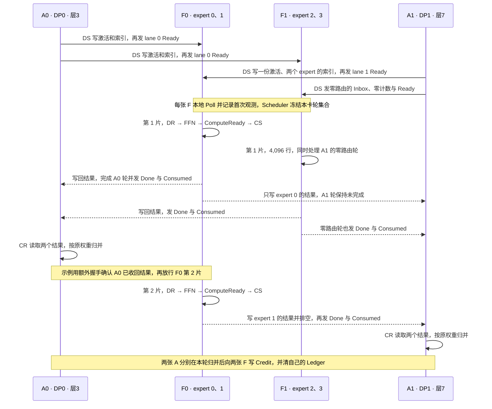

# A5 AFD 纯 UMDK 2A2F 联调指南

这份指南用 Ascend 950 上跑通的四卡例子，说明一轮 Attention 激活如何发到 FFN、如何参与跨层计算分片、如何回到发出它的 A 卡。例子直接调用 `torch.ops.umdk_cam_op_lib`，使用 CAM 算子、PyTorch、torch_npu 和 CANN HCCL/HCOMM。测试脚本会阻止导入 `deep_ep`，通信窗口的分配和注册由例子自带的 owner 与传输辅助库完成。 [基线设计与布局](https://github.com/puxiaokun3721/afd-plugin/blob/f0872364db1cd0b4d274a379a5f48c2d8ca50a27/docs/design/a5_afd_ffn_transaction.md) · [四卡脚本](https://gitcode.com/puxiaokun3721/umdk/blob/5c3daaa7ccffe4699ceed63b88cba104eb5af4c7/test/cam/afd_ffn_transaction_2a2f.py)

## 1. v1 代码入口和已验证范围

截至 2026 年 11 月 15 日 19:20（北京时间），四卡联调在个人 UMDK 分支 `codex/cam-ffn-transaction` 的 `5c3daaa7ccffe4699ceed63b88cba104eb5af4c7` 上通过。四个进程使用真实通信，两个 A 都通过了逐元素对照，退出码为 0。FFN 用 BF16 的按专家缩放来验证路由、层和回包，覆盖范围是算子与协议联调。 [个人分支固定提交](https://gitcode.com/puxiaokun3721/umdk/commit/5c3daaa7ccffe4699ceed63b88cba104eb5af4c7)

上游 PR !3918 目标为 `cam_feature`，当前审查提交为 `e15b13edf7ac80a737d9ddc2f2fd9bcf72acf368`，范围是四个通信算子及共享布局和绑定。已有的四算子 A5 回执对应候选 `dfc75a2fcef3160a5b33f40aebaad0e3c1b1f32b`，覆盖跨层多片、Attention 成员独立通信分轮、物理槽复用和旧 owner 的 eager 调用。复现本文的 CAM 控制入口、时间戳和独立 owner 示例，请使用上面的个人分支固定提交。 [UMDK PR !3918](https://gitcode.com/openeuler/umdk/merge_requests/3918) · [先前 A5 验证的通信提交](https://gitcode.com/puxiaokun3721/umdk/commit/dfc75a2fcef3160a5b33f40aebaad0e3c1b1f32b)

| 同事要看什么 | v1 源码入口 |
|---|---|
| 完整可运行版本 | GitCode 个人 UMDK 的 `codex/cam-ffn-transaction`，固定提交 `5c3daaa7`。四个通信算子、三个控制步骤及独立四卡用例在同一份源码中。[个人 UMDK 源码树](https://gitcode.com/puxiaokun3721/umdk/tree/5c3daaa7ccffe4699ceed63b88cba104eb5af4c7) |
| 运行脚本和通信初始化 | `test/cam/afd_ffn_transaction_2a2f.py` 编排四个 rank 和所有 CAM 调用。`afd_2a2f_owner.py` 负责分配设备缓冲和填 Context。`afd_2a2f_transport.cpp` 负责注册窗口、建立通道并导出 Jetty 句柄。[运行说明](https://gitcode.com/puxiaokun3721/umdk/blob/5c3daaa7ccffe4699ceed63b88cba104eb5af4c7/test/cam/README.md#L48) · [Owner](https://gitcode.com/puxiaokun3721/umdk/blob/5c3daaa7ccffe4699ceed63b88cba104eb5af4c7/test/cam/afd_2a2f_owner.py) · [Transport](https://gitcode.com/puxiaokun3721/umdk/blob/5c3daaa7ccffe4699ceed63b88cba104eb5af4c7/test/cam/afd_2a2f_transport.cpp) |
| Python 调用和算子注册 | `src/cam/comm_operator/pybind/pybind.cpp` 列出 DS、DR、CS、CR、Poll、带时间戳的 Poll、Scheduler 和 ComputeReady 的接口签名。[Torch 接口](https://gitcode.com/puxiaokun3721/umdk/blob/5c3daaa7ccffe4699ceed63b88cba104eb5af4c7/src/cam/comm_operator/pybind/pybind.cpp#L131) · [控制入口绑定](https://gitcode.com/puxiaokun3721/umdk/blob/5c3daaa7ccffe4699ceed63b88cba104eb5af4c7/src/cam/comm_operator/pybind/cam_afd_ffn.cpp) |
| 四个通信算子的实现 | 都在 `src/cam/comm_operator/ascend_kernels/`。DS 看发送与发布，DR 看事务取片，CS 看回包排空和逐轮退役，CR 看原 token 归并。[DS](https://gitcode.com/puxiaokun3721/umdk/blob/5c3daaa7ccffe4699ceed63b88cba104eb5af4c7/src/cam/comm_operator/ascend_kernels/cam_deepep_dispatch_send/op_kernel/cam_deepep_dispatch_send_rt.h) · [DR](https://gitcode.com/puxiaokun3721/umdk/blob/5c3daaa7ccffe4699ceed63b88cba104eb5af4c7/src/cam/comm_operator/ascend_kernels/cam_deepep_dispatch_recv/op_kernel/cam_deepep_dispatch_recv_transaction.h) · [CS](https://gitcode.com/puxiaokun3721/umdk/blob/5c3daaa7ccffe4699ceed63b88cba104eb5af4c7/src/cam/comm_operator/ascend_kernels/cam_deepep_combine_send/op_kernel/cam_deepep_combine_send_rt.h) · [CR](https://gitcode.com/puxiaokun3721/umdk/blob/5c3daaa7ccffe4699ceed63b88cba104eb5af4c7/src/cam/comm_operator/ascend_kernels/cam_deepep_combine_recv/op_kernel/cam_deepep_combine_recv_rt.h) |
| 调度算法和设备内存布局 | CAM 源码树内的 `utils/op_kernel/deep_ep/` 存放 Scheduler 实现和共享结构定义。运行时由 UMDK 的 CAM 构建使用这些源码，无需安装 DeepEP 扩展。[Scheduler](https://gitcode.com/puxiaokun3721/umdk/blob/5c3daaa7ccffe4699ceed63b88cba104eb5af4c7/src/cam/comm_operator/ascend_kernels/utils/op_kernel/deep_ep/impls/afd/ffn_scheduler.h) · [Context、TaskInfo、Inbox、Ledger](https://gitcode.com/puxiaokun3721/umdk/blob/5c3daaa7ccffe4699ceed63b88cba104eb5af4c7/src/cam/comm_operator/ascend_kernels/utils/op_kernel/deep_ep/layout/afd/context.h) · [Active 事务布局](https://gitcode.com/puxiaokun3721/umdk/blob/5c3daaa7ccffe4699ceed63b88cba104eb5af4c7/src/cam/comm_operator/ascend_kernels/utils/op_kernel/deep_ep/layout/afd/ffn_transaction.h) |

## 2. v1 最新方案与流程全景

### 2.1 一轮数据和一次计算事务如何衔接

```text
初始化：A、F 各自分配通信窗口与本地工作区
        四个 rank 建立 HCCL/HCOMM 资源并填好 Context 地址目录
                                  │
                                  ▼
Attention A                                   FFN F（每张卡独立执行）
计算本成员的轮数和轮内范围
  │
  DS 写 records / refs / counts / prefix ──────► F Payload
  DS 写 Inbox → 提交 A Ledger → 发 InputReady ─► F Control
                                                       │
                                                       ├─ Poll 看到 NEW_READY
                                                       │    └─ 首次周期 → F 本地 timestamps
                                                       │
                                                       └─ Scheduler 扫描、等齐完整通信轮
                                                            冻结本 F 的 Active 事务和组计数
                                                                  │
                                                 ┌──── 下一片 ◄───┤
                                                 │                ▼
                                                 └── DR → FFN → ComputeReady → CS
                                                                      │
A Payload ◄────────────────── CS 按来源 lane / token / TopK 槽写回 ──┤
A Control ◄────────────────── CS 排空本片，为已完成的轮发 Done → Consumed ┘
  │                                                      │
  CR 等所有 F 的 Done，按 A 原权重归并                     └─ 各片推进游标，事务结束再选下一批
  CR 回写下一代 Credit ───────────────────────────────► F Control
  A 释放 Ledger bank，复用槽前核对 Consumed
```

1. **A 侧先决定通信轮。** `B_i` 是本成员的输入行数，`C_i` 是它的物理槽容量。共同轮数模式下，同一个 DP 的各成员使用 `max(1,max_i ceil(B_i/C_i))`，短成员也发布空尾轮。独立分轮模式下各成员使用 `J_i=max(1,ceil(B_i/C_i))`，DS 和 CR 使用同一个 `J_i`，Inbox 申报本成员的轮数，`round_idx+1==J_i` 表示它的最后一轮。
2. **F 侧按逻辑通信轮等齐。** 首轮等齐同一个 DP 和 phase 的所有注册成员，零行或零路由成员也走 Ready 和确认。独立分轮首轮齐备后，每张 F 保存该任务的成员及各自 `J_i`，后续第 `r` 轮只等 `r<J_i` 的成员，并校验轮号与首轮声明。以 `B=(8193,8192)`、`C=8192` 为例，首轮两张 A 都发，第 1 轮只等长成员的最后 1 行。短成员收齐自己的回包和确认后可复用本卡槽位。F 用 `(DP, phase, microbatch, layer)` 区分旧任务的后续轮和新任务。
3. **一次选批冻结整轮。** 每张 F 按本卡可见状态选批，预填充和解码同批不混选。就绪条件满足时优先考虑与上一批不同的 phase，再用 Scheduler 的接管 tick 比较首组。选中集合可以跨 DP、microbatch、通信轮号及布局兼容的层。层之间共用当前传输形状与对齐，计算仍按各自层和专家使用对应权重。选出固定的通信轮后，后续片沿用同一个 `txn_id`，新到 Ready 留给下一次选批。Poll 的设备周期存到独立的 `timestamps`，当前选批使用已有逻辑 tick。
4. **F 侧再按整专家组取计算片。** 分组键为 `(layer, local_expert)`。一片同时满足 `Σ rows ≤ Q` 和 `Σ align_up(rows, a) ≤ Q_alloc`，其中 `a` 是行对齐。单组也须能同时放进这两个上限，`Q_alloc` 还受后端允许的最大行数约束。分片只在组与组之间进行。DR 搬完本片写 `INPUT_READY`，FFN 计算结束再用 `ComputeReady` 交给 CS。对有数据的轮，计算先行模式允许先算，CS 首次回包前再等 Credit。零路由控制轮在入选前检查 Credit。
5. **逐轮完成，逐片提交。** CS 先排空本片的回包队列。对本 F 在本片已完成的轮，先保留退役状态，再发 Done、Consumed，防止旧 Inbox 或 Payload 被覆盖后仍被后续片读取。CS 提交本片进度后，下一片只处理尚未完成的轮。某轮在本 F 已完成即可确认，A 收到所有 F 的 Done 就能归并该轮。CR 发下一代 Credit，再释放 Ledger，供后续槽位复用。 [独立分轮等齐](https://gitcode.com/puxiaokun3721/umdk/blob/5c3daaa7ccffe4699ceed63b88cba104eb5af4c7/src/cam/comm_operator/ascend_kernels/utils/op_kernel/deep_ep/impls/afd/ffn_scheduler.h#L166) · [接管与选批](https://gitcode.com/puxiaokun3721/umdk/blob/5c3daaa7ccffe4699ceed63b88cba104eb5af4c7/src/cam/comm_operator/ascend_kernels/utils/op_kernel/deep_ep/impls/afd/ffn_scheduler.h#L542) · [DR 容量判断](https://gitcode.com/puxiaokun3721/umdk/blob/5c3daaa7ccffe4699ceed63b88cba104eb5af4c7/src/cam/comm_operator/ascend_kernels/cam_deepep_dispatch_recv/op_kernel/cam_deepep_dispatch_recv_transaction.h#L47) · [CS 排空与确认](https://gitcode.com/puxiaokun3721/umdk/blob/5c3daaa7ccffe4699ceed63b88cba104eb5af4c7/src/cam/comm_operator/ascend_kernels/cam_deepep_combine_send/op_kernel/cam_deepep_combine_send_rt.h#L477)

Ready、Done、Consumed 和 Credit 都是按槽位交替推进的代次位。`Consumed` 让 A 知道旧输入何时可被覆盖，`Credit` 让 F 知道 A 的返回窗口何时可再次写入。需要多槽多轮并行时，当前接口用逐轮返回模式保存各槽的 `ReturnProgress`，由调用方轮询推进。四卡例子使用每张 A 一个槽和阻塞式收尾。 [DS 模式约束](https://gitcode.com/puxiaokun3721/umdk/blob/5c3daaa7ccffe4699ceed63b88cba104eb5af4c7/src/cam/comm_operator/ascend_kernels/cam_deepep_dispatch_send/op_kernel/cam_deepep_dispatch_send_rt.h#L291) · [CR 逐轮进度与确认](https://gitcode.com/puxiaokun3721/umdk/blob/5c3daaa7ccffe4699ceed63b88cba104eb5af4c7/src/cam/comm_operator/ascend_kernels/cam_deepep_combine_recv/op_kernel/cam_deepep_combine_recv_rt.h#L419)

### 2.2 设计和实测的对应关系

| 设计能力 | 已有验证 |
|---|---|
| 纯 UMDK 通信初始化、两个 A 各发一轮、F 跨层分两片、逐轮确认和不等权回包 | `5c3daaa7`，真实 A5 四卡，BF16 `H=7168`，运行退出 0。FFN 用固定增益验证路由和回包。 |
| Poll 记录首次 Ready 的系统周期 | 同一四卡用例在两个 F 上检查了每条 lane 的周期非零、身份正确、重复 Poll 后保持原值，覆盖 F1 对 A1 的零路由观测。 |
| 同一 DP 内长短成员独立分轮、短成员同槽复用、旧调用兼容 | 四算子候选 `dfc75a2f` 的 A5 实测使用配套 DeepEP owner。纯 UMDK 用例每张 A 发一轮。 |
| 上游提交 `e15b13ed` | CPU 差分和社区门禁已有结果。四通信算子的 A5 回执对应 `dfc75a2f`。 |

### 2.3 分轮模式怎样配置，谁算总轮数

| 问题 | 当前实现 |
|---|---|
| 共同轮数，模式 `0` | 调用方给同一 DP 的各参与 A 填相同的 `TaskInfo.num_comm_rounds=W`。通常取 `W=max(1,max_i ceil(B_i/C_i))`，也可以给统一、足够大的上界。短成员继续发布尾部空轮。 |
| 独立分轮，模式 `1` | 每张 A 用本卡输入行数（含 mask 占位）和槽容量算 `J_i=max(1,ceil(B_i/C_i))`，DS 和 CR 共用这份 TaskInfo。F 首轮等齐，再根据各成员申报的 `J_i` 判断后续各轮等待谁。 |
| 模式怎样选 | 这是通信域初始化时选定的协议。各 rank 的 Context `comm_round_mode`（偏移 68）与 TaskInfo 第八个 `uint32`（偏移 28）一致，DS 再将模式写入 Inbox。配套 DeepEP 诊断器用 `--local-comm-rounds` 调用 `owner.enable_local_rounds()`，并按此构造 TaskInfo。纯 UMDK 示例的 owner 和 TaskInfo 固定为模式 `0`、每 A 一轮。 |

共同轮数由上层提供。CAM DS 从 TaskInfo 读本卡的 `B_i`，从 Context 的 lane 表读本槽的 `C_i`，然后按照调用方填的轮数发。它只校验该轮数能覆盖本卡行数，A 卡之间没有用这条算子链路交换 `B_i` 或计算 `max`。如果上层已经掌握整个 DP 的切分计划，各 rank 直接用同一个计划生成 `W`。如果每张 A 只知道自己的动态长度，上层可以复用已同步的批次元数据，或在发送前对每卡的 `max(1,ceil(B_i/C_i))` 在 DP 内取最大值。需要共享的量只是统一的 `W`。配套诊断器的各 rank 从同一组命令行参数构造所有长度，再计算共同上界。共同轮数模式下若每张 A 填不同的 `W`，即使各自通过 DS 校验，F 也会将这些发布匹配为不同的轮，可能一直等不到完整成员。 [DS 参数校验与分轮循环](https://gitcode.com/puxiaokun3721/umdk/blob/5c3daaa7ccffe4699ceed63b88cba104eb5af4c7/src/cam/comm_operator/ascend_kernels/cam_deepep_dispatch_send/op_kernel/cam_deepep_dispatch_send_rt.h#L287) · [Context 与 TaskInfo](https://gitcode.com/puxiaokun3721/umdk/blob/5c3daaa7ccffe4699ceed63b88cba104eb5af4c7/src/cam/comm_operator/ascend_kernels/utils/op_kernel/deep_ep/layout/afd/context.h#L48) · [配套诊断器怎样计算轮数](https://github.com/puxiaokun3721/DeepEP-Ascend/blob/25b5153eb2549107c13c8d462e325ac28cea8dea/tests/afd/run_pipeline_cam.py#L214)

### 2.4 `Q`、`Q_alloc` 和 Credit 策略

- **`Q` 限制有效专家行。** 一行对应一条实际 token→expert 路由。同一个 token 的两个 TopK 路由落在同一张 F 上，就消耗两行，即使 F Payload 里只存了一份 token record。
- **`Q_alloc` 限制实际占用的行槽。** 每个专家组单独补齐到 `a` 行，再把组的对齐后占用相加。DR 和 FFN 输出缓冲按 `Q_alloc` 行预留，本片用完后下一片复用同一块缓冲。两项检查都通过，才能把下一整组加入本片。例如 `Q=Q_alloc=4096`、`a=32`，两个专家组分别有 2049 和 2047 个有效行。有效行合计正好 4096，对齐后是 `2080+2048=4128`，所以两组须分片。若单个完整组就超出任一上限，必须调配置或在上游控制该组大小。

Credit 匹配表示 A 的返回窗口可写入当前这一代。两种策略决定**把这个检查放在选批前，还是回包前**。

| 策略 | 有路由的轮如何推进 | 如何选择 |
|---|---|---|
| `COMPUTE_AHEAD` | Scheduler 可以先选中轮，DR 和 FFN 先做。CS 首次写该轮前，检查该轮各成员的 Credit 等于各自 `return_bit`，获得后保留许可供后续片复用。 | 个人 UMDK 的固定 AOT Scheduler 写死 `kCreditPrecheck=false`，当前 Torch 算子没有切换入参。配套 DeepEP owner 用默认的 `prepare_ffn(precheck=False)`。 |
| `PRECHECK` | Scheduler 只选已经满足 Credit 的轮，冻结时记为 `HELD`，CS 用已取得的许可。 | 配套 DeepEP owner 用 `prepare_ffn(precheck=True)`，诊断器对应 `--precheck`。它在准备时选择 JIT 模板。个人 UMDK 的固定 AOT 入口需要改实现并重新构建才能选此策略。 |

整个通信轮在本 F 零路由时，两种策略都在选择前检查 Credit，避免零路由轮先占住本 F 唯一的 Active 等窗口许可。在计算先行策略下，这次检查可以只用于筛选，CS 在确认该轮前还可再检查。 [固定 AOT 策略](https://gitcode.com/puxiaokun3721/umdk/blob/5c3daaa7ccffe4699ceed63b88cba104eb5af4c7/src/cam/comm_operator/ascend_kernels/cam_afd_ffn_scheduler/op_kernel/cam_afd_ffn_scheduler.cpp#L45) · [Scheduler 的 Credit 判断](https://gitcode.com/puxiaokun3721/umdk/blob/5c3daaa7ccffe4699ceed63b88cba104eb5af4c7/src/cam/comm_operator/ascend_kernels/utils/op_kernel/deep_ep/impls/afd/ffn_scheduler.h#L253) · [CS 回包前检查](https://gitcode.com/puxiaokun3721/umdk/blob/5c3daaa7ccffe4699ceed63b88cba104eb5af4c7/src/cam/comm_operator/ascend_kernels/cam_deepep_combine_send/op_kernel/cam_deepep_combine_send_rt.h#L407) · [配套 owner 的开关](https://github.com/puxiaokun3721/DeepEP-Ascend/blob/25b5153eb2549107c13c8d462e325ac28cea8dea/csrc/buffers/afd.hpp#L550)

### 2.5 `ComputeReady` 和 stream 顺序各保证什么

`cam_afd_compute_ready(active, execution_state)` 是状态标记算子。实际 FFN（如 GMM 或 `gmmswigluquant`）读 `recv_x`，计算后写 `combine_x`。调用方把 `ComputeReady` 排在 FFN 之后，它读取 Active 和 F 本地 ExecutionState。对 `WORK` 片，它要求原状态为 DR 写入的 `INPUT_READY`，再改为 `COMPUTE_READY`。标记算子没有 `combine_x` 入参，调度它的顺序由调用方保证。

同一条 stream 上，DR → FFN → CS 已能保证数据依赖和执行顺序。当前 v1 的 CS 另外校验本片协议状态。它进入后读一次状态，对 `WORK` 必须看到 `COMPUTE_READY`。若其它输入合法且缺少该标记，CS 报 `STATE_ORDER`，将片置为 `ABORTED` 并在回包前退出。整片只有零路由控制工作时，CS 接受 `INPUT_READY`，仍按协议检查 Credit 和确认。一个有数据的片混入零路由轮时，整片按 `WORK` 检查。

```text
同一条 stream：  DR 搬完 → FFN 写 combine_x → ComputeReady 标记 → CS 校验并回包
ExecutionState：INPUT_READY ────────────────► COMPUTE_READY ───► COMMITTED
不同 stream：   先用 event/wait 保证 DR → FFN 和 FFN → 标记/CS 的依赖
```

同 stream 的数据依赖本身足以保证输入产出顺序，当前 ABI 仍要求这一步状态转换。标记由调用方保证置于有效 FFN 输出之后，提前调用标记无法检测 FFN 是否真的写完。若以后用同流约束简化入口，需要一并修改 CS 的状态检查与接口约定。单卡示例用实际 grouped matmul 后显式标记，四卡示例用确定性的专家增益后显式标记。 [ComputeReady 实现](https://gitcode.com/puxiaokun3721/umdk/blob/5c3daaa7ccffe4699ceed63b88cba104eb5af4c7/src/cam/comm_operator/ascend_kernels/cam_afd_compute_ready/op_kernel/cam_afd_compute_ready.cpp#L25) · [CS 状态检查](https://gitcode.com/puxiaokun3721/umdk/blob/5c3daaa7ccffe4699ceed63b88cba104eb5af4c7/src/cam/comm_operator/ascend_kernels/cam_deepep_combine_send/op_kernel/cam_deepep_combine_send_rt.h#L163) · [单卡 GMM 调用](https://gitcode.com/puxiaokun3721/umdk/blob/5c3daaa7ccffe4699ceed63b88cba104eb5af4c7/test/cam/afd_ffn_transaction_smoke.py#L243)

## 3. 四卡例子怎么布置

| 项目 | 本例取值 |
|---|---|
| 拓扑 | 一个节点四张 A5。通信域 rank 0、1 为 A0、A1，rank 2、3 为 F0、F1。F 侧算子使用 F 本地下标 0、1。 |
| 输入 | 每张 A 各有 4,096 个 BF16 token，`H=7168`，TopK=2，路由权重均为 `[0.25, 0.75]`。 |
| A0 | lane 0、DP0、层 3、MB 0、轮 0、物理槽 0。两个 expert 是全局 0（F0）和 2（F1），缩放系数分别为 2 和 1。 |
| A1 | lane 1、DP1、层 7、MB 0、轮 0、物理槽 0。两个 expert 是全局 0 和 1（均在 F0），缩放系数分别为 4 和 8。 |
| F 容量 | 每张 F 管两个本地 expert。F0 管全局 0、1，F1 管全局 2、3。`Q=Q_alloc=8192`，按 32 行对齐。 |
| 通信轮 | 每张 A 的 `BS=C=4096`，所以各发送完整的一轮。F0 选中两轮组成一个本地计算事务，并分两计算片完成。 |

**通信轮由发送容量 C 划分，计算片由 F 的 Q 和 Q_alloc 划分。** 通信轮以 DP 和该轮的成员集合为单位到齐。一般情况下，一个 DP 可以有多个 A 成员。本例每个 DP 各一个 A 成员，A0 和 A1 的两轮可在同一 F 计算事务里合批。在独立通信分轮模式中，某成员结束自己的最后一轮后，后续轮的等待集合按尚有轮要发的成员构造。本文四卡示例的两个 A 各只发一轮。 [固定拓扑与路由](https://gitcode.com/puxiaokun3721/umdk/blob/5c3daaa7ccffe4699ceed63b88cba104eb5af4c7/test/cam/afd_ffn_transaction_2a2f.py#L40) · [成员独立分轮](https://github.com/puxiaokun3721/afd-plugin/blob/f0872364db1cd0b4d274a379a5f48c2d8ca50a27/docs/design/a5_afd_ffn_transaction.md#112-各-attention-成员独立分轮)

## 4. 从 A 发数据到 A 收回结果



每个进程持有本卡的张量和通信窗口。传输辅助库用 HCCL/HCOMM 建 Jetty 通道，注册 Payload、Control，以及 F 的回包源 `combine_x`。跨卡步骤访问已注册设备内存，通过 Context 目录解析 peer 和相对偏移。Context 固定头 256 B，后接 lane、F peer、lane×F 地址、模型层、返回目录、A peer 和返回 lane 表。当前 ABI 为 2，每张卡 Context 共 832 B。 [Owner 与记录布局](https://gitcode.com/puxiaokun3721/umdk/blob/5c3daaa7ccffe4699ceed63b88cba104eb5af4c7/test/cam/afd_2a2f_owner.py#L25) · [通信辅助库](https://gitcode.com/puxiaokun3721/umdk/blob/5c3daaa7ccffe4699ceed63b88cba104eb5af4c7/test/cam/afd_2a2f_transport.cpp) · [地址目录设计](https://github.com/puxiaokun3721/afd-plugin/blob/f0872364db1cd0b4d274a379a5f48c2d8ca50a27/docs/design/a5_afd_ffn_transaction.md#2-初始化和地址目录)

| 存储 | 本例的地址和内容 |
|---|---|
| F Payload | 每 F 两个 lane 窗口。每 lane 依次是 token records、route refs、counts、prefix，共 60,850,240 B。F Payload 共 121,700,480 B。 |
| F Control | 每 lane 128 B，起点 `128l`。相对该起点 `+0` 是 64 B Inbox，`+64` 是 InputReady，`+96` 是 Credit。每 F 共 256 B。 |
| A Payload | 每张 A 的本地 lane 有一个返回窗口，含 `4096×2` 个位置。第 `t` 个轮内 token 的第 `k` 个 TopK 槽起点为 `A.Payload + return_offset + (2t+k)×14336`。本例两张 A 各自的 `return_offset=0`，每张 A 预留 117,440,512 B。 |
| A Control | 每张 A 都按全局 lane 和 F 下标放确认位，共 256 B。`Consumed(l,f)=64(2l+f)`，`Done(l,f)=64(2l+f)+32`，相对本张 A 的 Control 起点。 |
| A 本地 | `TaskInfo` 64 B，指定来源 A、槽、MB、层、token 数和通信轮数。`Ledger` 128 B，为一个物理槽保留两个轮 bank。DS 写轮号、输入和返回代次、轮内长度等，CR 读后释放。 |
| F 本地 | Scheduler workspace 288 B、Active 544 B、ExecutionState 64 B、Completion 192 B。Poll 时间戳额外 128 B。`recv_x`、`combine_x` 各有 `[8192,7168]` 个 BF16 元素，`recv_src_metadata` 是 `[8192,4]` 的 int32 张量。 |

### 通信内存预留和本地计算内存

**图一。各窗口在初始化时按容量预留，DS 和 CS 只写当前轮实际使用的位置。** 下图每个偏移都从相应缓冲的起点算起，四张卡各自持有实际设备地址。

```text
每张 F 的接收窗口                                    每张 A 的回包窗口
┌ F Payload（已注册远端目标，121,700,480 B）           ┌ A Payload（已注册远端目标，117,440,512 B）
│ lane 0  +0           → A0 的输入槽                 │ 本卡 slot 0 ── 4096 个 token × 2 个 TopK 槽
│ lane 1  +60,850,240  → A1 的输入槽                 │ 位置 0    [token 0，TopK 0]  14,336 B
│                                                    │ 位置 1    [token 0，TopK 1]  14,336 B
│ 每 lane 60,850,240 B                                │ …
│ +0            records    60,817,408 B              └ 位置 8191 [token 4095，TopK 1]
│ +60,817,408   route refs      32,768 B
│ +60,850,176   counts             32 B              ┌ A Control（已注册远端目标，256 B）
└ +60,850,208   prefix             32 B              │ lane 0 / F0  +0    Consumed 32 B｜Done 32 B
                                                     │ lane 0 / F1  +64   Consumed 32 B｜Done 32 B
┌ F Control（已注册远端目标，256 B）                  │ lane 1 / F0  +128  Consumed 32 B｜Done 32 B
│ lane 0 起点 +0，lane 1 起点 +128                   └ lane 1 / F1  +192  Consumed 32 B｜Done 32 B
└ 每 lane：Inbox 64 B｜InputReady 32 B｜Credit 32 B      A0 使用自己的 lane 0，A1 使用自己的 lane 1
```

**图二。通信窗口用 `C` 定大小，F 的计算缓冲用 `Q_alloc` 定大小。** Context 是每卡本地地址目录，告诉算子去哪个 peer 的哪段窗口。下图列主缓冲，workspace、运行时和传输资源另计。

```text
跨卡数据流
  A 本地 x ── DS ──► F Payload ── DR ──► F 本地 recv_x
  A 本地 output ◄── CR ── A Payload ◄── CS ── F 本地 combine_x ◄── FFN ── recv_x

每张 A 的分配                              每张 F 的分配
┌ 通信目标区                              ┌ 通信目标区
│ A Payload 112 MiB，A Control 256 B       │ F Payload 两个 lane，F Control 256 B
└ 按本卡 C=4096 个 token 预留               └ 每 lane 按来源 A 的 C=4096 预留

┌ A 本地张量                              ┌ F 本地计算张量
│ x、output 各 [4096,7168] BF16             │ recv_x、combine_x 各 [8192,7168] BF16
│ 各 56 MiB                               │ 各 112 MiB，按 Q_alloc=8192 行分配
└ TaskInfo、Ledger、Context、workspace     │ combine_x 另注册为本卡回包源
                                          └ metadata、Active、ExecutionState、Completion
                                            Scheduler workspace、timestamps 等
```

`recv_x` 和 `combine_x` 每张 F 各分配一次，F0 用它们处理 8192 行的第一片和 4096 行的第二片。F1 也按同一配置预留两个 lane 和同样大小的计算缓冲，虽然本例 A1 在 F1 没有 record 和 route 引用。F1 仍要接收 A1 的零计数、Inbox 和 Ready，随后写确认。扩大 `C` 会增加各 lane 的窗口预留，扩大 `Q_alloc` 会增加 F 的本地计算缓冲。 [四卡 owner 分配](https://gitcode.com/puxiaokun3721/umdk/blob/5c3daaa7ccffe4699ceed63b88cba104eb5af4c7/test/cam/afd_2a2f_owner.py#L184)

### 每个算子读什么、写什么

| 步骤 | 读 | 写 |
|---|---|---|
| DS · `cam_deepep_dispatch_send` | A 本地输入、TopK 索引与权重、mask、TaskInfo、Context。复用前检查旧轮的 Consumed 和 Ledger bank。 | 在每张 F 的来源 lane 写 record、route refs、counts、prefix。排空数据之后，写 Inbox、提交 A 本地 Ledger，再发布 F InputReady。零 route 时也发布这一轮的控制信息。 |
| Poll · `cam_afd_ffn_poll_timestamp` | F 本地 Context、Control 的 Ready、Scheduler workspace 中的 Pending、Active。观测到新 Ready 时额外读取该 lane 的 Inbox。 | 生成每 lane 四列的就绪报告。首次观测写 F 本地时间戳缓冲。普通 `cam_afd_ffn_poll` 提供同样的分类报告。 |
| Scheduler · `cam_afd_ffn_scheduler` | F 本地 Ready、Inbox、Payload counts、Context 和 Pending。 | 把新到轮及 counts 放到 Pending，按当前规则一次选中同 phase 的到齐轮，冻结 Active 尾部的通信轮、成员和分组计数。 |
| DR · `cam_deepep_dispatch_recv` | Active 的固定事务和已提交游标、Context、当前片所需轮的 Inbox、Ready、counts、prefix、route refs 和 records。 | 生成片内 Entry、Member 和 Segment。将 hidden 按组搬到 `recv_x`，写 `[source_lane, token_in_round, topk_slot, entry_idx]`。完成搬运才发布 ExecutionState 的 `INPUT_READY`。 |
| FFN 与 `cam_afd_compute_ready` | FFN 读片内组与 `recv_x`，按层和 expert 计算。ComputeReady 读 Active 与 ExecutionState。 | FFN 按 DR 行序写 `combine_x`。随后调用方在已建立依赖的 stream 上执行 ComputeReady。对 `WORK` 片，它只写状态 `COMPUTE_READY`。 |
| CS · `cam_deepep_combine_send` | 当前片与固定事务、`combine_x`、来源 metadata、Context，以及本轮回包所需 Credit。 | 按 metadata 将结果写到 A 返回窗口。排空回包队列后记录 Completion 与各轮处理量，向本 F 已完成的轮依次发 Done 和 Consumed，提交本片游标。 |
| CR · `cam_deepep_combine_recv` | A 本地 TaskInfo、Ledger、所有 F 的 Done、返回窗口，以及原有 TopK、权重、mask。 | 用原权重以 FP32 累加，转换为 BF16 写原 token 行。随后向两张 F 写 Credit，清 Ledger，并确认 Consumed。 |

F Control 的 **InputReady** 是 A 发布的通信代次位。ExecutionState 的 **INPUT_READY** 是本 F 的 DR 搬完整个计算片后发布的执行状态。例子初始 Ready、Done、Consumed 均为 1，初始 Credit 为 0。第一轮使用代次 0，F 完成后写 Done=Consumed=0，CR 完成后向每张 F 写 Credit=1。 [各步骤读写与排空](https://github.com/puxiaokun3721/afd-plugin/blob/f0872364db1cd0b4d274a379a5f48c2d8ca50a27/docs/design/a5_afd_ffn_transaction.md#7-从一次选批到多片提交) · [A 侧回包与复用](https://github.com/puxiaokun3721/afd-plugin/blob/f0872364db1cd0b4d274a379a5f48c2d8ca50a27/docs/design/a5_afd_ffn_transaction.md#4-cs-和-cr-在-a-的通信内存如何交接)

## 5. Active 的三张表和两片怎么算

Active 尾部保存一份固定事务。Scheduler 选中后，后续两片沿用同一个 `txn_id`。Active 前缀由 DR 为**当前片**重建，供 FFN 与 CS 消费。

| 片内表 | 含义 | F0 第 1 片怎么看 |
|---|---|---|
| **Entry** | 本片处理的一个完整通信轮的描述。保存成员、Segment 范围及该轮在本片的有效行数。`is_final` 表示这次将处理完该轮在本 F 的剩余行。 | Entry 0 对 A0 那轮，有 4,096 行且本片完成。Entry 1 对 A1 那轮，有 4,096 行且仍有下一片。 |
| **Member** | 一个 Entry 下的一条物理 lane。保存 lane 下标、输入位、返回位、层槽和完成计数映射。 | Entry 0 的 Member 是 lane 0，输入位=返回位=0，层槽 0 对应模型层 3。Entry 1 的 Member 是 lane 1，层槽 1 对应模型层 7。 |
| **Segment** | 一个 Member 给一个本地 expert 的连续 route 区间，包含 refs 起点、route 数、目的行起点和组号。 | 第 1 段是 lane 0 / 层 3 / 本地 expert 0，写 `recv_x[0:4096]`。第 2 段是 lane 1 / 层 7 / 本地 expert 0，写 `recv_x[4096:8192]`。两段 refs 都从各自 lane 的下标 0 读取。 |

计算组按 `group_id = layer_slot × 2 + local_expert_idx` 编号。即使两层都路由到编号为 0 的专家，也分别按各自层的权重处理。F0 的组行数是 `[4096,0,4096,4096]`，F1 的是 `[4096,0,0,0]`。组在加入某片前检查有效行和对齐行两条容量约束，整个组一起进入一片。

| 本地计算片 | 实际进入的组 | 有效行／对齐行 | 提交及确认 |
|---|---|---:|---|
| F0 第 1 片 | 层 3/e0、层 7/e0 | 8,192／8,192 | A0 在 F0 完成。A1 的层 7/e1 尚未写回。 |
| F0 第 2 片 | 层 7/e1 | 4,096／4,096 | 同一事务续片。只含 A1 的 Entry、Member、Segment，refs 从 lane 1 的下标 4,096 读，结果从本片第 0 行起。 |
| F1 第 1 片 | 层 3/e0（全局 e2） | 4,096／4,096 | A0 和 A1 两轮均完成。A1 原轮仍是 4,096 token。F1 上有 Entry 和 Member，零行、零 Segment，仍发送确认。 |

F0 第 1 片结束后，A0 拿到两张 F 的确认并完成 CR。测试用默认 Gloo 进程组发额外的点对点消息，再让 F0 进入第 2 片，因此能判定 A0 的完成发生在 A1 的最后一片之前。正常的设备通信确认由 CS 与 CR 推进。 [分片及校验逻辑](https://gitcode.com/puxiaokun3721/umdk/blob/5c3daaa7ccffe4699ceed63b88cba104eb5af4c7/test/cam/afd_ffn_transaction_2a2f.py#L75) · [Active 固定事务布局](https://github.com/puxiaokun3721/afd-plugin/blob/f0872364db1cd0b4d274a379a5f48c2d8ca50a27/docs/design/a5_afd_ffn_transaction.md#6-active-是什么当前片和固定事务各放哪里)

## 6. 算一遍 A1 的 token 37

下文偏移均以各自通信窗口的起点为零。取 A1 下标为 37 的 token，它属于层 7，两个 TopK 槽命中 F0 的本地 expert 0、1。DS 给 F0 写一份激活 record，再在两个 expert 的 refs 区间各写一条引用。

1. **DS 写入 F0。** BF16 hidden 是 `7168×2=14,336 B`。Record 的 TopK ID、权重、轮内 token 编号和有效位图起点分别是 `14,336`、`14,368`、`14,376` 和 `14,380` 字节。包含对齐后的 metadata 共写 14,400 B，record 之间的预留步长是 14,848 B。lane 1 起点是 `60,850,240`。如果 DS 给 token 37 分配的 record 编号是 `r`，它写入 `F0.Payload + 60,850,240 + r×14,848`。tile 间的计数分配可能改变记录顺序，因此从实际 refs 取 `r`。
2. **DR 读两条 route。** lane 1 的 refs 起点是 `F0.Payload + 121,667,648`。expert 0 的 `refs[j0]=2r`，`0≤j0<4096`。expert 1 的 `refs[4096+j1]=2r+1`，`0≤j1<4096`。DR 用 `ref/2` 找 record，取余得到原 TopK 槽，再从 record 读出轮内 token 号 37。第 1 片放在 `recv_x[4096+j0]`，该行 metadata 是 `[1,37,0,1]`。第 2 片放在 `recv_x[j1]`，该行 metadata 是 `[1,37,1,0]`。片内 Entry 的编号随重建变化，两行仍回同一个 token。
3. **CS 写 A1。** 第 1 片回写槽 0，地址为 `A1.Payload + (37×2+0)×14336 = A1.Payload + 1,060,864`。第 2 片回写槽 1，地址为 `A1.Payload + (37×2+1)×14336 = A1.Payload + 1,075,200`。每格写 14,336 B。F0 在第 2 片排空后把 A1 的 Done 写在 `A1.Control + 160`，Consumed 写在 `A1.Control + 128`。F1 对 A1 的零路由轮确认分别写在 `A1.Control + 224`、`A1.Control + 192`。
4. **CR 恢复原行和加权。** 本轮 Ledger 的 `token_begin=0`，因此返回原行 `0+37`。第 0 列原 BF16 值为 `37%32=5`。两个 expert 按固定系数返回 `5×4=20` 和 `5×8=40`，A1 以原权重归并 `0.25×20+0.75×40=35`，写 `output[37,0]`。然后向每张 F 的 `Control+224` 写 A1 下一代的 Credit。

这些偏移可由 Context、Record 布局和运行脚本复算。脚本用 DR 交给 CS 的实际 metadata 验证原 token 的行序，再按原顺序逐元素检查结果。 [Record 格式](https://gitcode.com/puxiaokun3721/umdk/blob/5c3daaa7ccffe4699ceed63b88cba104eb5af4c7/src/cam/comm_operator/ascend_kernels/utils/op_kernel/deep_ep/layout/afd/token.h) · [DR 搬运行](https://gitcode.com/puxiaokun3721/umdk/blob/5c3daaa7ccffe4699ceed63b88cba104eb5af4c7/src/cam/comm_operator/ascend_kernels/utils/op_kernel/deep_ep/impls/afd/dispatch_recv.h#L770) · [CS 回包地址](https://gitcode.com/puxiaokun3721/umdk/blob/5c3daaa7ccffe4699ceed63b88cba104eb5af4c7/src/cam/comm_operator/ascend_kernels/cam_deepep_combine_send/op_kernel/cam_deepep_combine_send_rt.h#L477)

## 7. Poll 记录的设备系统时间

使用带时间戳的入口，把同一块缓冲保留到后续 Poll。它由调用方在 F 卡上按 lane 数分配并清零，每条 lane 64 B。本例每张 F 分配 128 B。普通入口只有就绪报告。

```python
timestamps = torch.zeros(2 * 64, dtype=torch.uint8, device=context.device)
report = torch.ops.umdk_cam_op_lib.cam_afd_ffn_poll_timestamp(
    context, control_buffer, scheduler_workspace, active, timestamps
)
```

`report` 为 `int32[2,4]`。每行是 `[分类, 实际 Ready 位, 期待位, phase]`，分类 0 表示无新 Ready，1 表示新 Ready，2 表示已接管为 Pending，-1 表示错误。`timestamps` 是同一调用就地更新的设备缓冲。脚本上的 `.cpu()` 用来校验，不参与设备打点。

Poll 读取 F 本地 Ready 后，如果看见新发布，会按当前 lane 的 `(input_bit, previous_adopt_tick)` 判重。首次记录时调用 AIV 的 `asc_get_system_cycle()`，取原始 `uint64` 设备系统 cycle，再读取 Inbox 的身份字段并写入本地缓冲。同一发布重复轮询不改首次 cycle。Lane 变成 Pending 或再次空闲后，仍保留最近一次记录，下一发布的首次观测才覆盖。Scheduler 如果先接管一轮，后面的 Poll 已看到 Pending，就没有该轮的首次观测记录。读取时结合 lane 和预期 MB、层、轮校验身份。

| 单条记录偏移（字节） | 字段 | 类型 |
|---:|---|---|
| 0、4 | `valid`、`input_bit` | `uint32` |
| 8、16 | `previous_adopt_tick`、`system_cycle` | `uint64` |
| 24、28、32、36 | `microbatch_idx`、`layer_idx`、`round_idx`、`num_comm_rounds` | `uint32` |
| 40、44、48、52 | `num_round_tokens`、`return_bit`、`num_recv_records`、`round_mode` | `uint32` |
| 56、60 | 保留字 | `uint32` |

系统 cycle 表示**这个 F 首次观察到这条 lane 的 Ready 的时刻**。如果同一 DP 由多张 A 组成，当前接口会保留各成员的观测值，成员身份从 Context 的 lane 表取。未来 Scheduler 可以在同一 F 上取当前 cycle 并减去相应记录，得到已等待的 cycle 数。如何把多个成员的等待时间合成一个组批依据由后续 Scheduler 设计。当前 Scheduler 的 `Pending.first_seen` 仍是它接管该 lane 时保存的调用计数，用于现有优先级规则，时间戳缓冲没有接入组批策略。 [时间戳记录布局](https://gitcode.com/puxiaokun3721/umdk/blob/5c3daaa7ccffe4699ceed63b88cba104eb5af4c7/src/cam/comm_operator/ascend_kernels/utils/op_kernel/deep_ep/layout/afd/poll_timestamp.h#L7) · [系统 cycle 采样](https://gitcode.com/puxiaokun3721/umdk/blob/5c3daaa7ccffe4699ceed63b88cba104eb5af4c7/src/cam/comm_operator/ascend_kernels/utils/op_kernel/deep_ep/impls/afd/poll_timestamp.h#L11) · [Scheduler 现有接管与择批](https://gitcode.com/puxiaokun3721/umdk/blob/5c3daaa7ccffe4699ceed63b88cba104eb5af4c7/src/cam/comm_operator/ascend_kernels/utils/op_kernel/deep_ep/impls/afd/ffn_scheduler.h#L542)

## 8. 构建、运行及通过条件

在装有匹配的 Ascend 950 CANN、PyTorch 和 torch_npu 的构建环境中，获取个人分支并检出固定提交。从 UMDK 仓库根目录构建四个控制入口和四个通信算子。

```bash
git clone --branch codex/cam-ffn-transaction https://gitcode.com/puxiaokun3721/umdk.git
cd umdk
git checkout --detach 5c3daaa7ccffe4699ceed63b88cba104eb5af4c7
git submodule update --init --recursive src/cam/third_party/catlass
controls='cam_afd_ffn_poll;cam_afd_ffn_poll_timestamp;cam_afd_ffn_scheduler;cam_afd_compute_ready'
transport='cam_deepep_dispatch_send;cam_deepep_dispatch_recv;cam_deepep_combine_send;cam_deepep_combine_recv'
bash build/cam/build.sh comm_operator -c ascend950 -a "$controls;$transport"
```

构建脚本会为 Ascend 950 按需获取 CATLASS v1.6.0。隔离工作树同样要确认 CATLASS 的 include 已就绪。按 CAM 安装说明安装**这次构建**生成的 `.run` 内核包和 `umdk_cam_op_lib` wheel，并执行安装目录的 CAM OPP 环境脚本。编译示例的通信辅助库，再按本机可用的 network layer 和设备可见性运行。

```bash
c++ -std=c++17 -O2 -fPIC -shared \
  -I"$ASCEND_HOME_PATH/$(uname -m)-linux/include" -L"$ASCEND_HOME_PATH/lib64" \
  test/cam/afd_2a2f_transport.cpp -o /tmp/libcam_afd_2a2f_transport.so \
  -lascendcl -lhccl -lhcomm

ASCEND_RT_VISIBLE_DEVICES=0,1,2,3 timeout 480s torchrun --standalone --nproc_per_node=4 \
  test/cam/afd_ffn_transaction_2a2f.py \
  --transport-library /tmp/libcam_afd_2a2f_transport.so --net-layer 0
```

`0,1,2,3` 和 `--net-layer 0` 是命令示例值。通过时退出码为 0，输出 `CAM_AFD_2A2F_PASS`。检查项包括实际加载的 CAM 扩展和辅助库 SHA-256、两张 F 的 Ready 与原始 cycle、重复 Poll 后时间戳逐字节一致、事务编号与各片组成员、A0 在 F0 续片前完成 CR、两个 A 各 29,360,128 个 BF16 元素精确匹配，以及两张 F 在所有 A 完成后的 Credit。 [构建和启动说明](https://gitcode.com/puxiaokun3721/umdk/blob/5c3daaa7ccffe4699ceed63b88cba104eb5af4c7/test/cam/README.md#L48) · [安装说明](https://gitcode.com/puxiaokun3721/umdk/blob/5c3daaa7ccffe4699ceed63b88cba104eb5af4c7/src/cam/README.md#L121) · [测试断言](https://gitcode.com/puxiaokun3721/umdk/blob/5c3daaa7ccffe4699ceed63b88cba104eb5af4c7/test/cam/afd_ffn_transaction_2a2f.py#L393)
