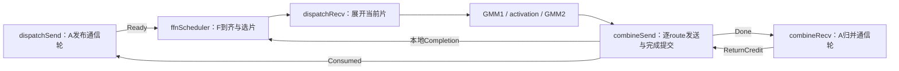

# A5 异步 AFD：DeepEP-Ascend 五算子详细设计

日期：2026-10-16。范围：`dispatchSend`、`dispatchRecv`、`combineSend`、`combineRecv`、`ffnScheduler`。本文定义接口与执行设计；五算子已有开发实现，当前实现范围与验证状态见[设计索引](README.md)，不能将设计目标视为已实机验证的 API。

上位约束：[整体设计 v3](a5_async_afd_design.md)。本版只实施 DeepEP-AFD 小算子路径；GMM1、activation/quant、GMM2 属于外部计算链，必须遵守本文 Active gate 和输出生命周期，但不重新设计其数值内核。MegaMoE/MTE 不在本次接口展开范围。

## 1. 设计依据、范围和命名

### 1.1 Skill 使用及适用边界

按 `ascendc-operator-design` 的接口、算法/API 伪代码、两级 tiling、UB、workspace、性能和验证模板组织本文；结合 `ascendc-api-best-practices` 的搬运/同步资料和 `ascendc-tiling-design` 的资源约束。使用 `ascendc-operator-code-review` 的溢出、并发及算子接口规则审查本文签名、地址公式和状态伪代码。具体资源链接见附录 B。

本任务参数和算子名已经由用户确定，无需再次确认。算子名按用户指定使用 lowerCamelCase，优先于 skill 的通用 snake_case 示例。五个名称不是要覆盖 PyTorch/NumPy 的通用数学接口；也不把本协议伪装成 `torch.distributed` collective。算子内参数、字段和辅助函数沿用 DeepEP 的 snake_case，类型用 PascalCase，编译常量用 `kNum...`。

`ascend-communication-analysis` 经读取确认面向 profiling DB 分析，本次不启动。图 skill 仅用于静态地址、图外初始化与 replay 生命周期检查，不执行模型改造流程，也不把其“只用于 Decode”的工作流建议当作本方案 Prefill 无法入图的硬件结论。

不照抄模板中的“workspace 等于 tiling 大小”“固定16MiB”“所有核分片必须512B”“所有半精度都必须升精度”等通用示例。本方案 workspace 按实际存活对象计算；搬运保持位模式，只有 combine 加权累加选择 FP32；512B 是所选通信 record 步长约定，32B 是独立控制块及 UB 对齐约定，具体 DMA 重载还需绑定工具链。

### 1.2 源码基线与事实

DeepEP-Ascend 原生参考基线：`3b25377d04b24fc6154698ded78a2bcb2c59afff`，目录 `D:/Code/refs/DeepEP-Ascend`。下文“原生”均指此版本，不能将其当作AFD工作区当前HEAD。2026-10-21静态修复开始时AFD HEAD为`dcad2ca0f8383dcd99402d95ac9952e54ece2cb5`，本次修改在其上进行。原生源码入口与行号见附录 A。

| 目标算子 | 原生主要入口 | 可直接保留的命名/机制 | 必须替换的语义 |
| --- | --- | --- | --- |
| dispatchSend | `dispatch_impl` / `simt_persistent_worker` | x、sf、topk_idx、topk_weights、metadata_send_buffer、dst_buffer_slot_idx、dst_gsge_idx；rank 去重与 SQ/CQ | 对称来源、全 rank counts 等待/barrier、完整事务容量 |
| dispatchRecv | `dispatch_copy_epilogue_impl` | recv_x、recv_sf、recv_src_metadata、expert prefix、分 stage 搬运 | 全 rank 接收和整轮展开；只展开 Active 计算片 |
| combineSend | `combine_impl` | x、src_metadata、workspace、jetty_ptrs、rank_idx、WQE/drain | 原 rank partial 归并与 send_buffer；改逐 route 返回 |
| combineRecv | `combine_reduce_epilogue_impl` | combined_x、combined_topk_idx、num_combined_tokens、token 分工 | 代表 rank 槽选择、权重恢复；改原 top-k 槽加权 |
| ffnScheduler | 无对应原生算子 | num_...、..._idx、..._state 风格 | 新增 DP 到齐、Pending、选片、Completion 应用 |

上游 `sf_pack_t=int16_t`，不是直接等价于数值 INT16 scale；上游允许预量化 E4M3FN x+sf 或 BF16 x。FP8 的 scale 编码和下游 GMM 兼容性必须单独准入，不能当作 INT8/MXFP8 格式的同义词。[S1、S6]

### 1.3 首版范围

- A 支持 TP/CP 显式成员及 token owner；F 为纯 EP。均匀连续专家分区：`num_experts % num_ranks == 0`，`rank_idx` 在 F 表示专家 rank，局部专家数为 `num_experts/num_ranks`。
- 纯 P、纯 D、P/D A 分离共用 F；同 DP 全成员到齐；同 phase/layer 的跨 DP 与同 DP 多 microbatch 可聚合。
- P 每成员单槽跨 mb 复用；D 每 mb 独立槽；通信轮按原始 token，F 片按专家展开行。
- dispatch rank 去重始终开启；BF16 或上游兼容的预量化 FP8 输入，combine BF16；不启用 rank partial、bias_0/bias_1、训练反向、cached handle、二维 route mask。
- `COMPUTE_AHEAD` 默认，`PRECHECK` 可选；每 F 唯一串行执行链和单计算 workspace。不增加 F leader。
- 一个逻辑算子可以包含内部阶段/局部核间同步；不得为了实现前缀而恢复跨 rank collective。首版 A send/recv 的 device 循环依赖核共存准入，不能只靠两个 stream 名称宣称无死锁。

## 2. 执行链与五算子的职责



`dispatchSend` 覆盖一次完整 MoE 事务，内部按通信轮循环。`combineRecv` 支持受限的全事务模式，以及多槽多轮必需的round-step模式：一次只probe/归并当前一轮，未就绪返回，框架在同一recv stream公平轮转所有活动槽。两者共用原归并流水和单scratch，每槽增加96B进度元数据；一次step退出不代表事务完成。F 的三个算子每次服务迭代处理一个 Active 计算片或控制任务。`ffnScheduler` 只扫描一遍有界 Pending/lane 表，不无限等待新任务；没有可选任务时输出 NOP，后续节点执行有界 no-op，框架继续下一服务迭代。

| 算子 | 调用一次处理的单位 | 正常返回保证 | 不保证 |
| --- | --- | --- | --- |
| dispatchSend | 一个 A 成员的一个 mb/layer 事务 | 最后一轮数据/描述/Ready 发布完成，本地发送和传输源引用结束 | 最终输入 ACK、结果归并、槽可跨事务复用 |
| ffnScheduler | 一次有界扫描和选片 | Completion 已应用；新 Active/执行状态/专家 prefix 已就绪，或 NOP/ABORT | payload 已展开、结果已返回 |
| dispatchRecv | 一个 Active 片 | recv_x/recv_sf 和本片 src metadata 可供计算使用 | 整通信轮输入可回收 |
| combineSend | 一个 Active 片 | 本片传输 drain 完成；Completion READY；若条目末片，已 Done→Consumed | A 已读走返回、下一轮已有 credit |
| combineRecv | 全事务模式：一个事务；round-step：本槽至多一个已就绪轮 | 只有完成状态才保证全部归并及最终全F ACK；未就绪step无payload/credit写 | 普通step退出不代表事务完成；完成后仍须 Etxn join |

FFN 循环是 `ffnScheduler → dispatchRecv → gated GMM1/activation/GMM2 → combineSend`。不再要求调用者猜测一个第六个 commit 算子；commit 是 combineSend 的末尾阶段，包括 CONTROL 任务。下一 scheduler 在吸收新 Ready 之前应用 Completion。

## 3. 公共 ABI：名称、类型、存储及所有权

### 3.1 标识与容量

| 名称 | 类型/含义 | 与原生关系 |
| --- | --- | --- |
| num_ranks / kNumRanks | 专家 F 数，不再兼指 A 来源数 | 保留专家维度含义；禁止用它分配来源表 |
| num_src_ranks / kNumSrcRanks | 注册物理 A 成员数 | 新增；沿 num_... 风格 |
| num_source_lanes / kNumSourceLanes | 所有 `(src_rank_idx,payload_slot_idx)` 数量，简称 L | 新增；D 多槽使 L 大于 A 数 |
| src_rank_idx / rank_idx | A 成员索引 / F 专家索引 | 将原对称 rank 身份拆开；通信域 peer 编号另有映射 |
| source_lane_idx | 固定 lane 表下标 | 不等于 DP、mb 或专家 rank |
| num_max_tokens_per_rank | 单 lane 最大通信容量的编译上界 C_max | 保留原生名；不是完整 B，也不是 L×C |
| num_token_capacity | 当前实现host静态完整事务输入行容量 B_cap（单rank maxBS） | 与通信窗口分开；输入、输出、mask按此容量分配 |
| num_tokens | task_info中的本事务本rank逻辑行范围 B_m，含mask=false位置 | ≤num_token_capacity；不是非零mask数量，device更新支持replay |
| num_round_tokens | 当前成员通信轮有效原始 token 范围长度，含 masked token 位置 | 新增；≤该 lane 的容量 C_m |
| num_max_expanded_tokens / num_max_padded_tokens | Q / Q_alloc | 设计接口名；当前实现为 `prepare_recv(q,q_alloc,...)`，host保存 `recv_q/recv_q_alloc` 并传入JIT模板，分别限制有效专家行和物理行 |
| num_expanded_tokens / num_padded_tokens | 当前 Active 有效行数/物理行数 | 新增 device 输出；不触发 host 动态分配 |
| expert_alignment | 每专家行数 padding 对齐 a，为2的幂 | 保留；首次 bring-up 可设1，其他值需 GMM 匹配 |
| topk_idx / topk_weights | int64 expert ID / FP32 权重 | 保留；每有效 token K 个互异有效 ID，首版1≤K≤32 |
| sf_token_stride / sf_hidden_stride | sf_pack_t 元素步长，不是字节 | 保留；地址乘 sizeof(sf_pack_t) |

上游 `num_max_tokens_per_rank` 表示一次原生EP调用的单rank输入容量；AFD保留这个底层命名，但一次通信轮才映射原生容量单位，故对应 C_max=max_lane C_m，不能拿它当完整事务maxBS。每lane实际C_m在lane_config中；当前host `num_token_capacity` 单独承载完整事务容量。原生容量公式若套入AFD，必须先明确换成C_m还是B_cap，不能同名替代。

所有 byte offset、申请大小与乘法链在计算前提升为 uint64/int64；int32 计数/下标继续使用时，host 必须证明上界≤INT_MAX。route reference 存 uint32，`UINT32_MAX` 为无效值，并要求最大 record 数×K<UINT32_MAX。L、DP/member 数、C_m、Q_alloc 及所有消息表在启动时冻结，禁止运行中改变成员集合。

### 3.2 持久 Context 与 host 启动契约

新增 `AFDContext`（host 管理资源）和 `AFDContextLayout`（device 布局解析），不复用原 `EPWorkspaceLayout` 的字段偏移冒充兼容。`context` 是只读 device byte tensor，内含版本、维度、配置和稳定地址表；不能序列化含 host 指针的 C++ 对象直接给 device。

必需注册表：

| 表/区域 | 内容与容量 | 生命周期 |
| --- | --- | --- |
| lane_config[L] | src_rank_idx、payload_slot_idx、dp_idx、phase、C_m、F输入分区offset、A返回offset | 全会话固定 |
| dp_member_offsets / dp_member_lanes | DP成员前缀表，以及按mb槽解析的lane映射 | 全会话固定；明确TP复制owner及CP分片 |
| peer_info / jetty_ptrs | peer域编号、远端base/长度/注册token、各本地AIV的队列 | 全会话固定；SQ/CQ计数持久推进 |
| layer_table[num_layers] | 按层W13/W2及scale地址、shape/dtype/tiling family标识 | 图外装载；权重按层组织不变 |
| policy_config | COMPUTE_AHEAD/PRECHECK，phase轮转与最大连续选择次数，扫描预算 | 启动固定；不在Active中途改策略 |
| buffer | F按lane紧凑record区，A按lane返回区 | 注册通信内存；地址固定 |
| control_buffer | Ready/Consumed/Done/credit各32B块；Inbox等 | 注册通信内存；初始化完成后才接纳任务 |
| workspace | 按角色的本地持久/临时区，见§10 | 普通HBM及所需注册资源分项计量 |

分配计划以显式offset/length表表达，每个区域先align，再检查`offset≤total && bytes≤total-offset`。未知 ABI 版本拒绝运行。host 校验无非预期重叠、容量乘积、层族相容、dtype/stride、peer拓扑和注册成功；不能让 kernel 通过层号0或截断count掩盖配置错误。

`AFDContext` 启动时创建资源、预编译模板、初始化协议并完成全域一次启动确认；不提供逐操作全域 barrier。所有 `jetty_ptrs` 保持本地队列 owner 不变，A send 的 URMA 队列不得被并发 A recv 使用；A recv credit 走独立 UBMEM 控制发布。不同 mb 的 dispatchSend 在同一 A 发送流串行发布，仍允许发布多个 D 槽后再阻塞接收。

### 3.3 固定 wire 描述与控制

以下是新 ABI 的字段规范；不是上游结构的二进制兼容扩展。

```cpp
struct alignas(32) AFDControlBlock {
    uint32_t value;                 // 0/1，唯一有效状态字
    uint32_t reserved[7];
};
struct alignas(32) AFDInbox {
    uint32_t microbatch_idx;
    uint32_t layer_idx;
    uint32_t round_idx;
    uint32_t num_comm_rounds;
    uint32_t num_round_tokens;
    uint32_t return_bit;
    uint32_t num_recv_records;      // 本F实际收到的去重record数
    uint32_t reserved[9];           // 总64B；不是原子提交块
};
```

F 上 `input_ready[L]`，A 上 `dispatch_consumed[slot][num_ranks]`、`result_round_done[slot][num_ranks]`，F 上 `return_credit[L]`。每块唯一远端 writer，消费者不清块；独立 bit 在数据/Inbox可见后提交。初始化 Ready/Consumed/Done=1、credit=0、首次期待位=0。P跨mb不重置位；全F包括零route每轮都确认。

每个 F/lane 另有 `num_recv_tokens_per_expert[R]`（有效route数）、`psum_num_recv_tokens_per_expert[R]`（exclusive-end，无padding的route表前缀）和 `route_reference[]`。这些是通信轮路由，不是当前计算片的GMM prefix。它们必须先于 Ready 完成，直到最终ACK前不可覆盖。prefix末值等于本F本lane route数，且不超过C_m×min(K,R)。

### 3.4 Record 与回源 metadata

`AFDTokenLayout` 保留 TokenLayout 的 hidden→sf→int64 topk→FP32 weights→source token 字段顺序；新增 `valid_topk_mask`，并把原 `src_token_global_idx` 改名 `src_token_idx`：它是本通信轮内 token 下标，来源由固定 lane 给出。禁止继续用`rank*C+token`拼接身份。

设 X=num_hidden_bytes、S=num_sf_bytes、K=num_topk：

```text
hidden_offset = 0
sf_offset = X
metadata_offset = X + align32(S)
topk_idx_offset = metadata_offset
topk_weights_offset = metadata_offset + align32(8*K)
src_token_idx_offset = topk_weights_offset + 4*K
valid_topk_mask_offset = src_token_idx_offset + 4
record_stride = align512(valid_topk_mask_offset + 4)
route_reference = record_idx*K + topk_slot_idx
```

首版要求 X 为32B倍数；BF16 S=0，FP8输入S由sf实际格式给出。示例X=7168、S=224、K=8时stride=7680，BF16 X=14336时stride=14848。无效topk位置写-1、mask位0、weight0。有效 token 的原 topk 权重仍由 A 保留，record权重保留只为格式/复用，不在F乘权重。

原生 `recv_src_metadata` 为去重token维度的 `[num_recv_tokens,K+2]`，保存K个展开位置和回源信息。[S2、S6] 本版输出改为：

```text
recv_src_metadata: int32[Q_alloc,4]
每个物理专家行 = [source_lane_idx, src_token_idx, topk_slot_idx, active_entry_idx]
padding行 = [-1,-1,-1,-1]
```

combineSend 对应参数仍叫 `src_metadata`，直接引用该张量。它是**AFD ABI v1**，不可传给上游 combine_impl。每行16B，Q_alloc=32768时512KiB；不再另配一份相同RowMap。`ActiveSegment`描述如何从route表得到源record，不先生成另一份Q行索引张量。

A返回布局固定为`[round_local_token][topk_slot][return_record]`，首版return_stride保留15360B预算（H=7168）；实际传输BF16 hidden为14336B，其余保留区不承载完成flag、不读取。Done独立控制块；不能按MTE DataAsFlag解释该record。

### 3.5 本地持久状态与变更责任

| 结构 | 关键字段/容量 | 唯一推进者与复用条件 |
| --- | --- | --- |
| AFDTaskInfo | src_rank_idx、payload_slot_idx、microbatch_idx、layer_idx、num_tokens、num_comm_rounds、token区间计划 | 框架在Etxn后更新；send/recv只读同一快照 |
| AFDSendState | input_bit、next_planned_return_bit、round_idx、send_status | dispatchSend；最后发布后send_status=PUBLISHED，不等价于槽释放 |
| AFDRecvState | expected_return_bit、round_idx、recv_status | combineRecv；最终ACK后RECEIVED，框架join为Etxn |
| RoundLedger[slot][2] | EMPTY/PUBLISHED、input_bit、return_bit、round_idx、token_begin、num_round_tokens、final_round | send发布，recv归并后回收；按input_bit选bank；严格SPSC所有权 |
| Pending | COLLECTING/READY/IN_FLIGHT/CONTINUATION、DP/mb/layer/round、成员位图、每成员header副本、R个消费游标、first_ready_cycle、grant | scheduler；一次只承接每lane一个输入，容量≤L个DP/mb条目 |
| Active | valid、kind、phase、layer_idx、num_entries、num_segments、num_expanded_tokens、num_padded_tokens、条目与段快照 | scheduler发布后只读；combineSend提交Completion后，下一scheduler才回收 |
| ExecutionState | stage、error_code、每entry授权状态、已完成进度 | scheduler初始化；dispatchRecv/计算链/combineSend按顺序写各自阶段 |
| Completion | EMPTY/ARMED/READY、每entry游标delta/grant/terminal | scheduler置ARMED；combineSend填入并置READY；下次scheduler应用一次后EMPTY |

ActiveEntry按逻辑DP/mb条目组织，包含所有成员lane、每成员input_bit/return_bit快照、原消费游标和本片各成员专家增量。ActiveSegment字段固定为`entry_idx, source_lane_idx, local_expert_idx, route_begin, num_routes, dst_row_begin`，均uint32，共24B。每entry/member/expert最多一个连续段，段容量≤L×R；尾部padding由当前片专家prefix推导，不额外占route。

Pending可引用稳定route表，但不能在ACK后访问它；combineSend先把Completion所需标量保存在本地/Active快照，再发ACK。Completion应用后才翻expected_input_bit、释放lane并吸收下一Ready。若一个DP本轮还有任何成员/专家route未完成，**该DP所有成员都不发本轮Done/Consumed**；零token成员跟随该DP末片闭合，避免半个DP推进到下一轮。

`grant_state=NONE/HELD/FINISHED`按Pending条目及其所有lane归属保存。COMPUTE_AHEAD由combineSend在首次写之前取齐Active所有条目成员的credit并记HELD；PRECHECK由scheduler取齐后选择。Continuation沿用HELD，不再申请。首版没有第二个Active，已算后等不能绕过。

## 4. 接口层次与签名

### 4.1 Host 公共接口

以下是拟新增C++扩展入口，调用者预分配输出；Tensor均为当前NPU设备。资源Tensor为uint8连续存储，含mutation的参数用非const引用表达。实现绑定必须声明所有本地副作用，不能注册成可消除的纯函数。`context` 不包含可变进度。

```cpp
void dispatchSend(
    const at::Tensor& x, const std::optional<at::Tensor>& sf,
    const at::Tensor& topk_idx, const at::Tensor& topk_weights,
    const std::optional<at::Tensor>& token_mask,
    const at::Tensor& task_info, const at::Tensor& context,
    at::Tensor& control_buffer, at::Tensor& round_ledger,
    at::Tensor& workspace, at::Tensor& send_status);

void ffnScheduler(
    const at::Tensor& context, const at::Tensor& control_buffer,
    at::Tensor& workspace, at::Tensor& active,
    at::Tensor& execution_state, at::Tensor& completion,
    at::Tensor& psum_num_recv_tokens_per_expert,
    at::Tensor& num_unaligned_recv_tokens_per_expert);

void dispatchRecv(
    const at::Tensor& buffer, const at::Tensor& context,
    const at::Tensor& active, at::Tensor& execution_state,
    at::Tensor& workspace, at::Tensor& recv_x,
    std::optional<at::Tensor>& recv_sf,
    at::Tensor& recv_src_metadata);

void combineSend(
    const at::Tensor& x, const at::Tensor& src_metadata,
    const at::Tensor& context, const at::Tensor& active,
    at::Tensor& control_buffer, at::Tensor& execution_state,
    at::Tensor& workspace, at::Tensor& completion);

void combineRecv(
    const at::Tensor& combined_topk_idx,
    const at::Tensor& topk_weights,
    const std::optional<at::Tensor>& token_mask,
    const at::Tensor& task_info, const at::Tensor& context,
    at::Tensor& buffer, at::Tensor& control_buffer,
    at::Tensor& round_ledger, at::Tensor& workspace,
    at::Tensor& combined_x, at::Tensor& recv_status, bool start = false);
```

`recv_sf`为可写optional Tensor句柄，注册schema必须声明其底层storage mutation；非FP8时传空，不得用未初始化地址代替。没有返回动态tuple、Python epilogue callback、CPU counts同步或调用内分配。kernel完成用运行流事件表达，host函数返回只是提交，不等价于表中device完成条件。

A的send_workspace与recv_workspace是不同分配，只通过显式RoundLedger及控制区通信；不能将两者包装为一个全量read/write依赖再强制串行。单轮D先发布M个槽，再按槽接收；多轮A收发从第一轮Ledger即可重叠，禁止recv等最终send事件。多个本地槽且多轮必须初始化round-step模式，首次start=True与随后所有活动槽的start=False公平sweep分离；见[完整接口及状态表](deepep_afd_operators/combineRecv/design.md)。图集成必须保留这一事件DAG，不能依赖自动alias分析猜测控制流。

### 4.2 张量 shape、dtype 与输入生命周期

| 参数 | shape/dtype | 读取或写入范围 |
| --- | --- | --- |
| x（dispatchSend） | `[B_capacity,H]` BF16或FP8 E4M3FN；连续 | 只读task_info.num_tokens行；完整事务至Etxn保活 |
| sf | `[B_capacity,num_sf_packs]`，每元素2B的上游sf_pack存储 | BF16为空；FP8必需；允许上游两种stride布局，保持实际stride |
| topk_idx / combined_topk_idx | `[B_capacity,K]` int64 | 同一A事务的同一稳定路由；有效token ID在[0,E)，互异 |
| topk_weights | `[B_capacity,K]` float32 | 必需；首版不支持training无权重；A最终乘一次 |
| token_mask | 空或`[B_capacity]` bool | true表示有效；false输出严格零；没有route级mask |
| recv_x | `[Q_alloc,H]`，与dispatch输入dtype相同 | 写当前物理片行及padding；后续计算只处理本片prefix |
| recv_sf | `[Q_alloc,num_sf_packs]` | 同量化格式，stride与匹配GMM约定冻结 |
| recv_src_metadata / src_metadata | `[Q_alloc,4]` int32 | dispatchRecv生成；combineSend只读有效物理行；padding跳过 |
| x（combineSend） | `[Q_alloc,H]` BF16 | 当前GMM2结果；注册为URMA可读源，drain前不得覆盖 |
| psum_num_recv_tokens_per_expert | `[R]` int32 | 当前片每专家padding后的exclusive-end，末值num_padded_tokens |
| num_unaligned_recv_tokens_per_expert | `[R]` int32 | 当前片各专家真实行数，sum=num_expanded_tokens |
| combined_x | `[B_capacity,H]` BF16 | 只写num_tokens行；inactive行0；容量尾部不属于有效输出 |
| send_status / recv_status | `[8]` uint32，独立32B | 状态字+错误/轮次诊断；正式成功由device最后写入 |

FP8搬运不做数值变换，dispatchRecv不负责把E4M3FN改成INT8。若GMM要求另一个scale布局，需图外固定族的显式转换小算子及预算，未验证前只启用匹配的BF16族。dtype/shape族不能随Active.layer_idx任意切换。

### 4.3 Device 入口：保留底层风格

以下签名是**AFD新kernel**，不是宣称原函数已接受这些参数。`workspace`内部偏移由AFDWorkspaceLayout解析；`buffer`按Context地址/长度表解析。编译模板在§10定义，此处省略模板列表，保留全部运行时参数。

```cpp
__global__ __vector__ void dispatch_send_impl(
    __gm__ void* x, __gm__ sf_pack_t* sf,
    __gm__ int64_t* topk_idx, __gm__ float* topk_weights,
    __gm__ uint8_t* token_mask, __gm__ const AFDTaskInfo* task_info,
    __gm__ const AFDContextLayout* context,
    __gm__ void* control_buffer, __gm__ AFDRoundLedger* round_ledger,
    __gm__ void* workspace, __gm__ void* jetty_ptrs,
    __gm__ uint32_t* send_status,
    const int sf_token_stride, const int sf_hidden_stride);

__global__ __vector__ void ffn_scheduler_impl(
    __gm__ const AFDContextLayout* context, __gm__ void* control_buffer,
    __gm__ void* workspace, __gm__ AFDActive* active,
    __gm__ AFDExecutionState* execution_state,
    __gm__ AFDCompletion* completion,
    __gm__ int* psum_num_recv_tokens_per_expert,
    __gm__ int* num_unaligned_recv_tokens_per_expert,
    const int rank_idx);

__global__ __vector__ void dispatch_recv_impl(
    __gm__ void* buffer, __gm__ const AFDContextLayout* context,
    __gm__ const AFDActive* active,
    __gm__ AFDExecutionState* execution_state, __gm__ void* workspace,
    __gm__ void* recv_x, __gm__ sf_pack_t* recv_sf,
    __gm__ int* recv_src_metadata, const int rank_idx,
    const int recv_sf_token_stride, const int recv_sf_hidden_stride);

__global__ __vector__ void combine_send_impl(
    __gm__ bfloat16_t* x, __gm__ int* src_metadata,
    __gm__ const AFDContextLayout* context, __gm__ const AFDActive* active,
    __gm__ void* control_buffer, __gm__ AFDExecutionState* execution_state,
    __gm__ void* workspace, __gm__ void* jetty_ptrs,
    __gm__ AFDCompletion* completion, const int rank_idx);

__global__ __vector__ void combine_recv_impl(
    __gm__ bfloat16_t* combined_x, __gm__ int64_t* combined_topk_idx,
    __gm__ float* topk_weights, __gm__ uint8_t* token_mask,
    __gm__ uint8_t* buffer, __gm__ const AFDTaskInfo* task_info,
    __gm__ const AFDContextLayout* context, __gm__ void* control_buffer,
    __gm__ AFDRoundLedger* round_ledger, __gm__ void* workspace,
    __gm__ uint32_t* recv_status,
    __gm__ AFDReturnProgress* return_progress, const bool start);
```

`rank_idx`来自静态F配置；A的src_rank_idx来自task_info并校验与Context一致。`num_tokens`/`num_combined_tokens`从稳定device描述读取，保留变量名，避免host读取实际token数再构建图。`jetty_ptrs`由host Context资源注入，不让调用者随便拼装。新struct字段均按显式宽度、offset、对齐构建；实现时需static_assert及host/device布局单测。

## 5. dispatchSend：A 的输入发布算子

### 5.1 输入输出与上游参数处置

数学/路由语义：对有效token及其目的专家rank集合，每目的rank只发送一份record；record包含所有原topk位置。每个目标F的route表按local_expert_idx分组，一条route保存`record_idx*K+topk_slot_idx`。全部输入token保留原轮内下标，不因mask或rank去重重编号src_token_idx。

| 上游参数/变量 | 本版处置 |
| --- | --- |
| x、sf、topk_idx、topk_weights、sf_*_stride | 保留名称、dtype及基本含义；读当前通信轮的子区间 |
| metadata_send_buffer | 保留，放send workspace；预留一个通信轮的metadata，URMA drain前不复用 |
| dst_buffer_slot_idx | 保留int32路由表`[C_m,K]`；同token同F的topk位置指向同record_idx；无效-1 |
| dst_gsge_idx | 保留为当前tile/SQE staging的局部映射；不再产出跨事务cached handle |
| cumulative_local_expert_recv_stats | 首版删除公共入口；统计如需开启用独立diagnostic区，不能参与正确性 |
| psum_num_recv_tokens_per_rank/expert | 删除“源端等全rank返回接收统计”；改本源目的rank/expert prefix |
| host_workspace、kDoCPUSync | 删除CPU通知/动态shape路径 |
| rank_idx / num_tokens | A rank拆成src_rank_idx；num_tokens从task_info读取 |
| recv_buffer_offset / local_base对称寻址 | 改为peer注册区+lane分区offset，见§11 |

### 5.2 计算逻辑及完成顺序

```text
dispatch_send_impl:
  InitSocState; validate task snapshot and static family
  for round_idx in [0, num_comm_rounds):
    if slot已有前次使用: wait所有F dispatch_consumed == previous_input_bit
    wait RoundLedger[input_bit] == EMPTY
    derive token_begin/num_round_tokens from shared round plan
    pass1: fixed token tiles -> rank_histogram, expert_histogram
    local prefix: tile_rank_psum, tile_expert_psum
    pass2: topk去重 -> dst_buffer_slot_idx, metadata_send_buffer, route_reference
    issue hidden + sf/metadata + routes/counts到各F的本lane区
    每个AIV drain自己所有已提交WQE；本地全发送核汇合
    负责人写每个F Inbox，完成描述发布
    发布本地RoundLedger，再publish InputReady到每个F
    完成Ready写；推进input_bit和next_planned_return_bit的本地发布计划
  send_status = PUBLISHED
```

首轮input_bit=0；只有成功完成上次全F ACK后才能以相反input_bit开始下一次覆盖。实现可保存`last_published_input_bit`和`next_input_bit`而不额外引入AF generation；必须在无旧ACK的首次使用分支显式跳过等待。最终轮不等待自身ACK，交给combineRecv收尾。

pass1/pass2只扫本轮C_m，而非每条route回扫0..B。tile按token划分；tile_rank_psum保证各tile到同F的record连续且不冲突，tile_expert_psum保证各专家route段不冲突。某token命中同F的多个专家时，所有这些route共用该F的record_idx，但保留不同topk_slot_idx。

首版允许一个逻辑kernel内用从上游分离的本地SyncAll阶段串接上述阶段；每阶段仅等待**本kernel实际启动核**。若工具链采用多kernel内部封装，应保持同一语义、固定地址与无host counts；不得将每轮全域同步搬到host。首版设计选择单kernel内device轮次循环及本地SyncAll；多kernel只是后续可评审替代，不在本版混用。该选择必须通过核共存准入。

### 5.3 API 序列与 buffer 生命周期

路由复用上游SIMT去重、`asc_atomic_add`在本地histogram上的模式；统计/前缀在本地GM/UB完成。metadata用上游`asc_copy_gm2ub_align`、`asc_copy_ub2gm_align`及成对`asc_sync_notify/wait`管理MTE/Scalar依赖。原始x作为URMA source，无需整轮hidden镜像；metadata_send_buffer先在GM生成再提交SGE，直到drain后才复用。

通信用上游`handle::HcommJetty`的WQE构造、`ring_doorbell`、`poll_cq`、`drain`组织，非对称地址按§11适配。上游启动barrier以及等待所有rank专家count的逻辑移除；保留本地所有发送核完成→远端数据可见→Inbox→Ready的依赖。

遇到任一tile非法route/越界，禁止发布Ready。前面已有写入仅留在未发布槽，进入域失败；不能发布零count装作成功。全mask=false/零长度成员仍构造num_recv_records=0及零counts，对全部F发布Ready。

## 6. ffnScheduler：F 的到齐、选择与进度算子

### 6.1 选择和状态转移

首版使用**一个AIV核、分块扫描GM状态**，不并行修改Pending。这样不需要多个核竞争任务归属；不承诺大L扫描没有性能代价。每次调用最多扫描L个lane、P个Pending条目（P≤L），输出一个Active或NOP；控制poll tile大小固定。

执行次序必须如下：

1. 如果Completion READY，应用各条目的游标delta和grant，末片释放lane并翻期待位，然后清Completion/旧Active。ARMED但尚未READY说明执行链未串行完成，报接口错误；不能跳过旧Active再选新任务。
2. 对非in_flight lane轮询本地Ready；匹配期待位后读取Inbox并校验。按`dp_idx, microbatch_idx, layer_idx, round_idx`归入Pending，保存member快照；身份冲突域失败，不能靠多个bit恰好相同配对。
3. 全DP成员齐备时，第一次设置first_ready_cycle；验证共同num_comm_rounds与layer/phase、counts和route容量。READY后持久保存年龄，续跑不刷新。
4. 在存在候选的phase间轮转；达到配置的连续phase上限时优先另一有候选phase。该phase内按首次到齐年龄选最老候选，layer由该候选决定；再按年龄加入同phase/layer的完整DP条目，容量不足时只取条目的一部分route，余量留Continuation。不强制凑满M。
5. PRECHECK仅把本条目所有成员credit可取得的候选算作可选，缺credit可跳过；先确定本片容量和候选集合，再在写Active前认领已选条目的grant。未选条目不占授权。COMPUTE_AHEAD不以credit作为选择条件；Continuation已有HELD不二次检查。
6. 按local_expert_idx升序，为各entry/member的未消费route生成连续ActiveSegment；同时限制有效行≤Q和每专家padding后总行≤Q_alloc。本片游标只写入Active proposed delta，Pending的已完成游标在下次应用Completion时才推进。
7. 设置Active和专家prefix，初始化ExecutionState，Completion=ARMED，最后发布Active.valid。无候选则Active.kind=NOP/valid=0、两prefix清0；没有ARMED的空任务。

专家行布局：每个专家的有效段连续相接，随后补到a对齐。令c_e为本片专家e有效行，`p_e=align_a(c_e)`，`psum[e]=sum_{j≤e}p_j`。每段dst_row_begin在该专家有效部分内，padding不对应route。Q_alloc至少容纳a行，否则启动拒绝；零route任务不受该行数下限约束。

首次完整到齐的零route DP输出CONTROL条目；可与同phase/layer WORK条目合入同一Active，entry内标记无数据。它也要在combineSend取credit并Done→Consumed。NOP绝不代表零route完成。

### 6.2 例子与容量

同DP的mb0、mb1占独立lane组，各自全员到齐后可以进入同一个Active。TP2的mb0若只到一个成员，mb0不能选；mb1如果两成员都到齐，可以单独选。同一DP的各mb并不是一个需要一次到齐的更大集合。

本F某DP有70000条route，Q=32768、a=1、无其他候选：依次选择32768/32768/4464行。第一次combineSend取grant，后两片延续；第三片后才对该DP所有成员发Done和Consumed。不同F片数不一致不影响协议。

### 6.3 API、层地址与错误

控制块按32B搬到UB，MTE2→Scalar完成后读取value；匹配后加载64B Inbox及必要counts。禁止循环GlobalTensor::GetValue。年龄可用上游`asc_get_system_cycle`的uint64差值；它是本地公平性时间，不是AF消息generation。

scheduler在选片前验证layer_idx范围和family；Active只存layer_idx与稳定层地址视图标识。GMM自己按该layer取权重，同一次Active不得混层。非法layer输出ABORT和错误码，不查layer0。任务/输出地址在错误分支都不能继续解引用。

## 7. dispatchRecv：F 当前片接收与专家展开

### 7.1 上游差异与算法

原生epilogue先处理完整来源流的histogram再展开；本版route表已由A按专家组织，scheduler已给本片段和prefix，因此不再扫描所有来源所有token，也不再做全rank等待。[S2]

```text
dispatch_recv_impl:
  read Active gate
  NOP/ABORT -> 不读输入，不写成功状态，返回
  CONTROL-only -> execution_state.stage=INPUT_READY，返回
  WORK -> 对ActiveSegment的有效row区间按核分配
    ref = route_reference[segment.route_begin + local_row]
    record_idx = ref / K; topk_slot_idx = ref % K
    load本lane record; check record_idx/count/mask/expert/source token
    copy hidden -> recv_x[dst_row_idx]
    copy sf -> recv_sf[dst_row_idx]（保持实际stride）
    write recv_src_metadata[dst_row_idx] = lane/token/topk/entry
  zero各专家padding行；metadata填-1
  所有输出MTE3完成，本地工作核完成汇合
  execution_state.stage=INPUT_READY
```

复制使用上游分stage的`asc_copy_gm2ub_align`→MTE2/S等待→`asc_copy_ub2gm_align`，sf非连续分支复用原stride处理，MTE3完成后再复用对应UB stage。BF16/FP8纯搬运不Cast；padding填bit零。不能在输出尚未落GM时报告INPUT_READY。

外部GMM必须验证INPUT_READY以及Active.kind；GMM2适配入口在全片输出写完成后由其负责人设置COMPUTE_READY。该写入属于GMM2适配epilogue，不能只让host在提交GMM2后提前改状态，也不隐藏一个新AF commit算子。只有WORK读取recv_x。CONTROL不执行空GMM，NOP不读旧prefix。采用padding的GMM只能按本片物理prefix处理，combineSend跳过padding行。

每个源record可能被不同计算片重复搬到workspace，但通信输入只存一份；这是有界workspace与本地读流量的取舍。不建立跨片全量展开cache。

## 8. combineSend：逐 route 返回与最终 commit

### 8.1 语义和参数变化

原 `combine_impl` 输入src_metadata对应去重token，先聚合同rank专家并写send_buffer；本版x已经是一片专家行，直接逐行发回。删除topk_weights、psum_num_recv_tokens_per_rank和整片send_buffer；不在F乘权重、不恢复训练权重、不写rank代表槽。[S3、S4]

`src_metadata[row]`给出lane、src_token_idx、topk_slot_idx及entry。目的地址：

```text
remote_return_addr = peer_return_base
                   + lane.return_offset
                   + (uint64(src_token_idx)*K + topk_slot_idx)*return_stride
src_addr = x + uint64(row_idx)*H*sizeof(bfloat16_t)
num_bytes = H*sizeof(bfloat16_t)
```

offset及byte数在注册区内验证。因为每个有效token的expert ID互异，每条route属于唯一F和唯一片，故返回位置无写冲突；不需要远端atomic add。

### 8.2 授权、发送与提交

```text
combine_send_impl:
  validate gate and execution stage
  NOP -> 返回，不产生Completion/控制
  ABORT -> 错误上报/域终止，不伪造Done/ACK
  WORK必须COMPUTE_READY；CONTROL-only必须INPUT_READY
  对Active每个entry：
    若NONE，等待全部成员credit/expected_return_bit一致，认领HELD
    若HELD，核对owner及位值，不重复消费
  本地授权阶段完成后，各发送核issue本片有效行
  各核完成自己的CQ/drain，再本地汇合
  负责人准备每entry的Completion标量副本
  对本F本轮全部route已完成的entry：
    所有成员Done(return_bit)写完成
    确认任何输入/route/Inbox引用均结束
    所有成员Consumed(input_bit)写完成
    entry grant=FINISHED
  非末片entry保持HELD，仅提交消费delta
  Completion=READY，execution_state.stage=COMMITTED
```

先取齐整个Active的授权，再开始本次返回写，避免部分发送后靠隐含位置恢复。可逐entry取授权；部分取到后等待其他entry时必须在ExecutionState保存HELD。单Active下无人竞争这些授权；异常不是可重试事务。

当前片drain后GMM2输出可在下一服务迭代复用，即使该通信轮还没结束；输入通信区仍不可复用。若Active合并多个DP/mb，一些末片、一些非末片，则分别发通知/提交游标，不清空整个phase或DP。final Completion只能读Active及执行快照，ACK后不得再查Inbox。

首版直接发送已注册的GMM2输出，禁止偷偷增加Q×H镜像。如果Hcomm资源无法注册这块输出，应阻断此实现并重新评审预算，不能改成大send_buffer后仍报告原预算成立。

## 9. combineRecv：A 按轮归并到真实输出

### 9.1 加权语义与回源

原生combine_reduce_epilogue会用seen_ranks选择代表槽并累加rank partial；本版删除该筛选，按原topk_slot_idx从小到大处理所有有效route，保证权重只在A乘一次：

```text
combined_x[token,h] = cast_bf16(sum_fp32(
    topk_weights[token,k] * cast_fp32(return_record[round_token,k,h])
    for k in [0,K)))
```

mask=false的token不读取陈旧返回位置，直接写零；mask=true的token必须有K个合法互异expert。首版bias参数删除；若模型需残差/共享专家，外部计算链负责，不改变此算子语义。FP32累加顺序固定按k递增，不直接沿用原rank-partial数值顺序，精度以原框架逐专家归并为基准。

### 9.2 按轮执行与最终收尾

下面为准入后的全事务模式。多本地槽多轮使用同一归并主体的round-step模式：一次最多一个ready轮，Ledger/Done/最终ACK缺失均立即结束本次调用；保存next_round，持续公平服务其它槽。每槽先start一次，后续sweep不重置状态，DONE后还须本地事件汇合；一次step退出不是RECEIVED。全事务模式在send和recv共同拒绝不安全的多槽多轮配置。

```text
combine_recv_impl:
  for round_idx in [0,num_comm_rounds):
    wait本lane RoundLedger对应bank为PUBLISHED；读稳定快照
    wait所有F result_round_done == ledger.return_bit
    按token区间分核，按hidden chunk：
      mask=false: 写0
      mask=true: 逐k load BF16 -> FP32，乘FP32权重，累加
      FP32 -> BF16，写combined_x[token_begin+round_token]
    本地所有核确认读取返回区结束、输出写完成
    按配置清理返回区需要的内部元数据
    expected_return_bit ^= 1；publish全部F的下一credit
    完成credit写后回收Ledger为EMPTY，保存next_round/last_input_bit
  wait最终input_bit对应的所有F dispatch_consumed
  recv_status=RECEIVED
```

DeepEP-AFD独立Done模式不要求把整个返回payload清零；必须初始化/清理的是本实现使用的元数据。每个有效route都会重写，masked位置从不读，故可省大窗口清零。若调试选择清零，必须在发credit之前结束，不能后台清零覆盖下一轮写入。

实现统一采用credit写完成后释放Ledger；最终input_bit在释放前复制到接收进度，不从已释放bank恢复。最终事务由框架`Etxn=join(Epub_final,Erecv)`收尾，随后才更新task_info、路由、输入和P跨mb槽归属。round-step须所有轮及最后ACK均完成，再以最后sweep退出事件参与该join。

### 9.3 API 精度与核分工

复用原epilogue按token分AIV的组织；首版每个token只由一个核负责，hidden在核内分块，避免跨核浮点归约。按实际API族选择`asc_cast`/SIMD load-store及mul/add，或等价AscendC `Cast/Muls/Add`，不得混合两套UB分配器。

规范性的API伪代码（LocalTensor表达数学段，不声明它已接入原裸UB实现）：

```cpp
DataCopyPad(input_bf16, return_gm, copy_params, pad_params);
// 配对MTE2 -> V事件完成后
Cast(value_fp32, input_bf16, RoundMode::CAST_NONE, num_hidden_elems);
Muls(value_fp32, value_fp32, weight, num_hidden_elems);
Add(acc_fp32, acc_fp32, value_fp32, num_hidden_elems);
// K次后；具体BF16舍入重载需匹配目标工具链及数值基线
Cast(output_bf16, acc_fp32, RoundMode::CAST_RINT, num_hidden_elems);
// 配对V -> MTE3事件后
DataCopyPad(output_gm, output_bf16, copy_params);
```

不使用scalar逐元素GM取值，不因该示例使用Muls而为每个hidden元素单独下发算子。真实实现沿上游SIMD VF完成该向量段，量化搬运路径不做这些Cast。

## 10. Tiling、UB 与 workspace

### 10.1 静态模板与动态状态分离

```cpp
struct AFDLaunchConfig {
    int32_t num_ranks, num_src_ranks, num_source_lanes;
    int32_t num_experts, num_topk, hidden, num_sf_packs;
    int32_t num_max_tokens_per_rank;
    int32_t num_max_expanded_tokens, num_max_padded_tokens;
    int32_t expert_alignment, num_vec_cores, num_ub_bytes;
    int32_t num_tokens_per_tile, num_tokens_per_stage, num_stages;
    int64_t num_timeout_cycles;
    uint32_t abi_version, dtype_id;
};
```

该配置由host资源查询和容量选择形成，映射为`kNumRanks/kNumExperts/kNumTopk/kNumVecCores/kNumUbBytes/kNumTimeoutCycles`等原生模板参数；新增`kNumSrcRanks/kNumSourceLanes/kNumMaxExpandedTokens/kNumMaxPaddedTokens/kNumTokensPerTile`。保留源文件中已有`kNumUBBytes`拼写时不强制批量改名；新增公共类型统一`kNumUbBytes`。

`microbatch_idx/layer_idx/round_idx/num_tokens/num_expanded_tokens/valid`来自device描述，不进入JIT模板key。`kCachedMode=false`、`kDoCPUSync=false`，不再用kDoBarrier切换一个包含全rank barrier的复合路径。host不得在replay时读取Pending决定输出shape。

### 10.2 各算子的核间与核内切分

| 算子 | Block级 | UB级与边界 |
| --- | --- | --- |
| dispatchSend | N_s个AIV分别处理连续token tiles；负责人做跨核tile前缀/发布 | tile至多T_s个token，SGE数组仅随T_s×K增长；尾tile按num_round_tokens裁剪 |
| ffnScheduler | 1个AIV负责Pending/Active | 逐批读取T_c个32B控制块和T_p个固定Pending头；游标/segment写GM，不把L×R全部放UB |
| dispatchRecv | N_r个AIV划分本片物理行；ActiveSegment可切在不同核 | T_r条route/record分stage，隐藏维再chunk；padding行单独置零 |
| combineSend | N_c个AIV划分有效物理行，各自单owner jetty | 每tile T_w条WQE/metadata；发送直接引用GM x，不建立hidden环形归并区 |
| combineRecv | N_a个AIV分本轮token，空核仍参加局部完成汇合 | 每token逐K、每次h个hidden元素，尾hidden mask；不把K份整hidden同时驻留UB |

实际核数由host runtime查询，不能照抄上游num_ai_cores或num_sms等于AIV数。A send/recv同时活跃时要求N_s+N_a在可并发核资源与调度语义下可运行；仅满足数值和还不是充分证明，G3需跑长等待压力测试。scheduler与F计算链串行，无本地等待scheduler同时运行才能释放的资源。

### 10.3 UB 分配公式

记`align32`为向上32B对齐，U为实际可用UB字节，U_res为工具链与公共控制/事件保留。所有表项先对齐再相加；struct使用真实sizeof，不能用下面估算替代编译期断言。

| 算子 | buffer及字节数 | 数量/复用 |
| --- | --- | --- |
| dispatchSend | DispatchUBLayout风格histograms：4E+8N_F；dst_rank_idx/dst_slot_idx/sgep_idx：12T_sK；sgep_to_entry：4(T_sK+N_F×SGE余量)；peer/jetty实际sizeof | 每核1份；去掉A/F不存在的self-copy等待 |
| dispatchSend | metadata stage=`align32(T_m×metadata_bytes)`；hidden local staging=`align32(h_s)`；SQE staging实际sizeof | metadata/hidden各2份起步；仅若生命周期证明不重叠才alias |
| ffnScheduler | 32T_c控制、64T_c Inbox、T_p×pending_header_bytes、O(R)计数/对齐预算、固定Active写出stage | 单buffer起步；与数据核UB独立 |
| dispatchRecv | T_r×record_chunk_bytes输入stage、T_r×16B回源metadata、T_r×4B route refs、padding zero stage | 输入双buffer；metadata可单buffer但必须等MTE3 |
| combineSend | T_w×16B src_metadata、T_w个SQE staging、peer/jetty actual sizeof、grant/entry staging | 双metadata stage可选；无QH/整hidden归并buffer |
| combineRecv | BF16输入2h、FP32 value4h、FP32 acc4h、BF16输出2h、FP32权重4K | 单输入时12h+4K；双输入时14h+4K；输入与输出不能未经依赖证明alias |

例如combineRecv取h=2048、K=8、双输入stage，数据UB为28800B，另加控制、地址和对齐；H=7168按2048/2048/2048/1024分块。此例解释容量，不是声称该tile最优；host可以增大h，只要`align后总量+U_res≤U`、指令长度/event数均合法。

dispatchSend选择最大合法T_s满足`sizeof(AFDDispatchUBLayout(T_s,...))+metadataStages+hiddenStages+U_res≤U`，且本批WQE不会超SQ/CQ深度或16位索引范围。普通搬运算子不存在一个可通用的“每元素20B系数”：其系数依赖K、record与stage，必须使用上表公式。每次kernel编译时static_assert UB、stage事件数、SGE与WQE上界；失败则减tile或拒绝该family，不强迫增加AIV至占满等待核资源。

### 10.4 GM workspace 与通信区账本

所有容量按同时存活峰值分配。以下不含模型权重/KV/完整A输入输出，后者仍按B容量存在。

| 对象 | 大小上界/位置 |
| --- | --- |
| 每F输入payload | `sum_lane C_m×record_stride`，注册通信buffer |
| 每A返回payload | `sum_slot C_m×K×return_stride`，注册通信buffer |
| 四类控制 | 全域逻辑`4×32×N_F×L`；按实际接收角色分布 |
| F Inbox/counts/prefix/routes | 每lane64B；每lane R个count+R个prefix；route最多`4×sum_lane C_m×min(K,R)` |
| A路由准备 | `dst_buffer_slot_idx` 4C_mK；tile_rank/expert counts及prefix至多`8×ceil(C_m/T_s)×(N_F+E)`；本轮route表及metadata staging另列 |
| A metadata_send_buffer | `C_m×metadata_stride`；包含sf及原topk信息，单轮共用，不复制hidden |
| F调度 | Pending `32+96L+2A32(4LR)`；Active `64+64L+32LR`（Entry/Member各L项，Segment物理stride32B）；Completion `32+64L+A32(4LR)` |
| F recv预检scratch | `32N_r+256+2A32(4min(LR,Q))`；后两项有界Segment索引，Q32k最多增加256KiB，非hidden镜像 |
| F recv_src_metadata | `16Q_alloc`，当前片单份 |
| F recv_x/recv_sf/GMM中间/GMM2 | 根据dtype、Q_alloc、H/I和库workspace算存活峰值；不能只报GMM2 |
| A RoundLedger/返回进度 | 本A每物理槽2个64B Ledger；round-step另每槽96B progress；单份归并scratch `256+A32(32N_c)`，无B×H副本 |
| W_transport | 所有SQ/CQ、peer/jetty对象、注册资源、临时描述符及平台空间；从实际资源返回值合计 |

A路由准备按一个发送流的最大C_m暂存复用，不为每D槽复制一套临时准备区；但在上次发送drain及本地退出前不可覆盖。F同一计算workspace只服务一个Active；GMM2结果作为注册URMA源直发。原上游combine send_buffer不分配；原metadata大小、对称buffer helper不能直接用于AFD申请。

本版没有给W_transport编造固定数字。目标环境未测得它及GMM注册方式之前，主要通信窗口预算可以计算，总HBM预算不能宣称闭合。

## 11. 传输原语、同步与发布契约

### 11.1 非对称地址适配

上游`HcommJetty::build_write_sqe`按`dst_sym_ptr-local_base`计算offset，再加peer.rmt_base_addr；它不是接受任意远端绝对地址的接口。[S5] A/F不同布局时直接传A本地同offset地址会定位错误。

拟新增内部`build_write_sqe_at_offset` / `put_at_offset`，沿原snake_case风格，参数为`peer, remote_offset, src_ptr, num_bytes`；保留token/jetty信息、strong ordering/fence/CQE标记、copy_sqe、SQ推进及doorbell逻辑，只替换目的地址计算：`remote_addr=peer.rmt_base_addr+remote_offset`。offset按该peer被注册的F输入区或A返回区解析，checked subtraction校验长度。注册多个buffer时peer entry必须同时标明目标region，不允许从第一个buffer猜测。

原底层WQE/SQ/CQ计数、phase、owner位继续保留。本设计取消的是AF输入/返回协议的generation，不是硬件队列内部索引。每本地AIV一个jetty owner，禁止另一kernel在并发stream推进同一head/tail。

### 11.2 需要实现但尚待平台验证的公共辅助函数

| 内部名（新增） | 必须提供的保证 | 实现依据与剩余验证 |
| --- | --- | --- |
| wait_local_control | 本地32B块刷新至UB，MTE2→Scalar后比较uint32 | 按上游Ascend C搬运/事件；缓存策略需A5 litmus |
| drain_payload | 覆盖本核本批所有提交，并结束源tensor/metadata引用 | 上游poll_cq/drain；若批量WQE不逐条请求CQE，补最终强序完成标记并证明覆盖 |
| publish_control | 前序指定数据远端可见后，写消费者本地32B控制块，确认该控制发布完成 | UBMEM注册地址+MTE发布；URMA→UBMEM跨通路顺序仍为G1-D阻断项 |
| local_stage_join | 仅本kernel启动核完成后，负责人发布下一阶段 | 复用上游AscendC::SyncAll<true>()的本地部分，所有启动核同次序调用；UB/MTE事件先完成，禁止空核早退；不调用含remote_signal的原全rank barrier |
| publish_completion | 完整条目结果先于READY；下一scheduler只应用一次 | F单串行stream＋GM完成；不得覆盖仍ARMED的上一次调用 |

伪代码中的辅助名是接口契约，不是虚构现成AscendC API。`drain()`本体只等待packed_head记录的预期CQE；不能只看到函数名就推断所有手工batch WQE已被覆盖。[S5] 对零payload轮，也必须先完成counts/Inbox再发Ready，CONTROL也必须取credit、Done、ACK。

当前未配置ASC_DEVKIT_DIR，没有可绑定的目标机CANN头文件安装；本地skill和源码可说明使用模式，不能替代目标版本API重载验证。官方资料检索未获得足以证明本组合URMA→UBMEM发布顺序的材料，故不据搜索摘要解除门禁。

### 11.3 A侧进度与死锁反例

若send在轮1等Consumed，F在轮0结果返回处等credit，而recv被错误安排在“send所有轮结束”之后，就无法推进。因此多轮必须从首个PUBLISHED Ledger启动recv；首轮credit在初始化时给出，后续credit由recv归并产生。A等待核不能占用全部可执行AIV导致recv无法调度。

单workspace先算后等允许F在上一轮A归并期间计算下一片，但该F此时不能处理另一任务。无额外output buffer就没有无成本绕过。PRECHECK仅减少这一类计算后等待，不消除A进度准入、慢F的全槽闭合或CONTROL的授权需求。

## 12. Gate、图 replay、失败与算子绑定

### 12.1 一致 gate

| Active / 状态 | scheduler | dispatchRecv / 计算链 | combineSend |
| --- | --- | --- | --- |
| NOP、valid=0 | 不ARM Completion，清本次prefix | 不读payload/权重，不访问旧layer | 不发任何消息，不完成不存在的任务 |
| CONTROL-only、valid=1 | 全DP成员到齐，记录entry | dispatchRecv仅INPUT_READY，所有GMM no-op | 取授权，Done→Consumed，Completion READY |
| WORK、valid=1 | 给出合法layer、段、prefix | 整理/计算；所有节点按相同Active工作 | 取/续授权，发送与逐entry提交 |
| ABORT | 记录原因，禁止选新任务 | 不开始新DMA/计算 | 不伪造成功ACK；触发域退出 |

ABORT只允许在共同的安全边界走统一分支。已经进入传输/多核等待的错误不能让某个核单独return；由host终止整个通信域、确认所有device访问结束再销毁。上游trap不自动构成可恢复协议；首版无重连和失败重试。

### 12.2 Replay 契约

图外完成建链、注册、预编译、输出及workspace分配、dtype/shape族检查。正式replay不得初始化交替位、Pending、队列head或Completion；warmup使用独立控制域或全NOP Active，不能消耗真实信用。设备端valid/num_tokens改变不引发host `.item()`、动态分配或Python callback。

F的一次捕获片段包含scheduler和后续整个执行链，每次串行replay；NOP后下一次WORK必须读新Active。最后一次combineSend的Completion由下一次scheduler或停机排空调用应用后，才能宣称服务状态已清空。正常停机先禁止新发布，继续调度与A接收直到所有Pending/Completion排空。

A的两个流不能捕获成`send全事务 → recv全事务`。single-round D的M个发布可先行；multi-round必须按§11.3保持并发。实际capture支持尚未验证，先在eager验证相同device状态机，再验证图；未通过时显式拒绝图模式，不能因使用固定tensor就宣称可capture。

Torch绑定需标记output、workspace和持久状态mutation，远端写也是不可删除的side effect。A send/recv对Ledger和control的细粒度并发无法仅靠Tensor alias schema证明：首版采用显式通信流/事件封装及不重排的custom op边界，capture/编译后核对实际事件图。编译器若强制全量串行，阻断该图路径而保留eager。

## 13. 审查结果、验证与开发落点

### 13.1 本次设计审查关闭的问题

| 假设检验 | 核对结果 | 本版处理 |
| --- | --- | --- |
| 原生metadata可直接用于Q片 | 不成立：原生按去重token且有K个展开位置 | 新AFD ABI按专家行16B，签名保留名称、布局明确变更 |
| 删除barrier即可分离A/F | 不成立：会丢失drain和局部完成依赖 | 分离payload完成、local join与全域汇合；仅删除最后一类 |
| int64目标变量能防乘法溢出 | 不成立：32位表达式可先溢出 | offset乘法首项提升，count/索引收窄显式校验 |
| combine发完当前片可ACK输入 | 不成立：后续片仍读旧routes/record | 末片且所有引用结束才ACK；每片仅提交进度 |
| 无route可以NOP | 不成立：破坏全F交替位闭合 | CONTROL消费授权并真实完成 |
| 五算子外还需要隐式commit | 不需要 | combineSend集成发送完成与commit，scheduler先应用Completion |
| 原生对称put适用A/F不同布局 | 不成立 | peer region+remote_offset适配，保留队列机制 |
| 模板workspace默认值可作为预算 | 不成立 | 按存活区和W_transport实际分配计量 |

审查对象是本文接口、地址和伪代码；这不是已完成代码review或编译认证。优先修复设计中可确定的契约，不用“实施时决定”延后状态所有权。

### 13.2 可机判测试矩阵

1. **纯控制**：全零token、全mask=false、F参与→零→参与，三轮0→1→0；每lane每轮Ready接纳一次、credit消费一次、Done/ACK各一次。
2. **路由**：K=1/8/32，同token多专家同F及跨F、非法/重复expert拒绝；counts/prefix/record/ref一致，参考CPU枚举逐route对照。
3. **小算子链**：先用恒等“专家结果=输入+专家编号”替代GMM核查返回位置，再接真实GMM；FP32权重只乘一次，inactive输出0。
4. **分片**：Q−1/Q/Q+1、单专家远超Q、padding与Q_alloc边界；每route覆盖一次，末片前没有ACK；paddingmetadata为-1。
5. **多成员/多mb**：TP2/CP不均衡、空成员、D同DP M=2/3聚合、P槽跨mb，快成员不能覆盖慢成员还引用的输入。
6. **调度**：PRECHECK绕过缺credit；COMPUTE_AHEAD先算后等、workspace不被覆盖；Continuation保持首次年龄、原grant；phase不饥饿。
7. **延迟**：分别延迟Inbox、Ready、Done、ACK、credit和某jetty CQE；Done可见后结果新鲜，ACK可见后毒化源/Inbox不得再读。
8. **内存**：固定来源拓扑、槽数和C_m时，单rank实际BS从32k增至256k/1M只增加轮数，不增加payload槽；增加owner或注册D槽须增加通信预留；Q变化只按账本改变计算峰值；统计metadata和W_transport，确认没有第二份QH发送镜像。
9. **宽度**：record×K边界、byte offset>4GiB、最后tile、SGE/SQ/CQ接近深度及wrap；禁止窄化后绕过检查。
10. **图/退出**：NOP→WORK、CONTROL→WORK、非法layer、replay复用、capture无正式状态消耗、故障终止后无在途DMA。

性能报告分别记录send发布、DP到齐等待、scheduler扫描、recv展开、GMM、credit等待、URMA issue/drain、A归并；不能用去掉epilogue的原生带宽替代端到端。对比相同token/route分布及相同通信/workspace预算。

### 13.3 实施顺序与阻断项

先做D0原生A5环境验证；随后独立做非对称地址和publish/drain litmus，再做五算子纯控制/恒等计算链，然后接入BF16 GMM、FP8及图。前两步未通过不扩写生产框架。

| 阻断项 | 必须取得的证据 | 不通过时的处理 |
| --- | --- | --- |
| A5/CANN重载与完成顺序 | 目标头文件、编译及URMA→UBMEM延迟压力测试 | 不启用DeepEP-AFD，不能靠多加PIPE_ALL假装修复 |
| 非对称注册及GMM输出可直发 | A/F不同大小窗口、peer region/token、输出注册和资源峰值 | 重新评审transport；不隐式加大镜像buffer |
| A收发等待核共存 | 多轮长等待下核配额/stream图无死锁 | 禁止该多轮执行配置，调整执行策略后再验收 |
| FP8 scale/GMM一致 | 位格式、stride、转换预算和数值基线 | 仅启用已验证BF16族；不能静默重新解释scale |
| 图与副作用保留 | capture/replay事件、mutation和队列状态不被重置/重排 | eager可独立验收；图显式不支持 |
| 域终止 | peer失联/队列错误时停止所有DMA后销毁 | 不宣称容错已通过 |

建议新增后端私有目录容纳AFDContextLayout、AFDTokenLayout和五入口，沿项目既有注册/构建方式接入。不要直接改上游原EPBuffer默认行为；对复制或适配的上游函数按AGENTS标记AFD差异并保持原版权/commit记录。底层新增`*_at_offset`不改原`put`语义；可独立贡献的非对称地址接口、独立drain封装与AFD调度分开维护。本文未创建这些实现文件。

## 附录 A. 精确源码证据

以下引用来自固定HEAD；“沿用”只代表可复用机制，未表示修改已经完成。

- **S1 dispatch入口与UB**：[dispatch.hpp:27](https://github.com/deepseek-ai/DeepEP-Ascend/blob/3b25377d04b24fc6154698ded78a2bcb2c59afff/deep_ep/include/deep_ep/impls/ep/dispatch.hpp#L27)定义DispatchUBLayout及snake_case字段；[dispatch.hpp:551](https://github.com/deepseek-ai/DeepEP-Ascend/blob/3b25377d04b24fc6154698ded78a2bcb2c59afff/deep_ep/include/deep_ep/impls/ep/dispatch.hpp#L551)模板参数与559入口签名；[dispatch.hpp:651](https://github.com/deepseek-ai/DeepEP-Ascend/blob/3b25377d04b24fc6154698ded78a2bcb2c59afff/deep_ep/include/deep_ep/impls/ep/dispatch.hpp#L651)原全rank barrier。
- **S2 接收epilogue**：[dispatch_copy_epilogue.hpp:175](https://github.com/deepseek-ai/DeepEP-Ascend/blob/3b25377d04b24fc6154698ded78a2bcb2c59afff/deep_ep/include/deep_ep/impls/ep/dispatch_copy_epilogue.hpp#L175)模板/签名及200 barrier；[dispatch_copy_epilogue.hpp:217](https://github.com/deepseek-ai/DeepEP-Ascend/blob/3b25377d04b24fc6154698ded78a2bcb2c59afff/deep_ep/include/deep_ep/impls/ep/dispatch_copy_epilogue.hpp#L217)histogram/stage/UB约束；[dispatch_copy_epilogue.hpp:464](https://github.com/deepseek-ai/DeepEP-Ascend/blob/3b25377d04b24fc6154698ded78a2bcb2c59afff/deep_ep/include/deep_ep/impls/ep/dispatch_copy_epilogue.hpp#L464)原metadata按token索引并保存各topk展开位置。
- **S3 combine发送**：[combine.hpp:162](https://github.com/deepseek-ai/DeepEP-Ascend/blob/3b25377d04b24fc6154698ded78a2bcb2c59afff/deep_ep/include/deep_ep/impls/ep/combine.hpp#L162)签名和模板；[combine.hpp:207](https://github.com/deepseek-ai/DeepEP-Ascend/blob/3b25377d04b24fc6154698ded78a2bcb2c59afff/deep_ep/include/deep_ep/impls/ep/combine.hpp#L207)原barrier/peer加载；[combine.hpp:301](https://github.com/deepseek-ai/DeepEP-Ascend/blob/3b25377d04b24fc6154698ded78a2bcb2c59afff/deep_ep/include/deep_ep/impls/ep/combine.hpp#L301)rank partial路径，342附近最终强序完成请求。
- **S4 combine接收**：[combine_reduce_epilogue.hpp:45](https://github.com/deepseek-ai/DeepEP-Ascend/blob/3b25377d04b24fc6154698ded78a2bcb2c59afff/deep_ep/include/deep_ep/impls/ep/combine_reduce_epilogue.hpp#L45)模板和完整签名；[combine_reduce_epilogue.hpp:102](https://github.com/deepseek-ai/DeepEP-Ascend/blob/3b25377d04b24fc6154698ded78a2bcb2c59afff/deep_ep/include/deep_ep/impls/ep/combine_reduce_epilogue.hpp#L102)seen_ranks/master_slot_mask及后续代表槽寻址。
- **S5 地址与完成**：[handle.hpp:232](https://github.com/deepseek-ai/DeepEP-Ascend/blob/3b25377d04b24fc6154698ded78a2bcb2c59afff/deep_ep/include/deep_ep/comm/handle.hpp#L232)build_write_sqe及对称offset；[handle.hpp:358](https://github.com/deepseek-ai/DeepEP-Ascend/blob/3b25377d04b24fc6154698ded78a2bcb2c59afff/deep_ep/include/deep_ep/comm/handle.hpp#L358)post_write/put；[handle.hpp:398](https://github.com/deepseek-ai/DeepEP-Ascend/blob/3b25377d04b24fc6154698ded78a2bcb2c59afff/deep_ep/include/deep_ep/comm/handle.hpp#L398)CQ owner/status处理；[handle.hpp:451](https://github.com/deepseek-ai/DeepEP-Ascend/blob/3b25377d04b24fc6154698ded78a2bcb2c59afff/deep_ep/include/deep_ep/comm/handle.hpp#L451)drain。
- **S6 host约束与scale类型**：[ep.hpp:88](https://github.com/deepseek-ai/DeepEP-Ascend/blob/3b25377d04b24fc6154698ded78a2bcb2c59afff/csrc/buffers/ep.hpp#L88)dispatch接口；[ep.hpp:138](https://github.com/deepseek-ai/DeepEP-Ascend/blob/3b25377d04b24fc6154698ded78a2bcb2c59afff/csrc/buffers/ep.hpp#L138)expert/rank及BF16/FP8、sf dtype/stride校验；[ep.hpp:411](https://github.com/deepseek-ai/DeepEP-Ascend/blob/3b25377d04b24fc6154698ded78a2bcb2c59afff/csrc/buffers/ep.hpp#L411)combine接口和src_metadata `[K+2]`校验；[compiled.hpp:33](https://github.com/deepseek-ai/DeepEP-Ascend/blob/3b25377d04b24fc6154698ded78a2bcb2c59afff/deep_ep/include/deep_ep/common/compiled.hpp#L33)sf_pack_t及32B常量。
- **S7 barrier拆分**：[barrier.hpp:115](https://github.com/deepseek-ai/DeepEP-Ascend/blob/3b25377d04b24fc6154698ded78a2bcb2c59afff/deep_ep/include/deep_ep/comm/barrier.hpp#L115)依次执行MTE3依赖、本地SyncAll、jetty drain、远端全组信号；只抽取本地部分，不能整段删除。
- **S8 wire布局**：[token.hpp:16](https://github.com/deepseek-ai/DeepEP-Ascend/blob/3b25377d04b24fc6154698ded78a2bcb2c59afff/deep_ep/include/deep_ep/layout/ep/token.hpp#L16)TokenLayout及字段offset；[token.hpp:92](https://github.com/deepseek-ai/DeepEP-Ascend/blob/3b25377d04b24fc6154698ded78a2bcb2c59afff/deep_ep/include/deep_ep/layout/ep/token.hpp#L92)BufferLayout对称来源维度。

## 附录 B. 本地 skill 与采用内容

- `ascendc-operator-design`（本地 skill 参考）：采用其设计模板，并读取templates/design-template.md、references/general-tiling-principles.md及index-tiling.md。索引示例的A2/A3核数/UB/指令假设不直接用于A5。
- `ascendc-api-best-practices`（本地 skill 参考）：读取api-datacopy.md、api-pipeline.md、api-hcomm.md；重点应用搬运粒度、跨pipe依赖和提交/完成区分。标准Hcomm API不是本基线手工HcommJetty的可替换签名。
- `ascendc-tiling-design`（本地 skill 参考）：采用核间/核内两级设计、实际UB查询和分支覆盖；通信/调度属于自定义组合，非普通elementwise。
- `ascendc-docs-search`（本地 skill 参考）：读取API索引，检查本地ASC_DEVKIT_DIR并检索官方资料。skill所述A3/8.5环境不是本机或目标A5环境事实。
- `ascendc-operator-code-review`（本地 skill 参考）：审查输入是本文签名、偏移公式和状态伪代码；规则为整数溢出、共享状态所有权及动态shape接口。参考02_ascendc_overflow_patterns.md、06_concurrency_safety.md、07_operator_interface.md。
- `model-infer-graph-mode`（本地 skill 参考）：采用图外固定分配、warmup/replay分离和禁止host动态读取的设计检查，未执行模型适配或声称capture已通过。

## 附录 C. 启动配置、状态编码与错误契约补充

本地结构采用显式布局目录：每种表的offset为uint64、元素stride和capacity为uint32，起点align32；解析必须校验ABI版本及`stride×capacity`。不依赖编译器对嵌套C++容器的布局。线上的AFDInbox与AFDControlBlock尺寸固定为64/32B；本地对象可按下列字段生成layout accessor，不将vector、optional或host指针放入device区。

### C.1 Task、状态及容量字段

`AFDTaskInfo`为64B：七个uint32字段依次为`abi_version,src_rank_idx,payload_slot_idx,microbatch_idx,layer_idx,num_tokens,num_comm_rounds`，其余九个保留。token_begin由round_idx×C_m推导，最终按num_tokens裁剪；同一DP成员num_comm_rounds必须一致。CP在各成员本地输入中按连续owner行组织；跨成员原序恢复由框架既有TP/CP映射负责，不新增隐式全局tokenId。

RoundLedger条目为64B：八个uint32字段`state,input_bit,return_bit,round_idx,token_begin,num_round_tokens,final_round,microbatch_idx`，另八个保留。layer由当前稳定task_info确定，跨事务复用必须等Etxn。state只有EMPTY=0/PUBLISHED=1；producer拥有EMPTY条目，consumer拥有PUBLISHED条目。双方按release/acquire交接后才写同一state字，不同时修改一个条目。return/输入bit来自发布快照而非recv瞬时位。

Active头至少包含`valid,kind,phase,layer_idx,num_entries,num_segments,num_expanded_tokens,num_padded_tokens`八个uint32；目录给出entry/segment数组位置和容量。ActiveEntry包含Pending下标、成员range、terminal标志和各成员位值/游标delta，均有启动上界；禁止临时malloc。Continuation的剩余工作在Pending，不把整轮route复制到Active。

Prefix输出只由scheduler生成，dispatchRecv只消费。F的`num_unaligned_recv_tokens_per_expert`保留上游名称，是当前片每专家有效行数；通信counts通过`AFDInboxLayout`按lane读取，不能拿通信轮总count当GMM本片count。

| 状态域 | 编码 |
| --- | --- |
| Active.kind | NOP=0, WORK=1, CONTROL=2, ABORT=3 |
| Pending.state | EMPTY=0, COLLECTING=1, READY=2, IN_FLIGHT=3, CONTINUATION=4, ABORTED=5；COMPLETED为应用Completion时的过渡，随后EMPTY |
| grant_state | NONE=0, HELD=1, FINISHED=2 |
| Completion.state | EMPTY=0, ARMED=1, READY=2 |
| ExecutionState.stage | EMPTY=0, SELECTED=1, INPUT_READY=2, COMPUTE_READY=3, COMMITTED=4, ABORTED=5 |
| send_status[0] | IDLE=0, RUNNING=1, PUBLISHED=2, FAILED=3 |
| recv_status[0] | IDLE=0, RUNNING=1, RECEIVED=2, FAILED=3 |

status `[1]`为error_code、`[2]`为最后处理round_idx、其余保留。IDLE只在Etxn后由框架重置；不得用轮询send_status作为输入ACK。ExecutionState中grant数组以ActiveEntry/member范围索引，容量≤L；Completion保存的进度标量先写、READY最后写。

### C.2 默认配置与拒绝条件

默认策略COMPUTE_AHEAD，rank dedup开启，kCachedMode/kDoCPUSync关闭；P槽数1，D槽数由框架注册（M=2/3为必测），C_DP为同DP每成员当前槽C_m之和、无固定32k上限，Q与Q_alloc显式传入。phase轮转设置`max_consecutive_phase_selections=1`作为可验证首版默认，只有另一phase有可选任务时生效；phase内选最老layer，其他layer在该批有限工作完成后可选。此值是调度政策，不是硬件常数。

延续上游可证明的边界，首版K≤32、局部专家R≤512；源维度新增后E/N_F/L以及SIMT线程覆盖仍按实际循环/编译断言验证，不能因为数组改大就宣称支持任意拓扑。每lane 0<C_m≤32768（当前已实现族边界，不是maxBS或硬件通用上限）、C_m≤C_max；DP容量求和无32768限制；Q>0、Q_alloc≥max(Q,a)、B_m≤B_cap≤INT_MAX，所有record/ref/prefix/SGE/queue范围必须同时满足。每family的合法hidden/scale布局由匹配GMM和实际重载校验，不宣称任意H。

运行时错误码固定为：OK=0、BAD_ABI=1、BAD_TASK=2、BAD_LAYER=3、BAD_ROUTE=4、CAPACITY=5、STATE_ORDER=6、TIMEOUT=7、TRANSPORT=8。一次错误锁存后禁止覆盖成成功；需要报告lane/round/peer等诊断时写独立error记录，不能复用Ready/Done块padding。

### C.3 设计验收状态

已给出五入口、原生参数处置、route回源、授权与完成提交、UB/GM公式、graph与错误契约。本版仍是设计审查稿；真实API重载、URMA发布可见性、核共存、资源注册与图测试须由目标环境关闭门禁。任何实现若改变本文的metadata ABI、slot完成条件、权重归并位置或增加QH镜像，必须显式更新本文件及预算评审，不允许只在kernel里局部修补。
