# A5 / Ascend 950 异步 AFD 统一设计（含 DeepEP-Ascend 小算子后端）

当前文档入口与实现状态见[设计索引](README.md)。本文定义目标协议，源码存在不等于平台验收通过。

日期：2026-10-16。状态：独立复核后的设计基线；平台准入尚未通过。本文按场景、现有方案、技术选型、总体架构和详细设计展开。设计决定不代表 A5 实现、编译、图模式或性能验收已经完成。

# 第一部分：场景、目标与设计边界

## 1.1 三种场景，共用一套框架

本方案把 Attention 和 FFN 分开部署，并覆盖以下三种模式。本文 P 为 Prefill，D 为 Decode，A 为 Attention 物理成员，F 为 FFN 专家 rank。

| 场景 | Attention 部署 | FFN 部署 | 主要诉求 |
| --- | --- | --- | --- |
| 纯 P 异步 AFD | 多个独立 Prefill DP，DP 内可有 TP/CP | 一套纯 EP 专家卡 | 大 token 批次、受控内存、DP 异步推进 |
| 纯 D 异步 AFD | 多个独立 Decode DP，DP 内可有 TP/CP | 一套纯 EP 专家卡 | 小批次跨 DP/同 DP 多 microbatch 聚合、低时延 |
| P/D 共用 FFN | P、D Attention 分开部署，可使用不同 TP/CP 配置 | 共用一套纯 EP 专家卡 | 专家资源共池、P/D 独立推进、统一协议 |


16 卡示例为 4 张 P Attention、4 张 D Attention、8 张 FFN。物理 source 与调度单位不同：P=DP2TP2、D=DP4TP1 时，共有 6 个逻辑 DP、8 个物理 A 成员。

## 1.2 统一目标与首版边界

本方案面向 A5 / Ascend 950，在同一模型、层定义和专家映射下统一 Attention/FFN 分离。Attention 支持 TP/CP，FFN 仅使用 EP；DP 是最小到齐和调度单位，各 F 独立调度，不引入 F leader。权重保持框架原有的按层组织，通过 device 地址视图选层。

首版每次计算一种 phase、一个 layer；Decode 支持同层跨 DP 和同 DP 多 microbatch 聚合。Prefill 默认每成员一个物理 payload 槽跨 microbatch 复用，Decode 默认每 microbatch 独立槽。通信窗口按原始 token 限定，计算 workspace 按专家展开行限定，两者独立配置。

共享专家、动态 EPLB、异构层形状、重连恢复和跨互联域不在首版范围。图模式是目标能力，需单独准入。后端选择在第二部分对照源码后确定；MTE 与 URMA 的发布顺序和非对称地址注册均不能仅由原生 EP 可运行推定。

| 场景 | A 槽与来源 | F 选择 |
| --- | --- | --- |
| 纯 P | 一个物理槽承接本成员各 mb；每个 mb 内允许多通信轮 | 一个完整到齐 DP 的一轮或若干兼容 DP 的轮，按 Q 切片 |
| 纯 D | 每 mb 独立槽；默认 M=2/3 也可配置其他有限值 | 同 layer 的跨 DP、同 DP 多 mb 均可聚合；不强制凑满 M |
| P/D 分离共享 F | P、D A 成员在同一静态注册表，phase 由 lane 配置给出 | 一次只选一种 phase/一个 layer；公平性参数防止 P 被长期饿死 |

## 1.3 术语和变量

| 符号 / 名称 | 定义 |
| --- | --- |
| A、F | Attention 物理成员、FFN 专家物理成员；rank 是注册通信成员编号 |
| P、D、phase | Prefill、Decode 及二者的类别编号 |
| DP、TP、CP、EP | 数据、张量、上下文、专家并行；DP 是最小到齐与选择单位 |
| `member` | DP 内注册的物理 Attention 成员；用显式映射表，不假设 rank 连续 |
| `slot` | `payloadSlot`，只表示物理内存槽；不是逻辑 microbatch、层号或事务代数 |
| `mb`、`layer`、`round` | 逻辑 microbatch、层标识、该 MoE 事务内通信轮序号；round 用于逻辑身份，不用于槽新鲜度判断 |
| B、H、K | B为下述B_m的简写；H为hidden size；K为每个有效 token 的top-k数 |
| E、R、N_F | 总专家数、每 F 专家数、注册 F 数；均匀分布时 E=R×N_F |
| maxBS_m / B_cap,m | 单 Attention rank 完整事务最大 token 容量；不是通信窗口 |
| B_m | 算子本事务本 rank 的逻辑行范围长度（含 mask=false 位置）；≤B_cap,m |
| C_m、C_DP | 单 rank、单物理槽的通信轮容量；C_DP=Σ_m C_m 为本DP每成员各选一槽的容量和，无固定32k合计上限；多个D槽不重复计入同一轮 |
| Q、Q_alloc | 每个 F 单计算片最大有效专家展开行数、物理workspace行预算；同一token命中多个专家计多行。启用专家padding时必须满足物理行数≤Q_alloc，不在Q之外隐含追加内存 |
| M、L | 一个 DP 同时允许发布的 D microbatch 数、注册的 `(member,slot)` 源 lane 总数 |
| inputBit、returnBit | 某物理槽本次输入/返回交替位，状态存为 uint32 0 或 1；两个通道各自推进 |
| route、record | 一次 token→专家计算、传输 token 数据的物理记录；去重后一个 record 可对应多个 route |
| Ready、Consumed/ACK、Done、credit | 分别是InputReadyControl、DispatchConsumed、ResultRoundDone、ReturnCredit的简称；credit在F被一次性认领后称grant（返回授权） |
| Eattn、Epub、Erecv、Etxn | Attention输入准备完成、本地发布完成、本地接收归并加最终ACK完成、send/recv都退出后的事务完成事件；详细依赖见§4.6 |
| `alignN(x)` | 字节数 x 向上取整到 N 字节倍数；MiB=2²⁰B，GiB=2³⁰B |

## 1.4 设计与证据的适用范围

- **源码事实**：以附录 A 的本地检出版本和附录 B 的文件行号为准，不代表当前运行环境已安装对应算子包。
- **设计决定**：本文的 ABI、状态转换、容量边界，是新增实现的规范，不伪称 CAMAsync 已支持。
- **逻辑推演**：§4.4、§4.5、§6.5的安全性与进度证明依赖明确列出的平台和调度前提。
- **平台阻断项**：A5 远端发布、完成语义、非对称注册、等待核进度与图支持，必须完成§6.3测试；本次仅静态审查。

已按项目 AGENTS.md 检查；使用本地 Ascend C 设计、代码审查、API 搬运/同步、tiling、图模式资料核查。该任务不是模型端到端优化，不启动相应优化工作流。32B 搬运不是“整个描述原子发布”的证据，流水 barrier 也不能替代跨卡可见性保证。

# 第二部分：现有实现、通信内存与技术选型

每张原生 EP 卡通常同时产生自己的 token、计算本地专家，兼有源端和专家端职责。本部分先说明四类实现的实际布局、通信路径和限制，再确定 AFD 改造基线；原生单卡窗口不能直接当作 AFD 的 A 卡或 F 卡窗口。

## 2.1 统一分析口径

以下四类实现都按“角色和布局 → Dispatch → Combine → 容量 → 限制”展开。跨卡操作区分真实 payload 和控制信息，不以 host 中的服务名称判断 payload 引擎。

| 参数 | 示例值/含义 |
| --- | --- |
| `epWorldSize` | 8，原生对称 EP rank 数 |
| `numMaxTokensPerRank` | 32768 / 262144 / 1048576，单源容量，分别简称 32k/256k/1M |
| `hiddenSize` | 7168 |
| `topk` | 8，专家 ID 不重复 |
| `expertPerRank` | 8，共 64 个专家 |
| Dispatch | FP8/MXFP8 payload；各实现是否内部量化分别说明 |
| Combine | BF16，2 B/元素；是否 F 局部归并分别说明 |
| 单位 | GiB=2^30 B，MiB=2^20 B；不是十进制 GB |

**容量表是指定布局的申请需求或主数据区外推，不证明原算子能运行该 shape。** 当前 Distribute 路径的 512 限制、MegaMoE prepass/索引约束等均可能先触发。普通输出、权重、内部 workspace、队列、实际通信后端额外分配分别计量。原生 EP8 和目标 8A+8F 的卡数/角色不同，不直接据其单卡数字计算系统节省比例。

## 2.2 MegaMoE：源端一份量化数据，专家端远端读取

### 2.2.1 角色、布局和来源定位

MegaMoE 将 Dispatch、Linear1、Activation、Linear2、Combine 融合。A5 MTE 的源端不把 token hidden 按 topk 复制后存放：QuantRecords 仍按原始 token 排列，route 指向它。

```text
每个原生 EP rank 的 MTE 通信窗口
┌──────────────────────────────────────────────────────────────┐
│ 60 KiB 同步/握手区                                           │
├──────────────────────────────────────────────────────────────┤
│ 8 KiB Count[localExpert][sourceRank] 固定预留                  │
├──────────────────────────────────────────────────────────────┤
│ Routes[localExpert][sourceRank][numMaxTokensPerRank]            │
│ 每项是原 token/topk 的展平下标，不是 payload                  │
├──────────────────────────────────────────────────────────────┤
│ QuantRecords[numMaxTokensPerRank][token + scale]               │
│ 本 rank 原始输入，一 token 一份                              │
├──────────────────────────────────────────────────────────────┤
│ ReturnRows[numMaxTokensPerRank][topk][hiddenSize] BF16          │
└──────────────────────────────────────────────────────────────┘
专家输入、scale、激活、GMM2 输出在普通计算 workspace，另算。
```

```text
routeIndex = tokenId × topk + topkId
源地址 = sourceWindow + quantOffset + (routeIndex / topk) × quantRecordBytes
专家行 = expert/source count 前缀 + 该来源专家列表中的 routeOrdinal
```

### 2.2.2 Dispatch 交换什么，为什么需要

| 数据 | 产生/存放 | 用途 |
| --- | --- | --- |
| 量化 token、scale | 源 rank 本地 QuantRecords | 专家计算实际输入；由专家端 read |
| 每专家 route 列表 | 源 rank write 到专家 rank | 确定远端 token 地址、本地专家以及原 topk 位置 |
| 带 tag 的 count | 源 rank 最后 write 到专家 rank | 数量、前缀和本轮路由就绪；零 count 也必须发布 |
| 32 B MetaInfo | 专家端整理时本地生成 | 保存 source/token/topk，供结果写回 |

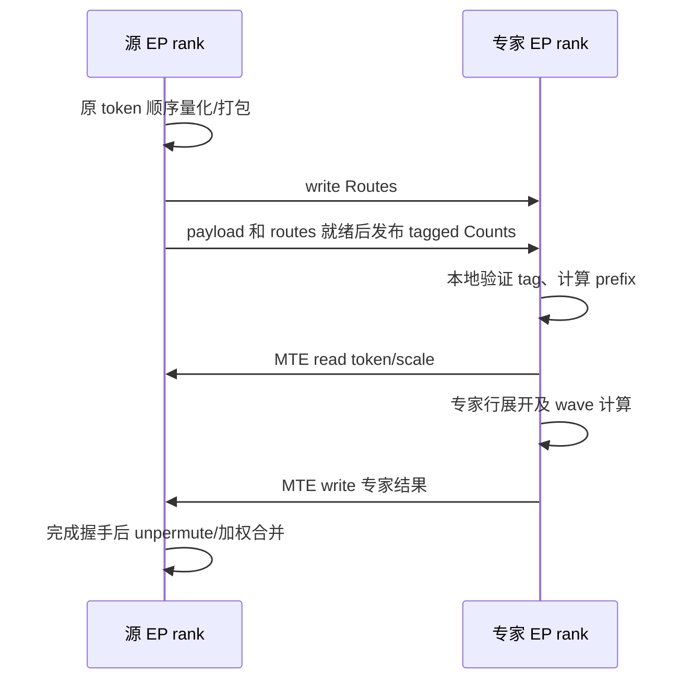

原 count 高 8 位含同步 tag、低 24 位是数量；tag 随同步轮次循环，假定端间调用轮次一致。它不是我们需要的异步 DP/microbatch 配对及物理槽交替握手协议。

已有 dispatch 去重通过 rowDesc 分组：同来源 token 命中本 F 多个专家时，FIRST 行只跨卡读取一次，再本地扇出；关闭时多次读取同一源地址。**该开关改变通信量，不改变源 QuantRecords 的存储份数。**

### 2.2.3 Combine 的结果、定位和完成

专家端按 MetaInfo 写 `ReturnRows[tokenId][topkId]`，不同专家写不同位置，不做远端 atomic add。源端使用 topk weights unpermute/reduce。原生同步区负责结果完成握手，没有目标 AFD 的逐成员 credit/Done 表。首版目标保留逐专家返回与 A 最终加权，不开启 F partial combine。

### 2.2.4 容量公式与 32k—1M 外推

无权重前移、无 combine 去重时，本例 record 为：

```text
quantRecordBytes = align32(align256(hiddenSize) + 2×ceil(hiddenSize/64)) = 7392
quantBytes = numMaxTokensPerRank × quantRecordBytes
returnBytes = numMaxTokensPerRank × topk × hiddenSize × 2
routeBytes = expertPerRank × epWorldSize × numMaxTokensPerRank × routeIndexBytes
windowBytes = 68 KiB + align后的routeBytes + quantBytes + returnBytes
```

本表 topk×capacity 超过16位索引范围，routeIndexBytes=4；小容量可按原生同源布局函数选择索引宽度。实际分区仍按原函数对齐。

| 单源容量 | Quant | Return | Routes | 窗口合计，含68 KiB |
| --- | ---: | ---: | ---: | ---: |
| 32k | 0.225586 GiB | 3.5 GiB | 8 MiB | 约3.733463 GiB |
| 256k | 1.804688 GiB | 28 GiB | 64 MiB | 约29.867252 GiB |
| 1M | 7.21875 GiB | 112 GiB | 256 MiB | 约119.468815 GiB |

因此 read 避免了专家端全源 payload 接收区，但整批 topk 返回区仍会很大。目标方案必须同时限制输入窗口和返回窗口，不能只减少读取次数。

### 2.2.5 约束、成熟度与可借鉴点

- 原生 A5 MXFP8、MTE wave、去重与 workspace 布局有代码可复用，不代表异步 AFD 已实现。
- `num_max_tokens_per_rank` 是单源容量；`max_recv_token_num` 映射 maxOutputSize，约束专家展开行。原计数截断不能作为 AFD 超容量处理，必须完整返回。
- dispatch 去重有 UB/prepass 容量护栏和收益门控，小 decode 可以关闭；大容量外推不意味着能绕过这些护栏。
- 图能力须区分原生算子与目标 AFD 全流程；device 选层、独立 scheduler、窗口复用和 A 并发收发仍需实施。
- 选择此后端是为了保留计算通信 wave，修改输入准备、来源视图和返回协议，避免重写 GMM tile。

本节源码依据见附录 B 的 B5；版本固定在附录 A。

## 2.3 MoeDistribute V2 A5 MTE：逐专家写入接收区

### 2.3.1 选择的版本与通信布局

本地 vLLM-Ascend 使用 `npu_moe_distribute_dispatch_v2` / `npu_moe_distribute_combine_v2`。A5 空 comm_alg 默认选择 MTE/fullmesh_v1 的通用 dispatch 内核；显式 fullmesh_v2、CCU 是其他分支，不能混用限制和代码结论。

```text
每个原生 EP rank 的数据窗口（控制区另计）
┌──────────────────────────────────────────────────────┐
│ 半区0                                                │
│   CombineRecv[token][topk][returnRecord]               │
│   DispatchRecv[source][localExpert][B][inputRecord]    │
├──────────────────────────────────────────────────────┤
│ 半区1：同样的两个独立分区，连续调用切换半区            │
└──────────────────────────────────────────────────────┘
```

Dispatch 起点显式加上 combine 预留容量；combine 从当前半区开头开始。**一个半区内两者没有地址复用；两个半区也不是同批数据发送两份。** 两半都在实际寻址范围内，需要相应预留。

### 2.3.2 Dispatch 的 payload、辅助信息与通知

源 rank 对每条专家 route 量化/打包 token，write 到目标 `[source][localExpert][expertOrdinal]`，发布 counts/status；专家 rank 等本地状态后复制到专家输入，生成 source/token/topk 辅助信息。一个 token 命中同一 F 的多个专家，仍写多份 hidden。

| 信息 | 作用 |
| --- | --- |
| token + 量化 scale | 实际专家输入；A5 对应分支可在 dispatch 内做 FP8/MXFP8 量化 |
| source/token/topk 辅助定位 | combine 回到哪个源、哪个结果位置 |
| 每专家/来源 counts | 计算接收前缀、专家输入范围 |
| status | 数据写入完成的通知，接收侧查询本地状态 |

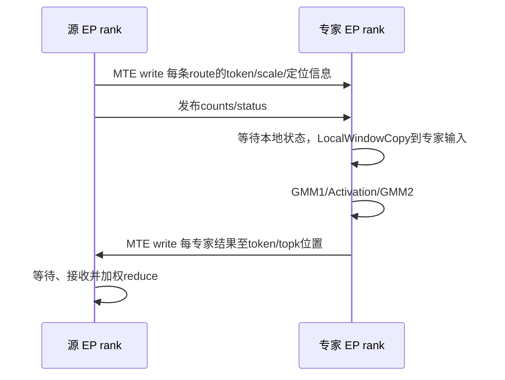

### 2.3.3 Combine 与 A5 record

专家结果按原 source/token/topk 写回。选定 A5 BF16 DataAsFlag 路径每512 B中有480 B有效数据：

```text
returnRecordBytes = ceil(hiddenSize×2/480)×512 = 15360
```

这项开销不能套用到 A3 独立 info table 的 F2A，也不能拿 BF16 hidden 原始字节数替代实际 A5 record。

### 2.3.4 容量公式与外推

本例 FP8 dispatch record 含 scale/辅助信息并按512 B对齐，为7680 B：

```text
dispatchHalfBytes = epWorldSize × expertPerRank × numMaxTokensPerRank × 7680
combineHalfBytes = numMaxTokensPerRank × topk × 15360
dataWindowBytes = 2 × (dispatchHalfBytes + combineHalfBytes)
```

| 单源容量 | 单半区 Dispatch | 单半区 Combine | 双半区数据区 |
| --- | ---: | ---: | ---: |
| 32k | 15 GiB | 3.75 GiB | 37.5 GiB |
| 256k | 120 GiB | 30 GiB | 300 GiB |
| 1M | 480 GiB | 120 GiB | 1200 GiB |

这是未修改布局的外推，当前该路径不能直接运行这些大 BS。若先按目的 rank 去重但仍保留对称双半区，32k数据区变为 `2×(1.875+3.75)=11.25 GiB`；这还没有得到 AFD 按角色分离和单槽复用的收益。

### 2.3.5 约束、成熟度及放宽方向

- 选定公共 tiling/框架 MC2 存在512容量限制；不能推断所有同名版本均相同。
- 整批 routing/mask 常驻 UB、`CalTokenSendExpertCnt`逐route扫描历史前缀、DMA/计数宽度都需改；仅删除512检查不可行。
- 当前小 BS 框架集成和团队 DataCopy 调试经验是选择依据，不是“任何 shape 最快”的证据。
- 有框架图集成基础；新 AFD、32k、TP/CP、FP8 和分轮组合仍需验收。
- 专家相关 smooth scale 可能使同 token 不同专家的 payload 不同，不能强制去重；MTE 去重模式要求专家无关量化，示例采用 MXFP8，DeepEP 的 FP8 格式另行核对。
- 目标保留量化、DataCopy、结果打包和 reduce，借鉴 EP/DeepEP 重写路由统计、去重和 prefix，详见第五部分。

本节源码依据见附录 B 的 B6、B7；版本固定在附录 A。

## 2.4 MoeEP Direct：rank 去重、URMA payload 与独立 epilogue

### 2.4.1 数据布局

选定 A5 Direct 路径通过 Hcomm UBC_CTP 通道的 WriteNbi/BatchCommit 传 payload；本地整理仍使用 MTE。Host 中的 MTE 服务分类不等于裸 DataCopy 跨卡 payload。本结论不推广到未核对的所有 Hybrid/后续版本。

```text
原生 EP rank 的 Direct 窗口
┌────────────────────────────────────────────────┐
│ dump/diagnostic、counts、channel notify等控制区  │
│ combine结果通知表，部分按B×topk预留             │
├────────────────────────────────────────────────┤
│ DispatchRecv[sourceRank][B][rank去重record]     │
├────────────────────────────────────────────────┤
│ CombineRecv[B][topk][resultRecord]              │
├────────────────────────────────────────────────┤
│ PayloadStash[B][metadata]                      │
└────────────────────────────────────────────────┘
```

同 token 发给同 rank 一份 record，记录专家成员/权重等 metadata，接收 epilogue 展开为专家行；不按本地专家数预留多份 payload。self 路径可直接引用本地输入，不能据此省略整体容量检查。

| 交换内容 | 所在区域/产生方式 | 为什么需要 |
| --- | --- | --- |
| 去重token hidden及预量化scale | DispatchRecv；URMA从本地输入及metadata暂存提交 | 实际计算数据，同目的rank不重复hidden |
| topk专家、权重、source rank/token定位 | record metadata，发送端stash组织 | epilogue判断本地专家、展开并保留combine返回位置 |
| rank/expert counts | counts通知区 | 确定接收数量、输出前缀和有效行数 |
| channel完成通知 | notify区 | epilogue确认payload已到，不能只凭count就读取 |
| 每专家输出及返回通知 | CombineRecv及其状态表 | 源端等待后按路由权重合并 |

### 2.4.2 Dispatch、Combine 与 epilogue

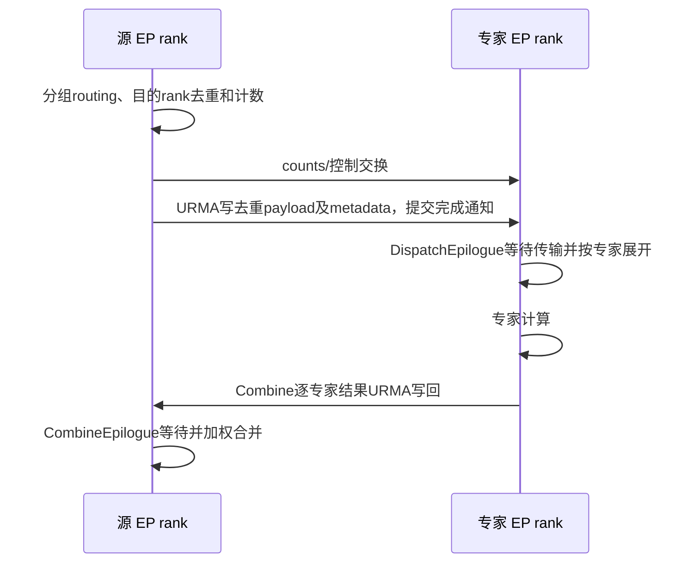

epilogue把提交/传输与最终等待、输出整理分开，为异步重叠提供边界；不意味着 dispatch 提交前完全没有 counts 等待或全组协调。Combine仍逐专家结果返回，没有这里 DeepEP 的 F rank partial 归并。

FP8接口接受预量化 x+scales，不在所述 dispatch 内把 BF16 转 FP8。H=7168时，FP32/128 或 E8M0/32 scale实际都约224 B/token；非FP8输入不是同时携带7k scale。

### 2.4.3 实际 record 与保守申请

```text
reservedMetadataBytes = align512(align32(hiddenSize)+2×align32(topk×4)+32) = 7680
reservedDispatchRecordBytes = align512(align32(2×hiddenSize)+reservedMetadataBytes) = 22016
reservedCombineRecordBytes = align512(align32(2×hiddenSize)+32) = 14848

dispatchReserveBytes = epWorldSize×numMaxTokensPerRank×reservedDispatchRecordBytes
combineReserveBytes = numMaxTokensPerRank×topk×reservedCombineRecordBytes
stashBytes = numMaxTokensPerRank×reservedMetadataBytes
```

实际 FP8 metadata 对齐后可为512 B，实际 token record 为7680 B；但当前申请使用上述保守最大格式，不能按实际传输量缩小窗口。大 metadata 预留不是某种已支持量化必须产生7k scale。

本例 Direct 控制区为 `numMaxTokensPerRank×topk×512 + 195072` B，195072包含固定前缀、counts及本拓扑channel通知等；改变拓扑、专家数或channel数须重新按原布局计算。完整公式为上述三数据区加控制区。

| 单源容量 | Dispatch保守预留 | Combine保守预留 | Direct布局总申请 |
| --- | ---: | ---: | ---: |
| 32k | 5.375 GiB | 3.625 GiB | 约9.359557 GiB |
| 256k | 43 GiB | 29 GiB | 约74.875182 GiB |
| 1M | 172 GiB | 116 GiB | 约299.500182 GiB |

包装器可能为未知/Hybrid上下文采用更保守配置；上表不是所有包装入口的实际分配量，更不是进程全部HBM。大容量仍是布局外推，须通过接口及实现限制。

### 2.4.4 约束和借鉴价值

`numMaxTokensPerRank`由调用者传入，不由kernel推断真实BS。本地 vLLM-Ascend没有此后端集成，不能说它已对应某个唯一框架参数。集成时由框架容量明确映射。

其分group读取routing、双计数和rank去重适合大BS参考。完整 ElasticBuffer ACLGraph能力未确认；默认host counts同步和动态输出分配需核实，标准ACLNN或torch.compile不等于完整包装已入图。本版不再增加 MoeEP 作为第三种小算子实现；它提供路由与 epilogue 参考，直接实施候选由后文比较 DeepEP-AFD 和 MTE 后确定。

本节源码依据见附录 B 的 B6；版本固定在附录 A。

## 2.5 DeepEP-Ascend：UBMEM 控制、URMA 数据与 rank partial combine

### 2.5.1 布局与两种互联机制

基线README明确同一EPBuffer接口支持训练、prefill、decode；要求A5同时支持UBMEM和UBC_CTP/URMA，两者运行时都有用。

- UBMEM用于映射后的计数、原子和同步控制，并不等于所有控制都用MTE DataCopy。
- URMA用于主要payload。Hcomm提供资源，底层还直接组织队列描述符、doorbell和CQ/drain，不等价于简单的一次WriteNbi。

```text
EPBuffer
  控制/workspace/队列：另行规划
  主payload区：align2MiB(max(Dispatch需求, Combine需求))
      Dispatch阶段：[source][token][FP8 hidden+scale+route metadata]
      Combine阶段 ：[rank或代表topk槽][token][BF16 partial+metadata]
  专家展开输出、发送metadata、combine暂存等普通HBM另计
```

### 2.5.2 Dispatch与Combine交互

Dispatch用expert/rank histogram、同token目的rank去重及跨核前缀定位，把payload及专家元信息写到对端；deferred epilogue等待drain并展开专家行。

| 交换内容 | 方向与作用 |
| --- | --- |
| token、预量化scale | URMA写目标rank，构成实际专家输入 |
| topk权重、专家路由、原token来源 | metadata随record传输，供展开、结果归属和局部加权使用 |
| rank/expert histogram及同步状态 | 控制映射和归约，用于输出容量、目的record定位及完成协调 |
| 本地展开行到原token/代表topk的对应关系 | dispatch handle/本地metadata，combine据此找局部归并成员及返回槽 |
| BF16 rank partial及完成状态 | F写回源，源epilogue汇总不同rank |

Combine在专家rank先将同原token的多个专家贡献归并为一条rank partial，按代表topk位置和原token信息发送；源端只累加各rank partial。权重必须在局部归并前正确参与。


局部归并改变求和顺序，并存在BF16 partial舍入；不能未经精度验证代替我们保留的逐专家返回。主buffer取max复用依赖其原生完成协议，不能直接复制到独立A/F窗口。

### 2.5.3 容量公式与外推

本例FP8 scale为224 B；dispatch metadata为 `align32(topk×4+align32(topk×8)+4)=128` B：

```text
actualFp8DispatchRecordBytes = 7168+224+128 = 7520
actualDispatchBytes = epWorldSize×numMaxTokensPerRank×7520
combineRecordBytes = hiddenSize×2 + align32(topk×4) = 14368
combineBytes = min(epWorldSize,topk)×numMaxTokensPerRank×14368
mainPayloadBytes = align2MiB(max(dispatchProvisionBytes,combineBytes))
```

容量helper的FP8 scale hint更保守，本例record为7744 B；实际预留应使用helper值。以下配置仍由BF16 combine主导，因此两种dispatch口径均不改变主buffer结果：

| 单源容量 | FP8实际Dispatch需求 | BF16 Combine需求 | 主payload区 |
| --- | ---: | ---: | ---: |
| 32k | 1.835938 GiB | 3.507813 GiB | 3.507813 GiB |
| 256k | 14.6875 GiB | 28.0625 GiB | 28.0625 GiB |
| 1M | 58.75 GiB | 112.25 GiB | 112.25 GiB |

若使用BF16 dispatch，32k需求约3.53125 GiB，不能将它误称FP8 dispatch容量。队列、普通计算输出和其他暂存不在本表，改变K/EP后主导项也可能变化。外推不绕过SQ深度、编码、对齐、索引和输出上界。

### 2.5.4 支持边界与借鉴价值

README明确graph capture、Hybrid等在所述基线不支持。host counts/动态shape、延迟回调、源tensor异步生命周期及队列replay都是适配点，不能简化为“URMA硬件不能入图”。已有prefill/decode接口不代表本项目无需改造即可AF分离。

可借鉴histogram/跨核前缀、rank去重、完成后主buffer复用；目标 DeepEP-AFD 保留其传输队列基础，但首版不引入 rank partial 数值变化；需重新定义非对称角色和队列生命周期。现有公开带宽部分不含最终epilogue，不能与完整MTE算子时延直接比较。

本节源码依据见附录 B 的 B9–B13；版本固定在附录 A。

## 2.6 CAMAsync 框架已有能力与目标差距

CAMAsync 已有 dispatch_send / dispatch_recv / combine_send / combine_recv、DP 轮询、TP 成员计数聚合、分轮计算及 layered GMM。它不是本文协议的实现证明：当前 DP 轮询按连续 tpSize 组织，零 token 会被当作未就绪；部分 token offset 使用 uint16；预算分轮按整专家推进，不等于本设计允许单专家跨 Q 切片。[源码 B1]

当前 Attention 固定两个 microbatch 的关键顺序为 `compute mb1 → recv mb0 → send mb1`，F 则循环 `recv → layered executor → send`，服务循环逐步 synchronize。当前 layered 路径有限定 A3/eager 的检查；不能由“有 device 层号”推出 A5 图模式已支持。[B2、B3]

本设计新增的实质能力包括：发布与最终 ACK 分离、同 DP 多 mb 真正同时可达、TP/CP 显式成员映射、跨 P/D 共享 F 调度、物理槽交替位协议、精确 route 切片、各后端 gate 与图接口。复用既有代码时按 AGENTS.md 对上游差异加 PATCH 标记，不把框架改造误放入通用通信算子。

## 2.7 比较与选择：MegaMoE 融合主线、DeepEP 小算子候选、MTE 备选

<a id="native-capacity-reference"></a>

以下按原生相关布局外推，不是保证这些超大 B 可通过 host 限制；单位 GiB，B 为单源 token 容量。用于说明需要分轮与去重，不作为可直接配置的容量。

| 原生布局示例 | 32k | 256k | 1M |
| --- | ---: | ---: | ---: |
| MegaMoE peer window | 3.733463 | 29.867252 | 119.468815 |
| V2 A5 MTE 双半区示例 | 37.5 | 300 | 1200 |
| MoeEP 窗口示例 | 9.359557 | 74.875182 | 299.500182 |
| DeepEP 示例主窗口 | 3.507813 | 28.0625 | 112.25 |

各项公式和独立计量范围见 §2.2–§2.5。容量差异之外，还需比较搬运方向、路由组织和框架边界：

| 维度 | MegaMoE | Distribute V2 A5 MTE | MoeEP Direct | DeepEP-Ascend |
| --- | --- | --- | --- | --- |
| Dispatch payload | read | write | Hcomm URMA write | URMA write |
| 同目的rank去重 | 已有读取去重，可自动关闭 | 目标新增 | 已有 | 已有 |
| Combine | write，支持多模式 | write | write | F局部归并后write |
| 计算通信融合 | 已有wave | 主要依赖外部组织 | epilogue分离 | 延迟epilogue |
| Dispatch内BF16→FP8 | A5支持MX量化 | A5支持对应量化分支 | 所述接口不支持，预量化输入 | 所述接口预量化输入 |
| 大Prefill | 按容量及资源约束 | 当前选定路径需改512及内部逻辑 | 有大容量设计，仍需完整校验 | 明确支持prefill接口 |
| 入图证据 | 原生算子能力不等于目标AFD已验证 | 有vLLM-Ascend集成基础 | 完整包装待确认 | 基线明确不支持capture |
| 本项目复用价值 | 最大程度复用融合流水 | 保留为小算子备选 | 参考rank去重与epilogue边界 | 优先验证的小算子改造基础 |

共同的控制协议、DP到齐、Pending/Active、两级分轮和A侧事件不随后端改变。变化的是输入搬运方式、计算组织、传输完成原语及record格式。DeepEP-AFD是优先验证的小算子候选，并未取代MegaMoE融合路径。

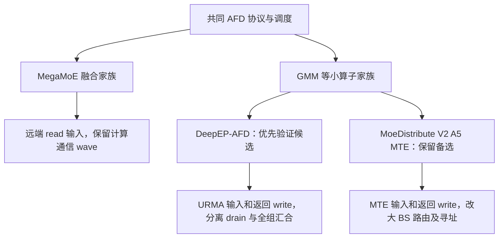

后端选型图：两个执行家族、三种实现候选，不能把“三种实现”读成同时在一个Context中运行。backend及transport在创建Context时固定，不在在途事务中切换。

| 比较维度 | MegaMoE | DeepEP-AFD | V2 A5 MTE |
| --- | --- | --- | --- |
| 当前定位 | 融合主线 | 小算子优先验证 | 小算子备选 |
| 关键复用 | GMM/wave及主要workspace组织 | rank去重、通信issue/epilogue边界、URMA请求与drain | 量化、MTE搬运、部分归并逻辑 |
| 主要新增 | sourceLane、按片描述、授权gate、device层与完成通知 | 非对称角色、去全组同步、Q接收片、逐route combine | 四段拆分、固定tile路由、去重、紧凑接收寻址 |
| 默认先算后等的范围 | 原wave缓冲允许的提前量 | 当前计算片可算完再等，drain后回收输出 | 当前计算片可算完再等 |
| 最关键准入 | wave反压、A5 gate与图 | 原生环境、跨通路完成顺序、注册及传输资源 | 大BS正确性、MTE发布语义及AIV共存 |

### 2.7.1 为什么小算子优先验证 DeepEP，以及它仍需改什么

优先验证 DeepEP 的理由是已有 rank 去重、histogram/prefix、通信 issue 与 epilogue 分界、BF16/FP8 搬运和接收展开，能减少 MTE 方案的大 BS 路由及拆分工作。它仍是对称 EP collective 实现，不包含独立 A/F 角色、DP Pending 调度、两级分轮和小返回窗口信用协议。预期改造更集中是源码推断，不是已测工期或性能承诺。

本地固定基线为 `3b25377d04b24fc6154698ded78a2bcb2c59afff`。原生 host dispatch 仍按 `num_experts/num_ranks` 分配专家；device notify 等所有 rank 的专家计数。dispatch/combine 和 epilogue 路径仍有 barrier，只是位置受配置控制。`defer_epilogue=True` 不会取消这些依赖。[B9]

```text
上游EP: 所有rank dispatch(issue+counts) → 延迟epilogue(drain/接收展开)
        → 本rank专家计算 → combine(rank内归并+issue) → epilogue(最终归并)

目标AFD: A dispatch_send(只发本lane) → 本地F Ready/DP到齐
         → F dispatch_recv(只展开Active的Q行) → GMM
         → F combine_send(逐route返回) → A combine_recv(按Ledger归并)
```

不能把 A/F 都加入 EPBuffer 再用零 token 占位作为最终方案：它仍要求所有 rank 进入相同 collective 序列，既不能证明独立 F 调度，也会把 P/D 进度绑定在一起。环境测试可以用原生 EPBuffer，AFD 数据面使用单独的适配 API。

| 改造项目 | DeepEP 已有基础 | 本版必须新增或替换 | 与 MTE 相比 |
| --- | --- | --- | --- |
| rank 去重与路由 | 已有 warp 去重、histogram、前缀、SGE 组织 | 源 lane/目的 F 映射与本槽偏移 | 复用优势明显 |
| 大 BS / UB | 按核分 token，epilogue 分 stage | 核配额变化时重新核算发送表；必要时固定 tile 化 | 有基础，仍非任意 BS 零改造 |
| 收发分段 | issue、copy/reduce epilogue | 去掉全 rank 汇合，保留传输 drain 与局部同步 | 边界更接近目标 |
| A/F 不对称 | 同一 num_ranks 同时描述来源与专家 | 分离 N_A/L/N_F，显式远端地址及专家表 | 两方案都需做 |
| 分片 / device 调度 | 一次 EP 操作的 handle 与完整展开 | Q 行接收、Continuation、Active gate、device 选层 | 两方案都需做 |
| combine | rank 内预归并、URMA 发送、最终归并 | 首版改逐 route 返回、单 workspace drain 后回收 | 不能原样复用完整 combine |
| 平台集成 | UBMEM/URMA、DeepJIT | 版本固定、预编译、运行时持久资源与图准入 | 比 MTE 多一组部署依赖 |

## 2.8 其他实现的复用边界

| 来源 | 可借鉴 | 不能直接继承 |
| --- | --- | --- |
| MoeEP | 通信 window 的控制/dispatch/combine/stash 分区与安全容量检查 | Hcomm UBC_CTP WriteNbi/BatchCommit 不是已证实等价的 V2 MTE API |
| DeepEP-Ascend | §5.3将路由与URMA提升为候选实施基础 | 原EPBuffer集体语义、原handle生命周期、图能力和rank partial combine不能原样继承 |
| DeepGEMM-Ascend | MegaMoE pipeline、对称窗口与同步实现的参考 | epoch/双 signal/远端 atomic 的全 rank barrier 不适用于独立 F 调度 |
| vLLM-Ascend | 当前参数来源、逐层权重组织、量化选择与 operator selector | 默认容量不是任意大 BS 支持；源码 checkout 不证明运行时加载版本 |

vLLM-Ascend V2 容量来自 get_mc2_tokens_capacity/TP；MegaMoE prefill 默认 max_tokens=65536 并不自动拆成本文 32k 窗口。现有部分 A5 调用传 mask=None，不能因此忽略目标 mask 契约。运行时 lazy init 必须在 capture 前完成。[B7、B8]

# 第三部分：目标 AFD 总体架构

以下从原生对称 EP 转向目标 A/F 分离。先说明全局职责和任务单位，再走一遍单轮流程；第四部分定义其可实现的字段、状态和依赖。

## 3.1 全局职责：A 发布和归并，F 独立调度和计算

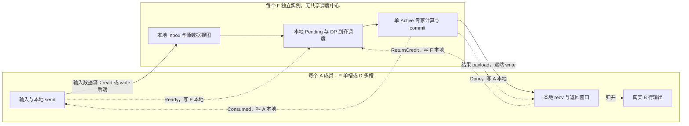

总体职责图：实线表示数据流，虚线表示控制消息。图中 A、F 各画一个代表实例，按注册表复制；每个 F 有自己的 Pending/Active，A recv 必须收齐该槽全部注册 F 的 Done。输入数据实线只表示数据从 A 到 F：MegaMoE 由 F 发起远端 read，小算子后端由 A 发起远端 write。没有图外的中央调度节点。

## 3.2 为什么要两级分轮：分批处理，复用固定内存

这里的“多轮”不是让同一批 token 重算，也不是要求模型多执行几次 MoE。一个 microbatch 在一个 MoE 层上的完整调用称为**事务**；我们把事务中的不同数据分批处理，结果仍只写入一次完整输出。目的在于：**不为整批输入及其所有专家展开行同时预留通信区和计算临时区，而让不同批次安全地复用同一块内存。**

### 3.2.1 不分轮时，内存为什么会随 BS 增长

先看目标 AFD 的同一种布局，暂不做分轮。设一个 A 成员的真实 token 数为 B，每个 token 选 K 个专家，hidden 维度为 H。量化输入每行占 q 字节；小算子输入 record 占 d 字节；返回每条 route 占 r 字节。q/d/r 包含各自格式的 scale、metadata 或对齐，不能只按 hidden 数据大小计算。

- **输入通信区**：MegaMoE 在 A 保存 B×q 的源数据，F 远端读取。去重的小算子后端在每个 F 为该来源预留 B×d；有多个来源就对来源求和。不同 token 即使尚未被 F 计算，也占着本事务的输入通信区。
- **返回通信区**：A 要容纳每个 token 的 K 条专家结果。小算子按 B×K×r 预留，MegaMoE 按 B×K×2H 预留；A 最终归并出的真实输出只有 B×H，二者不是同一块缓冲。
- **F 计算 workspace**：通信输入按 token 保存，不代表计算也只有 B 行。同 token 命中本 F 的几个专家，就展开成几行。若一次展开全部已选任务，GMM 输入、中间激活和输出按全部专家行数分配；路由倾斜或聚合多个 DP/mb 时，这个数还会增长。

因此只做一种分轮不够：**A 限制原始 token 数，才能限制通信窗口；F 再限制专家展开行数，才能限制计算 workspace。** 32k 原始 token 在 K=8 且路由集中到一个 F 的八个专家时，仍可形成 256k 专家行。反过来，只让 GMM 每次算 32k 行，却仍把整批输入和所有返回结果放在通信区，也省不下整批通信预留。

### 3.2.2 第一级：A 分通信轮，输入区和返回区按窗口容量分配

为每个 A 成员的物理槽配置固定单轮容量 C_m，DP 聚合容量由成员求和，不设32768合计上限。当前小算子实现族仍要求单槽 C_m≤32768，这是已实现族的边界，不是 maxBS 或芯片通用上限。**通信轮**处理该 DP 事务中一段原始 token，各成员共同确认轮次计划；本轮无 token 的成员仍发布零长度控制。具体范围公式见 §4.1。

每个物理槽只有一份输入区和一份返回区，按 C_m 而不是 B 分配：

| 内存项 | 不分通信轮，同一目标布局 | 分通信轮后 |
| --- | --- | --- |
| MegaMoE：该 A 的量化源数据 | B×q | C_m×q |
| 去重小算子：每 F 为该来源预留的输入 | B×d | C_m×d |
| 小算子：该 A 的返回窗口 | B×K×r | C_m×K×r |
| MegaMoE：该 A 的返回窗口 | B×K×2H | C_m×K×2H |
| 真实输入、真实输出及权重等普通 HBM | 按完整事务/模型需求 | 不因通信分轮自动缩小 |

以**一个 DP、一个 A owner、八个 F**为例：B=262144（256k），C_m=32768（32k），H=7168，K=8，使用去重小算子示例 d=7680B、r=15360B。这里只比较同一目标布局有无分轮，不把原生 EP 双半区、rank 去重或 A/F 拆分的收益混进来。

| 主要通信预留 | 整批一次放入 | 8 个通信轮复用一个槽 |
| --- | ---: | ---: |
| 每 F 为该 A 预留的输入区 | 1.875 GiB | 0.234375 GiB，即 240 MiB |
| 该 A 的返回窗口 | 30 GiB | 3.75 GiB |
| 八个 F 输入区与一个 A 返回区合计 | 45 GiB | 5.625 GiB |

表中主要通信预留降为 1/8，是因为八轮用的是**同一组物理地址**，不是分配八个 32k 槽。控制、路由 metadata、传输资源和 workspace 另计；完整 BF16 输入、输出仍各为 3.5 GiB。B 增至 1M 时，通信轮数增至32，窗口容量仍不变。

返回窗口虽称“小窗口”，仍容纳**一整个通信轮**的 K 路结果，不是只容纳一个 F 计算片。A 在第 n 轮全 F Done 后，把窗口结果归并到真实输出中该轮 token 对应的区间，再清理并释放窗口。第 n+1 轮复用原返回地址，但归并到另一段真实输出；无需保留八份专家展开返回结果。

P 默认跨 microbatch 也只保留一个物理槽，避免再乘 microbatch 数；D 为并发发布默认每个 microbatch 独立槽，需要按槽数乘预算。这项槽配置与通信分轮是两个独立选择，不把 D 并发槽静默压成一个。

### 3.2.3 第二级：F 分计算片，只展开当前片的专家行

一个 F 对已到齐通信轮的专家展开行再切成**计算片**。Q 是每片最大有效专家行数，Q_alloc 是考虑专家 padding 后的物理行预算。Pending 保存尚未消费的 route 游标，Active 只描述本次选择的片；不能先把整轮专家行全部展开到一个大临时张量，再给 GMM 传一个小 slice，否则输入展开的内存仍没有省下来。

例如上述一个32k通信轮在 F0 集中展开262144行，令 Q=Q_alloc=32768，F0分8片。以 BF16 GMM2 输出为例，整轮张量需 `262144×7168×2=3.5GiB`；单片只需 `32768×7168×2=448MiB`。其他按行分配的计算张量同样按 Q_alloc 核算，库 workspace 和同时存活峰值见 §5.5.3；448MiB 不是全部计算 workspace。

处理顺序为：取当前片输入 → GMM/activation → 写回该片结果 → 确认发送不再引用本片输出 → 复用计算缓冲处理下一片。MegaMoE 仍在原有 wave 缓冲与依赖范围内流水，不要求改为整个片先算完再发送；DeepEP 的输出回收必须等待覆盖该发送的 drain。

**计算片完成不释放通信轮。** 输入 record、routes 和 Inbox 仍可能被下一片引用，必须保留到该 F 本轮最后一片结束。各片结果累计写到同一个通信轮返回窗口中的不同 route 位置；中间片不发 Done/Consumed，不让 A 提前清窗口。F1 可以只需一片或零 route，各 F 的计算片数不必一致，也不需要 F 间逐片 barrier。

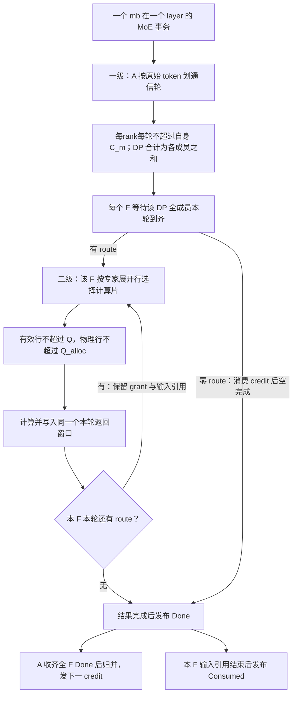

两级分轮图：第二级分片限制计算 workspace，不为每片分配新通信槽。输入槽可在全 F Consumed 后承接同事务下一通信轮；返回槽则等 A 归并后发出的下一 credit。上述两条释放链可以重叠，完整时序见单槽握手时序图；此图没有把它们串成一个新的 barrier。零 route 分支直接执行真实控制完成，不进入 GMM。

### 3.2.4 复用内存新增什么交互，等待发生在哪里

代价来自“这块内存何时能覆盖”的确认。相对一次性整批处理，通信轮把原本一次的发布/完成细化为每轮一次，并增加返回窗口的循环授权；第二级计算片主要增加 F 本地续跑状态，不增加逐片 A/F 握手。

| 交互或状态 | 谁产生、谁消费 | 为什么需要；省略会怎样 |
| --- | --- | --- |
| 共同轮次计划与轮描述 | DP 成员在事务开始前确定；A 发布本轮 Inbox | 确认各成员属于同一 mb/layer/round；不能把成员的不同轮拼成一次计算 |
| InputReady | 每个 A 成员写各 F 本地控制块 | 表示本轮 payload、routes 和 Inbox 已可读；每轮发布，零长度也发布 |
| DispatchConsumed | 每个 F 写 A 本地控制块，A send 收齐全部 F | 证明旧输入及描述已无引用；缺少它就可能在 F 续算时覆盖旧输入 |
| ResultRoundDone | 每个 F 写 A 本地控制块，A recv 收齐全部 F | 证明整通信轮的所有结果已完成；不是某个计算片完成，也不是发送刚提交 |
| ReturnCredit | 启动时初始化首轮信用；之后 A recv 归并/清理后写各 F 本地控制块 | 证明旧返回已读完，允许下一轮覆盖；只等 Done 不足以证明 A 已读走结果 |
| Pending 游标与 Continuation | F 本地 scheduler/commit 更新 | 保留下一计算片起点与已取得的返回授权；不重新申请本轮 credit，不重复路由 |
| RoundLedger | A send 发布、A recv 消费 | 即使输入已进入下一轮，recv 仍能找到旧返回对应的真实输出区间和位值 |

四种 AF 控制均由生产者写到消费者本地，不新增远端状态轮询。每个 F 都要处理本轮控制，包括没有 route 的 F；否则交替位复用会跳过中间状态。首次信用在启动初始化时已给出，后续每个授权只被消费一次；跨计算片持有，跨通信轮重新取得。

下面展示同一槽的两个相邻通信轮。A send/recv 是并行执行路径；各 F 分别执行图中逻辑，不隐含 F leader：

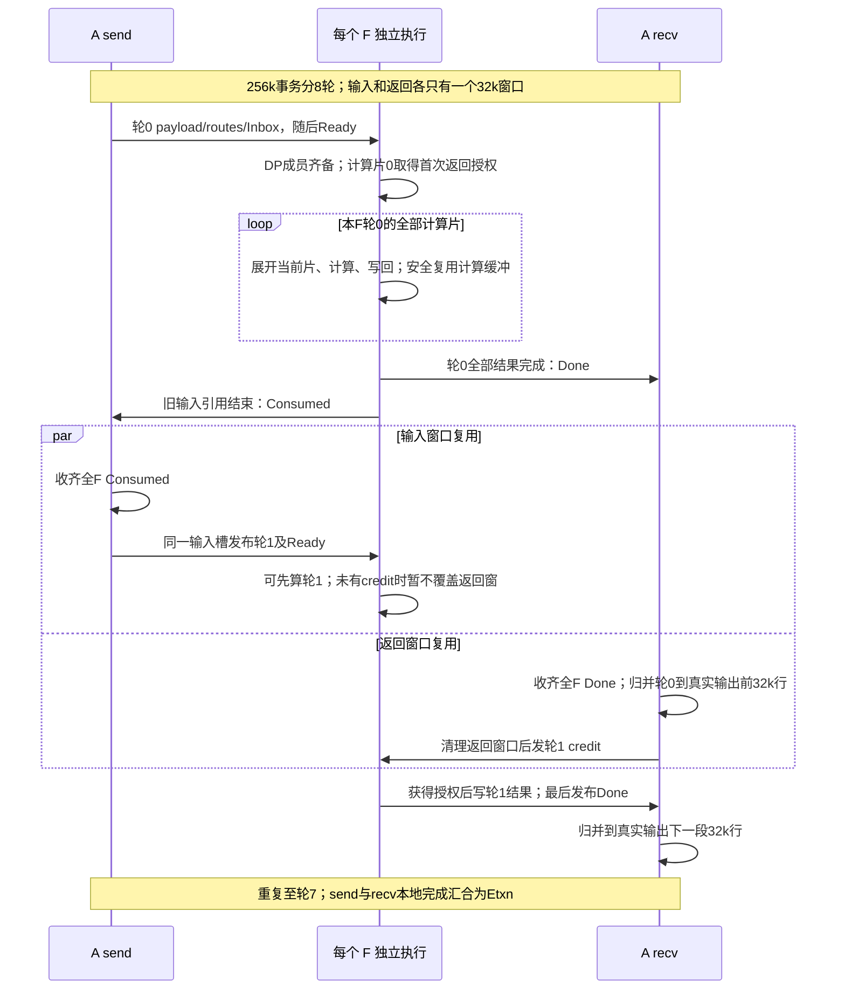

图中默认采用先算后等。F 可以在 A 归并上一轮时计算下一轮，但下一轮首次返回写必须等 credit；单 workspace 已被这片占用时，该 F 会发生队头阻塞，不能无成本绕过。PRECHECK 则在选择前检查 credit，缺授权条目留在 Pending。输入 ACK 与返回 credit 各保护一块内存，既不能互相代替，也不应合并成“全局每轮全部串行”的新 barrier。

### 3.2.5 省下内存的代价及框架变化

分轮减少的是**同时驻留的预留与临时峰值**，通常不减少该事务需要处理的 token、专家计算量或有效 payload 总字节。它增加每轮路由准备、控制通知、调度/提交和边界等待，也可能降低大 GMM 的效率。较大的 C_m/Q 减少这些开销但增加内存；较小的值节省内存，但增加轮次和片数，最终配置需实测吞吐与 D 尾延迟。

每个物理来源槽每个通信轮，四类32B控制各覆盖全部 N_F 个 F，稳态控制块流量约 `4×32×N_F` 字节，不含 Inbox、counts/routes、启动信用和底层协议开销。上述 N_F=8 时约1KiB/轮，8轮约8KiB；边界消息按完整连续使用序列计量。相对字节数，更需要测量的是慢 F、A 归并及等待核资源造成的窗口复用时延。计算片数增加不会把这四类消息再乘片数。

A 侧 `dispatch_send`/`combine_recv` 需要在内部推进通信轮、维护 Ledger 并归并真实输出；不要求主机每32k做一次全域同步。多轮 send 为等待输入 ACK 可能仍在运行，此时 recv 必须已能消费已发布轮的结果并发 credit；不能等 send 发完全部8轮才启动 recv。最终 send 发布完成不代表事务完成，必须与 recv 的归并和最终 ACK 收尾汇合。具体事件图与等待核进度门禁见 §4.6、§6.3。

F 侧小算子执行链按片重复，MegaMoE 按片接入既有 wave，末片才提交该通信轮的完成通知。框架须允许这个有界续跑循环，且图 replay 不重置持久游标和交替位。上述是目标新增的执行契约，不能因为 CAMAsync 已有“分轮”变量就认为现有调用顺序已经满足。

## 3.3 先走通一次单轮任务

以一个已注册 DP 的某个 microbatch、某一 MoE 层为例，先只看一个通信轮：

1. A 成员准备本轮输入与路由，写各 F 的 Inbox，最后发布 Ready。即使没有有效 token，也发布零长度描述。
2. 每个 F 独立收集该 DP 的全部成员，把到齐任务留在 Pending，选择兼容的 phase/layer 和不超过计算预算的专家行进入 Active。
3. 后端取得输入、执行专家计算。默认允许先算后等：首次返回写之前取得本轮返回授权；后续计算片继续持有该授权。
4. F 将结果写到 A 本轮小返回窗口；全部片结果完成后发布 Done，结束全部输入引用后发布 Consumed。零 route 的 F 也消费授权并提交这两个通知。
5. A recv 收齐全 F Done 后归并到真实输出，释放返回窗口；A send 收齐全 F Consumed 后可复用输入槽。两条释放链独立推进。
6. 多通信轮继续上述流程；最后由 send、recv 的本地完成共同形成 Etxn，才结束该逻辑事务并允许跨 microbatch 复用 P 槽。

这里的“等待全 F”发生在各 A 槽的完成收集，不要求各 F 同步选择同一个 DP。完整的交替位、零 route、延迟通知和覆盖证明见 §4.4；A 并发收发事件见 §4.6。

## 3.4 总体设计选择及代价

| 项目 | v3 决定 | 边界与代价 |
| --- | --- | --- |
| 拓扑 | Attention 支持 TP/CP，FFN 仅 EP；DP 全成员到齐才可调度；各 F 独立选择 | 无 F leader；仍存在每个 A 槽的全 F 完成汇合 |
| 物理槽 | P 默认每成员一个槽跨 microbatch 复用；D 默认每 microbatch 独立槽 | 同一逻辑 microbatch 上次 MoE 事务完整结束才能开启下次 |
| 分轮 | A 按各 rank 自身 C_m 分通信轮，DP 聚合无固定32k上限；F 按专家展开行数分计算片 | 同一专家也能跨片；通信容量与计算容量独立 |
| 返回 | 每输入物理槽配一个小返回窗口；多个 F 写不相交的 route 位置 | 一个返回授权覆盖一通信轮的所有计算片 |
| 交替位 | 四类控制各用独立 32B 块，只有 uint32 状态字有效；全注册 F 每轮握手 | 无 generation/windowSequence；不支持重连、乱序重传或中途变更注册拓扑 |
| 调度策略 | 默认 `COMPUTE_AHEAD`，可选 `PRECHECK`；每 F 单 Active、单计算 workspace | 提前计算后等待会阻塞当前 F，不能无成本绕过 |
| 后端选择 | MegaMoE 融合路径保留；小算子路径优先验证 DeepEP-Ascend 改造，MTE 方案保留 | DeepEP 环境、非对称拆分和完成语义通过前不替换已确定的部署能力 |
| 零 route | 真实 CONTROL 任务：消费授权、Done、Consumed；无 payload、无 GMM | 不允许跳过某 F 的中间交替位 |
| device 选层 | 单次 Active 一种 phase、一个 layer；权重继续按框架原有层组织 | 新增带 gate 的算子入口；非法层禁止回落第 0 层 |
| mask | 首版 None 或一维 bool token mask，inactive 输出明确写零 | 二维 route mask 暂不接入，是范围选择，不是芯片限制 |
| 通知简化 | 首版保留 Done 与 Consumed；§6.5给出可合并的完整证明 | 不把未来提前 ACK 能力隐式删掉 |

`COMPUTE_AHEAD` 保留用户已接受的“先算后等”。两种小算子通信实现都可算完当前计算片再在 combine 等待；MegaMoE 仅在原 wave 有界缓冲范围内先行，首次远端返回写之前取授权。不能承诺整个 MegaMoE 计算片均提前算完，同时又完全不增加缓冲。

# 第四部分：共同数据模型、通信协议与调度

本部分将总体流程落实为静态配置、数据 ABI、持久状态、握手和执行事件。三个后端共用这些完成条件，只有 payload 的位置、搬运方式和传输完成原语不同。

## 4.1 DP 成员、token 所有权、轮次计划与静态注册

DP 注册一个固定成员表以及 token 所有权规则。TP 复制的 token 只能由指定 owner 发一次；CP 的不相交 token 分片由各 owner 发出。所有成员仍必须发布包括零长度在内的本轮控制。owner 发布的专家输入必须为约定完整 H 维；若 TP 仍持有 hidden 分片，先按框架语义完成必要 gather/reduce，再记录 Eattn。A 归并后按框架既有 TP/CP 通信恢复需要的表示。32k/256k 的 maxBS 指单个 Attention 发端 rank 的完整事务容量。两个不相交 owner 各有32k窗口时，DP每轮可发送64k；TP副本仍只由明确owner贡献唯一token，不能重复计数。物理非owner的注册槽若保留，仍计入通信预留，即使只发布零长度。

每次 MoE 发布前，DP 成员使用一致的事务计划：`numCommRounds=max(1,max_m ceil(B_m/C_m))`，其中 B_m 为各成员传给算子的逻辑行范围长度（包括 mask=false 的位置，而非 count_nonzero(mask)），C_m 必须为正；成员 m 第 round 轮处理 `[min(B_m,round×C_m),min(B_m,(round+1)×C_m))`。已无 token 的成员仍发零长度控制。 异构 C_m 按各自窗口推进；短成员提前耗尽后仍参与后续全部轮次的到齐、Done/Consumed和credit闭合，不能自行提前退出。框架单rank真实BS记为 B_rank；普通owner不压缩时 B_m=B_rank。TP非owner可提交 B_m=0，或提交与副本相同的行范围并全mask=false（输出行按inactive契约清零）；非连续owner若压缩输入，必须保存映射并恢复真实输出位置。不得把完整副本的 B_rank 与唯一owner token数混为一谈。B_m、mb、layer 和轮数在本次 send 之前由框架已有元数据或固定顺序 DP 控制交换确定，不能在 recv 归并/发 credit 的关键路径上等新的 collective。

容量修订不改变交替位协议：每物理槽仍最多一波未ACK输入，ACK前所有片的引用结束；每轮仍全F Done→Consumed闭合，A归并后发ReturnCredit。更多owner或更多Q片只延长闭合时间，不允许更早翻位。零长度成员和零route F照常闭合，最终退出按DP共同 numCommRounds 而非某成员本地耗尽判断。

`ContextConfig` 在启动时冻结：ABI 版本、芯片/CANN/算子包标识、backend、量化/布局、策略、DP→member 表、member→phase、slot→mb 映射规则、F→专家映射、H/K/R、C_m、Q、所有窗口地址和长度、层表、有限调度公平性参数。不能在运行中改变参与 F 集合；某轮实际 route 的目的 F 集合可变化。

每个成员为每个物理槽注册输入区、返回区与本地控制区。MegaMoE 输入 payload 位于 A，由 F read；Distribute 和目标 DeepEP-AFD payload 位于 F，为各源 lane 独立分区，由 A write。所有后端的 Inbox 都位于 F 的本地可轮询窗口；A 写到每个 F。DeepEP-AFD 是本文定义的改造后端名，不是上游已有产品接口。

非对称 A/F 地址通过显式 rank/address 表解析，不用 `epWorldSize` 推断源数。`sourceLane=(member,slot)` 与专家 rank 是不同维度；同一 Active 中只出现选中的 lane，不能把未选 lane 的陈旧计数带入计算。

## 4.2 物理窗口与数据 ABI


### 4.2.1 物理 Inbox 与独立 bit 提交

`Inbox[F][member][slot]` 是单 A writer、单 F 消费者的稳定描述。首版 header 为 64B 对齐、16 个 uint32：

| 字段 | 含义 |
| --- | --- |
| logicalMicrobatchId、layerId、commRound | 本轮逻辑身份；与所有同 DP 成员一致 |
| numCommRounds | 本事务总轮数；无 token 成员也发布相同值 |
| originalTokenCount | 本成员本轮原始 token 数，包括 mask=false；≤C_m |
| returnBit | send 按槽发布序列规划的返回位，不从 recv 的瞬时位复制 |
| recordCount | 小算子后端发给本 F 的实际 record 数；MegaMoE 为本成员量化源行数 |
| reserved[9] | 必须写零；以后变更需 ABI 版本协商 |

header 后为 `expertCounts[R]`、`expertPrefix[R+1]` 和专家 route 引用表。prefix 从 0 起，末项为本 lane 在本 F 的 route 数；每个专家区间长度等于 counts；最多 C_m×min(K,R) 个引用。MegaMoE 可保留原 dense 专家源表作为构建暂存，但发布的公共视图为上述紧凑表；其暂存单独记入 workspace，不强制另复制 payload。

`InputReadyControl[F][member][slot]` 独立于 Inbox；32B 对齐的块中仅首个 uint32 为 inputBit，其他 28B 为无语义填充。Ready 不携带动态地址、mb 或 layer，不依赖多字段原子快照。消费者先本地轮询 Ready，再按静态地址读 Inbox；inputBit 相同但本地 lane 已锁定时不得再次入队。

四类块的唯一 writer 和位置：

| 名称 | writer → 本地消费者 | 维度 | 表示 |
| --- | --- | --- | --- |
| InputReadyControl | A send → F scheduler | F×member×slot | 稳定输入已发布 |
| DispatchConsumed | F commit → A send/recv | member×slot×F | 输入与 route 引用全部结束 |
| ResultRoundDone | F commit → A recv | member×slot×F | 本轮所有结果已写完，含零 route |
| ReturnCredit | A recv/初始化 → F grant 检查 | F×member×slot | 对应 returnBit 的返回窗口可写 |

全部跨卡控制均由生产者 write 到消费者本地。消费者不远端 polling，也不清对方控制块。不同 writer 绝不共享同一个 32B 搬运块。

### 4.2.2 Record 与 routeReference 编码

K 在注册时固定。首版 uint32 `routeReference`，保留 UINT32_MAX 为非法引用；地址字节乘法在运算前提升 uint64。

| 后端 | 编码 | 解码和返回定位 |
| --- | --- | --- |
| MegaMoE read | `roundLocalToken*K+topkSlot` | 商为本轮 token，余数为原 top-k 位置 |
| 小算子 write（Distribute / DeepEP-AFD） | `recordIndex*K+topkSlot` | 商为本 F lane 内 record，余数为原 top-k 位置；token 从 record header 取 |

小算子 record header 保存 `roundLocalToken` 和 `validTopkMask`，`expertIds[K]` 保留原 top-k 槽位，无效位置=-1。MTE 的 K 超过单字 mask 宽度时按 `ceil(K/32)` 个 uint32 分配，record stride 重新计算；不能沿用 K=8 的预算常量。DeepEP-AFD 首版 K≤32，具体字段宽度和offset见§5.3.3。

- ENABLE 去重：同 `(lane,token,F)` 一条 record，mask 标出所有命中本 F 的 top-k 位。
- DISABLE 非去重：每 route 一条 record，**仅该 route 的 top-k 位有效**；不能给每份复制 record 全专家列表再二次扇出。
- 两模式都按 F rank 紧凑存 record，再由专家间接表 gather 成专家连续计算输入。route 表 ordinal 只是序号，不是 token ID。
- 解引用校验：record/ref 范围、mask 位、expert ID 对当前 F 和专家的归属、token<C_m。每个有效 token 的专家 ID 必须互异；否则注册容量公式不成立，输入判错而不是截断。
- read 要求 C_m×K≤UINT32_MAX；write 要求 recordCapacity×K≤UINT32_MAX。超限启动时拒绝，不隐式切换 ABI。DMA 单次长度另按目标重载上限分块，u64 地址不代表 DMA 长度字段也为 64 位。

例如 K=8，token 5 的 top-k 槽 1、3 均命中 F0。ENABLE 的 record 7 含位 1、3，引用为 57、59；DISABLE 的 record 7 仅位 1、record 8 仅位 3，引用为 57、67。两种情况均只产生两行专家计算，返回 token 5 的槽 1、3。

### 4.2.3 Mask、真实输出及返回窗口

mask 为 None 或 `[B] bool`，A send/recv 共用稳定视图。首版不压紧原始 token 编号：roundLocalToken 保留本通信轮内原始位置；全 false 不等于本轮未发布。专家 ID、权重等只在有效 token 上消费。

每物理槽返回区按 `[C_m][K][returnRecordStride]` 分配，各 route 由唯一 F 写。A 在事务开始将完整真实 `[B,H]` 输出置零；recv 仅对有效 token 的有效 K 项归并，按稳定 token 映射写回真实输出。inactive token 不读陈旧返回数据。权重乘法只在约定的一处执行：首版由 A recv 按原 top-k 顺序乘 routing weight 再归并；后端原生若已加权，适配必须关闭重复加权并做精度对照。

每轮归并后清理返回 record 中后端仍使用的数据就绪标记，再发布下一 credit；payload 无需为了“清零”再整窗搬运。公共 Done 不能替代原布局内部尚未删除的 data-as-flag 重置要求。结果不按 F 再复制一份窗口。

## 4.3 从发布到执行：持久状态及其所有权


### 4.3.1 各结构职责、容量和 writer

| 结构 | 位置 / writer | 内容与上限 | 回收条件 |
| --- | --- | --- | --- |
| Inbox | F 本地 / A send | 每 lane 一份 header+routes；未 ACK 前稳定 | A 收齐全 F Consumed |
| LaneState | F 本地 / scheduler | 每 lane 的 expectedInputBit、inFlight、Pending 坐标 | 先消费最终 Completion，再翻位并解锁 |
| Pending | F 本地 / scheduler | 未选中或续跑的 DP/mb/round 条目；成员快照、每专家游标、首次到齐时间、grant 状态 | 最终 Completion 已应用 |
| Active | F 本地 / scheduler | 唯一不可变执行快照，有效行≤Q、物理行≤Q_alloc；一 phase、一 layer；所选 Pending 坐标及切片 | Completion 被 scheduler 消费后 |
| ExecutionState | F 本地 / 执行链指定节点 | grant 获取结果、该片执行状态/错误；不修改 Active | 下一 Active 前重置 |
| Completion | F 本地 / commit | 唯一 Active 各条目的实际进度、grant、终结状态 | scheduler 应用一次后清空 |
| RoundLedger | A 本地 / send 发布、recv 回收 | 每 lane 两个环形条目，记录本轮 inputBit/returnBit、逻辑身份、token 映射、最终轮标志 | recv 归并及该条目读取结束 |

Pending 上限由注册 DP、各 DP 同时可占槽的 mb 数决定：每个 DP/mb 至多一个在途通信轮，未齐成员也占该条目；总条目数不大于注册 lane 数。满表禁止继续接纳未分配条目，不能丢 Ready 或覆盖已有条目。首次到齐时间只在全成员首次齐备时写一次，续跑不刷新年龄。

Pending 保存成员 header 的必要标量副本；route 表可以继续引用 Inbox，直到最终 commit 前必须结束引用。Active 内含 `valid`、`kind`、phase、layer、entryCount、rowCount、physicalRowCount、各 entry 的 Pending 下标/member lane/位值/专家切片，以及每行源引用；`rowCount≤Q`，padding后`physicalRowCount≤Q_alloc`。不复制所有历史输入，也不把按层权重拼成新的巨型连续 buffer。

RoundLedger 的两项足够：send(n+1) 可早于 recv(n) 完成；但 send(n+2) 需要 ACK(n+1)，后者需要 credit(n+1)，而 credit(n+1) 只有 recv(n) 回收后才发布。因此不会出现三个未回收 Ledger。Ledger 按 inputBit 选 bank，使用本地 EMPTY/PUBLISHED 状态与 release/acquire；不能用可能已覆盖的 Inbox 为 recv 重建旧轮映射。首轮发布前目标 bank 必须 EMPTY。

### 4.3.2 Pending、授权和 Completion 状态

| Pending 状态 | 进入条件 | 允许动作 |
| --- | --- | --- |
| COLLECTING | 至少一个物理成员新 Ready | 保存到达位图，核对所有成员身份；不计算 |
| READY | 同 DP 全部成员同 mb/layer/round 到齐 | 按策略和公平性选入 Active |
| IN_FLIGHT | 已选入唯一 Active | scheduler 不再修改它，等待 Completion |
| CONTINUATION | 已提交部分 route，尚未完成本轮 | 保留 Inbox 与 HELD grant；下次按剩余游标选片 |
| COMPLETED | 最后 route、Done、Consumed 全部提交成功 | 应用 Completion，释放条目及 lane |
| ABORTED | 描述非法、执行错误或通信域失败 | 不推进成功游标，不复用槽；进入会话退出 |

每条目 grant 为 `NONE → HELD → FINISHED`。HELD owner 绑定 Pending 下标、每个 member/slot/inputBit/returnBit 的稳定快照。首次获取要求该 DP 所有成员的本地 ReturnCredit 匹配、F 对该 lane 的 expectedReturnBit 匹配且未被占用；单 scheduler/执行链保证一次消费。不能“读取到相同 bit”就反复取得授权。

CONTINUATION 必须验证 HELD owner 一致，不能再次要求 credit 未占用。FINISHED 表示 F 本地完成整个通信轮；A 物理返回窗口真正可复用仍需 A 归并/清理后发布下一 credit。这是两个不同的释放点。

Completion 生命周期为 `EMPTY → ARMED → READY → EMPTY`。scheduler 把当前 Active 与 Completion 配对并置 ARMED；commit 先写条目结果，最后发布 READY。下一 scheduler 必须先应用 READY，再释放旧 Active/清 Completion，再吸收新 Ready。无并发第二条执行链、无重入 replay，因此无需跨卡 generation 区分 Completion；逻辑 mb/layer 相同不能单独证明新鲜度。

commit 最终 ACK 后可能立刻被 A 覆盖 Inbox，因此其后所有 Completion 数据必须来自 Active/ExecutionState 的副本，不得再读取 Inbox。新 Ready 即使已经到达，也只能在旧 Completion 应用、expectedInputBit 翻转、inFlight 清除后被接纳。


Pending 状态图：Pending 的状态图只展示正常路径；任意执行错误进入 §6.1 的会话失败路径，不回到 READY。Active 不是第二份待调度队列，Completion 也不是历史日志；它们各只有一份，在图中的单串行执行链上交接。授权是在首次选择或首次返回写前取得，续跑不重复申请。

## 4.4 单轮交替位协议及覆盖证明


### 4.4.1 初始化与唯一更新者

所有连接、地址和 buffer 建立后，先初始化并完成整个域的启动确认，再接纳事务。Ready/Consumed/Done 初值均 1，第一使用位为 0；credit 初值 0，仅在返回窗口完成初始化且启动屏障完成后可消费。F expectedInputBit/expectedReturnBit 初值 0。启动屏障不是每轮 F barrier。

A send 独占 `currentInputBit`、`nextPlannedReturnBit`，后者从 0 按本槽**每次发布**翻转。A recv 独占 `expectedReturnBit`，从 0 按每次归并翻转并发下一 credit。send 不能读取 recv 当前位来推导下一 Inbox.returnBit：下一输入可能在上一轮归并前发布，这会错误地再使用上一返回位。

两个返回状态按同一物理槽使用序列一一对应，但瞬时值不必相同；不同 TP/CP 成员的位值也不要求相同。DP 到齐比较逻辑身份，分别保存每成员位值，不设一个 DP 全局 bit。跨 mb 共用 P 槽时不重置位。

### 4.4.2 一轮的必要顺序与允许重叠

下面列出必须满足的依赖，不要求 A send、F 和 A recv 串行执行；尤其最后的 A 归并步骤只依赖全 F Done，可以与各 F 的引用收尾/Consumed 并行。

1. A send 首次使用无需等旧 ACK；以后覆盖该槽输入/Inbox 前，先收齐全 F 上次 Consumed，再翻 inputBit。跨 mb 的槽移交还需上一 MoE 事务完整结束。
2. A 准备 payload、routes、Inbox，确保 F 可读：read 后端稳定 A 本地源数据并发布 F 本地描述，write 后端完成 F 目的区写入；本地发布稳定 Ledger；最后向全部 F 写独立 Ready bit。send 的最终轮发布完成即可返回 PUBLISHED。
3. F scheduler 仅在 expected bit 匹配且 lane 不在途时接纳，锁定 lane。所有 DP 成员齐备且身份一致后允许选择；不齐不得跳过成员计算。
4. 按策略首次取得返回授权。每个 F、每个 member/slot、每一轮都必须消费 credit；零 route 也不例外。
5. F 所有计算片写入各自 route 位置；最后一片远端结果写完成后，向每成员写 Done(returnBit)，并确认 Done 写完成。
6. 所有输入、路由、wave DMA 引用结束后，向每成员写 Consumed(inputBit)，确认写完成，再提交最终 Completion。F 本地下一 expectedReturnBit 只在该完成被应用时翻转。
7. A recv 从 Ledger 获取本轮位值，收齐全部注册 F Done 后归并/clear、回收 Ledger，再向所有 F 写下一 credit。最终 ACK 可在归并之后等待；recv 不改变 inputBit。

第 5、6 步是保守完成顺序，牺牲输入提前释放以保持简单证明。中间计算片不发 Done/Consumed；不能以“已 gather 当前 Q 行”作为整个通信轮的输入释放条件。

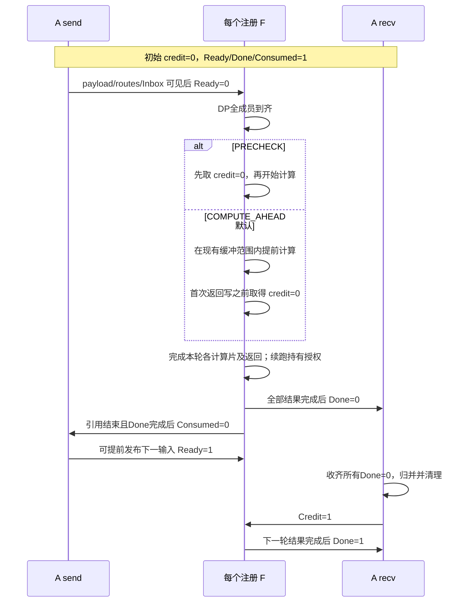

单槽握手时序图：展示同一物理槽连续两次使用的一个合法时序，不表示所有成员的bit必须相同。图中的“每个F”代表各独立实例；A发下一输入前收齐全F Consumed，A发下一credit前收齐全F Done并完成归并。后两件事是两个不同的汇合点。所示下一输入属于同一事务；跨mb/跨MoE事务还须等待Etxn。

### 4.4.3 为什么 0→1→0 不会接受旧消息

原稿反例是 F0 在使用 0 写 Done=0，在使用 1 零 route 不写 Done，使用 2 再次参与时旧 Done=0 被误认。输入 ACK 本身不能修复它。[原稿 L896/L910/L922；作者回复 L36–46]

本协议有四条闭合链：

```text
输入: Ready(n) → inFlight锁定 → 引用结束 → 全F Consumed(n) → Ready(n+1)
返回: Credit(n) → 每F恰好消费一次 → 全F Done(n) → A归并/clear → Credit(n+1)
跨通道: Done(n)写完成 → Consumed(n)写完成 → 下一输入才可发布
复用: 再授权bit=0之前，A必已观察每个F的中间Done=1
```

由返回链，每个 F 的中间 Done 必须覆盖旧值；由输入链，每个 F 的中间 Ready 必须被消费且 ACK；inFlight 防止轮询重复入队。由跨通道链，已确认的旧 Done/Consumed 不允许在后续轮重新到达覆盖新状态。零 route、实际参与集合改变均不改变上述链；多个 TP/CP 成员分别满足，再由 DP 到齐约束合并。

允许某条当前通知任意延迟，结果是等待；不允许“报告远端写完成后旧 DMA 才再次覆盖目的地址”。后者不能由交替位修复，必须由传输完成语义保证。两位状态也不能支持丢包后无界重传、重连、在线重置或跳过零 route 轮；这些能力不在首版范围。

### 4.4.4 写顺序和缓存要求

接口需实现 `publish_data_then_bit`、`wait_local_bit_then_read`、`finish_remote_writes` 三个有明确芯片/CANN 重载的底层原语。不能仅给它们起名字就宣称已实现：

- bit 是对齐 uint32 的原子可观察状态；32B 搬运包含的填充不承载复合提交字段。
- payload/header/routes 的远端可见先于 Ready；结果远端可见先于 Done；Done 的完成先于 Consumed。
- 轮询优先通过正确同步的 GM→UB 搬运读取本地状态；必须处理 MTE2→Scalar 顺序与 UB 重用。若用 scalar GM load，则须按芯片文档处理 DCache 可见性。
- 本地 stream event 只证明其定义的完成范围；不能未经证实推导网络远端落地。PIPE_ALL、DCCI、DSB、CrossCoreSetFlag 各自作用域不同。
- 目标 CANN 重载、数据类型、GM/UB 对齐、搬运粒度、长度上限、远端 completion 定义必须绑定版本做 litmus。§6.3 G1 未过，交替位部署被阻断。

官方 DataCopyPad 文档说明的是搬运接口约束，cache_ctrl 文档说明缓存操作；均不直接证明目标 AF 整条发布链。参考：[DataCopyPad UBToGM](https://www.hiascend.com/document/detail/en/CANNCommunityEdition/910/API/ascendcopapi/docs/en/api/SIMD-API/basic_api/memory_vector_compute/data_move/DataCopyPad_UBToGM.md)、[asc_dcci](https://www.hiascend.com/document/detail/en/CANNCommunityEdition/910/API/ascendcopapi/docs/en/api/SIMD-API/C-API/cache_ctrl/asc_dcci.md)。9.1 文档不能替代未来实际 9.2 或其他安装包的核对。

## 4.5 调度、授权续跑与进度


### 4.5.1 两种策略共用协议和单 workspace

| 阶段 | PRECHECK | COMPUTE_AHEAD（默认） |
| --- | --- | --- |
| 首次选择 | 所有成员 credit 匹配后占用 grant，再进入 Active | DP 齐备可进入 Active，grant 可暂为 NONE |
| 无 credit | 保留 Pending，选择其他兼容候选 | 允许提前计算；首次返回写前等待，独占 Active/workspace |
| Continuation | 验证 HELD owner，直接续跑 | 同左，不再获取新 credit |
| 最后一片 | 完成 Done/Consumed/Completion 后释放 F 本地 owner | 同左 |
| 性能代价 | 可能减少跨轮计算与 A 归并重叠 | credit 等待造成 F 队头阻塞；无额外结果 buffer |

策略是 Context 的启动配置，两者用同一 grant ABI、控制块和容量公式。首版不在一个 Active 中途切换策略。选择多个 DP/mb 聚合时，每个条目保持独立 grant；compute-ahead 在首次结果写之前取得本次 Active 涉及条目的全部授权，避免发送一半后靠隐含状态恢复。部分已取得授权也须明确记为 HELD，不重复消费。

零 route 没有提前计算收益，调度器仅选择已有全部 credit 的 CONTROL 条目，并继续扫描其他条目；控制队列同样受公平性保证。聚合等待有有限超时/调度预算，到期立即选择当前可用子集，不等待 M 个 mb 必齐。

公平性采用配置的有限 `maxDecodeBurst` 和 Pending 到齐年龄：连续 D 服务达到上限且存在 P 候选时服务 P；续跑和零 route 也纳入服务计数。该规则保证有资源且信用最终到达时不会永久饿死，不给有限硬件时延承诺。

### 4.5.2 单 workspace 先算后等的进度证明

考虑 F0 已算通信轮 n，等待它的 credit(n)。若 n 为首次，credit 来自启动初始化；若 n 为后续轮，Ready(n) 已存在说明 A 收齐全 F Consumed(n-1)。保守顺序进一步说明全 F 的结果(n-1)与 Done(n-1)都已完成。

因此 credit(n) 对应的上一返回轮已经具备归并条件，但这**不自动证明 A 的归并任务能获得执行机会**。还必须保证 A 在所有活动物理槽之间公平处理已就绪的轮：不能把 mb1 的上一轮归并排在“收完 mb0 所有轮”之后。多成员、多 DP 聚合时，每个 member 所在 A 都必须满足这个条件。

满足逐槽公平推进后，缺 credit 只等待一个已经全 F Done 的旧轮被 A 读取；一个有限 sweep 会访问它，未就绪槽不会挡住它，不再依赖当前被阻塞的 F 计算。此证明仍要求 recv 不等待整个多轮 send、不在发 credit 前等待未完成的 TP/CP 模型 collective，并且 A 有执行资源。两个 stream 本身不能保证这些条件；默认 compute-ahead 的队头阻塞仍然存在。

反例（Q=4，mb0/mb1 各有独立槽，均两通信轮；同 phase/layer）：F0 先处理 mb0 最后一轮的前4/6行，同时关闭 mb1 的零 route 首轮；其他 F 也关闭 mb1 首轮，A 因而可以发布 mb1 第二轮。F0 下一片包含 mb0 的剩余2行和 mb1 第二轮的有效行，首次返回前等待 mb1 新 credit。如果 A 仍在执行完整 `recv(mb0)`，则形成 `F0等mb1 credit → A尚未执行mb1首轮归并 → A等mb0末轮Done → F0`。零 route 首轮已有启动 credit，故仅修复零 route 调度过滤不能消除此环。

作者提出“未授权候选留 Pending、可绕过”是 PRECHECK 的进度规则，不能提升为所有正确实现的必要条件。默认 compute-ahead 接受队头阻塞；要再绕过已占 workspace 的任务，需额外保存结果/执行状态并重新预算，本版不做。

### 4.5.3 第二层分片与计算例子

一个 DP 轮在 F 上展开 70000 行，Q=Q_alloc=32768、a=1：按稳定专家顺序形成片 32768、32768、4464 行，同一专家可被切开。第一片取得 grant；两次 Continuation 继续持有。前两片只更新 Completion 游标，第三片全部返回后才发每成员 Done/Consumed。输入 payload 与 route 表保留到第三片引用结束。

一个 Active 可聚合多个同 phase/layer、已到齐 DP/mb，合计有效行数≤Q，专家padding后的物理行数≤Q_alloc。选择 DP 作为调度实体不等于要求一次计算完其所有专家；它要求首次选择前所有成员齐备，并把剩余游标保存在该 DP 条目内。

## 4.6 A 侧执行图、microbatch 与槽复用


### 4.6.1 Decode M=2/3 的真实可达发布图

首版保守 Decode 快路径限定每 mb 一个通信轮（B≤C_m），每 mb 有独立槽，进入本层前各槽上次事务已结束。`Eattn_j` 表示 mb j 的 Attention、route 和必要 TP/CP 数据准备完成；`Epub_j` 只表示发布完成；`Erecv_j` 表示归并加最终 ACK 的本地 recv kernel 完成；`Etxn_j=join(Epub_j,Erecv_j)` 表示事务整体完成。本节 recv 已等最后 Epub，因此 Erecv 同时满足 join，但接口仍保留显式 Etxn。

```text
M=2
compute: Attn0 → Eattn0 → Attn1 → Eattn1
send:    wait Eattn0 → publish0 → Epub0 → wait Eattn1 → publish1 → Epub1
recv:    wait Epub1 → recv0 → finalACK0 → Erecv0 → recv1 → finalACK1 → Erecv1

M=3
compute: Attn0 → Eattn0 → Attn1 → Eattn1 → Attn2 → Eattn2
send:    wait Eattn0 → publish0 → Epub0 → wait Eattn1 → publish1 → Epub1
         → wait Eattn2 → publish2 → Epub2
recv:    wait Epub2 → recv0 → finalACK0 → Erecv0
         → recv1 → finalACK1 → Erecv1 → recv2 → finalACK2 → Erecv2
```

send 不等最后 Consumed，因此即使 F 尚未执行 mb0，也能实际发布 mb1/mb2，F 可观察同 DP 同层多个 mb。F 可早处理已齐的任意子集，不能等待凑满 M 才服务。每个 mb 有独立 ATask/mask/output/event；下一层该 mb 等自己的 Etxn，TP/CP collective 按所有成员一致的固定顺序执行。

该保守路径无需让长期等待的 recv 抢占资源阻塞最后一个发布；代价是最早结果归并延后到所有 mb 发布完成。若要更早 recv 与后续 Attention 并行，必须另过 AIV 共存门禁。图 capture 必须固化这些 event 依赖，而不是依赖 host 恰好下发得快。

### 4.6.2 P 或 D 多通信轮与事务完成

多轮不能使用“recv 等最后 Epub”。send 可能在内部等上一 ACK，而 F 可能等 A 归并后 credit；recv 必须在第一个 Ledger 可见后即可逐轮消费，独立于 send 整体返回。

```text
send: publish round0 → wait allACK0 → publish round1 → ... → Epub_final
recv: wait Ledger0 → allDone0 → reduce/clear → credit1
      → wait Ledger1 → allDone1 → reduce/clear → credit2 → ... → finalACK
```

多轮 recv 返回后，框架在回收流以 `wait(Epub_final) → wait(Erecv) → record(Etxn)` 汇合。不能把 wait(Epub_final) 移到 recv kernel 前，否则重建等待环。最终远端 ACK 也不证明本地 send kernel 的尾部、send_status 写入或退出已经完成。

**多个本地槽与多通信轮同时存在时，使用同一个 combineRecv 的 round-step 模式。** 单个调用最多归并本槽一个已就绪轮；Ledger、全 F Done 或最终 Consumed 未齐均返回“仍在推进”，不在该槽自旋。A 在独立 recv stream 上固定轮转全部活动槽，每轮转一遍称为一个 sweep，重复直到所有事务完成或域超时。只增加每槽96B进度元数据（TaskInfo快照、next_round和最终输入位等），共享原单份recv scratch；没有第二份hidden结果或完整事务缓存。

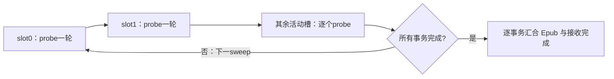

每个 probe 若未就绪就跳过，若就绪则复用原归并流水，读完该轮后发布 credit、释放 Ledger。最后 ACK 未齐时也跳过，不能把阻塞从 Done 等待搬到 ACK 等待。调用者必须持续服务所有活动槽，不能通过一次 probe 的kernel退出就释放事务。图中一次 capture 可包含固定槽序的一个 sweep；首次 start 与后续 sweep 分离，replay不重置进度，单次graph不承诺全部事务完成。每槽 routing/mask/output/TaskInfo 地址保持稳定至Etxn。

兼容的全事务阻塞模式仅准入“本A只有一个已注册槽，可多轮”或“本A多个槽，但每事务只有一轮”。当前DeepEP host初始化冻结 `return_progress_mode`，send和recv都校验准入，多槽多轮必须显式选择round-step并接受公平驱动契约。P单槽跨mb复用和D单轮M=2/3保留；不能靠关闭默认compute-ahead掩盖不安全的接收排队方式。

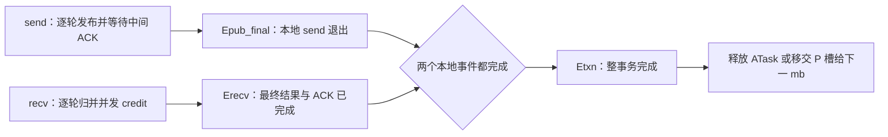

事务完成汇合图：这是完成条件的join图，send和recv在进入join前仍通过Ready/Done/credit/ACK协作。没有从Epub_final指向recv入口的边，避免把多轮执行错误地变成先发完再接收。

P 单槽跨 mb 的移交在上一 mb 的 Etxn 完成后；不能只看 Epub 或 Erecv。输入窗口每轮覆盖需要全 F Consumed；返回窗口每轮覆盖需要新 credit；普通 HBM 完整输入输出生命周期由整事务持有。两种窗口的释放条件不同，但保守 Done→Consumed 使它们的跨轮依赖有界。

当前 dispatch_send 与 combine_recv tiling 都申请全部 AIV。[B4] 目标需分配可共存的核配额或提供等价已证明的分段执行方式；在实机证明以前，多轮并发是阻断项。不能通过无条件启动两个全核等待 kernel 宣称死锁已解决。

### 4.6.3 发布、输入释放、接收与事务完成的区别

| 状态 | 能做什么 | 仍不能做什么 |
| --- | --- | --- |
| send_status=PUBLISHED | 发送流发布其他独立 mb 槽 | 释放 ATask、把该槽给下一事务 |
| 全 F Consumed | 覆盖本通信轮输入/Inbox，发布同事务下一轮 | 覆盖尚未取得 credit 的返回区 |
| recv_status=RESULTS_AND_ACK_COMPLETE | 归并与最终 ACK 完成；等待本地 send/recv 事件 join | 不能单独释放仍可能被 send 尾部访问的 ATask |
| Etxn / TRANSACTION_COMPLETE | 本地 send、recv 均退出；下一 MoE 事务可开始 | 不经检查重置交替位或重连旧通信域 |

输入位唯一由 send 在下一次使用时推进；recv 的最终 ACK 等待只读，不翻位。send 下一次仍检查旧 ACK，不能把上次 send_status 当作该检查的替代。

# 第五部分：后端接口、代码改造与资源预算

共同协议通过以下 API 落到后端。先定义公共输入输出和完成点，再分别说明 MegaMoE、DeepEP-AFD 与 MTE 的改造边界，最后汇总目标窗口、workspace 和实际通信量。

## 5.1 公共逻辑 API 与完成契约

以下为语义 ABI，具体绑定参数可合并成 device descriptor；不得省略字段的含义和所有权。

```text
dispatch_send(Context, ATask, SlotSendState, RoundLedger)
  ATask: mb/layer/B、input、expertIds、routingWeights、mask、tokenMap
  输出: send_status=PUBLISHED（所有本次发布DMA已完成，不等最终ACK）

dispatch_recv(Context, SchedulerState, Pending, Completion, Active, ExecutionState)
  先应用Completion；吸收Ready；DP全成员核对；按Q选片；最后发布Active.valid

gather / GMM1 / activation_quant / GMM2(Context, Active, ExecutionState, Workspace)
  全部是显式gate-aware入口；读取相同不可变Active；输出当前计算片

combine_send(Context, Active, ExecutionState, Workspace)
  首次写前取得或验证grant；所有本片结果写完成；不回收Pending

ffn_commit(Context, Active, ExecutionState, Completion)
  终结条目: 结果写完成→Done完成→输入引用结束→Consumed完成
  非终结条目: 仅提交游标和HELD；最后发布Completion.READY

combine_recv(Context, ATask, SlotRecvState, RoundLedger, output)
  全事务模式按轮等待；round-step模式仅probe当前轮，未就绪立即结束本次调用
  就绪轮全F Done→归并/clear→发布下一credit→释放Ledger
  最终Consumed所需位在回收Ledger前复制到SlotRecvState；step模式未齐仍返回
  全部轮与最终ACK完成才输出recv_status=RESULTS_AND_ACK_COMPLETE

mega_execute(Context, Active, ExecutionState, LayerTable, Workspace)
  取代gather至combine的主体，遵守同一grant/commit契约；保留wave
```

框架在本地发布事件 Epub_final 与 recv 完成事件 Erecv 都完成后产生 Etxn，并置事务状态 TRANSACTION_COMPLETE。ATask、输入、mask、routingWeights、tokenMap 及输出存储至少保留到 Etxn；send 或 recv 单独返回均不得触发框架释放。F 不需要远端读取 A 普通 HBM 的 tokenMap，返回 roundLocalToken 由 A Ledger 转真实输出位置。

### 5.1.1 小算子后端统一接口与框架边界

**设计决定：DeepEP-AFD 与 MoeDistribute V2 A5 MTE 对 AFD 框架提供同一套五算子接口和完成语义。** 初版先实现 DeepEP-AFD，MTE 后续实现同一契约；这不是两个上游接口天然兼容，也不表示当前已具备可互换的实现。

对外算子统一命名为 `dispatchSend`、`dispatchRecv`、`combineSend`、`combineRecv`、`ffnScheduler`。上方语义 ABI 表示职责分解，不要求逐项暴露为框架算子：其中调度职责从原逻辑 `dispatch_recv` 拆到 `ffnScheduler`，数据接收/展开由 `dispatchRecv` 承担，`ffn_commit` 作为 `combineSend` 的末尾阶段执行。框架不再单独调用第六个 commit 算子。具体参数、shape、dtype 和上游映射以独立的[五算子详细设计](a5_async_afd_deepep_operator_design.md)为准。

| 公共算子 | 两种小算子实现必须保持一致的职责与完成含义 |
| --- | --- |
| dispatchSend | 发布一个 MoE 事务，内部按通信轮推进；完成表示最终轮发布及相关发送完成，不表示最终输入 ACK 已到或槽可复用 |
| ffnScheduler | 应用上次 Completion，收集 DP 全成员发布，选择计算片或 CONTROL/NOP/ABORT；不承担 payload 展开 |
| dispatchRecv | 按同一 Active 展开当前计算片，产出约定的专家输入布局、有效/物理行数和回源 metadata；不提前释放整轮输入 |
| combineSend | 按统一授权规则逐 route 返回；完成本片发送后提交 Completion，终结条目执行 Done→输入引用结束→Consumed；零 route 也执行控制闭合 |
| combineRecv | 按 Ledger 等待全 F Done、归并真实输出并释放返回窗口，最终等待输入 ACK；与 send 的本地完成汇合后才形成 Etxn |

统一契约还包括 mask/inactive 输出、量化格式、专家 padding、错误处理、device gate、状态所有权和数值容差。仅函数名和参数类型一致不足以互换。某后端未通过对应 dtype、shape 或图模式准入时，初始化必须明确拒绝该配置，不能静默改变语义。内部通信 record 可以不同，但框架可见的张量布局和语义必须一致；若必须转换，转换及其内存、时延成本由后端适配层承担并纳入预算。

```text
AFD 调度 / 模型执行
    │ 统一五算子调用、张量契约和完成事件
    ▼
AFD 后端适配层：能力检查、资源查询/创建、二进制选择与加载、销毁
    ├── DeepEP-AFD：URMA 队列、注册内存、drain、UBMEM 控制
    └── MTE-AFD：MTE 窗口、搬运及对应完成原语
```

框架的调度和模型执行路径不编写按通信实现分支的逻辑。部署配置和初始化适配层仍需知道所选后端：它们负责选择实现、查询并分配各类 workspace、创建通信资源、预热和销毁。资源大小通过统一查询契约返回，不能让框架按上游内部布局自行计算；backend 在 Context 创建时固定，不允许在途事务切换。MegaMoE 继续使用融合执行主体，本节不要求把 wave 强行拆成五个小算子。

**命名分层**：公共算子名称和框架语义统一；后端内部参数、模板参数、结构及局部变量尽量沿用各自上游命名。DeepEP 实现保留 `x`、`sf`、`topk_idx`、`num_tokens`、`jetty_ptrs` 等原有命名逻辑，新增 AFD 字段保持相同风格；明确改义的字段须在详细设计中标注，不能因同名就视为可直接传给原生 kernel。

### 5.1.2 统一交付契约与 DeepJIT 的部署边界

两种小算子实现可以提供相同安装入口、算子注册接口、资源管理接口和版本/能力查询方式。**统一交付契约不等于二进制内容、通信依赖或 workspace 大小相同。** 交付件至少应涵盖以下职责，具体文件组织由实现工程确定：

| 交付内容 | 共同要求 | 允许的后端差异 |
| --- | --- | --- |
| 框架绑定与 launcher | 同一五算子接口、明确参数 ABI、stream 与完成契约 | 底层 kernel 符号、内部参数打包和启动序列 |
| 设备二进制及变体清单 | 标明芯片、工具链/运行时兼容范围、ABI 版本、dtype、容量及模板特化配置 | 二进制数量、内部模板和搬运实现 |
| 资源管理与依赖说明 | 初始化前检查能力，统一查询资源需求，在途访问结束后销毁 | URMA/HCOMM/UBMEM 资源或 MTE 相关窗口及运行依赖 |
| 验收证据 | 同一功能、完成语义、精度、资源和图模式测试契约 | 性能结果与已准入配置范围 |

DeepJIT 属于编译、缓存、加载和启动适配，不是 AF 通信协议。初版可沿用上游 DeepJIT，并在服务启动及图捕获前准备所需内核；框架公共接口不因此增加 DeepJIT 参数。后续可以改为预编译设备二进制加自有 launcher，使部署运行时不依赖 DeepJIT，但需完整接替二进制加载、函数查找、参数 ABI 打包、特化版本选择、stream/block/动态 UB 配置及句柄生命周期管理。

只交付一个 `.o` 文件不足以构成可直接接入框架的算子。交付的必须是兼容目标运行时、可加载的设备二进制，而非仅未链接的中间目标文件；还需匹配的 launcher、资源初始化和配置清单。即使移除 DeepJIT，CANN Runtime 及实际使用的通信组件依赖仍然保留。具体二进制格式和加载 API 随锁定的工具链版本验证，不把某一版本的文件后缀当成跨版本兼容保证。

## 5.2 MegaMoE AFD：远端 read / write，保留 wave

源码 arch35 MegaMoE 的源计数与 peer 布局含 epWorldSize 假设；wave 交织 GMM1、GMM2 和 combine，AIC/AIV 角色要求相同调用次序。[B5] 目标保留主要量化/GMM、wave 切换、activation/GMM2 workspace 分区与本地同步；改变来源索引、route 选择、层地址和授权边界。

1. A publish 量化源行及紧凑 route 视图；F 依据 Active 的 sourceLane/read ref 定位，不用专家 EP rank 代替 A 来源。
2. 用 Active 构造本片专家 group list / source prefix / row descriptor。只覆盖本片涉及的 Q 行；原专家计数等待改读已经由 DP 调度确认的稳定片描述，不等待未选 A 源。
3. device 层表返回本层 W13/W2、scale 等地址；shape、dtype、量化方式、布局和 tiling 家族必须与本次 graph/kernel 相容。跨形状层分不同执行家族，不以一个地址表掩盖 shape 不兼容。
4. 第一笔远端 combine write 前调用共同 grant gate。等待时沿原 wave 依赖反压，禁止计算核覆盖尚未发出的输出 buffer；不能仅让发送核自旋而取消缓冲归还依赖。
5. 本片结束提交游标；最后片确认全部 wave 返回及读引用结束后执行公共 commit。CONTROL 和 invalid 必须在 wave flag 初始化/等待前统一分支。

提前计算量由现有 wave 缓冲深度决定，不增加第二份 Q×H 输出。需要新增 sourceLane 数相关 prefix/row 描述，但不能把原所有 epWorldSize 一概替换为 L：专家规模仍是 N_F，源规模才是 L。无 F 间集合 barrier，不照搬 DeepGEMM rank barrier。

## 5.3 DeepEP-AFD：四段拆分、传输完成与有界工作区

选型和原生边界见 §2.7.1；本节只定义目标改造。D0 原生环境通过之后仍须通过非对称拆分与协议验证，实施门槛见 §6.2。

### 5.3.1 拆分同步：保留 drain，移除全组汇合

URMA 的工作请求称 WQE，完成记录称 CQE，提交/完成队列为 SQ/CQ；jetty 是源码封装的通信队列端点。原 `comm::scalar::barrier` 先处理 MTE stores 和本地核同步，按条件执行 jetty drain，然后向所有 rank 更新 barrier signal 并等待全组。直接删除此调用会同时丢失传输完成保证。[B10]

AFD 适配定义三个独立动作：

1. `issue_payload`：写 WQE/SGE，完成本地描述可见性、推进 SQ 并敲 doorbell。它只发起传输，不提交 Ready/Done。
2. `finish_issued_writes`：确保每条已用发送队列的最后请求具有正确的强序/fence/CQE 语义，再等待覆盖这些请求的 CQE，检查错误。复用 `HcommJetty::drain`/`poll_cq` 的机制，但必须保留它所依赖的完成请求生成逻辑；不能在没有 completion-producing WQE 的情况下调用空 drain 后当成完成。
3. `publish_af_control`：在数据远端可见条件成立后，由唯一控制 writer 写消费者本地的 32B Ready/Done/Consumed；首版使用已注册 UBMEM 地址的写路径，仍执行 §4.4.4 的发布与缓存契约，不用远端 atomic 加总计数代替交替位。

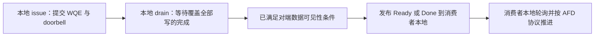

DeepEP 发布依赖图：没有全rank逐操作barrier，但保留传输完成依赖。drain到远端可见性这一箭头必须由G1-D验证；它不是“出现CQE就无条件成立”的既定平台事实。

首版一个进程的该后端采用单一发送提交所有者：A 的 send 串行提交本地各槽；F 的 combine 随单 Active 串行提交；A recv 的 credit 控制使用独立控制地址/路径，不并发修改 payload jetty 的 SQ/CQ。某些队列由多 AIV 协作填 WQE 时沿用原核内/核间生产者协议，禁止两个 graph replay 共用同一队列游标。

底层 SQ head、CQ tail、owner phase 等计数必须保留，这是传输层队列状态；取消的是 AF 槽协议 generation，不是要求删除可靠传输内部计数。通信域初始化/销毁可以全域协调，但数据面不再按每个 dispatch/combine 做全 rank barrier。

CQE 是否保证对端内存可见、以及 URMA 完成后跨 UBMEM 发布 Ready 的顺序能否成立，是新增 G1-D 门禁，当前源码调用不能代替厂商语义和实机 litmus。无法证明时该后端不得发布 Ready/Done；不能以延时等待补齐。

### 5.3.2 A/F 地址和四段接口

注册表新增 `TransportContext`：物理 rank→角色、远端注册基址/长度/访问凭据、A→F 与 F→A 通道、每发送队列 owner、SQ/CQ 资源、持久 metadata 源区、受控的传输超时。专家映射只按 F 集合计算，不能继续使用 `expertId/(E/(N_A+N_F))`。这里 N_A 为物理 A 成员数；L 仍是全部源槽数。

首版保留两侧注册机制的机会，但不为满足对称 EP allocator 在每张卡复制整套 A/F 大窗口。对称小控制区可以保留；payload/返回按角色分配，SGE 目的地址由显式 lane 分区计算。若实际 HCOMM/UBMEM context 只能提供不满足预算的对称大窗口，列为 G2-D 阻断，不把额外分配藏在 runtime 内。

| API | 适配后的职责与完成条件 |
| --- | --- |
| `dep_afd_dispatch_send` | A 本地校验/量化适配、rank 去重及紧凑定位；写各 F 本 lane record/routes/Inbox；完成所有相关发送队列 drain 后发 Ready；返回 PUBLISHED，不等最终输入 ACK |
| `dep_afd_dispatch_recv` | 使用共同 scheduler 的 Active；仅从选中 lane/专家区间 gather 本片，输出专家连续 Q 行及稳定 RowMap；不等未选 DP 或其他 F |
| `dep_afd_combine_send` | 等/验证 Active grant；从注册的唯一 GMM2 输出区发逐 route 结果；本片全部队列 drain 后允许 workspace 回收；最后一片交公共 commit 发 Done/Consumed |
| `dep_afd_combine_recv` | A 按 Ledger 等全 F Done，使用 A 自有 routingWeights 做 top-k 归并，inactive=0，清理需要的内部状态并发 credit；按 §4.6 汇合 Etxn |

ATask及其输入、mask、routingWeights仍保留到Etxn；传输专用metadata staging在覆盖全部网络读取的drain完成且本地send不再访问之后可回收，首版以Epub为该回收事件。同一A的串行send可复用这份staging，不能仅凭原issue kernel的Python event回收。当前上游host lambda特意捕获x和metadata，因为issue退出后网络还在读；目标把这层所有权变成显式的SlotSendState/TransportContext。[B9]

本版将 drain 收入 A dispatch_send 的发布完成边界，所以 Epub 表示“传输完成且 Ready 已发布”，不再使用原 issue 返回事件冒充 Epub。代价是同一 A send 流的后续 mb 可能等前一轮网络 drain；仍无需等 F 计算或最终 ACK，故 M=2/3 发布可达性保留。将来若拆成 issue+publish 双节点优化该重叠，必须增加持久 in-flight 描述并重新验证，不属于首版。

原生cached dispatch handle不跨AFD事务直接复用：同shape、同slot并不证明expertIds、prefix或dst_slot相同。首版每次输入重建本轮路由，Continuation只使用该轮持久描述；可以缓存JIT二进制和静态Context，不能把编译缓存与动态route缓存混为一谈。JIT按dtype/shape/核数家族在正式服务和capture前完成，mb/layer动态值不触发host编译或CPU counts读取。

### 5.3.3 Record、Q 分片与 tiling

首版沿用 §4.2 的小算子公共语义与保守物理 stride：示例 FP8 dispatch 槽 7680B，返回槽 15360B。传输编解码允许复用 DeepEP TokenLayout 的 hidden、scale、int64 topk、weight 字段访问，但 native `src_token_global_idx` 改为本 lane 的 roundLocalToken，不能继续用 `rank*C+token` 混合来源身份。lane 由固定分区给出；validTopkMask 为显式字段，不能靠陈旧 expertIds 推断。

K=8、H=7168、scale=224B 时，原生 metadata 对齐为128B，FP8 record 为7520B；AFD 可以在 7680B 预算槽内组织该数据和头字段。这里明确不宣称 byte-for-byte 兼容 native epilogue；必须由 `AFDRecordLayout` 统一给出字段 offset/stride，并让 send/gather 同用，不能一侧用 native get_num_bytes、另一侧用7680。首版仍按完整7680B record预算/发送，紧凑7520B是后续优化。

锁定 DeepEP-AFD record offset：令 X 为一个 token 的 hidden 字节数、S 为实际 scale 字节数（无scale时为0），要求X为32B倍数。hidden在0，scale在X；expertIds的offset为`O=X+align32(S)`，占`align32(8K)`；weights紧随其后占4K；roundLocalToken再占4B，validTopkMask再占4B（本后端K≤32）。recordStride为`align512(O+align32(8K)+4K+8)`，余下字节写零。示例offset依次为0、7168、7392、7456、7488、7492，stride=7680；返回首2H字节为未加权BF16结果。该布局是明确的新ABI，上游TokenLayout访问器只有offset一致的字段可复用。

FP8输入及scale必须由A侧按选定GMM量化契约产生；DeepEP通信本身不替代模型量化。FP8 dtype、scale分组/类型/排列须在Context中冻结，必要的转换kernel及缓冲纳入时延/峰值，不允许把INT8 W4A8与FP8格式混用。原生环境测试包含BF16，但若目标dispatch也改BF16，则X=2H、S=0，本例recordStride=14848B，需重新预算，不能继续宣称7680B的FP8窗口成本。

首版 DeepEP-AFD 使用 ENABLE 目的 rank 去重，P/D 都可使用；公共 DISABLE 布局保留给 MTE，DeepEP-AFD 若配置 DISABLE 则显式拒绝，直到实现并验证每 route 单有效位分支。D 多槽、同 DP 多 mb 聚合不依赖 DISABLE，三类业务场景不受此范围限制。K 首版≤32，R≤512；其余编译约束由实际 UB/线程配置校验，不能把 K≤32 或 R≤512 外推成所有后端的共同限制。

发送端原 `DispatchUBLayout` 含每核 token×K 的目的索引、SGE 映射等数组，容量随 C_m/核数增长；原生能测16k并不证明32k低核配额也合法。[B11] AFD 选固定 token tile T_d，使 `sizeof(RouteTile(T_d,K,E,N_F))+metadataStages+hiddenStages≤实际UB`。不能为“支持32k”强制占满全部 AIV，破坏 §4.6 的 send/recv 进度。

采用两遍本地准备：按 tile 复用 rank 去重/histogram，HBM 保存 tile counts；前缀计算各 F record/各专家 route 区间；第二遍填 record/route 和有限 WQE 批次，完成批次 drain 后回收 staging。复杂度 O(C_m×K)，UB 不随总 B 增长。能在目标 C_m/核配额下通过原 UB 检查的配置可先复用原准备核，但仍必须去掉原 remote counts 汇合。

接收侧不再执行原“整轮 expanded output”的 host 分配。Pending 持有每专家区间和消费游标，Active 给出当前最多 Q 行，改造 copy_epilogue 的搬运/scale 整理循环按 Active gather。`RowMap[q]=(lane,recordIndex,topkSlot,expertId)`，每行固定4个uint32、占16Q字节，保留到 combine drain 完成；不得只保存原 EP handle 期待它区分同槽不同轮。

若 GMM 需要每专家按 a 行对齐，令 `Q_alloc` 为物理 workspace 行预算，调度需满足 `Σ_e align_a(selectedRows_e)≤Q_alloc`；本文 Q 的无 padding 示例取 a=1，启用 padding 时必须改用 Q_alloc 算内存。padding 行置零、RowMap 无效，不发送结果也不增加 route 消费游标。不能在 Q 行之外无预算追加 R×(a−1) 行。

当前上游 dispatch host 在 `do_cpu_sync=False` 时仍按 `num_ranks*C*min(K,R)` 外加 padding 申请完整展开张量。目标改造预分配固定 Q_alloc 的 device workspace，不在每轮做 CPU counts 等待、tensor 动态分配或 `.item()`。[B9] DeepEP 不含本文所需的 GMM 和 device 选层实现，继续接共同的 gated GMM/activation 链。

### 5.3.4 Combine：逐 route 返回及 workspace 生命周期

原生 combine 将同 token 在本 F 的多个专家结果先局部归并，返回 rank partial；其 reduce_epilogue 也按目的 rank 去重。目标若直接保留，会遇到同 token 专家结果跨 Q 片的问题，同时改变浮点归并顺序。[B12]

首版选择逐 route 返回：每一有效 RowMap 恰好生成一次返回 write，地址为 `A.returnBase[lane]+(token*K+topkSlot)*returnStride`。网络写实际有效 BF16 H 维，A 返回槽剩余 padding 不参与归并；不要用原 rank slot/subslot 公式寻址。F 不做 routingWeights 乘法，A 按原 top-k 槽顺序只乘一次；专家 executor 若带融合权重，必须在适配时关闭或另定互斥模式，不能双乘。

因此复用的是 DeepEP 的传输请求构造、doorbell、完成轮询与局部搬运，而不是不加修改调用原 combine/reduce_epilogue。传输总量按 K route，不宣称原生 rank partial combine 的带宽收益仍保留。通信窗与 v3 逐 route 预算相同，不增加全轮 rank 累加区。

GMM2 的唯一输出 workspace 必须本身可作持久注册的 URMA 源；优先在初始化时从可注册内存分配输出张量。combine 每片先取得信用，再提交 payload，等待覆盖本片所有写的完成，最后才能提交 Completion 并覆盖 GMM2 输出。不能在 issue 返回后就调度下一片，也不能隐含再分配 Q×H 的发送镜像。若 runtime 无法直接注册/访问该输出区，零额外结果副本目标被阻断，必须显式增加 staging 预算再评审。

后续 rank partial 优化只有两条清楚的路径：按 token 打包其本 F 全部专家结果到同一片，并要求最大一组行数≤Q_alloc，改变当前专家切片选择；或维护跨片 partial 累加和完成计数，增加内存与数值验收。两者都不能作为“原生 combine 免费复用”混入首版。

### 5.3.5 容量、流量与资源清单

首版每 A 物理槽返回预留仍 `C_m*K*15360`；每 F 输入预留为 `Σ_lane C_m*7680`，全部去重。32k/256k/1M 仍只改变通信轮数，DeepEP 不获准按真实 B 扩大 native EPBuffer。P 单槽、D 多槽及小返回窗口原样保留。

在 §5.5 的8A/8F示例中，P 主要通信预留仍45GiB全域；D 128 token、M=2为360MiB全域；4P+4D均去重为22.675781GiB全域。7520B wire record 或 rank partial 优化的收益未提前从预算中扣除。

DeepEP 额外资源必须单列，不能拿上游 `calculate_buffer_size=max(dispatch,combine)` 的数字直接替代 AFD 的并存分区：

| 项目 | 生命周期 / 上限 | 预算处理 |
| --- | --- | --- |
| SQ/CQ、jetty/peer 信息、注册与库 runtime | Context 常驻 | 记为 W_transport，记录队列数/深度/entry stride及运行时实测HBM；不得与payload混算或省略 |
| A metadata 源区 | 每个正在发布的通信轮，所有网络读结束前稳定 | 至多C_m×metadataStride，不随真实B增长；原生scale布局决定实际字节 |
| tile counts / prefix | 单发送准备任务 | 与ceil(C_m/T_d)、N_F、E有关；明确分配峰值并可复用 |
| RowMap | 每 F 当前物理计算片 | 16×Q_alloc，Q=32768时0.5MiB；若与已有等价row descriptor别名，须证明字段/生命周期等价 |
| GMM输出 / gather / scale转换 | 单 Active | 沿用小算子峰值，URMA drain 前禁止覆盖；scale transpose若必要也计入峰值 |

W_transport 受实际设备通道配置影响，当前不虚构固定数字。部署验收必须满足“主窗口公式+显式metadata+计算峰值+W_transport”总预算；若队列/对称注册额外成本超出目标剩余HBM，则保留MTE，不能因为主payload公式相同就称已满足预算。

## 5.4 MoeDistribute V2 A5 MTE：独立收发与大 BS 路由

选择明确限定 A5 arch35、V2、MTE 路径；源码空 comm_alg 默认 fullmesh_v1，不能混用 fullmesh_v2 的 CCU 分支或 A3 约束。[B6] 原发送 record、量化/DMA、combine 归并机制可复用，但独立 A/F 拓扑、四算子拆分、紧凑 rank 接收寻址都是新增。

大 BS 路由准备采用固定 tile 大小 T（token 数），由 UB 可用量与所选重载决定，不随 B 增大：

1. 分 tile 扫描 token、K 个专家与 mask，构建目的 rank 去重位图及专家计数；把 tile counts 写普通 HBM 暂存。
2. 在 HBM counts 上做 rank / expert / tile 前缀，得到每 tile 不冲突的 record 和 route 输出区间。整数前缀范围须容纳 C_m×K。
3. 再扫每 tile，按 ENABLE/DISABLE 规则生成 record 和 routeReference；使用第 2 步前缀，不逐 route 从 token0 重扫。
4. dispatch_send 将各 rank 紧凑 record 与 routes 写到其源 lane 分区，最后发布 Inbox/Ready。dispatch_recv 只 gather 当前 Active 切片到专家连续 workspace。
5. GMM1、activation/quant、GMM2 使用同层地址；combine_send 依据原 top-k 位置写 A 返回区；commit 负责完整通信轮结束通知。

两遍扫描是 O(C_m×K) 主工作量，另有 tile prefix；UB 大小为 O(T×K)，HBM 计数暂存随 tile 数增长并纳入预算。源内所有字节 offset 用 u64；复制长度、stride、repeat 字段逐项校验，不靠把 B 改大绕过接口宽度限制。

原 kernel 将整个 BS×K 路由表放 UB，部分前缀回扫、固定专家跨度接收仍按原布局；host BS_UPPER_BOUND=512。[B6] 因此不能仅放宽 host 检查。新模式统一采用 rank 紧凑 record；DISABLE 安全容量 C_m×min(K,R)，ENABLE 为 C_m，依赖专家 ID 互异。route 表在两模式均最多 C_m×min(K,R) 项。

## 5.5 三场景、TP/CP 与资源预算

原生完整 BS 预留的比较已在 §2.2–§2.5 展开。以下仅计算目标 AFD 的有限窗口；同一个 32k 参数在两者中的角色不能混用。

### 5.5.1 口径与示例常量

以下为预算算例，不是所有量化模式通用 stride：H=7168、K=8、R=8、N_F=8；P 的成员容量 C=32768；D 的成员容量 128、M=2；专家中间维 I=2048（SwiGLU 后）；默认 Q=Q_alloc=32768，以下workspace数值不含额外专家padding；若启用padding，按Q_alloc和实际布局重算。k 在本节均按 1024，1M=1048576 token。

MegaMoE 输入量化行 `q=align32(align256(H)+2×ceil(H/64))=7392B`；返回每 route `o=2H=14336B`。Distribute 示例 dispatch record `d=align512(7168+224+32+32+32+32)=7680B`，各项依次为量化数据、scale、header、expertIds、ordinal、可选权重段；return record `r=ceil(2H/480)×512=15360B`。未启用字段的空间可保留，删除字段不一定降低对齐后 stride。

### 5.5.2 目标固定窗口

| 后端 | 每个 A 物理槽主要通信预留 | 每个 F 的输入预留 |
| --- | --- | --- |
| MegaMoE | C_m×(q+K×o) | 不复制全部 payload；仅 Inbox/routes/控制 |
| Distribute ENABLE | C_m×K×r（A 返回） | Σ_lane C_m×d |
| DeepEP-AFD ENABLE | C_m×K×r（首版沿用返回槽预算） | Σ_lane C_m×d（示例同为7680B，但record字段布局独立） |
| Distribute DISABLE | C_m×K×r（A 返回） | Σ_lane C_m×min(K,R)×d |

上述不含 metadata、通信 runtime 必要公共区、对齐和计算 workspace。P 只有一个物理槽，故 B 从 32k 增到 256k、1M 时窗口不变，通信轮分别为 1、8、32；D M 个槽按 M 倍预留，不能把逻辑 mb 数乘进 P payload。

| 部署例子 | MegaMoE主要通信预留 | DeepEP-AFD主要通信预留 | MTE主要通信预留 |
| --- | --- | --- | --- |
| 8个P A、8F，每A为独立DP | 每A 3.725586GiB；全域29.804688GiB | ENABLE：每A 3.75GiB、每F 1.875GiB；全域45GiB | ENABLE同左 |
| 8个D A、8F，128 token、M=2 | 每A 29.804688MiB；全域238.4375MiB | ENABLE：每A 30MiB、每F 15MiB；全域360MiB | ENABLE同左；DISABLE每F 120MiB、全域1200MiB |
| 4个P A、4个D A、8F | 按各A槽公式求和 | P/D均ENABLE：每F 967.5MiB；全域22.675781GiB | P ENABLE/D DISABLE：每F 1020MiB；全域23.085938GiB；均ENABLE则与DeepEP主窗口相同 |

表内只比较主要通信窗口，不能据此宣称总HBM一样。DeepEP-AFD首版仅支持ENABLE，不能套用MTE的D DISABLE配置；其额外W_transport、metadata与RowMap见§5.3.5。相同7680B stride也不表示两种record字段可以混读。MTE混合例的去重模式按phase冻结。

TP/CP 主例：同一 P DP 有两个发送不相交token的 owner，每rank maxBS=B_m=262144、C_m=32768，共8个通信轮；每轮DP合计65536。每 A Mega输入+返回仍为3.725586GiB、小算子返回3.75GiB；每 F 为这两个来源预留输入480MiB（单owner为240MiB），route refs等另计。若K=8且全部route集中同一F，每轮524288专家行，Q=Q_alloc=32768且a=1时分16片，workspace不随DP聚合扩大。

四个P物理A仅重组为两个DP而不改变槽容量时，前表每F输入不变；DP分组不减少注册来源。只有显式将每rank窗口改为16384时，各A窗口才减半，四P加四D的MTE P ENABLE/D DISABLE示例才降至每F540MiB，同时每rank256k事务改为16轮。这是可选窗口配置，不是TP/CP约束。

metadata 必须另加：四种控制共 `4×32×N_F×Σ_member(slotCount)` 字节；F Inbox header 为 `64×L`；counts/prefix 约 `4×(2R+1)×L`；route refs 最多 `4×Σ_lane C_m×min(K,R)` 每 F。Pending 为 O(L×R+L) 字段，Active/Completion及按物理行保存的描述总量按 O(Q_alloc+L) 预算，A Ledger 为每 lane 两项及必要 tokenMap 引用，不复制真实 B×H。

单卡求和口径：A返回预留为 `Σ_本A物理槽 C_lane*K*r`；F输入预留为 `Σ_全部已注册来源槽 C_lane*d`（ENABLE），包含暂时无任务或零长度来源。DP本轮逻辑聚合只取每成员当前槽，不等于F注册全部D槽的预留。普通HBM完整输入输出按各rank的B_cap或实际分配行数计算。所有总和、字节乘积和轮次地址先用uint64，落入ABI的uint32/int32前检查范围，不因取消DP上限而放宽索引或DMA限制。

### 5.5.3 单计算 workspace

Mega 主数据近似（无padding时）`Q×(H+2ceil(H/64)+I+2ceil(I/64)+32+2H)`；本例每行 23872B，Q=32768 为 746MiB，Q=262144 为 5968MiB。另加 row descriptor `Q×align32((2+3K)×4)`，分别 4/32MiB；示例 wave flags `2R×ceil(Q/256)×64`，分别 0.125/1MiB；还有源码额外 50MiB、平台 workspace、source prefix 与其他布局项。**746MiB 不是总 workspace。**[B5]

小算子后端至少核算 gather/quant 行、GMM1、activation、GMM2 及库 workspace 的同时存活峰值。若 GMM1 BF16 输出为 `[Q,2I]`，则 256MiB；GMM2 BF16 `[Q,H]` 为 448MiB（Q=262144 时分别 2GiB、3.5GiB）。缓冲别名仅在消费者结束后合法；compute-ahead 保留唯一当前片的输出，不增第二份结果。最终分配取生命周期峰值加路由暂存，不把这些数机械相加或只报其中一个。所有后端只要启用专家行padding，都以物理Q_alloc计算这些张量，调度同时约束有效行和物理行。

### 5.5.4 实际通信量与普通 HBM

窗口预留不是实际传输量。小算子 ENABLE（MTE / DeepEP-AFD）对每 token 的 payload 发送次数为实际命中 F 数，MTE DISABLE 为 K 个 route；Mega remote read 实际字节随 gather/缓存复用实现，不能把 A 输入只存一份推断为网络只读一次。返回按实际有效 route 写入；首版没有 rank partial combine，因此不改变 top-k 归并语义。

每 lane 每轮四类控制各向全部 F 发一块，稳态为约 `128×N_F` 字节，不含启动信用和底层协议开销；零 route 仍产生控制流量但不产生专家 payload/GMM。每 F 独立调度不消除慢 F 对槽重用的约束。

1M×7168 的 BF16 完整输入为 14GiB，完整输出也为 14GiB，这是普通 HBM，有限通信窗不能消除。路由/权重、模型权重、KV cache、计数暂存及图常驻内存均需另列。32k 窗口和 Q 切片仅限制通信与计算临时峰值。

# 第六部分：执行约束、实施与验证

协议和后端定义之后，还需保证每个执行节点遵守同一 gate、replay 和退出契约，并用明确门禁区分设计可行性与平台已验证能力。

## 6.1 Device 选层、图 replay 与一致退出


### 6.1.1 每个节点的 gate

`Active.kind` 为 WORK / CONTROL / NOP / ABORT；WORK、CONTROL 的 valid=1，后两者 valid=0。零 route 是 CONTROL，不是 invalid。调度器先完整校验层号、shape 家族、route 边界和成员一致性，最后才发布统一 Active 快照。

| 节点 | WORK | CONTROL | NOP / ABORT |
| --- | --- | --- | --- |
| dispatch/gather | 读取本片 payload/routes | 不读 payload | 不读 Inbox/payload/route |
| GMM1、activation/quant、GMM2 | 解析合法层地址并计算 | 在权重解析及同步前统一 no-op | 同样提前统一 no-op |
| MegaMoE | 所有 AIC/AIV 按相同快照进入 wave | 全部角色在 wave 初始化前跳过主体 | 全部角色在 wave 初始化前跳过主体 |
| combine_send | 取得/验证授权、写结果 | 取得/验证授权，不写 payload | 不取授权，不发结果或成功通知 |
| ffn_commit | 提交片进度；最后片发 Done/Consumed | 发真实空 Done/Consumed | NOP 提交空 Completion；ABORT 提交错误 Completion |

普通 ACLNN GMM/activation 不会自动理解 Active.valid；必须适配 kernel 入口或具备已验证的 device 条件执行。不能用 host `.item()`、torch.where、错误层回落或伪造非空输入充当 gate。现有 layered 地址工具非法层会回落 0，目标必须在该工具解引用之前拒绝。[B3]

### 6.1.2 Replay 和 Completion 新鲜度

每个 F 同时只运行一条串行执行链：scheduler → backend → commit → 下一 scheduler。图节点参数地址稳定，Active/Completion 内容可更新，不能两个 replay 并发使用同一状态。若无任务，NOP 完整走到空 Completion；不能复用上一 Active 的输出。

warmup/capture 使用隔离的临时上下文或 NOP 模式，不向正式 peer 发 Ready/Done/ACK，不改变正式交替位。正式 replay 不重置控制位、不重新初始化 LaneState；graph destroy/rebuild 先停止接纳并完成在途事务，确认设备不再访存才销毁窗口。权重地址、通信地址与描述池在整个 graph 生命周期稳定。

当前源码 eager 限制不能因接口设计而消失；动态 layer、gate、循环调度、通信注册与 stream/event capture 兼容性均列为 G3/G4 准入。层号选择不导致 host round trip。

### 6.1.3 停止、错误和故障分层

首版不承诺已进入 mixed wave 的任意角色可以随时 device early return。原 MegaMoE 的 GM flag 自旋和 CrossCoreWaitFlag 无取消协议，一方退出会使其他角色永久等待。[B5]

| 情况 | 统一行为 | buffer 与通知 |
| --- | --- | --- |
| 启动校验失败 | 拒绝创建正式 Context | 无远端工作，无伪 ACK |
| graceful stop | 主机控制面停止新事务，仍允许已接纳事务发布剩余通信轮；这些事务继续正常供给 recv/credit 并完成；所有 lane 空闲后退出 | 正常完成通知；确认全域 quiescent 后销毁 |
| Active preflight 非法层/描述 | 尚未进入 wave，所有角色统一 ABORT gate；报告控制面并停止整个域接纳 | 不提交成功游标，不伪造 Done/Consumed；已失败事务输出丢弃 |
| 在途 kernel、网络或 peer 故障 | 主机独立控制面协调终止整个通信域；不能等待同一已阻塞计算 stream 来执行终止逻辑 | 地址与权重保留到执行终止获证；销毁会话，不复用旧位恢复 |

控制面消息语义固定为 STOP_ADMISSION、ABORT(errorCode,sourceRank)、QUIESCENT；每进程独立控制服务可接收，错误是 sticky，所有 A/F 最终收到 ABORT 后不得提交该会话输出到后续模型层。正常停止必须确认全部在途事务而非仅当前 Active；F 无 leader 的数据面不排除主机管理面的统一停止。

若产品要求 credit 等待中的 mixed kernel 可在 device 主动取消，则必须新增所有角色一致的 discard/drain：停止远端结果写、保留原有限内部同步次序、消费/归还所有 wave 缓冲后在共同边界退出。此机制当前未有源码证明；**主动 device 中断是条件性阻断项 G5，不以一个 abort flag 声称完成**。首版采用上述域级终止，不静默引入未证明的 drain。目标运行时能否终止挂起 kernel 并确认不再 DMA，同样需要 G5 验证。

## 6.2 DeepEP 实施阶段与后端选择门槛

| 阶段 | 产出 / 必过条件 | 不代表什么 |
| --- | --- | --- |
| D0 原生环境 | 同事在目标A5完成§6.2.1，BF16/FP8、deferred epilogue正确性、版本与日志齐全 | 不代表AFD、图或任意非对称拓扑可运行 |
| D1 传输与非对称最小闭环 | 显式A/F地址；去全组汇合但保留drain；A-only send / F-only recv / return；G1-D、G2-D通过 | 不用全rank零token占位伪装独立调度 |
| D2 v3协议 | 延迟一个DP时其他DP可推进；零route全F握手；P单槽0→1→0、M=2/3；Q+1与单专家多片 | 不先追求rank partial或多Active |
| D3 集成准入 | gated GMM/device层、eager端到端、内存峰值；随后单独做graph与退出验证 | 原生README的graph unsupported不因D0通过而消失 |

D0成功后优先投入D1；D1/D2通过并确认总内存与实际收益，才把DeepEP-AFD提升为小算子默认实现。若D0环境受限、D1必须依赖全组barrier、无法证明完成可见性或非对称注册预算不成立，则继续MTE路线。三种实现共用同一控制协议和ATask/Pending/Active ABI，不能在一个在途Context中动态切换transport。

### 6.2.1 给 A5 环境测试同事的清单

当前同事执行D0：在目标A5验证原生DeepEP依赖、BF16/FP8、deferred epilogue和目标容量，回传完整版本、命令、正确性、内存与日志。可直接转交[附录D的测试手册](#deepep-environment-check)，无需先读AFD协议细节。

D0通过后，由AFD开发继续D1/D2：非对称A/F、独立DP进度、drain与控制发布、两级分轮及交替位复用。D0通过不等于AFD、图模式或预算已通过；选择门槛见§6.2。

## 6.3 实施前必须关闭的门禁

| 门禁 | 当前状态与具体缺口 | 通过证据 |
| --- | --- | --- |
| G1 远端发布与完成 | 阻断部署：目标 CANN、接口重载及完成定义未绑定 | A5 上 payload/header→bit、result→Done→ACK 的延迟/压力 litmus，无旧值、撕裂、迟到覆盖；标明 dtype/对齐/长度/缓存操作 |
| G2 A/F 非对称注册 | 阻断部署：原生 EP 对称假设不能直接外推 | 只 A 分配源/返回、只 F 分配接收的地址与边界测试，完整销毁生命周期 |
| G3 A 等待核进度 | 阻断多轮运行：现有全 AIV 配额不能证明 send/recv 共存 | 核数配额、stream priority、长延迟下 P 多轮及 D 多轮无死锁，含 TP/CP |
| G4 A5 gate/选层/图 | 阻断图模式宣称：无目标已实现 ABI | 每节点 NOP/CONTROL/错误层测试，capture/replay 重复0→1→0，不修改正式状态的 warmup；运行包与源码一一对应 |
| G5 一致终止 | 阻断容错验收：需验证主机域终止能处理在途 DMA/阻塞 kernel | 注入 peer 失联，禁止伪 ACK，所有设备停止访问后才销毁；若要求 device 中断，先实现完整 drain |
| G6 后端数值/布局 | 阻断功能合入：新 rank 紧凑寻址和 wave 授权门尚未实现 | dedup开关一致、权重只乘一次、单专家跨片、两后端精度与原框架基线对照 |
| G1-D DeepEP传输完成 | 阻断DeepEP-AFD：CQE覆盖范围及URMA→UBMEM跨通路顺序尚待验证 | 每队列最终强序完成覆盖所有payload，Ready/Done观察后数据新鲜；issue退出不能替代drain |
| G2-D DeepEP注册/资源 | 阻断DeepEP-AFD：非对称地址、可直接发送的GMM输出和传输资源峰值需确认 | 无全rank逐操作barrier、无隐含整轮/整片发送镜像，主窗口+W_transport实测满足预算 |

G1–G6及启用DeepEP时的G1-D/G2-D是必须验证的具体平台/实现缺口；本文已规定协议和接口，不再用“实施时决定谁翻位、何时释放”代替设计。图、容错或某数据类型未准入时须显式拒绝对应模式，不能退回另一语义却报告成功。

## 6.4 正确性、容量与性能验收

1. **交替位**：每槽至少三次使用，覆盖0→1→0；某 F route 集合 参与→零→参与；逐个延迟 Ready/credit/Done/ACK；检查每输入接纳恰好一次、每 credit 消费恰好一次、每 route 返回恰好一次。
2. **成员与复用**：TP/CP 成员快慢差、零长度成员、P 跨 mb 共享槽、D 多槽，逻辑身份不一致应域失败；不同成员 bit 不同仍正确到齐。
3. **分片**：Q−1/Q/Q+1、单专家远超 Q，Continuation 不再次取授权；ACK 后毒化旧 Inbox/payload，确认无残留读。
4. **策略**：PRECHECK 可绕过缺 credit 条目；COMPUTE_AHEAD 能先计算但等待时不覆盖 workspace；注入延迟 A 归并验证无 F 依赖环和 HOL 代价。
5. **框架**：M=2/3 同 DP 同层的所有 Epub 实际可达；不强制凑满；recv 最终 ACK、Epub/Erecv 汇合为 Etxn、send 位唯一 writer；模型 collective 顺序跨成员一致。
6. **布局**：同 token 多专家同 F、跨 F、全 mask=false、稀疏非前缀 mask、重复 expert ID 拒绝、非法 ref、u32 边界及大字节 offset；inactive 输出严格0。
7. **图与退出**：NOP 后 WORK、CONTROL 后 WORK、非法 layer、warmup、重复 replay、graceful stop、在途故障；不得读取旧 Active 或回落 layer0。
8. **资源**：同一注册拓扑、槽数和 C_m 下，单rank maxBS/实际BS为32k/256k/1M时通信预留固定；增加owner或物理槽须增加相应预留，Q 改变只影响计算峰值；记录普通 HBM、元数据、临时 workspace 分项，测 P/D 吞吐及 D 尾延迟，包含慢 F 和零 route 控制占比。

实现顺序：先做共同协议原语与纯控制 mock 验证，再接一后端的单 DP 单片，扩展成员/分片/多 mb，最后双后端、P/D 混合和图。性能选择以实测调整策略，不回退全 F 闭合正确性。

## 6.5 首版简化与后续优化

| 建议 | 前提与正确性依据 | 内存 / 流量 / 时延 / 复杂度影响 | 时机 |
| --- | --- | --- | --- | --- |
| 静态字段由 lane 配置推导 | member/slot/phase/backend 已在 Context 注册，运行中不变 | 减少 Inbox 冗余；payload/workspace 不变；减少核对字段 | 首版采用 |
| Active 只保存选片快照 | Pending 保留完整游标，ACK 前引用不结束 | O(Q+L) 而非复制所有输入；保留清晰所有权 | 首版采用 |
| Ledger 两项环 | §4.3最多两轮未回收证明 | 常量元数据；不按总 B/round 数预留 | 首版采用 |
| 零 route 只走控制 | 全成员齐备并消费 credit，发真实全 F 完成 | 无空 GMM/payload；仍有全 F 控制等待 | 首版采用 |
| credit 连续目的块批量 DMA | 仍为每目的本地单 writer 32B 块，完成语义保持 | 降低下发开销；逻辑消息/容量不变 | 后续实测；不假设存在廉价广播 |
| 去掉 record ordinal/权重副本 | route ref 足够定位，A 保留权重；上游调用不再读取字段 | stride 可能仍是 7680；减少字段未必省通信 | 后续，先测收益 |
| 输入提前 ACK | F 已复制整轮所需输入和路由，并保留到全部片结束 | 可能增加大 workspace；改变无环证明 | 本版不采用 |
| 多 Active 绕过等待 | 增加独立输出/执行状态、仲裁与预算 | 可减 HOL，但内存与同步复杂度上升 | 本版不采用 |

### 6.5.1 合并 Done / Consumed 的完整候选证明

严格保守顺序下可定义唯一 `RoundComplete(inputBit)`：F 消费本轮 credit → 所有结果写完成 → 所有输入引用结束 → 写 RoundComplete。A send 等全 F RoundComplete 后允许下一输入；A recv 从独立 Ledger 取 inputBit，等全 F RoundComplete 后归并/clear，再发下一 returnBit credit。

证明：send 可能先观察完成并发布下一输入，但下一 RoundComplete 必须先取得下一 credit；该 credit 只有 recv 观察旧 RoundComplete 并消费结果后才发。因此下一完成不可能覆盖 recv 尚未观察的旧完成。反方向，下一输入必须等 send 观察旧完成，故也不会覆盖 send 尚未观察的旧完成。两消费者都不清共享块；中间位仍全 F 必达，零 route 也消费 credit 并完成，ABA 证明保持。

该合并无需 inputBit 与 returnBit 实时相等，recv 使用 Ledger 中的 inputBit 等完成、按独立 returnBit 发授权。必要前提是 Ledger 不从已覆盖 Inbox 重建、ACK 不提前、无遗漏 F、同槽一波输入、首轮状态一致。

每 lane/F 可省 32B 控制预留和每轮一次 32B 消息；payload、计算 workspace 不变。归并可能因等待最后输入引用结束而略晚，并把两个通道生命周期耦合，取消未来独立早 ACK 的自由度。**首版仍保留两通知**，在完整协议测试通过、控制流量占比可测后再以新 Context 模式启用；禁止运行中混合两套协议。

## 附录 A. 设计参考源码基线

以下为设计分析时的固定源码快照，不是当前开发分支 HEAD。历史审查材料见本地归档或 Git 历史。

| 仓库绝对路径 | 设计参考 commit |
| --- | --- |
| D:/Code/mine/vllm-afd-plugin | 7cb0aebf4b036ca6466bf01153ec89282a9eff03 |
| D:/Code/refs/ops-transformer | 8d46ac50deabb544f59f56f5b82a995159907c03 |
| D:/Code/refs/vllm_ascend | be0b61da22778b043eb2369b5f922b2a39ddc46d |
| D:/Code/refs/DeepEP-Ascend | 3b25377d04b24fc6154698ded78a2bcb2c59afff |
| D:/Code/refs/DeepGEMM-Ascend | 8491bbb4b8c02a094a2318965f50c70438a3e73c |

源码版本还需与实际安装 CANN、自定义算子包、torch_npu 和 vLLM-Ascend 版本绑定后才能做部署结论。

## 附录 B. 源码证据索引

以下是代码事实定位；范围用起始行链接，正文描述同时给出必要后续行。这些引用用于说明参考实现；当前 AFD 开发实现见设计索引链接的代码仓。

**B1 CAMAsync 接收与调度**

- [dispatch_recv.h:500](../../csrc/npu/ascend_kernels/afd_async_dispatch_recv/op_kernel/afd_async_dispatch_recv.h#L500)：至564为DP轮询，526零token不就绪；255聚合TP计数，287分轮预算，343续跑；121/419的uint16不能直接用于任意大token索引。
- [async_cam.py:523](../../afd_plugin/connectors/npu/async_cam.py#L523)：发送入口；629接收、692 FFN接收、766 FFN发送。现有调用不等于目标协议已实现。

**B2 框架时序**

- [deepseek_v2_async_cam_forward.py:447](../../afd_plugin/model_executor/models/npu/deepseek_v2_async_cam_forward.py#L447)：451 recv mb0、452 send mb1；末尾478–486同类顺序。
- [ffn_model_runner.py:373](../../afd_plugin/v1/worker/npu/ffn_model_runner.py#L373)：recv/executor/send串行；[ffn_worker.py:170](../../afd_plugin/v1/worker/npu/ffn_worker.py#L170)逐step同步。

**B3 Layered 和模式**

- [async_cam_w4a8.py:149](../../afd_plugin/model_executor/npu/async_cam_w4a8.py#L149)：至179使用层索引调用两GMM；并非所有节点已有Active gate。
- [layered_tensor_addr.h:43](../../csrc/npu/ascend_kernels/utils/op_kernel/layered/layered_tensor_addr.h#L43)：48–49非法层回落0；[layered GMM:45](../../csrc/npu/ascend_kernels/grouped_matmul_swiglu_quant_v2_layered/op_kernel/grouped_matmul_swiglu_quant_v2_layered.cpp#L45)入口读取层号。
- [ffn_model_runner.py:124](../../afd_plugin/v1/worker/npu/ffn_model_runner.py#L124)、[feature_validation.py:186](../../afd_plugin/compat/npu/feature_validation.py#L186)：现有layered芯片/eager边界与功能检查。

**B4 AIV 配额**

- [dispatch_send.cpp:198](../../csrc/npu/ascend_kernels/afd_async_dispatch_send/op_host/afd_async_dispatch_send.cpp#L198)、[combine_recv.cpp:185](../../csrc/npu/ascend_kernels/afd_async_combine_recv/op_host/afd_async_combine_recv.cpp#L185)：全AIV配置不能证明等待核并发进度。

**B5 MegaMoE arch35**

- [mega_moe_wave_a8w8.h:630](https://gitcode.com/cann/ops-transformer/blob/8d46ac50deabb544f59f56f5b82a995159907c03/mc2/mega_moe/op_kernel/arch35/mega_moe_wave_a8w8.h#L630)：wave入口；684–727交错GMM和combine，700附近要求角色相同调用序。
- [mega_moe_gmm_epilogue_sync.h:34](https://gitcode.com/cann/ops-transformer/blob/8d46ac50deabb544f59f56f5b82a995159907c03/mc2/mega_moe/op_kernel/arch35/common/mega_moe_gmm_epilogue_sync.h#L34)：GM等待；59–61跨核flag等待无取消协议。
- [mega_moe_peermem.h:40](https://gitcode.com/cann/ops-transformer/blob/8d46ac50deabb544f59f56f5b82a995159907c03/mc2/mega_moe/op_kernel/arch35/common/mega_moe_peermem.h#L40)：固定同步区；136量化record；207–242路由和总容量。
- [mega_moe_workspace.h:165](https://gitcode.com/cann/ops-transformer/blob/8d46ac50deabb544f59f56f5b82a995159907c03/mc2/mega_moe/op_kernel/arch35/common/mega_moe_workspace.h#L165)：dispatch；205activation、220metadata、331GMM2、337rowDesc。
- [mega_moe_tiling.cpp:1658](https://gitcode.com/cann/ops-transformer/blob/8d46ac50deabb544f59f56f5b82a995159907c03/mc2/mega_moe/op_host/op_tiling/arch35/mega_moe_tiling.cpp#L1658)：额外预留与平台workspace；[mega_moe_arch35.h:295](https://gitcode.com/cann/ops-transformer/blob/8d46ac50deabb544f59f56f5b82a995159907c03/mc2/mega_moe/op_kernel/arch35/mega_moe_arch35.h#L295)源维度假设。

**B6 V2 A5 MTE 与 MoeEP**

- [V2 selector:1253](https://gitcode.com/cann/ops-transformer/blob/8d46ac50deabb544f59f56f5b82a995159907c03/mc2/moe_distribute_dispatch_v2/op_host/op_tiling/arch35/moe_distribute_dispatch_v2_tiling_arch35.cpp#L1253)：默认comm_alg选择；[V2 tiling:62](https://gitcode.com/cann/ops-transformer/blob/8d46ac50deabb544f59f56f5b82a995159907c03/mc2/moe_distribute_dispatch_v2/op_host/op_tiling/moe_distribute_dispatch_v2_tiling.cpp#L62)及950的BS上限。
- [dispatch kernel:513](https://gitcode.com/cann/ops-transformer/blob/8d46ac50deabb544f59f56f5b82a995159907c03/mc2/moe_distribute_dispatch_v2/op_kernel/moe_distribute_dispatch_v2.h#L513)：完整路由UB；809回扫前缀；822固定专家跨度；1062状态搬运不能证明整条目标发布协议。
- [A5 combine:1461](https://gitcode.com/cann/ops-transformer/blob/8d46ac50deabb544f59f56f5b82a995159907c03/mc2/moe_distribute_combine_v2/op_kernel/arch35/moe_distribute_combine_v2_a5_mte.h#L1461)：mask后才等待；1695全inactive早退；1063–1076清理data-as-flag。
- [MoeEP dispatch:1191](https://gitcode.com/cann/ops-transformer/blob/8d46ac50deabb544f59f56f5b82a995159907c03/mc2/moe_ep_dispatch/op_kernel/moe_ep_dispatch.h#L1191)：Hcomm写/提交路径；[MoeEP layout:82](https://gitcode.com/cann/ops-transformer/blob/8d46ac50deabb544f59f56f5b82a995159907c03/mc2/common/op_host/op_tiling/moe_ep_window_layout.cpp#L82)stride，100–106stash和总窗口。

**B7 vLLM-Ascend**

- [token_dispatcher.py:130](https://github.com/vllm-project/vllm-ascend/blob/be0b61da22778b043eb2369b5f922b2a39ddc46d/vllm_ascend/ops/fused_moe/token_dispatcher.py#L130)：容量参数；232 V2调用。
- [moe_comm_method.py:375](https://github.com/vllm-project/vllm-ascend/blob/be0b61da22778b043eb2369b5f922b2a39ddc46d/vllm_ascend/ops/fused_moe/moe_comm_method.py#L375)：至449 Mega容量；497–500 A5 mask；519–534逐层参数。
- [moe_utils.py:144](https://github.com/vllm-project/vllm-ascend/blob/be0b61da22778b043eb2369b5f922b2a39ddc46d/vllm_ascend/ops/fused_moe/moe_utils.py#L144)：算子动态选择和capture前初始化；实际包版本需另核。

**B8 其他参考**

- [DeepEP dispatch.hpp:174](https://github.com/deepseek-ai/DeepEP-Ascend/blob/3b25377d04b24fc6154698ded78a2bcb2c59afff/deep_ep/include/deep_ep/impls/ep/dispatch.hpp#L174)：histogram及181–186rank去重；[buffers/ep.hpp:285](https://github.com/deepseek-ai/DeepEP-Ascend/blob/3b25377d04b24fc6154698ded78a2bcb2c59afff/csrc/buffers/ep.hpp#L285)异步通信张量生命周期。
- [DeepEP README:28](https://github.com/deepseek-ai/DeepEP-Ascend/blob/3b25377d04b24fc6154698ded78a2bcb2c59afff/README.md#L28)：UBMEM/URMA依赖及后续验证环境/图范围。
- [DeepGEMM comm/mega_moe.hpp:66](https://github.com/deepseek-ai/DeepGEMM-Ascend/blob/8491bbb4b8c02a094a2318965f50c70438a3e73c/deep_gemm/include/deep_gemm/comm/mega_moe.hpp#L66)：epoch/双signal/atomic rank barrier；不能作为无F barrier的现成实现。

**B9 DeepEP host、collective与异步生命周期**

- [ep.hpp:138](https://github.com/deepseek-ai/DeepEP-Ascend/blob/3b25377d04b24fc6154698ded78a2bcb2c59afff/csrc/buffers/ep.hpp#L138)：专家按context num_ranks分配；269同一num_ranks进入kernel；285捕获URMA源生命周期；299–319 CPU counts或最坏展开容量；322以后动态输出分配；395以后deferred epilogue返回。
- [dispatch.hpp:470](https://github.com/deepseek-ai/DeepEP-Ascend/blob/3b25377d04b24fc6154698ded78a2bcb2c59afff/deep_ep/include/deep_ep/impls/ep/dispatch.hpp#L470)：等待所有rank专家计数；651进入barrier；不能凭defer取消全组依赖。
- [dispatch_copy_epilogue.hpp:179](https://github.com/deepseek-ai/DeepEP-Ascend/blob/3b25377d04b24fc6154698ded78a2bcb2c59afff/deep_ep/include/deep_ep/impls/ep/dispatch_copy_epilogue.hpp#L179)：kDoBarrier与200处调用；258原按rank分区BufferLayout。

**B10 DeepEP URMA完成与barrier职责**

- [barrier.hpp:115](https://github.com/deepseek-ai/DeepEP-Ascend/blob/3b25377d04b24fc6154698ded78a2bcb2c59afff/deep_ep/include/deep_ep/comm/barrier.hpp#L115)：barrier入口；120开始MTE/核同步，131开始jetty drain，156以后remote_signal与全rank等待。
- [handle.hpp:239](https://github.com/deepseek-ai/DeepEP-Ascend/blob/3b25377d04b24fc6154698ded78a2bcb2c59afff/deep_ep/include/deep_ep/comm/handle.hpp#L239)：强序/fence/CQE标志；398 CQ轮询；430错误检查；452 drain按提交完成计数等待。源代码不是跨通路可见性已实测的证明。
- [combine.hpp:342](https://github.com/deepseek-ai/DeepEP-Ascend/blob/3b25377d04b24fc6154698ded78a2bcb2c59afff/deep_ep/include/deep_ep/impls/ep/combine.hpp#L342)：追加请求CQE的strong-order NOP；仅移除barrier会影响原完成路径。

**B11 DeepEP UB与record/容量**

- [dispatch.hpp:25](https://github.com/deepseek-ai/DeepEP-Ascend/blob/3b25377d04b24fc6154698ded78a2bcb2c59afff/deep_ep/include/deep_ep/impls/ep/dispatch.hpp#L25)：UBLayout数组；58–73 metadata/hidden stages；83–85每核token×K维度；174–186去重与histogram。
- [dispatch_copy_epilogue.hpp:217](https://github.com/deepseek-ai/DeepEP-Ascend/blob/3b25377d04b24fc6154698ded78a2bcb2c59afff/deep_ep/include/deep_ep/impls/ep/dispatch_copy_epilogue.hpp#L217)：固定histogram stage与metadata/MTE UB预算；244以后R≤512、histogram/事件数/UB静态检查。
- [token.hpp:16](https://github.com/deepseek-ai/DeepEP-Ascend/blob/3b25377d04b24fc6154698ded78a2bcb2c59afff/deep_ep/include/deep_ep/layout/ep/token.hpp#L16)：原生metadata、对齐和TokenLayout字段；[ep.hpp:560](https://github.com/deepseek-ai/DeepEP-Ascend/blob/3b25377d04b24fc6154698ded78a2bcb2c59afff/csrc/buffers/ep.hpp#L560)buffer公式，582–609 size hint取dispatch/combine最大并对齐。

**B12 DeepEP combine数值与地址**

- [combine.hpp:301](https://github.com/deepseek-ai/DeepEP-Ascend/blob/3b25377d04b24fc6154698ded78a2bcb2c59afff/deep_ep/include/deep_ep/impls/ep/combine.hpp#L301)：rank/source slot地址及多专家局部归并；不能直接等价于目标逐route返回。
- [combine_reduce_epilogue.hpp:63](https://github.com/deepseek-ai/DeepEP-Ascend/blob/3b25377d04b24fc6154698ded78a2bcb2c59afff/deep_ep/include/deep_ep/impls/ep/combine_reduce_epilogue.hpp#L63)：原barrier；102开始seen_ranks及130–135 rank/subslot返回寻址。

**B13 DeepEP环境与原生测试**

- [README.md:26](https://github.com/deepseek-ai/DeepEP-Ascend/blob/3b25377d04b24fc6154698ded78a2bcb2c59afff/README.md#L26)：依赖与验证栈；38以后HDK说明；84 graph不支持；252–285运行示例与多机启动约定。
- [test_ep.py:553](https://github.com/deepseek-ai/DeepEP-Ascend/blob/3b25377d04b24fc6154698ded78a2bcb2c59afff/tests/ep/test_ep.py#L553)：CLI参数及脚本自行spawn；33 deferred epilogue测试入口；149区分CPU同步与最坏接收容量。
- [上游项目说明](https://github.com/deepseek-ai/DeepEP-Ascend)：在线README与本地基线需分别记录；本文新增设计结论仍以固定commit源码为依据。

<a id="deepep-environment-check"></a>

## 附录 C. DeepEP 原生 A5 环境测试手册

本节只要求验证上游原生DeepEP能否在目标环境运行，不要求同事实现本文AFD改造。测试结果用于D0准入；源目录和安装以测试服务器Linux路径为准，不能在本Windows工作区执行这些NPU命令。本次文档更新没有运行下列命令，也没有替同事认定环境通过。

**版本和前提记录。** 固定本次源码commit `3b25377d04b24fc6154698ded78a2bcb2c59afff`及DeepJIT子模块；如用另一commit，记录差异并重新对照CLI。记录具体950设备型号、NPU数量/跨机拓扑、driver/firmware/HDK、CANN、Bisheng、Python/PyTorch/torch_npu、HCCL/HCOMM与UBMEM/URMA可用性、源码和运行时实际加载包路径。README验证栈为950DT/CANN9.2.0/PyTorch2.13.0+cpu/torch_npu2.13.0rc1，性能使用特定PoC HDK，不能把其计划发布的商业HDK日期当成当前机器已满足条件。[B13]

**安装与第一次JIT。** 按该commit README完成DeepJIT子模块和扩展安装；保留编译日志与JIT首次编译时间，确认运行时仍可访问CANN/Bisheng。原生要求多rank为偶数；先选实际具备互联的2卡，再扩展目标8卡/跨机拓扑，不用单卡成功替代通信测试。

在仓库根目录、正确激活的Linux环境内，可用以下原生命令做小规模正确性检查（参数已与本地tests/ep/test_ep.py核对）：

```bash
python tests/ep/test_ep.py --num-processes 2 --num-tokens 128 --hidden 7168 --num-topk 8 --num-experts 256 --dispatch-dtype bf16 --defer-epilogue 1 --do-cpu-sync 1 --skip-perf-test --test-first-only
python tests/ep/test_ep.py --num-processes 2 --num-tokens 128 --hidden 7168 --num-topk 8 --num-experts 256 --dispatch-dtype fp8 --defer-epilogue 1 --do-cpu-sync 0 --skip-perf-test --test-first-only
```

`--test-first-only`仅为冒烟，不代表完整矩阵通过；保留correctness检查，不能添加`--skip-check`。默认num-ai-cores=0按上游使用默认核数；后续必须加测目标send/recv核配额，不能只测全核配置。

然后在可用的8卡环境运行目标容量检查：

```bash
python tests/ep/test_ep.py --num-processes 8 --num-ai-cores 32 --num-tokens 32768 --hidden 7168 --num-topk 8 --num-experts 256 --dispatch-dtype fp8 --defer-epilogue 1 --do-cpu-sync 0 --skip-perf-test --test-first-only
```

上式会按原生完整展开布局分配显著HBM；先用4096/16384逐级测试并确认空闲内存，不能把原生展开OOM误判成URMA不可用。若32k低核配额编译出现UB断言，报告具体核数/shape/日志，这是§5.3.3固定tile改造的输入，不通过改编译常量掩盖。完整测试再去掉`--test-first-only`，覆盖defer=0/1、cpu_sync=0/1、BF16/FP8、buffer复用及不均衡路由。生产目标只开启已验证的dtype/shape族。

多机启动必须沿原README的方式：其WORLD_SIZE/RANK表示节点数/节点编号，脚本自己spawn本地`--num-processes`进程；不要再套普通torchrun导致重复spawn。部署环境变量按README和本机管理规范设置，保留实际值；不能把某台PoC机器的端口、HDK参数或性能调优项当作通用前提。[B13]

**结果回传表：**

| 类别 | 必须回传 |
| --- | --- |
| 环境 | 上述版本、实际import路径、git/submodule commit、设备及网络拓扑 |
| 正确性 | 每条完整命令、退出码、测试PASS/FAIL、每rank错误日志；不能只截图最终带宽 |
| 模式 | dtype、token容量、topk/专家数、核数、defer/cpu_sync、buffer复用方式 |
| 内存 | 原生buffer申请、测试前后/峰值HBM、完整expanded输出占用；OOM阶段 |
| 时延 | 首次JIT与稳态分开；issue、epilogue、两者完整完成耗时；若测带宽写清包含范围 |
| 异常 | 编译、通道建立、CQE/timeout、精度、UB断言、OOM分别分类 |

环境PASS只能证明原生EP路径、依赖与选定拓扑可用。上游README明确graph capture尚不支持；原生带宽测量排除最终epilogue，不能拿它作为AFD完整收益。后续D1/D2由AFD开发验证：只A发送只F接收、延迟其他DP不阻塞、Q分片、全F交替位与原生流量完成边界。
