# A5 异步 AFD 通用设计：审查修订版 v2（PD共享FFN、双后端）

> 修订日期：2026-10-16。状态：供原作者与架构师复核的详细设计草案v2。独立副本，未覆盖原稿；以下首版取舍是本次修订建议，不代表用户已批准或平台已验证。尚未完成目标A5算子实施、编译和实机验收。
>
> 本文的阅读主线是：业务场景 → 原生机制与选型 → 目标架构 → 数据和协议 → 算子改造 → 执行与验收。原生现状、目标设计、布局外推与待验证能力分别标明，不能互相替代。

## 本次修订的首版选择

原稿：[原设计](a5_async_afd_unified_megamoe_distributed_design.md)。问题证据与原稿行号：[审查意见](a5_async_afd_architecture_review_2026-10-16.md)。本文保留原生分析与容量推导，修改共同协议及执行契约；具体准入条件见附录D。

| 审查问题 | v2首版选择 | 代价/边界 |
| --- | --- | --- |
| 返回参与F变化时交替位ABA | 所有注册F每轮消费credit、提交Done，零route也执行控制握手 | 多空完成消息及慢F等待；没有空GMM，没有F leader |
| 复合提交块无原子快照保证 | Inbox按member/slot；动态身份在稳定header；提交块仅bit | 状态字与发布顺序仍须平台验证 |
| 单workspace与先算后等credit冲突 | scheduler先检查本条目所有成员credit再选择计算 | 首版放弃跨返回轮compute-ahead；保留任务内wave |
| mask未闭环 | send/recv共享稳定mask；首版仅None或一维token mask | inactive输出为0；二维route mask后续扩展 |
| Decode同DP多mb无法同时到达 | A先发布同层多个独立槽mb，再等结果；F不强制凑满 | 框架事件图及AIV进度需要新增实施 |
| DISABLE布局存在两套约定 | 两模式均用rank紧凑record＋专家route间接表 | F不能继续用原固定专家payload寻址 |

保留三场景、A TP/CP、F纯EP、DP到齐、两级分轮、P单槽、D多槽、device单层及两个后端。原生事实、目标协议、容量外推和实机待验证须分开理解。

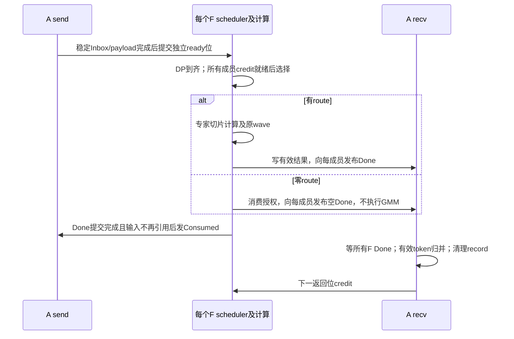

空Done是真实控制完成，不是伪造结果payload。F独立推进，A只收集本成员槽的完成；没有F间集合barrier。

## 阅读导航

| 读者关注 | 建议阅读 |
| --- | --- |
| 方案为何需要、选型是否合理 | 第一、第二部分 |
| A/F 如何协作、架构是否闭环 | 第三、第四部分 |
| 数据结构、窗口大小、生命周期 | 第四部分及第五部分各后端容量小节 |
| 修改哪些算子、保留哪些代码 | 第五部分；原接口见附录B |
| 图执行、风险、实施和验收 | 第六部分 |
| 源码版本和具体位置 | 附录A、附录C |

阅读方式：架构评审可先读第一至第三部分及2.6选型结论；协议评审沿第四部分逐项核对生产者、消费者与释放条件；开发交接从5.1接口开始，对照各后端的原流程、数据布局和代码保留表。第五部分容量汇总只用于索引结论，不另起一套计算口径。

## 术语和变量速查

下表先解释贯穿全文的概念；每个后端特有的record字节数、offset和workspace参数在对应公式旁定义。方括号表示数组维度，不代表额外复制所有数据；`align32/64/512(x)`表示把字节数x向上取整到相应字节边界，`ceil(x)`表示向上取整。

| 名称 | 含义与例子 |
| --- | --- |
| A / F，rank | Attention卡 / FFN卡；rank是通信域中的物理成员编号 |
| DP / TP / CP / EP | 数据并行 / 张量并行 / 上下文并行 / 专家并行；DP2TP2表示两个Attention调度组、每组两个TP成员 |
| `phase` | Prefill或Decode类别，分别简称P/D |
| `attentionDpId` | 逻辑DP编号；scheduler要求一个DP本轮所有注册成员到齐 |
| `attentionMemberRank` / `attentionMemberId` | 物理Attention成员编号/DP内部成员编号；DP0={A0,A1}时，两者共同服务DP0 |
| `logicalMicrobatchId` | 一个DP内的逻辑microbatch编号，例如mb0、mb1；下一层仍沿用该编号 |
| `payloadSlot` / `numPayloadSlots` | 物理通信数据槽编号/数量；P的mb0、mb1可先后共用slot0，D通常分别用slot0/slot1 |
| `communicationRoundId` | 第一层通信轮编号；整批64k、轮容量32k时有round0和round1 |
| 第二层计算分段 | 对同一通信轮的专家行再切片以控制workspace；不再次填充通信槽，不翻转其发布位 |
| `publishBit` / `expectedBit` | 发送端发布的0/1交替状态/接收端本地预期状态；实际字段为uint32，详见4.3.2及4.5.4 |
| `inputBit` / `returnBit` | Pending、Active和RoundLedger保存的本次输入/返回通道交替位快照；两通道独立推进 |
| `consumedBit` / `doneBit` / `creditBit` | 输入已消费ACK / 结果已写完 / 返回槽写入授权的交替位 |
| Inbox / Pending / Active | A写F的发布描述 / F持久待调度状态 / scheduler选出的本次计算视图 |
| `SelectedDpEntry` / `SelectedMemberView` | 本次选中的一个DP/microbatch/通信轮 / 该条目中一个物理成员的地址和路由视图 |
| `sourceLane` | 原生来源维度的适配索引，表示(物理Attention成员,microbatch)，不是DP编号 |
| `hiddenSize` / `topk` / `expertPerRank` | hidden维度 / 每token路由专家数 / 每张F卡拥有的专家数 |
| `route` / 专家行 | 一个token的一次专家计算；一个token的topk=8最多产生8条专家行 |
| `numMaxTokensPerRankPrefill` | 物理Attention rank的整批Prefill容量；与下面的DP轮次总量不同 |
| `numMaxTokensPerDpCommRoundPrefill` | 一个DP所有owner成员合计的单通信轮原始token上限，目标32k |
| `memberCommTokenCapacity` | 一个物理成员实际预留的单轮token容量；DP2成员均匀分担32k时可各16k |
| `maxExpertRowsPerCompute` | 一个F任务的专家展开行数上限；控制计算workspace，不是原始token上限 |
| `RoundLedger` / `dpReadyTime` | A保存的逐轮范围和状态描述 / F首次发现整个DP条目到齐的本地时间 |

例如DP0={A0,A1}、mb0、layer7、round0：这是一个调度条目；A0/slot0和A1/slot0是不同卡的两块物理内存。A0可以发布inputBit=1，A1可以发布inputBit=0；F分别匹配各成员自己的expectedBit，再验证mb0/layer7/round0到齐，不能要求两个物理成员的交替位数值相同。

# 第一部分：场景、目标与设计边界

## 1.1 三种场景，共用一套框架

本方案把 Attention 和 FFN 分开部署，并覆盖以下三种模式。本文 P 为 Prefill，D 为 Decode，A 为 Attention 物理成员，F 为 FFN 专家 rank。

| 场景 | Attention 部署 | FFN 部署 | 主要诉求 |
| --- | --- | --- | --- |
| 纯 P 异步 AFD | 多个独立 Prefill DP，DP 内可有 TP/CP | 一套纯 EP 专家卡 | 大 token 批次、受控内存、DP 异步推进 |
| 纯 D 异步 AFD | 多个独立 Decode DP，DP 内可有 TP/CP | 一套纯 EP 专家卡 | 小批次跨 DP/同 DP 多 microbatch 聚合、低时延 |
| P/D 共用 FFN | P、D Attention 分开部署，可使用不同 TP/CP 配置 | 共用一套纯 EP 专家卡 | 专家资源共池、P/D 独立推进、统一协议 |


16 卡示例为 4 张 P Attention、4 张 D Attention、8 张 FFN。8 张 A 不等于 8 个调度 source：P=DP2TP2、D=DP4TP1 时，共有 6 个逻辑 DP、8 个物理 A 成员。

## 1.2 统一抽象与差异参数

三种模式统一使用 DP 任务、成员窗口、ready/consumed/credit 和 scheduler。纯 P、纯 D 是 DP 注册表的子集，不另做一套算子协议。

| 共用机制 | 根据场景配置 |
| --- | --- |
| DP 内成员到齐、逻辑事务身份 | DP 数、TP/CP 成员与 token owner |
| A 发送/接收、F 调度/计算/返回接口 | P/D phase 与调度策略 |
| 通信轮次与计算分轮 | 整批容量、单轮容量、专家行数预算 |
| payload 槽及状态生命周期 | P 默认跨 microbatch 单槽复用，D 默认独立槽 |
| device 选择层权重 | 首版单层，结构支持未来多层 |

两条后端都实施：MegaMoE 复用融合通算流水；Distributed 复用 MTE dispatch/combine 与现有计算小算子。二者共用框架职责和控制语义，payload 存放位置及搬运方式不同。

## 1.3 目标范围与首版边界

- 目标 A5/950、同一支持远端访存的互联范围、MTE 数据通路。
- 同一模型、相同层定义、相同专家映射。Attention支持TP/CP，FFN仅纯EP；DP内成员及token所有权由框架明确注册，具体CP布局适配需验收。
- 数值示例采用 MXFP8 A8W8、BF16 专家输出、不做 combine 通信量化。
- 权重保持框架现有的按层加载和 HBM 组织方式，通过地址视图引用，不复制整套权重。
- 首版一次FFN任务只选择一种phase、一个layer；Decode可聚合同DP的多个microbatch及不同DP。任务结构支持未来多层，每个DP/microbatch/通信轮次必须先满足成员到齐条件。
- 不引入F leader，各F独立扫描、调度和计算。不同F不要求处理相同DP或相同轮次；某F选中一个DP条目时，必须已收到该条目所有Attention成员的本轮发布信息。
- A5 按角色注册不同大小通信窗口作为设计假设；A3 已有实践，A5 仍需验收。
- 图模式是目标能力，不能因为当前 CAMAsync 分支的限制而排除目标方案入图。
- 共享专家、动态 EPLB、异构层形状、重连恢复、跨互联域不计入首版容量示例。

# 第二部分：现有实现、通信内存与技术选型

本部分只分析原生实现。每张原生 EP 卡通常同时产生自己的 token、计算本地专家，因此同时具有“源端”和“专家端”职责；不能直接把其单卡窗口等同于 AFD 的 A 卡或 F 卡窗口。

## 2.1 统一分析口径

以下四类实现都按“角色和布局 → Dispatch → Combine → 容量 → 限制”展开。跨卡操作区分真实 payload 和控制信息，不以 host 中的服务名称判断 payload 引擎。

| 参数 | 示例值/含义 |
| --- | --- |
| `epWorldSize` | 8，原生对称 EP rank 数 |
| `numMaxTokensPerRank` | 32768 / 262144 / 1048576，单源容量，分别简称 32k/256k/1M |
| `hiddenSize` | 7168 |
| `topk` | 8，专家 ID 不重复 |
| `expertPerRank` | 8，共 64 个专家 |
| Dispatch | FP8/MXFP8 payload；各实现是否内部量化分别说明 |
| Combine | BF16，2 B/元素；是否 F 局部归并分别说明 |
| 单位 | GiB=2^30 B，MiB=2^20 B；不是十进制 GB |

**容量表是指定布局的申请需求或主数据区外推，不证明原算子能运行该 shape。** 当前 Distribute 路径的 512 限制、MegaMoE prepass/索引约束等均可能先触发。普通输出、权重、内部 workspace、队列、实际通信后端额外分配分别计量。原生 EP8 和目标 8A+8F 的卡数/角色不同，不直接据其单卡数字计算系统节省比例。

## 2.2 MegaMoE：源端一份量化数据，专家端远端读取

### 2.2.1 角色、布局和来源定位

MegaMoE 将 Dispatch、Linear1、Activation、Linear2、Combine 融合。A5 MTE 的源端不把 token hidden 按 topk 复制后存放：QuantRecords 仍按原始 token 排列，route 指向它。

```text
每个原生 EP rank 的 MTE 通信窗口
┌──────────────────────────────────────────────────────────────┐
│ 60 KiB 同步/握手区                                           │
├──────────────────────────────────────────────────────────────┤
│ 8 KiB Count[localExpert][sourceRank] 固定预留                  │
├──────────────────────────────────────────────────────────────┤
│ Routes[localExpert][sourceRank][numMaxTokensPerRank]            │
│ 每项是原 token/topk 的展平下标，不是 payload                  │
├──────────────────────────────────────────────────────────────┤
│ QuantRecords[numMaxTokensPerRank][token + scale]               │
│ 本 rank 原始输入，一 token 一份                              │
├──────────────────────────────────────────────────────────────┤
│ ReturnRows[numMaxTokensPerRank][topk][hiddenSize] BF16          │
└──────────────────────────────────────────────────────────────┘
专家输入、scale、激活、GMM2 输出在普通计算 workspace，另算。
```

```text
routeIndex = tokenId × topk + topkId
源地址 = sourceWindow + quantOffset + (routeIndex / topk) × quantRecordBytes
专家行 = expert/source count 前缀 + 该来源专家列表中的 routeOrdinal
```

### 2.2.2 Dispatch 交换什么，为什么需要

| 数据 | 产生/存放 | 用途 |
| --- | --- | --- |
| 量化 token、scale | 源 rank 本地 QuantRecords | 专家计算实际输入；由专家端 read |
| 每专家 route 列表 | 源 rank write 到专家 rank | 确定远端 token 地址、本地专家以及原 topk 位置 |
| 带 tag 的 count | 源 rank 最后 write 到专家 rank | 数量、前缀和本轮路由就绪；零 count 也必须发布 |
| 32 B MetaInfo | 专家端整理时本地生成 | 保存 source/token/topk，供结果写回 |

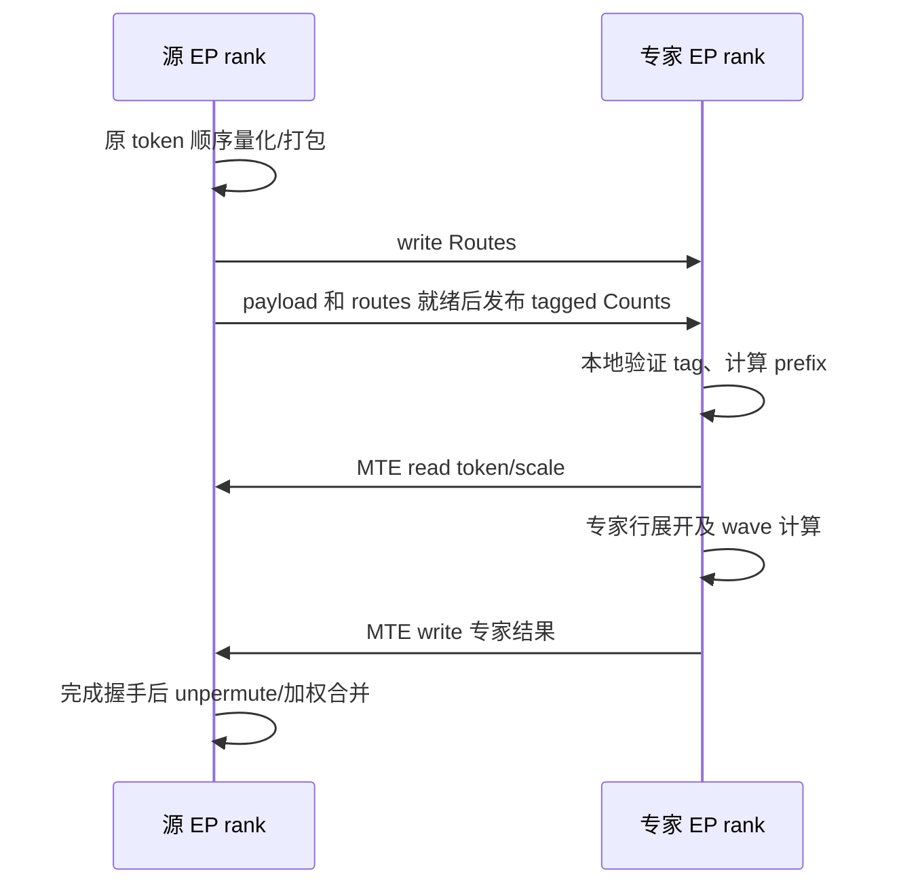

原 count 高 8 位含同步 tag、低 24 位是数量；tag 随同步轮次循环，假定端间调用轮次一致。它不是我们需要的异步 DP/microbatch 配对及物理槽交替握手协议。

已有 dispatch 去重通过 rowDesc 分组：同来源 token 命中本 F 多个专家时，FIRST 行只跨卡读取一次，再本地扇出；关闭时多次读取同一源地址。**该开关改变通信量，不改变源 QuantRecords 的存储份数。**

### 2.2.3 Combine 的结果、定位和完成

专家端按 MetaInfo 写 `ReturnRows[tokenId][topkId]`，不同专家写不同位置，不做远端 atomic add。源端使用 topk weights unpermute/reduce。原生同步区负责结果完成握手，没有目标 AFD 的逐成员 credit/Done 表。首版目标保留逐专家返回与 A 最终加权，不开启 F partial combine。

### 2.2.4 容量公式与 32k—1M 外推

无权重前移、无 combine 去重时，本例 record 为：

```text
quantRecordBytes = align32(align256(hiddenSize) + 2×ceil(hiddenSize/64)) = 7392
quantBytes = numMaxTokensPerRank × quantRecordBytes
returnBytes = numMaxTokensPerRank × topk × hiddenSize × 2
routeBytes = expertPerRank × epWorldSize × numMaxTokensPerRank × routeIndexBytes
windowBytes = 68 KiB + align后的routeBytes + quantBytes + returnBytes
```

本表 topk×capacity 超过16位索引范围，routeIndexBytes=4；小容量可按原生同源布局函数选择索引宽度。实际分区仍按原函数对齐。

| 单源容量 | Quant | Return | Routes | 窗口合计，含68 KiB |
| --- | ---: | ---: | ---: | ---: |
| 32k | 0.225586 GiB | 3.5 GiB | 8 MiB | 约3.733463 GiB |
| 256k | 1.804688 GiB | 28 GiB | 64 MiB | 约29.867252 GiB |
| 1M | 7.21875 GiB | 112 GiB | 256 MiB | 约119.468815 GiB |

因此 read 避免了专家端全源 payload 接收区，但整批 topk 返回区仍会很大。目标方案必须同时限制输入窗口和返回窗口，不能只减少读取次数。

### 2.2.5 约束、成熟度与可借鉴点

- 原生 A5 MXFP8、MTE wave、去重与 workspace 布局有代码可复用，不代表异步 AFD 已实现。
- `num_max_tokens_per_rank` 是单源容量；`max_recv_token_num` 映射 maxOutputSize，约束专家展开行。原计数截断不能作为 AFD 超容量处理，必须完整返回。
- dispatch 去重有 UB/prepass 容量护栏和收益门控，小 decode 可以关闭；大容量外推不意味着能绕过这些护栏。
- 图能力须区分原生算子与目标 AFD 全流程；device 选层、独立 scheduler、窗口复用和 A 并发收发仍需实施。
- 选择此后端是为了保留计算通信 wave，修改输入准备、来源视图和返回协议，避免重写 GMM tile。

## 2.3 MoeDistribute：逐专家写入接收区，MTE write/write

### 2.3.1 选择的版本与通信布局

本地 vLLM-Ascend 使用 `npu_moe_distribute_dispatch_v2` / `npu_moe_distribute_combine_v2`。A5 空 comm_alg 默认选择 MTE/fullmesh_v1 的通用 dispatch 内核；显式 fullmesh_v2、CCU 是其他分支，不能混用限制和代码结论。

```text
每个原生 EP rank 的数据窗口（控制区另计）
┌──────────────────────────────────────────────────────┐
│ 半区0                                                │
│   CombineRecv[token][topk][returnRecord]               │
│   DispatchRecv[source][localExpert][B][inputRecord]    │
├──────────────────────────────────────────────────────┤
│ 半区1：同样的两个独立分区，连续调用切换半区            │
└──────────────────────────────────────────────────────┘
```

Dispatch 起点显式加上 combine 预留容量；combine 从当前半区开头开始。**一个半区内两者没有地址复用；两个半区也不是同批数据发送两份。** 两半都在实际寻址范围内，需要相应预留。

### 2.3.2 Dispatch 的 payload、辅助信息与通知

源 rank 对每条专家 route 量化/打包 token，write 到目标 `[source][localExpert][expertOrdinal]`，发布 counts/status；专家 rank 等本地状态后复制到专家输入，生成 source/token/topk 辅助信息。一个 token 命中同一 F 的多个专家，仍写多份 hidden。

| 信息 | 作用 |
| --- | --- |
| token + 量化 scale | 实际专家输入；A5 对应分支可在 dispatch 内做 FP8/MXFP8 量化 |
| source/token/topk 辅助定位 | combine 回到哪个源、哪个结果位置 |
| 每专家/来源 counts | 计算接收前缀、专家输入范围 |
| status | 数据写入完成的通知，接收侧查询本地状态 |

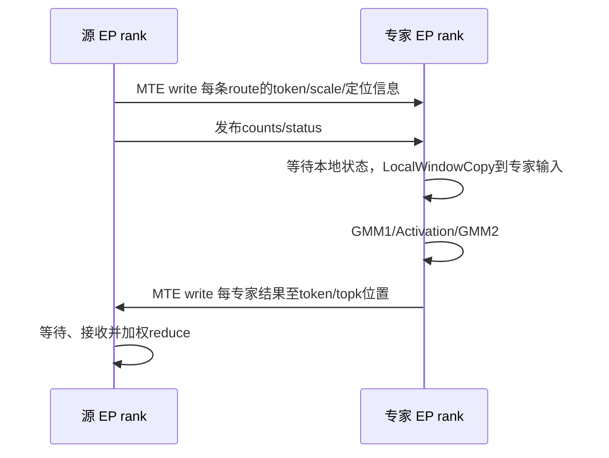

### 2.3.3 Combine 与 A5 record

专家结果按原 source/token/topk 写回。选定 A5 BF16 DataAsFlag 路径每512 B中有480 B有效数据：

```text
returnRecordBytes = ceil(hiddenSize×2/480)×512 = 15360
```

这项开销不能套用到 A3 独立 info table 的 F2A，也不能拿 BF16 hidden 原始字节数替代实际 A5 record。

### 2.3.4 容量公式与外推

本例 FP8 dispatch record 含 scale/辅助信息并按512 B对齐，为7680 B：

```text
dispatchHalfBytes = epWorldSize × expertPerRank × numMaxTokensPerRank × 7680
combineHalfBytes = numMaxTokensPerRank × topk × 15360
dataWindowBytes = 2 × (dispatchHalfBytes + combineHalfBytes)
```

| 单源容量 | 单半区 Dispatch | 单半区 Combine | 双半区数据区 |
| --- | ---: | ---: | ---: |
| 32k | 15 GiB | 3.75 GiB | 37.5 GiB |
| 256k | 120 GiB | 30 GiB | 300 GiB |
| 1M | 480 GiB | 120 GiB | 1200 GiB |

这是未修改布局的外推，当前该路径不能直接运行这些大 BS。若先按目的 rank 去重但仍保留对称双半区，32k数据区变为 `2×(1.875+3.75)=11.25 GiB`；这还没有得到 AFD 按角色分离和单槽复用的收益。

### 2.3.5 约束、成熟度及放宽方向

- 选定公共 tiling/框架 MC2 存在512容量限制；不能推断所有同名版本均相同。
- 整批 routing/mask 常驻 UB、`CalTokenSendExpertCnt`逐route扫描历史前缀、DMA/计数宽度都需改；仅删除512检查不可行。
- 当前小 BS 框架集成和团队 DataCopy 调试经验是选择依据，不是“任何 shape 最快”的证据。
- 有框架图集成基础；新 AFD、32k、TP/CP、FP8 和分轮组合仍需验收。
- 专家相关 smooth scale 可能使同 token 不同专家的 payload 不同，不能强制去重；首版用专家无关 MXFP8。
- 目标保留量化、DataCopy、结果打包和 reduce，借鉴 EP/DeepEP 重写路由统计、去重和 prefix，详见第五部分。

## 2.4 MoeEP：rank 去重、URMA payload 与独立 epilogue

### 2.4.1 数据布局

选定 A5 Direct 路径通过 Hcomm UBC_CTP 通道的 WriteNbi/BatchCommit 传 payload；本地整理仍使用 MTE。Host 中的 MTE 服务分类不等于裸 DataCopy 跨卡 payload。本结论不推广到未核对的所有 Hybrid/后续版本。

```text
原生 EP rank 的 Direct 窗口
┌────────────────────────────────────────────────┐
│ dump/diagnostic、counts、channel notify等控制区  │
│ combine结果通知表，部分按B×topk预留             │
├────────────────────────────────────────────────┤
│ DispatchRecv[sourceRank][B][rank去重record]     │
├────────────────────────────────────────────────┤
│ CombineRecv[B][topk][resultRecord]              │
├────────────────────────────────────────────────┤
│ PayloadStash[B][metadata]                      │
└────────────────────────────────────────────────┘
```

同 token 发给同 rank 一份 record，记录专家成员/权重等 metadata，接收 epilogue 展开为专家行；不按本地专家数预留多份 payload。self 路径可直接引用本地输入，不能据此省略整体容量检查。

| 交换内容 | 所在区域/产生方式 | 为什么需要 |
| --- | --- | --- |
| 去重token hidden及预量化scale | DispatchRecv；URMA从本地输入及metadata暂存提交 | 实际计算数据，同目的rank不重复hidden |
| topk专家、权重、source rank/token定位 | record metadata，发送端stash组织 | epilogue判断本地专家、展开并保留combine返回位置 |
| rank/expert counts | counts通知区 | 确定接收数量、输出前缀和有效行数 |
| channel完成通知 | notify区 | epilogue确认payload已到，不能只凭count就读取 |
| 每专家输出及返回通知 | CombineRecv及其状态表 | 源端等待后按路由权重合并 |

### 2.4.2 Dispatch、Combine 与 epilogue

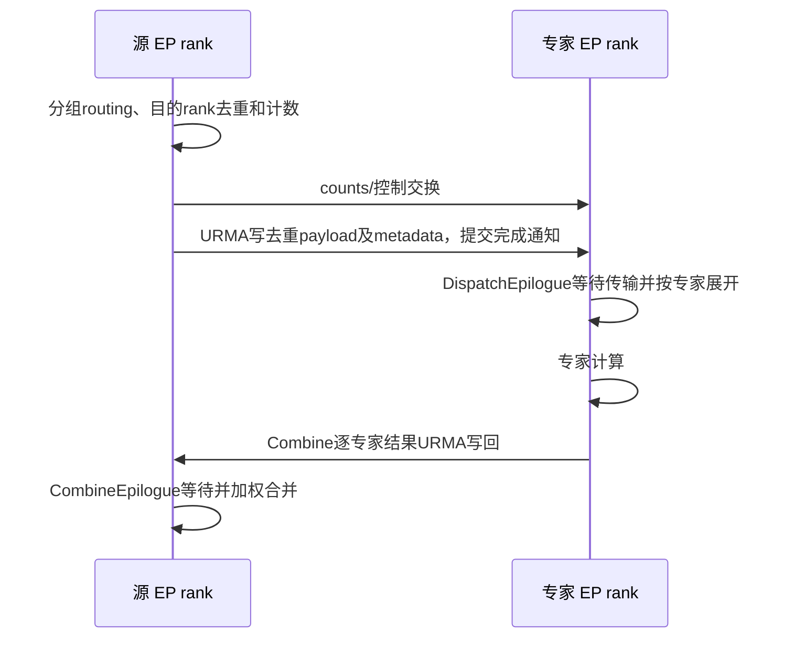

epilogue把提交/传输与最终等待、输出整理分开，为异步重叠提供边界；不意味着 dispatch 提交前完全没有 counts 等待或全组协调。Combine仍逐专家结果返回，没有这里 DeepEP 的 F rank partial 归并。

FP8接口接受预量化 x+scales，不在所述 dispatch 内把 BF16 转 FP8。H=7168时，FP32/128 或 E8M0/32 scale实际都约224 B/token；非FP8输入不是同时携带7k scale。

### 2.4.3 实际 record 与保守申请

```text
reservedMetadataBytes = align512(align32(hiddenSize)+2×align32(topk×4)+32) = 7680
reservedDispatchRecordBytes = align512(align32(2×hiddenSize)+reservedMetadataBytes) = 22016
reservedCombineRecordBytes = align512(align32(2×hiddenSize)+32) = 14848

dispatchReserveBytes = epWorldSize×numMaxTokensPerRank×reservedDispatchRecordBytes
combineReserveBytes = numMaxTokensPerRank×topk×reservedCombineRecordBytes
stashBytes = numMaxTokensPerRank×reservedMetadataBytes
```

实际 FP8 metadata 对齐后可为512 B，实际 token record 为7680 B；但当前申请使用上述保守最大格式，不能按实际传输量缩小窗口。大 metadata 预留不是某种已支持量化必须产生7k scale。

本例 Direct 控制区为 `numMaxTokensPerRank×topk×512 + 195072` B，195072包含固定前缀、counts及本拓扑channel通知等；改变拓扑、专家数或channel数须重新按原布局计算。完整公式为上述三数据区加控制区。

| 单源容量 | Dispatch保守预留 | Combine保守预留 | Direct布局总申请 |
| --- | ---: | ---: | ---: |
| 32k | 5.375 GiB | 3.625 GiB | 约9.359557 GiB |
| 256k | 43 GiB | 29 GiB | 约74.875182 GiB |
| 1M | 172 GiB | 116 GiB | 约299.500182 GiB |

包装器可能为未知/Hybrid上下文采用更保守配置；上表不是所有包装入口的实际分配量，更不是进程全部HBM。大容量仍是布局外推，须通过接口及实现限制。

### 2.4.4 约束和借鉴价值

`numMaxTokensPerRank`由调用者传入，不由kernel推断真实BS。本地 vLLM-Ascend没有此后端集成，不能说它已对应某个唯一框架参数。集成时由框架容量明确映射。

其分group读取routing、双计数和rank去重适合大BS参考。完整 ElasticBuffer ACLGraph能力未确认；默认host counts同步和动态输出分配需核实，标准ACLNN或torch.compile不等于完整包装已入图。首版不选择该payload引擎，避免新增URMA和包装适配工作。

## 2.5 DeepEP-Ascend：UBMEM控制、URMA数据与rank partial combine

### 2.5.1 布局与两种互联机制

基线README明确同一EPBuffer接口支持训练、prefill、decode；要求A5同时支持UBMEM和UBC_CTP/URMA，两者运行时都有用。

- UBMEM用于映射后的计数、原子和同步控制，并不等于所有控制都用MTE DataCopy。
- URMA用于主要payload。Hcomm提供资源，底层还直接组织队列描述符、doorbell和CQ/drain，不等价于简单的一次WriteNbi。

```text
EPBuffer
  控制/workspace/队列：另行规划
  主payload区：align2MiB(max(Dispatch需求, Combine需求))
      Dispatch阶段：[source][token][FP8 hidden+scale+route metadata]
      Combine阶段 ：[rank或代表topk槽][token][BF16 partial+metadata]
  专家展开输出、发送metadata、combine暂存等普通HBM另计
```

### 2.5.2 Dispatch与Combine交互

Dispatch用expert/rank histogram、同token目的rank去重及跨核前缀定位，把payload及专家元信息写到对端；deferred epilogue等待drain并展开专家行。

| 交换内容 | 方向与作用 |
| --- | --- |
| token、预量化scale | URMA写目标rank，构成实际专家输入 |
| topk权重、专家路由、原token来源 | metadata随record传输，供展开、结果归属和局部加权使用 |
| rank/expert histogram及同步状态 | 控制映射和归约，用于输出容量、目的record定位及完成协调 |
| 本地展开行到原token/代表topk的对应关系 | dispatch handle/本地metadata，combine据此找局部归并成员及返回槽 |
| BF16 rank partial及完成状态 | F写回源，源epilogue汇总不同rank |

Combine在专家rank先将同原token的多个专家贡献归并为一条rank partial，按代表topk位置和原token信息发送；源端只累加各rank partial。权重必须在局部归并前正确参与。


局部归并改变求和顺序，并存在BF16 partial舍入；不能未经精度验证代替我们保留的逐专家返回。主buffer取max复用依赖其原生完成协议，不能直接复制到独立A/F窗口。

### 2.5.3 容量公式与外推

本例FP8 scale为224 B；dispatch metadata为 `align32(topk×4+align32(topk×8)+4)=128` B：

```text
actualFp8DispatchRecordBytes = 7168+224+128 = 7520
actualDispatchBytes = epWorldSize×numMaxTokensPerRank×7520
combineRecordBytes = hiddenSize×2 + align32(topk×4) = 14368
combineBytes = min(epWorldSize,topk)×numMaxTokensPerRank×14368
mainPayloadBytes = align2MiB(max(dispatchProvisionBytes,combineBytes))
```

容量helper的FP8 scale hint更保守，本例record为7744 B；实际预留应使用helper值。以下配置仍由BF16 combine主导，因此两种dispatch口径均不改变主buffer结果：

| 单源容量 | FP8实际Dispatch需求 | BF16 Combine需求 | 主payload区 |
| --- | ---: | ---: | ---: |
| 32k | 1.835938 GiB | 3.507813 GiB | 3.507813 GiB |
| 256k | 14.6875 GiB | 28.0625 GiB | 28.0625 GiB |
| 1M | 58.75 GiB | 112.25 GiB | 112.25 GiB |

若使用BF16 dispatch，32k需求约3.53125 GiB，不能将它误称FP8 dispatch容量。队列、普通计算输出和其他暂存不在本表，改变K/EP后主导项也可能变化。外推不绕过SQ深度、编码、对齐、索引和输出上界。

### 2.5.4 支持边界与借鉴价值

README明确graph capture、Hybrid等在所述基线不支持。host counts/动态shape、延迟回调、源tensor异步生命周期及队列replay都是适配点，不能简化为“URMA硬件不能入图”。已有prefill/decode接口不代表本项目无需改造即可AF分离。

可借鉴histogram/跨核前缀、rank去重、完成后主buffer复用；首版不引入rank partial数值变化和新的队列执行体系。现有公开带宽部分不含最终epilogue，不能与完整MTE算子时延直接比较。

## 2.6 选型、成熟度与放宽约束的路径

| 维度 | MegaMoE | Distribute V2 A5 MTE | MoeEP Direct | DeepEP-Ascend |
| --- | --- | --- | --- | --- |
| Dispatch payload | read | write | Hcomm URMA write | URMA write |
| 同目的rank去重 | 已有读取去重，可自动关闭 | 目标新增 | 已有 | 已有 |
| Combine | write，支持多模式 | write | write | F局部归并后write |
| 计算通信融合 | 已有wave | 主要依赖外部组织 | epilogue分离 | 延迟epilogue |
| Dispatch内BF16→FP8 | A5支持MX量化 | A5支持对应量化分支 | 所述接口不支持，预量化输入 | 所述接口预量化输入 |
| 大Prefill | 按容量及资源约束 | 当前选定路径需改512及内部逻辑 | 有大容量设计，仍需完整校验 | 明确支持prefill接口 |
| 入图证据 | 原生算子能力不等于目标AFD已验证 | 有vLLM-Ascend集成基础 | 完整包装待确认 | 基线明确不支持capture |
| 本项目复用价值 | 最大程度复用融合流水 | 最大程度复用熟悉的MTE收发 | 参考rank去重与epilogue边界 | 参考紧凑缓冲和归并设计 |

本项目两条路径都实施：MegaMoE 追求融合流水，小算子路径提供易调试、便于逐步验证的组合方案。MoeEP、DeepEP 作为设计参考，首版不额外引入新的 payload 引擎、返回数值语义和框架集成工作。

PR #408 的 Window 路径实际调用 `attention_to_ffn / ffn_worker_batching / ffn_to_attention / attention_worker_combine`，不是同一个完整 distributed 算子仅凭 role 参数裁剪。其 A2F/F2A DataCopy 实现、source/slot/layer 定位值得借鉴；已核对 A2F 仍按 topk 逐路由写，不具备目标 rank 去重，其公开入口重点在 A3/arch22，不能当作 A5 目标已经实现。

| 目标要求 | 采用的实现 | 保留与改造边界 |
| --- | --- | --- |
| 复用融合通算流水 | MegaMoE | 保留GMM/wave/WorkspaceLayout，拆源端量化及unpermute，适配独立任务与窗口 |
| 熟悉的DataCopy小算子通路 | Distribute V2 A5 MTE | 保留量化、搬运、打包、reduce，重写大BS路由和独立A/F控制 |
| 大BS去重与路由统计 | 借鉴MoeEP、DeepEP | 借鉴分块histogram/prefix，不搬用URMA提交/全组同步 |
| 大整批容量但HBM有界 | 目标协议 | 独立的通信轮次和计算分轮、小返回区、microbatch槽管理 |

成熟度按证据表达：原生实现可用性、现有框架集成、团队调试经验、目标扩展验证分别列出，不按项目名称给无依据的稳定性排名。放宽BS是算法和资源改造；入图是执行/生命周期契约；异步AFD是参与者与调度协议改造，三者不能只靠一个role参数完成。

# 第三部分：目标 AFD 总体架构

## 3.1 全局职责与双后端

```text
Attention：TP/CP Attention → AF边界token规范化/Gate/TopK
          → 并发dispatch_send、combine_recv → 恢复框架需要的TP/CP布局 → 下一层

MegaMoE 后端：
    ffn_scheduler → megamoe_afd
                    远端读取 + GMM1 + Activation + GMM2 + 写回

Distributed 后端：
    ffn_scheduler → dispatch_recv → GMM1 → SwiGLU/量化 → GMM2 → combine_send
```

| 项目 | MegaMoE AFD | Distributed AFD |
| --- | --- | --- |
| A2F payload | F 通过 MTE read A 本地量化窗口 | A 通过 MTE write F 接收窗口 |
| F2A payload | F 通过 MTE write A 返回窗口 | 相同 |
| 控制消息 | 生产者 write 到消费者本地状态区 | 相同 |
| scheduler / pending / 两层分轮 / credit | 共用语义 | 共用语义 |
| 计算 | 尽量保留融合算子 wave 流水 | 复用现有 GMM 等算子 |

这里的 read/write 指真实跨卡 payload；MegaMoE read 模式也通过 write 发布 ready 和 consumed。

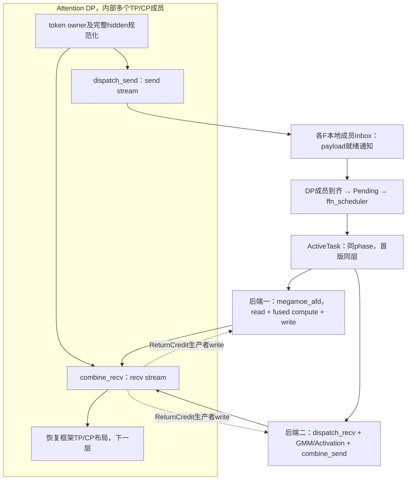

F的scheduler只选择任务，计算实体不常驻扫描Active。Host可以循环提交固定图，但不读取scheduler结果来选层或分配实际输出shape。

## 3.2 先分清三种单位

| 单位 | 逻辑归属或物理定位 | 作用 |
| --- | --- | --- |
| 调度条目 | DP + microbatch + layer + communicationRound（顺序事务） | 到齐、排队、续跑和完成 |
| 物理来源视图 | Attention成员 + microbatch + payloadSlot + 输入/返回交替位 | payload地址、credit及结果返回地址 |
| 专家行 | 某token的一条专家route | GMM工作量与maxExpertRowsPerCompute预算 |

```text
DP0 = {A0,A1}                         调度最小单位是DP条目
  microbatch0 / communicationRound0
      A0 MemberView → 若干专家routes  payload来源是成员
      A1 MemberView → 若干专家routes
  microbatch1 / communicationRound0   Decode可同时选择两个microbatch
      A0、A1各有自己的payload槽
```

payloadSlot参与地址计算，交替位只标识当前一次交接，不参与offset计算；控制字段在4.3.2定义。调度描述在不同推理迭代可能重复，其新旧由每槽握手和事务顺序保证。

同一token在同F的payload可以去重，但每条专家route仍要计算。每个DP条目先要求成员到齐，随后可切片计算，不要求把全部专家行一次搬入workspace。

## 3.3 先走通一次单轮任务

以一个DP、一个microbatch、一个通信轮次为例，尚不发生窗口复用：

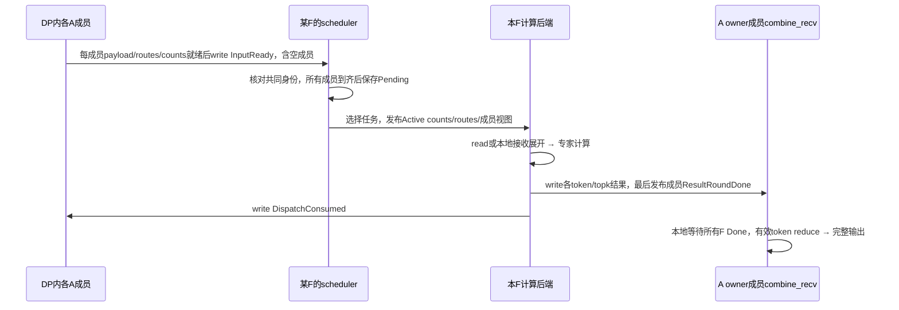

这条闭环在两种后端中相同，区别是payload在A还是F、F是否调用融合算子。下一部分定义其中每个数据结构与完成条件。

## 3.4 三种省内存机制与两个独立分轮

| 机制 | 减少什么 | 不改变什么 |
| --- | --- | --- |
| 同目的F去重 | Distribute接收重复payload；两后端的重复跨卡传输 | 专家真实计算行数 |
| P跨microbatch单槽 | 多个逻辑microbatch重复预留payload | 逻辑metadata仍分别保存 |
| 第一层DP token通信轮次 | A量化源/F接收窗口、A topk返回窗口 | 真实整批普通HBM输入输出 |
| 第二层专家行计算分轮 | F专家展开与计算张量容量 | 一个已发布通信轮次的payload驻留 |

```text
逻辑Prefill事务（可256k/1M）
  ├─ 通信轮0：DP总计最多32k owner token
  │    ├─ 计算分段0：最多maxExpertRowsPerCompute条route
  │    ├─ 计算分段1：继续同轮，可能切在同一个专家内部
  │    └─ 全部成员相关routes完成，A消费后释放返回窗口
  ├─ 通信轮1：复用同一小窗口
  └─ ...直到完整输出完成
```

小返回区要求A发送与接收共同推进，否则F等credit、A send等输入窗口、A recv尚未执行可能构成等待环。第二层同轮多个计算分段共享一次返回窗口使用权，不逐段要求A释放整窗。

# 第四部分：共同数据模型、通信协议与调度

本部分是两个后端之间的共同契约。先定义身份、结构和物理存放，再说明消息顺序；后端如何适配原算子放在第五部分。

## 4.1 DP成员、token所有权与静态地址视图

DP2TP2示例：`DP0={A0,A1}`、`DP1={A2,A3}`。scheduler有两个DP候选；一个候选下面是该DP某microbatch、某通信轮次的所有物理成员。成员列表显式映射到通信rank，不依赖连续rank编号。成员数按实际并行组注册，不能未经框架核对就用TP×CP推导，避免把重叠/嵌套的组重复计算。

AF边界统一为：每条逻辑token恰有一个发送owner，发送时hidden维完整。不同成员的token可以不连续，但不能重复计算同一逻辑token。

| Attention边界布局 | A侧适配责任 |
| --- | --- |
| 不同成员持有不同token，hidden完整 | 直接发送，注册本地到DP逻辑token的映射 |
| TP成员持有相同token的完整副本 | 确定唯一发送owner或按token重新分配；不得每个副本都发送 |
| hidden维仍被TP切分/为部分和 | 在A侧用必要的现有集体通信恢复完整hidden后发送 |
| CP成员持有不同上下文token | 使用实际token所有权和映射；不能假定各成员token数相同或连续 |

返回只送回发送owner，combine_recv输出该调用成员负责的真实token范围。框架若需要复制、聚合或序列并行布局，由A适配层恢复；相关all-gather/reduce-scatter等开销须计入端到端评估。F不执行Attention TP/CP计算或集体通信。当前CAMAsync的TP聚合不等于所有CP布局已验证。

## 4.2 容量参数和不变量

| 参数 | 语义 |
| --- | --- |
| `numAttentionDps` | 逻辑Attention DP数，scheduler候选source数 |
| `numAttentionRanks` / `numFfnRanks` | 物理Attention成员总数/F专家rank数，与A+F通信域大小分开 |
| `attentionMembers[attentionDpId]` | 该DP参与AF收发的物理成员列表，含TP/CP拓扑和token映射 |
| `numMaxTokensPerRankPrefill` | 每物理A成员经owner规范化后的Prefill整批最大token数，不是DP总量 |
| `numMaxTokensPerRankDecode` | 每物理A成员经owner规范化后的Decode单批最大token数 |
| `numMaxTokensPerDpPrefill` / `numMaxTokensPerDpDecode` | 每DP去掉副本后的逻辑整批容量，供轮次计划和聚合预算使用 |
| `numMaxTokensPerDpCommRoundPrefill` | 第一层通信轮次的DP逻辑token总预算；目标支持32768 |
| `memberCommTokenCapacity` | 一个物理A成员的窗口token容量；按轮次分配计划确定，不默认等于DP预算 |
| `maxExpertRowsPerCompute` | 第二层单F单任务专家展开行数上限；映射MegaMoE maxOutputSize |
| `numMicroBatches` | 每DP逻辑microbatch数，DP内成员保持一致，常见2，允许3 |
| `reuseTokenBufferAcrossMicroBatches` | Prefill默认true、Decode默认false |
| `numPayloadSlots` | 复用时1，否则numMicroBatches |
| `hiddenSize` / `intermediateSize` | hidden维度/SwiGLU后的中间维度；MegaMoE hiddenDim=2×intermediateSize |
| `expertPerRank` / `topk` | 单层每F专家数/每原始token专家数 |
| `dispatchDedupMode` | Distributed首版显式ENABLE或DISABLE；AUTO预留但不作为已实现能力 |
| `maxScheduledLayers` | 任务结构可扩展；首版配置为1 |

DP通信预算和成员窗口容量由同一个初始化计划校验：每轮实际DP token总量不超过DP预算，每个成员实际数不超过自己的窗口。成员配置容量之和允许大于DP预算以容纳负载不均匀，但内存必须按实际预留容量之和计算；不能用较小的DP预算替代物理申请量。

重要不变量：

1. 同一原始token的topk专家ID不重复；否则安全容量按实际允许的重复路由重新推导。
2. payload及Inbox按物理槽复用；Pending和逻辑事务状态按microbatch保留，不因缩减Inbox而删除未完成任务状态。
3. 每F一次任务 `actualExpertRows <= maxExpertRowsPerCompute`，不截断、不丢route。
4. 一次初版任务只选同phase、同layer。Prefill只选一个DP/microbatch/通信轮次的route切片；Decode可选同DP多个microbatch以及多个DP的条目，均受总行数预算约束。
5. 通信地址、dtype、record stride由初始化约定，不逐批传协议版本、模型版本、layout_profile、session重连ID或地址偏移。
6. `attentionDpId`为调度身份；`sourceRank`仅作为原算子适配层的物理Attention成员编号，等价于本文的`attentionMemberRank`，不能用它替代DP。到实际HCCL rank的映射在静态表。
7. 原始token数、目的rank去重record数、专家展开行数是三个不同计数。
8. 单计算通道使用一份workspace；增加同F多任务并发时必须重新计算workspace并发份数。
9. DP条目只有在本F收到所有成员匹配身份的发布后才进入计算；零token/零本地路由成员也必须发布明确的空counts和ready。
10. 整DP一轮实际token数是各成员owner token数之和。均匀TP2可各分16k组成32k；若每成员均允许32k，则窗口按各32k申请，但调度是否允许总64k必须由独立DP预算决定。

## 4.3 数据结构：从发布到执行的接力


| 结构 | 生产者 → 消费者 | 生命周期 | 回收/覆盖条件 |
| --- | --- | --- | --- |
| DP/Member Registry | 初始化框架 → 所有算子 | 服务/模型实例 | 通信和graph全部停止后 |
| Inbox header/counts/routes | A成员 → F scheduler/接收端 | 一个物理成员槽的通信轮次 | 所有F完成相关引用并ACK后A才覆盖 |
| PendingTable/MemberStates | F scheduler及完成提交 → scheduler | 条目首次到达至该轮完成 | 所有成员相关route完成，必要通知已发布 |
| ActiveTask | scheduler → 计算后端 | 一次计算任务 | 本次计算/发送和完成提交结束 |
| RoundLedger | A send → A recv | 逻辑microbatch各轮 | 该逻辑事务完整输出完成 |
| ReturnState | F → A recv | 当前返回窗口轮次 | A读取并清理后发布下轮credit |
| InputReadyControl | A send → F scheduler | 一次物理输入槽使用 | 对应输入全部ACK后才能再次发布；F接收后以inFlight去重 |
| ReturnCredit | A recv → F发送端 | 一次物理返回槽授权 | A消费旧结果后发布下一交替位；同一授权不能重复用于另一轮 |

以下字段定义为逻辑规格。跨AF header和tensor字段类型、跨度与对齐按表给出；最终二进制ABI实施时需锁定并由同源布局函数生成，不能假设跨cache line的结构写入天然原子。

### 4.3.1 静态注册表

初始化建立两级注册表：

```text
AttentionDpRegistry[attentionDpId]
    phase、成员列表、TP/CP拓扑、DP整批/轮次预算、microbatch数、轮次计划规则
AttentionMemberRegistry[attentionMemberRank]
    attentionDpId、attentionMemberId、实际通信rank
    owner token布局/映射、成员整批/单轮容量、payload槽数
    后端、去重模式、量化布局、A窗口地址及各分区偏移
```

专家/权重映射、F窗口描述和成员接收区偏移也在初始化时建立。P/D的TP/CP配置可不同，不能用一个全局tpSize推导所有DP。旧内核需要的sourceRank由物理member映射获得。

原生后端必要控制头为 `BackendControl`，例如HCCL上下文、必要状态区。它不必为每slot复制；每slot的ready/credit/轮次状态另行独立。实际偏移必须把这部分算入，不能默认大小为0。

### 4.3.2 逻辑任务、物理槽与交替位发布

首版不传递独立的generation、windowSequence或publishSequence。调度描述使用 `attentionDpId + logicalMicrobatchId + layerId + communicationRoundId`，phase为属性；描述在下一次推理迭代可以重复，其新旧性由严格顺序的交替位握手保证，而不是把描述当成永久唯一ID。同一逻辑microbatch上一MoE事务完整结束后才能开始下一事务，DP内TP/CP成员遵循一致的事务和轮次顺序，不允许跳过发布。未来若引入乱序重传、重连或同槽多条在途发布，必须重新设计身份和队列协议。

这里把两种坐标分开：`payloadSlot`是成员上的物理通信槽编号，用来算地址；`logicalMicrobatchId`是逻辑microbatch编号，用来排队和记录完整输出。Prefill的mb0、mb1可以先后使用slot0；Decode通常mb0使用slot0、mb1使用slot1。交替位翻转不会切换payload地址，也不会额外申请另一份payload。

发布分成描述区和独立提交控制块：

| header字段 | 意义 |
| --- | --- |
| `logicalMicrobatchId` | 本次发布属于哪个逻辑microbatch，物理槽可被不同microbatch轮流占用 |
| `communicationRoundId` | 第一层通信分轮编号，从0开始；不是第二层计算分段编号 |
| `layerId` / `phase` | 设备选权重与P/D调度 |
| `payloadSlot` | 实际物理槽编号；与microbatch不是同一个概念 |
| `returnBit` | 本通信轮预定的返回交替位，F保存到MemberView并用它匹配credit和发布done；不能从inputBit推断 |
| `tokenStart` / `actualTokenCount` | DP轮次范围起点/本成员本轮owner token数，允许0；非连续布局另有映射 |
| `memberTokenMap` | 可选device映射，或静态轮次计划确定的本地token位置 |
| `totalTokenCount` 或 `isLastRound` | DP整批大小/共同最后轮次标志，不能按本成员耗尽提前结束 |
| `uniqueRecordCount` | 去重write后端的实际record数；read后端可由路由推导 |

DP/member编号可由mailbox坐标和注册表隐含。描述头按align64(实际字段字节数)申请，变长映射和routes另放，不强制塞入64B。payload、header、counts和routes先完成并满足远端可见性，再发布独立InputReady控制块。不能把一次32B或64B DMA当成整个描述的天然原子提交。

**交替位按物理成员/槽维护，不按逻辑microbatch独立维护。** Inbox[member][slot]保存稳定header（含logicalMicrobatchId）、counts及routes。独立InputReadyControl[member][slot]只包含publishBit和固定padding，不含动态指向。scheduler匹配bit且未inFlight后，再单独DMA读取同一物理坐标的Inbox；所有F ACK前发布者不得修改它。DP成员bit可不同，到齐按逻辑身份核对。状态字原子可观察性及header先于bit的远端完成顺序仍须在目标CANN验证，不能由32B对齐推导。

| 状态变量 | 存放与更新者 | 含义 |
| --- | --- | --- |
| `publishBit` | A写F的InputReadyControl | 本槽当前发布的交替位，合法值0/1 |
| `expectedBit` | F本地持久槽状态 | F下一次允许接收的位，初始0；已接收置inFlight，避免重复入队；消费并发ACK后翻转 |
| `currentInputBit` | A本地槽状态 | A当前发布/等待ACK的位，初始0；收齐全部F的DispatchConsumed后翻转 |
| `consumedBit` | 各F分别写A的DispatchConsumed | F对本槽本次输入的消费确认，回传本次publishBit |
| `currentReturnBit` / `expectedReturnBit` | A本地返回槽状态及F本次MemberView | 独立的返回通道交替位；不由输入ACK推进 |
| `doneBit` | 所有注册F分别写A的ResultRoundDone | 已消费本轮credit且结果写完；零route表示空完成 |
| `creditBit` | A写每个注册F本地ReturnCredit | 所有F每槽每轮恰好消费一次；零route不能跳轮 |

以上字段实际使用uint32_t，0/1只占用其语义上的1 bit。初始化无效值为 `CONTROL_INVALID=2`；ready/ACK/done消息初始化为无效，F.expectedBit和A.currentInputBit初始化为0，首轮返回credit初始化授权0（初始化写入完成后才启动工作kernel）。消费者预期值只在0/1之间翻转。各控制消息至少按独立32B块规划和搬运，需要更大cache-line隔离时按后端要求增加stride；不同生产者不能共享一个会被整块覆盖的消息块。expectedBit等本地状态可以紧凑存储，不需要逐字段独占DMA块。

选定MTE控制实现采用uint32_t状态、32B DataCopy块和本地GM→UB→GetValue的标量比较，不使用向量Compare检测一个flag。基础DataCopyPad也支持uint8_t及非32B有效长度，但这不等于已证明跨卡1字节通知的顺序/原子性，首版不依赖该路径。发布/轮询仍须按所选后端实现必要的MTE同步和可见性；UB中的旧副本不能当作持续更新的GM状态。

接口依据：950的[DataCopyPad UB→GM](https://www.hiascend.com/document/detail/en/CANNCommunityEdition/910/API/ascendcopapi/docs/en/api/SIMD-API/basic_api/memory_vector_compute/data_move/DataCopyPad_UBToGM.md)和[GM→UB](https://www.hiascend.com/document/detail/en/CANNCommunityEdition/910/API/ascendcopapi/docs/en/api/SIMD-API/basic_api/memory_vector_compute/data_move/DataCopyPad_GMToUB.md)支持8/16/32位整数等类型，非对齐变体的有效blockLen以字节计；本方案选用的32B控制块参考原Distribute V2的SetStatus（8个int32元素）及本地状态搬运读取流程。基础API支持类型与跨卡消息协议保证分别验收。

交替位安全性要求：同槽输入最多一波未确认发布；A复用前收到所有F的输入/元数据ACK；ACK只在最后一次相关访问完成后写；消息按生产者顺序完成，禁止迟到旧ACK覆盖新ACK；同逻辑microbatch事务顺序推进；重建通信时统一排空/初始化，不带旧消息重连。A、F不通过交替清零同一个flag握手。输入区与返回区分别受独立握手保护，不能因输入已消费就覆盖未归并结果。

本成员token已耗尽但DP仍有后续轮次时，仍按DpRoundPlan发布零counts，交替位也正常推进；phase/layer/round计划冲突走协议错误出口。DP/member/microbatch/slot/layer/round编号使用经容量校验的32位整数，字节地址与偏移uint64，route引用默认uint32，超范围显式扩宽。actualTokenCount=0是有效消息，不代表没有ready。

### 4.3.3 F持久Pending、成员到齐与首次时间

```text
F窗口或本地GM
  Inbox[attentionMemberRank][payloadSlot]：各A成员发布描述，F读取
  InputReadyControl[attentionMemberRank][payloadSlot]：仅提交位，坐标定位Inbox
  InputSlotState[attentionMemberRank][payloadSlot]：expectedBit/inFlight，本地持久状态
  ReturnSlotState[attentionMemberRank][payloadSlot]：expectedReturnBit、授权占用及Done提交状态
  ReturnCredit[attentionMemberRank][payloadSlot]：各A成员发布，F读取
  PendingTable[attentionDpId][logicalMicrobatchId]：F持久DP条目状态
    MemberStates[]：成员身份、ready、输入/返回交替位、counts及每专家route进度
  ActiveTask：本次选择结果，F scheduler写，计算读取
  DistributedRecvPayload：仅write后端需要
  ComputeWorkspace：普通HBM，按原算子布局独立申请
```

Pending按DP/microbatch保存逻辑身份、共同轮次、成员到齐集合、各成员每专家route总数/已完成数、是否已有任务在执行/尚待发送。可以记录成员首次到达时间用于诊断；用于候选排队的dpReadyTime是本F第一次发现该条目**所有成员到齐且身份匹配**的本地时间，只记录一次，未选中时不覆盖。不同机器的绝对时间不参与比较。

```text
当前新到齐DP条目：DP1/mb0、DP3/mb0、DP5/mb1
Pending历史未处理：DP2/mb0、DP4/mb0
本次Decode选择DP1/mb0 + DP2/mb0
结果：其他三个条目及dpReadyTime留在Pending，半到齐条目也保留MemberStates
```

| Pending/MemberStates内容 | 建议表达 | 含义 |
| --- | --- | --- |
| DP条目身份 | DP/microbatch/round/layer/phase及本次发布状态 | 只与同事务成员配对 |
| memberReady集合 | 按注册成员数的bitmap或数组 | 判断全DP发布到齐，不代表已计算 |
| dpReadyTime | F本地单调时间uint64 | 第一次全成员到齐时记录，未选中不覆盖 |
| member window view | 成员号、slot、输入/返回交替位、本地token映射 | 计算和返回的稳定视图 |
| 每成员每专家total/completed | 固定容量计数/游标数组 | 直接定位第二层下一段route，不反复扫record |
| inFlight/发送提交状态 | 单任务状态 | 避免scheduler提前复用Active或重复选择route |

半到齐条目只保存已到成员，不进入GMM；身份冲突走错误出口。通信窗口内的route表在Consumed前保持有效，不把Pending复制一个header误当成已复制所有payload/route。

### 4.3.4 ActiveTask、同DP多microbatch与未来多层

以下为逻辑结构，不宣称已注册的ABI：

```text
ActiveTask
  phase
  numSelectedLayers                         // 首版恒为1
  numSelectedDpEntries
  numSelectedMemberViews
  actualExpertRows
  LayerGroups[maxScheduledLayers]
  SelectedDpEntries[maxActiveDpEntries]
  SelectedMemberViews[maxActiveMemberViews]
  ActiveCounts[maxScheduledLayers][expertPerRank][sourceLane]
  ActiveRoutes：对应上述counts的来源路由引用
```

`SelectedDpEntry`包含attentionDpId、logicalMicrobatchId、communicationRoundId、layer、phase及MemberViews范围。`SelectedMemberView`包含该条目对应的attentionMemberRank、payloadSlot、inputBit、returnBit、成员本地输出/token映射，以及本次选择的专家route范围；同DP条目的所有成员均有视图，本计算分段未选中route的成员count为0。DP条目提供调度原子性，成员视图提供真实payload和返回地址；计算端不重新读取可能变化的Inbox。

`sourceLane`由注册表给每个(物理Attention成员, logicalMicrobatchId)分配，在microbatch数统一时可用 `attentionMemberRank × numMicroBatches + logicalMicrobatchId`；不同DP的microbatch数不同时用前缀表。它兼容原算子的来源槽维度，不是DP编号。未选中lane的count为0。maxActiveDpEntries按逻辑DP条目容量规划，maxActiveMemberViews/sourceLane按物理成员×microbatch规划，不能少算TP/CP成员。

例如DP0={A0,A1}，选择DP0/mb0与DP0/mb1时，Active中有两个SelectedDpEntry和四个SelectedMemberView。两条microbatch各自独立到齐、独立返回/完成，但共享同次专家计算。Decode独立槽允许这种聚合；Prefill单槽仍受生命周期限制。

`LayerGroup = {layerId, DP-entry范围/索引, counts/routes范围}`。未来多个LayerGroup将同编号不同层专家视为独立计算组；首版只消费一组，不能因此把所有层flags全部预留。去重键通过member view绑定当前Active entry的DP/microbatch/layer/round与物理token，不能将不同microbatch或成员的同号token误合并。

ActiveRoutes建议仍采用32位成员来源内引用，MegaMoE表示memberRoundLocalToken×topk+topkId；write后端可表示record槽/record内专家成员位置（区别于Attention TP/CP成员）。后端配置静态确定解码方式，原始返回token/topk可从record或路由表取得。超出编码范围时必须校验或扩宽，不能溢出。`routeOrdinal`是该专家在物理成员来源列表中的次序，`routeReference`才决定token和payload地址。

Active可用固定dense逻辑坐标；实际route数据用前缀compact存储且总长度不超过maxExpertRowsPerCompute，避免每次复制全部source的route容量。若为最大复用原生stride暂用dense存储，必须按每维最大容量申请并计入下节公式。

| Active部分 | 写入方 → 读取方 | 必须表达 |
| --- | --- | --- |
| SelectedDpEntries | scheduler → 完成提交/计算适配 | 每个独立DP/microbatch/通信轮的身份和成员视图范围 |
| SelectedMemberViews | scheduler → payload/返回地址适配 | 物理来源、slot/交替位、token映射、本次route范围 |
| LayerGroups | scheduler → device权重选择 | 首版一层，未来多层的entry和count范围 |
| ActiveCounts | scheduler → 原count前缀/GMM group list | 每专家/物理来源本次实际展开行数，未选中为0 |
| ActiveRoutes | scheduler/route视图 → dispatch | 来源内route引用，总有效长度受专家行数预算约束 |
| ComputeCompletion | 最后消费者 → scheduler | 逐entry/member route进度与返回已提交完成 |

count=0能避免处理未选中来源，但无法单独表达哪个microbatch/slot/layer/round及本次发布；这就是SelectedDpEntries和MemberViews存在的原因。GMM只消费专家行与group list，不承担DP到齐判断。

## 4.4 A/F物理布局与存储边界

物理地址分为通信窗口、普通本地GM控制区、计算workspace。并非每个F本地结构都必须注册为远端可见：只有由对端write/read访问的区域必须属于对应后端可访问窗口。

### 4.4.1 A成员窗口、RoundLedger与完整输出

```text
AWindow（每个物理Attention成员独立申请）
  BackendControl                         // role级，按后端实际需求
  LogicalMicrobatchState[numMicroBatches]
  RoundLedger[numMicroBatches][maxCommunicationRounds]
  DispatchConsumed[numFfnRanks][numPayloadSlots]
  PayloadSlots[numPayloadSlots]
    QuantizedTokens                      // MegaMoE需要；write后端可用普通GM暂存
    CombineResults[memberCommTokenCapacity][topk]
    ReturnState[numFfnRanks]              // 每F独立32B控制块：doneBit及必要校验字段
    SlotControl                          // owner、currentInputBit/currentReturnBit、参与F集合等
```

DP逻辑microbatch按统一顺序推进，owner和轮次计划由框架传入或确定性推导；物理槽的输入与返回交替状态由device持久状态维护。内部多轮进度、参与F和等待目标必须保留，图replay不能把交替状态重新初始化。

`RoundLedger`保存共同DP轮次、成员actualTokenCount、本地范围/token映射、该成员有payload的F集合（仅诊断/统计，不缩减Done等待集合）、稳定active_mask视图、inputBit/returnBit和本地描述符ready。send可能已准备下一轮而recv仍在消费上一轮，不能用一个“当前参与F集合”覆盖所有轮次。metadata按逻辑microbatch、最大DP轮次数保留，容量约为 `numMicroBatches × ceil(numMaxTokensPerDpPrefill/numMaxTokensPerDpCommRoundPrefill) × roundDescriptorBytes`；DP整批1M/轮次32k仅32个描述符/逻辑microbatch。A先发布本地描述符，recv再据此查询本地F结果状态。变长token映射数据容量另计，不能当作固定header的一部分省略。

Prefill多个逻辑microbatch共用一个payload槽时，槽在本批返回全部消费、最后输入ACK收齐且send/recv结束后交给下一microbatch。逻辑M=2或3不自动放大payload；Decode每microbatch独立payload槽，避免前一个microbatch的槽占用阻塞后一个。

偏移统一按以下方式生成，不省略后端控制区：

```text
controlEnd = align512(backendControlBytes + logicalStateBytes
    + roundLedgerBytes + dispatchConsumedBytes)
slotBase(payloadSlot) = controlEnd + payloadSlot × slotStrideBytes
quantOffset = 0
returnOffset = align512(quantRegionBytes)
returnStateOffset = align512(returnOffset + returnRegionBytes)
slotControlOffset = align64(returnStateOffset + returnStateBytes)
slotStrideBytes = align512(slotControlOffset + slotControlBytes)
```

write后端quantRegionBytes可为0。所有值uint64；控制区与数据区均有真实容量。独立控制消息只更新本消息归属cache line，避免多生产者false sharing和互相覆盖。

### 4.4.2 F窗口和本地GM

```text
F通信窗口
  BackendControl
  MemberInbox[物理Attention成员][payloadSlot]
      发布header、expert counts、remote route引用
  InputReadyControl[物理Attention成员][payloadSlot]
      仅publishBit及固定padding；每槽独立提交块
  ReturnCredit[物理成员][payloadSlot]
  DistributedRecvPayload[物理成员][payloadSlot][安全record容量]
      仅write后端；read后端此大区不存在

F普通GM
  PendingTable[DP][logicalMicrobatch] + MemberStates
  ActiveTask + compact/dense ActiveRoutes
  ComputeCompletion
  原算子WorkspaceLayout/GMM输入输出
```

InputReadyControl和ReturnCredit的消息容量分别按物理成员的payload槽数求和、乘controlMessageStrideBytes；A侧DispatchConsumed和ReturnState再乘numFfnRanks。controlMessageStrideBytes至少32B并满足后端隔离要求；各字段使用uint32并不意味着只按4B计算消息预留。F本地InputSlotState和ReturnSlotState另计，不要求远端注册。

Inbox行按成员隔离，避免TP/CP成员互相覆盖；Pending按DP条目聚合；Active按本次任务生成。三者可以使用不同坐标，不应为了表面一致把DP误当物理rank。保守实现可把Active也放窗口，但其容量必须显式计入。

一个固定对齐header的大小为align64(字段字节数)；member Inbox头容量按各物理成员的payload槽数求和，counts按expertPerRank求和。Pending头按DP×microbatch，成员进度再乘每DP成员数×expertPerRank；bitmap按实际成员数取整。route表通常是metadata大头，不能只统计几个header。

payload record、返回record以及对应字节公式分别在5.2.2和5.3.2定义，以保证具体后端的“布局—容量”在同一处可核对。

### 4.4.3 路由metadata的容量

Mailbox/Pending本身小，完整route表须单独计量。首版Inbox按物理槽，Active优先compact：

```text
inboxRouteBytes = 4 × expertPerRank × Σmember(numPayloadSlotsForMember × memberCommTokenCapacity)
activeCompactRouteBytes <= 4 × maxExpertRowsPerCompute
// 如为兼容原生stride而使用dense Active，另计：
activeDenseRouteBytes = 4 × maxScheduledLayers × expertPerRank
    × Σmember(numMicroBatchesForMember × memberCommTokenCapacity)
```

TP=CP=1、8物理源、P单槽、M=2、R=8、每成员32k：Inbox routes为8 MiB；dense Active为16 MiB，合计24 MiB，其他控制/计数另计。D双槽在同样32k假设下Inbox为16 MiB，实际Decode容量通常更小。DP4TP2且每成员16k时上述容量减半。Inbox不再强制乘逻辑microbatch数。

Pending按DP×microbatch保留身份、成员到齐和每专家进度；Active引用稳定route切片或复制compact引用。ACK之前所有后续引用必须结束。异构成员按真实预留容量求和，不按1M整批预留专家route表。

## 4.5 单轮交互协议与精确完成条件

### 4.5.1 四类producer-write事件

| 事件 | 生产者 | 写入位置/消费者 |
| --- | --- | --- |
| InputReady（含空counts） | 每个A成员 | 各F本地InputReadyControl，物理坐标定位稳定Inbox；scheduler检查DP到齐 |
| DispatchConsumed | F | 各A成员本地输入consumed，dispatch_send查本地 |
| ResultReady / ResultRoundDone | F | 对应A owner成员的本地返回状态，combine_recv查本地 |
| ReturnCredit | 各A成员 | F本地该成员credit，combine_send或megamoe_afd查本地 |

没有跨卡轮询flag，read后端只远端读取payload。首版输入和返回都对所有注册F逐轮闭合：每F每轮接收Ready、消费本轮credit、发布Done及Consumed；零route只执行控制，不执行GMM或写结果payload。各生产者独占消息块，连续写有序且完成后才能复用发送buffer。

A初始化时向所有F写首轮credit=0。以后仅在收齐本成员槽所有F Done、完成有效结果归并/输出/record清理后，向所有F发布下一位credit。F ReturnSlotState记录本轮授权占用及Done提交状态；同轮多个计算分段共享一次授权，所有F均不能跳过中间轮。

DispatchConsumed表示不再引用本轮输入/元数据。首版采用保守顺序：本F条目全部相关结果写完 → 向所有成员写Done（含空完成）且确认写完成 → 确认输入/route引用结束 → 写Consumed → 推进本地槽状态并释放Pending。A收齐全F ACK后才发布下一输入。未来提前ACK需另证状态容量和生命周期，不在首版启用。

| 事件 | 前置条件 | 允许复用 | 不代表 |
| --- | --- | --- | --- |
| InputReady | 稳定header/counts/routes/payload完成发布 | 不授权复用 | F已经消费 |
| DispatchConsumed | 全部输入引用结束，首版还要求Done已提交完成 | A收齐全F后复用输入/Inbox | A已消费结果 |
| ResultRoundDone | 消费本轮授权，成员结果写完或明确零结果 | F源结果buffer按DMA完成条件复用 | A返回槽已释放 |
| ReturnCredit(next) | 所有F Done且本地消费/清理完成 | 下一物理返回轮 | 整事务完成 |
| MicrobatchComplete | 全轮输出完成且最后输入ACK收齐，send/recv均结束 | P槽交下一mb | TP/CP恢复已完成 |

### 4.5.2 零数据成员与空完成

每个成员向所有F发布header/counts，即使token=0或对本F无route。F先收到整个DP匹配身份的成员发布；memberParticipatingFfnMask只统计payload，不决定Done等待集合。

整DP对本F零route时，scheduler保留条目；全部成员本轮credit就绪后占用授权，向每成员发空Done，再发Consumed，不下发GMM。某成员零route而其他成员有route时也加入完成提交。整批DP为0仍执行一次共同空事务，所有状态一致推进。

不能删除空完成：F若在0轮参与、1轮不发Done、2轮再次参与，A会匹配旧Done=0；可重复的mb/layer/round不能避免该ABA。全F逐轮完成增加控制和慢F等待，但不要求不同F执行相同计算分段数，也不引入F间barrier。

### 4.5.3 发布顺序、旧状态与错误出口

- Ready发布在payload、routes、counts可见之后；本地SyncAll本身不能代替完整远端可见性保证。
- F在最后相关返回写入完成后发布ResultRoundDone，不只表示写入已提交。
- A完成读取、reduce、输出写入及本地record就绪状态清理后再向所有注册F发布下一轮ReturnCredit；不复位F写入的done交替字。
- 所有等待先匹配本槽预期交替位，再验证任务描述的microbatch/layer/round；单次发布只接收一次，不让A和F同时清同一flag。
- 等待kernel必须允许shutdown/错误退出；目标错误协议不靠无界静默自旋维持服务。

### 4.5.4 交替位贯穿示例：同槽0→1→0如何安全复用

以A0的slot0、Prefill的mb0/mb1共用此槽为例。表中输入位是A0物理槽的位，不是整个DP的统一位；所有F都收到发布，哪怕本F路由为0也需要元数据ACK。

| 次序 | 逻辑数据 | A发布inputBit | F处理及反向ACK | A允许做什么 |
| --- | --- | ---: | --- | --- |
| 初始化 | 无数据 | 无效2；A.currentInputBit=0 | ready/consumed/done为无效2，F.expectedBit=0，inFlight=false | 不把初始内存当作发布；返回首轮credit授权0 |
| 第一次使用 | mb0/layer7/round0 | 0 | 首次发现0后置inFlight并存Pending；全部相关输入访问结束才回consumedBit=0，再令expectedBit=1 | 收齐所有F的0后currentInputBit变1，输入区可复用 |
| 第二次使用 | mb0/layer7/round1 | 1 | 接收1、处理、回consumedBit=1，expectedBit变0 | 收齐1后currentInputBit变0 |
| 第三次使用 | mb1/layer7/round0 | 0 | 只有mb0全部返回已被A消费、槽owner交接后才会发生；接收本次0，再读取同槽Inbox中的mb1身份 | 复用同一slot0地址，不新增一份payload |

第一次0与第三次0不会同时在途：A在收到第一次0和中间1的全部ACK前不能发布第三次0，F也不会在Pending中重复接收同一个已inFlight的发布。旧控制写入必须已完成且有序；交替位无法修复无序迟到写入。

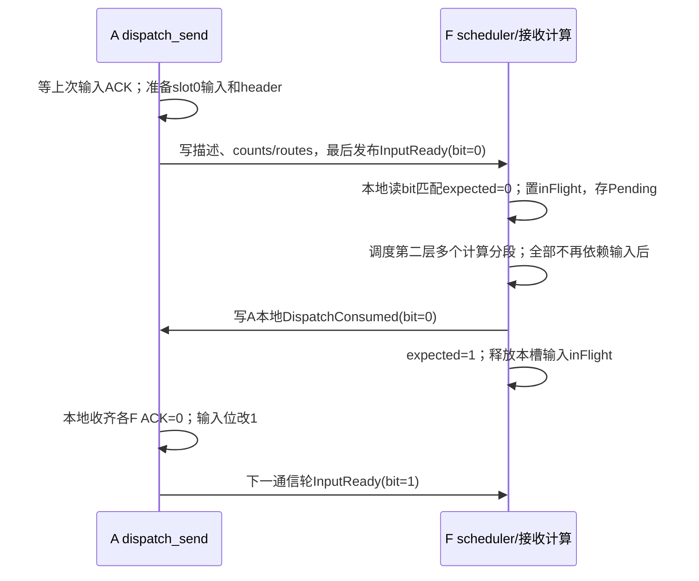

返回握手独立维护状态，每次槽使用所有F都参与。选择一个DP条目的首个计算分段前，scheduler确认所有成员returnBit匹配F ReturnSlotState期望和本地credit，并占用授权；同轮后续分段无需重新申请。最后结果完成后向每成员发Done，零route路径同样执行。

A收齐全F Done后才归并/清理并发下一credit。每个F必须完成中间1轮，A才能重新授0；输入全F ACK又保护Inbox不会被下一输入覆盖。该证明依赖有序且无迟到重复写、初始化排空、单轮占用以及硬件发布原语，不覆盖重连或乱序重传。

```text
使用0：每F（含零route）consume credit0 → Done0
A：全F Done0 → reduce/clear → credit1
使用1：每F（含零route）consume credit1 → Done1
A：全F Done1 → reduce/clear → credit0
使用2：再次使用0；旧Done0已经被中间Done1替换
```

inputBit、returnBit分别存储，资源语义独立；当前闭合协议下数值可能同步，仍禁止隐式相互推导。下一轮输入可先进入Pending，但credit未到不能选计算。第二层分段不翻位、不提前ACK整轮。每个mb前一事务输出及最后输入ACK均结束后才开始下一事务。

## 4.6 从单轮扩展到两层分轮

### 4.6.1 第一层：DP token范围与成员共同轮次计划

```text
整DP逻辑BS=256k，DP通信轮次预算=32k
round0：[0,32768)
round1：[32768,65536)
...
round7：最后一段
```

A框架为整个DP生成一致的轮次计划，成员在算子内按计划遍历；不能各自按本地BS独立编号round。每轮是同一DP逻辑token集合，各成员按owner映射给出本地范围或token映射，尾轮允许某成员actualTokenCount=0。DP内layer、microbatch、事务顺序和round总数保持一致。非连续CP布局使用映射而不是强行套用一个连续tokenStart。

例如DP内TP2、均匀token分片时，DP单轮32k对应每成员16k。若成员负载不均匀，按实际计划注册各成员容量，不能未经证明把每成员容量都申请成DP预算除以成员数。输出仍为每调用成员真实owned token数的完整张量，随后由A适配层恢复框架所需布局，不拆模型Attention计算。

第一层限制A量化源区或F DispatchRecv，并限制A CombineRecv返回窗口。窗口复用需要显式consumed/credit，而不是依赖host调用顺序猜测远端已完成。

### 4.6.2 第二层：固定专家行数预算与专家内切片

```text
一个DP通信轮次（DP总计最多32k唯一原始token，所有成员发布到齐）
    → 计算任务0：部分专家routes
    → 计算任务1：后续routes
    → ...直到本F相关routes全部完成
```

本F原始安全上界：

```text
maxExpertRowsForOnePrefillCommRound =
    min(numMaxTokensPerDpCommRoundPrefill,
        ΣDP内成员 memberCommTokenCapacity)
    × min(topk, expertPerRank)
```

如果maxExpertRowsPerCompute小于这个上界，scheduler按每专家route游标切片，单个专家也允许被分成多个任务。现有CAMAsync按完整专家分轮的方式可借鉴，但不能原样支持“单专家超过容量”。

该上界按DP唯一token数计算，不再额外乘TP/CP。DP到齐只表示整个条目可调度，不要求一次将全部成员的专家行搬入workspace。scheduler跨成员累计预算，并可切分某个成员的单专家route列表。各计算任务内部仍按 `[localExpert][sourceLane][routeOrdinal]` 组织专家行，sourceLane定位物理成员及microbatch；routeOrdinal是该专家来源列表的序号，不等于token ID，预留跨度使用该物理成员窗口容量。

Dispatch读取去重只要求在当前任务内正确。若同token不同专家被拆进不同计算任务，可能重复读取；初版接受这项代价，可在不破坏预算时尽量把同token本地routes放在同任务。不能为了去重跨任务复用未定义的临时buffer。

### 4.6.3 专家行数的预算示例

```text
actualExpertRows = ΣselectedDpEntries Σ该条目内memberViews
    ΣlocalExpert selectedRouteCount
actualExpertRows <= maxExpertRowsPerCompute
```

不能用去重record数或平均路由代替专家行数。Prefill一次一个DP条目并不意味着只有BS行；先汇总其所有成员的唯一token，再应用 `DP轮次token数×min(topk,expertPerRank)` 极端上界。Decode同DP多microbatch按条目分别计数，不能因为DP相同而只算一次。

| 单DP唯一原始token容量 | 最坏专家行数，K=R=8 |
| --- | ---: |
| 4096 | 32768 |
| 32768 | 262144 |
| 262144 | 2097152 |
| 1048576 | 8388608 |

第二层预算固定后，DP总计32k的通信轮可以分若干计算任务，不强制申请262144行workspace。若DP内两个成员各自实际32k且允许总64k，则整轮上界是524288行；不能继续套用32k总量的上界。

### 4.6.4 返回地址、同轮多次写入和整轮释放

每个物理A成员的返回窗口按其第一层owner token范围组织：`[payloadSlot][memberRoundLocalToken][topk]`。F不同第二层计算任务写入其中不重叠的专家结果位置，返回目标同时包含DP条目和成员视图。该成员完整输出地址为：

```text
memberOutput[memberOutputIndex(memberRoundLocalToken), hiddenColumn]
// 连续分片：memberOutputIndex = memberTokenStart + memberRoundLocalToken
// 非连续CP/重排布局：由memberTokenMap定位，不能直接用DP tokenStart替代
```

同一DP通信轮次的多个计算任务共享各成员窗口的使用权，不在每次计算后等A释放整窗。各F在该DP轮次完成后向所有成员发Done（含空完成）；成员等所有F后归并有效owner token并释放返回窗口，再由A侧恢复框架TP/CP布局。可后续优化逐token提前reduce，但首版不依赖此优化。

### 4.6.5 首版credit预检与单workspace

```text
输入到齐 → Pending.Ready
credit未齐：保留Pending，继续扫描其他条目
credit已齐：唯一scheduler占用本条目全部成员授权
    → Active → dispatch/compute/combine → 完成提交
```

单F仅一份Active/workspace，选择前检查全部成员（含零route成员）的授权。Decode聚合的每个条目分别满足该条件；只有唯一scheduler/串行完成路径更新状态，检查占用不与另一个任务并发。A在收齐本轮Done前不会撤销已授授权。

首版不先计算未获credit的新返回轮，combine阶段不以正常credit等待占住唯一workspace。没有可执行任务时scheduler同时扫描发布、空完成、其他候选和退出状态，不无界等待单一候选。硬件DMA完成等待仍需处理。

代价是放弃跨返回轮compute-ahead，保留单任务内MegaMoE read/GMM/activation/write wave。将来若要先算后等又绕过阻塞任务，必须新增有限结果buffer、Active生命周期及提交队列并重算内存，不能继续按单份workspace承诺。

### 4.6.6 A并发收发、时间线与禁止的等待环

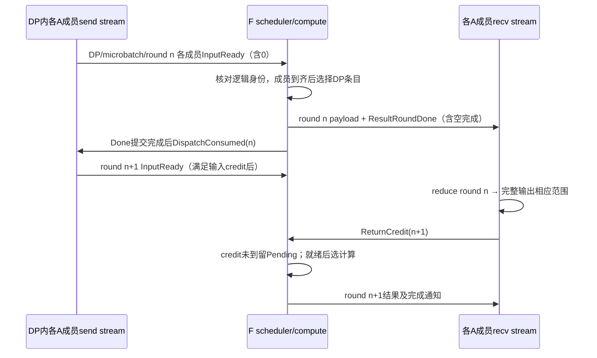

每个A成员在send/recv两个stream下发独立算子：共享启动事件确保owner规范化后的输入、路由权重、共同轮次计划及状态初始化完成；recv不等待整个dispatch_send结束；下一层等待本地send_status、combine_recv及必要的A内布局恢复完成。所有成员遵循同一DP逻辑轮次，即使本成员本轮为空也发布header。第一层多轮在算子内部闭环，graph捕获的是固定节点。

**禁止在同一stream串行下发“整批dispatch_send完成后才开始combine_recv”并同时复用小返回窗口。** 那会形成send等输入释放、F等返回credit、recv尚未运行的等待环。可替代实现是框架逐轮交替下发，但本文目标保留一次send/一次recv及内部循环，要求验证AIV核数配额、并发kernel调度和图模式跨stream事件。单纯使用两个stream不证明一定能并发执行。

实际BS不超过窗口容量时走单轮快路径；最后一轮仍需完成通知，但没有后续窗口复用等待。框架尽量限制大请求每次MoE实际BS，可使多数运行走单轮。

### 4.6.7 CAMAsync机制的继承边界

当前本地CAMAsync A发送整批，F的WaitFromAttn先检查一个DP内全部TP成员到齐，再汇总成员的专家counts并选择计算分轮；返回metadata保存成员前缀和专家计数。它按连续rank和tpSize定位DP，目标改为显式成员表，并支持TP/CP非连续token映射。它并未把整批payload窗口变成小环形窗口。接收选择要求每个完整专家的TP聚合行数能放入maxTokenNum，部分地址索引为uint16，大容量改造必须审计。

目标复用“DP内到齐、按成员聚合、固定计算容量、持久消费游标”的机制，新增第一层窗口轮换、CP所有权映射及专家内route切片，不照搬整专家限制，也不在F重新引入TP。

## 4.7 scheduler状态机和进度提交

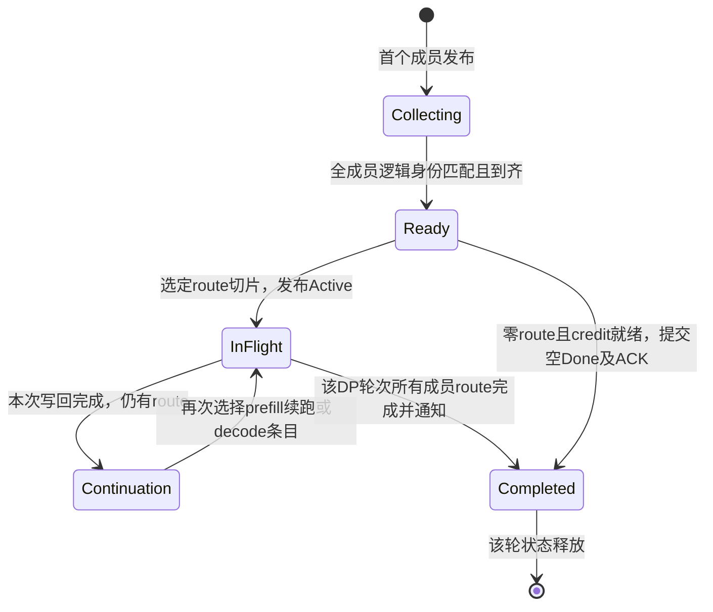

未被选择的Ready/Continuation及半到齐Collecting都持久保存；完成回传后才推进已处理游标。P/D优先级先决定phase；若选择P，再优先当前通信轮次的第二层续跑，不强制跟随同DP的下一通信轮次。

### 4.7.1 选择规则

1. 扫描物理成员/槽的InputReadyControl，只接收匹配expectedBit且尚未inFlight的发布，再按同一member/slot坐标读取稳定Inbox，把匹配DP/microbatch/layer/round的描述吸收进Pending；所有成员到齐才生成可计算候选，整DP零路由走元数据完成路径。未选中或半到齐条目均保留。
2. 由phase策略选P或D。初版保留decode优先方向；具体公平性/等待阈值独立实现。
3. 选择一种layer；首版maxScheduledLayers=1。
4. 如果选P，一次选择一个已到齐DP/microbatch/通信轮次的route切片，优先续跑该条目尚未完成的第二层分段；预算跨DP内所有成员累计。选择前检查所有成员credit；未齐留Pending并扫描其他候选。
5. 该条目第二层完成后释放prefillContinuation；同DP下一第一层通信轮次重新参加普通队列，不强制持续独占。
6. 如果选D，可聚合同DP的多个microbatch/slot及不同DP条目；每个条目独立满足全成员到齐，且同phase、同layer、合计行数不超预算。tokenId相同但microbatch不同的token不能去重合并。
7. 写Active，完成发布后返回；计算实体非驻留扫描Active，按stream依赖执行。

第一层不默认续跑优先：下一轮成员未必到齐；大1M请求不应连续占住F；各F独立推进也不适合绑定等待同DP。未来可加公平性，不改变协议。Prefill共享payload槽时，同DP多个microbatch不能同时拥有完整有效的成员payload，不能仅因任务结构容纳多个条目就把它们聚合计算。

### 4.7.2 按条目提交完成，而不是清空整个DP

计算返回成功后，消费者按SelectedMemberViews提交各成员/专家的route进度，scheduler再推进对应SelectedDpEntry。某DP条目只有所有成员相关route完成才结束，聚合的多个microbatch分别提交，不用一个Done清空整个DP。不能在dispatch_recv刚搬入时就把整个条目标记计算完成。单F只有一个活动计算任务时，Active不并发覆盖；要重叠任务则需多份Active和workspace，首版不做。

## 4.8 贯穿示例：TP2 Prefill续跑与同DP多Decode microbatch

### 4.8.1 一个DP的通信轮次，多次F计算

DP0={A0,A1}、layerId=7、microbatch0、DP单轮32k，A0/A1各负责16k唯一token。F0的maxExpertRowsPerCompute=32768。以下只列F0，其他F独立运行。

| 时刻 | 数据/状态变化 | 可调度性 |
| --- | --- | --- |
| A0先发布 | F0保存DP0/mb0/round0的A0视图与counts | Collecting，不计算半个DP |
| A1随后发布 | 同microbatch/layer/round及各成员预期发布匹配；F0本轮counts合计80000专家行 | 记录dpReadyTime，进入Ready |
| scheduler任务0 | 一份SelectedDpEntry、两份MemberView，选32768条route | 原workspace仅承载本次行数 |
| 任务0返回完成 | 向A0/A1各自token/topk位置写部分结果，提交route游标 | 同返回窗口仍占用，不等待A整轮释放 |
| scheduler任务1 | 若选择P，优先继续此条目，再取32768行 | 原workspace安全复用 |
| scheduler任务2 | 最后14464行 | 提交整轮完成，发布成员结果Done及Consumed |
| A接收 | 各成员等所有F Done，reduce有效token并写本地完整输出 | 向F发布下一返回交替位的credit |

80000是专家展开行数，不是token数。各成员counts分布需满足每专家最多该成员16k个token的约束；它可以分布在多个本地专家上。若F2对整个DP本轮counts=0，F2全成员到齐且credit就绪后向每成员发空Done再发Consumed，不执行GMM。

第一层下一通信轮需重新匹配全部成员并进入普通候选队列。即使F0继续接收DP0，也不强迫其他F同步选择DP0。

### 4.8.2 同一Decode DP两个microbatch一起计算

DP0仍有A0/A1，mb0和mb1使用不同payload槽，四份发布均就绪且同phase/layer：

| DP条目 | A0本F专家行 | A1本F专家行 | 小计 |
| --- | ---: | ---: | ---: |
| DP0/mb0 | 40 | 60 | 100 |
| DP0/mb1 | 70 | 90 | 160 |

scheduler可以一次选择两条SelectedDpEntry、四条MemberView，总260行。按专家组织输入后使用同一层权重；mb0/token7和mb1/token7绝不去重成一个token。计算完成按各条目/member分别返回和推进，不用一个DP Done覆盖两条状态。还可加入其他DP同层Decode条目，但必须重新累计预算。

# 第五部分：后端接口、代码改造与资源预算

共同协议规定“选择什么、何时能读写”；本部分规定“怎样映射到原内核”。保留的内部逻辑、必要新增逻辑、payload布局与计算容量在各后端一起说明。

## 5.1 公共逻辑API与初始化契约

以下是**拟定逻辑API**，不是当前已存在的torch_npu或ACLNN符号。实现时保留ACLNN两阶段workspace查询/执行模式和固定tensor地址约束；不把这些新入参直接追加到旧上游函数并宣称兼容。

`AfdContext`包含role/后端、DP及成员注册表、成员窗口和容量、FFN纯EP映射；`AfdTaskState`包含共同DP事务身份、逻辑microbatch及成员进度；`DpRoundPlan`给出共同轮次及各成员token映射；`ActiveTask`由scheduler产生。静态属性在初始化确定，动态值为device tensor。DP内多microbatch是多份独立task_state，不复用一份可变身份记录。

```python
dispatch_send(
    x, expert_ids, active_mask, task_state,
    dp_round_plan, member_token_map,
    afd_context,
    # 静态：本DP/成员身份、后端、dispatchDedupMode、
    #       numMaxTokensPerDpCommRoundPrefill、memberCommTokenCapacity、
    #       numMaxTokensPerRankDecode、reuseTokenBufferAcrossMicroBatches、量化格式
) -> send_status

combine_recv(
    expert_scales, active_mask, task_state, afd_context,
    dp_round_plan, member_token_map,
    output,  # [本调用成员真实ownedToken数, hiddenSize]，普通HBM；框架再恢复TP/CP布局
) -> output

ffn_scheduler(
    afd_context, pending_table, compute_completion,
    active_task,
    # 静态：DP成员表、maxActiveDpEntries/maxActiveMemberViews、
    #       maxExpertRowsPerCompute、maxScheduledLayers=1、phase策略
) -> active_task

megamoe_afd(
    afd_context, active_task,
    layer_weight_views, layer_scale_views,
    workspace, compute_completion,
    # 原有activation/quant/weight布局属性
) -> expert_token_nums, compute_completion

dispatch_recv(
    afd_context, active_task,
    expand_x, dynamic_scales, expert_token_nums, assist_info_for_combine,
) -> actual_expert_rows

combine_send(
    expand_x, assist_info_for_combine, active_task,
    afd_context, compute_completion,
) -> compute_completion
```

`assist_info_for_combine`保留原物理source/token/topk定位语义，并通过sourceLane/SelectedMemberView关联DP条目、microbatch、slot、交替位、layer和round。优先保留原三元组，把新增身份放在旁路entry表；GMM只处理专家行和group list，不需要理解DP/TP/CP拓扑。不同microbatch同号token由不同MemberView隔离。

FFN仅纯EP，原distribute的F端TP all-gather/reduce-scatter分支关闭；这是F的计算限制，不是禁止Attention TP/CP。shared expert首版禁用或单独定义，不用dummy参与者模拟完整EP。expert_scales按owner token留A做最终加权；不启用F部分归并或提前乘权，以保持首版数值语义。

### 5.1.1 A侧执行流程与输入输出生命周期

```text
框架在A完成AF边界owner/完整hidden规范化
DP内生成相同事务身份和DpRoundPlan，成员各自准备expert_scales及输出
  并发启动dispatch_send与combine_recv

dispatch_send：
  for DpRoundPlan中的每个communicationRound：
    首次从初始化的Free输入槽开始；后续等全F Consumed取得输入窗口
    根据成员token范围/映射读取本轮x和routing，计算本成员参与F及专家counts
    read后端：量化到A本地通信区，向F写routes/counts
    write后端：量化、按模式去重/不去重，写F record区及路由表
    payload/routes完成后向各F写成员InputReady，零route也写count=0
    中间轮等全F Consumed再复用输入；最后一轮发布DMA完成后返回send_status，不在本send内等最终ACK

combine_recv：
  for communicationRound：
    先等RoundLedger ready，再等所有注册F本轮ResultRoundDone
    使用稳定active_mask归并有效token的topk结果；inactive输出写0
    根据memberTokenStart或memberTokenMap写本成员完整output
    清理本地该轮状态，向所有注册F写下一轮ReturnCredit
  归并完最后一轮后，按Ledger最后inputBit等全F Consumed，再结束recv
  与send_status汇合后才释放物理槽；recv只读ACK，不代替send翻转输入位
框架在必要时恢复TP/CP的复制或序列并行输出布局
```

AfdContext持有长期窗口；send_status仅表示源x搬运及发布完成，不表示输入槽可复用。x和发送临时buffer保持到实际搬运及send结束，mask/scales/token映射保持到recv结束。recv收尾等待最后全F输入ACK，下一次send仍按自身输入状态处理ACK/翻位，不能由两个kernel重复推进输入位。单槽owner在全轮输出及最后输入ACK完成前不变；下一层等待send、recv及必要布局恢复共同结束。

## 5.2 MegaMoE AFD：拆源端，保留专家wave

### 5.2.1 原流程与目标归属

原A8W8入口为MegaMoeA8W8Wave::Process→基类ProcessWave，原输入准备、计数/去重表、专家wave及source unpermute在同一算子内。目标只是改变阶段归属和任务输入，不能把AIC/AIV0/AIV1的交错wave改成串行五步。

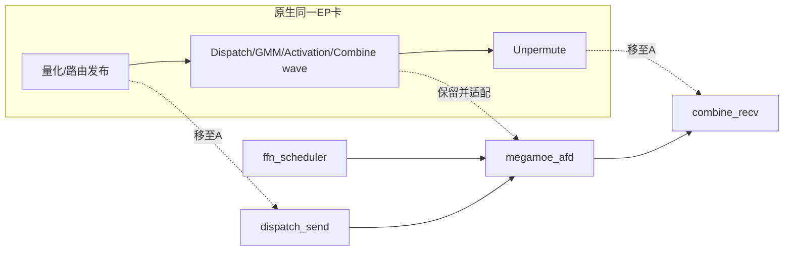

| 原阶段 | 目标位置/变化 |
| --- | --- |
| 原输入量化与发布 | 移至A dispatch_send，尽量复用TokenQuant/打包 |
| 原接收counts/routes | scheduler先确认DP条目所有成员到齐，再由SelectedMemberViews适配原计数/物理来源视图 |
| 原远端读取和去重 | 保留；winRankAddr改为物理member/microbatch/slot/round视图；不同条目token不混组 |
| GMM1/Activation/GMM2 | 保留tile、wave、原workspace布局；初始化时device选当前层权重 |
| 原combine write | 保留主要搬运；目的地改A返回窗口，首次选择前由scheduler检查并占用credit |
| 原source Unpermute | 移至A combine_recv |
| 原计数截断 | 不作为合法路径；scheduler容量检查替代 |
| 原EP全组状态 | 替换为逐成员全F完成握手和AFD身份；无F间集合barrier |

```text
megamoe_afd Init：
  读取ActiveTask（可含同DP多个Decode microbatch），定位本次层权重地址
  绑定原WorkspaceLayout与各MemberView累计的本次expert counts
  绑定物理sourceLane的当前窗口、token映射及返回视图
Process：
  准备计数/可选去重表
  原dispatch/GMM1/activation/GMM2/combine wave流水
  本任务结果写完后提交route进度
  每个DP条目在本F完成时，向所有成员写ResultRoundDone（含空完成），确认后向所有成员写DispatchConsumed
```

第二层route切片必须让原prepass只覆盖本次有效行，MetaInfo使用成员本轮原始token/topk而不是计算输出行号，sourceLane关联完整DP/microbatch身份。不同任务之间重置原flags，不把上一任务wave flag当作本次ready。原source维度的计数和flag容量按物理member views规划；DP聚合不要求重写wave的GMM计算。

### 5.2.2 目标源record、A窗口容量与F路由区

MXFP8的常规整齐维度，scale物理字节为 `2×ceil(hiddenSize/64)`；其他尾部按原布局函数处理。不开权重前移、combine去重时：

```text
quantizedTokenRecordBytes =
    align32(align256(hiddenSize) + 2×ceil(hiddenSize/64))

returnRecordBytesMegaMoe = hiddenSize × 2

attentionPayloadBytesMegaMoe = numPayloadSlots × memberCommTokenCapacity ×
    (quantizedTokenRecordBytes + topk × returnRecordBytesMegaMoe)
```

若启用权重前移或其他带权重record模式，必须通过原生布局函数增加权重段，不继续用上述数字。初版权重留A进行最终reduce，保持原权重语义。

F不预留所有A的payload接收区；Inbox/route/Active的实际容量按4.4计算，不能称为零内存。A同时持有小量化源区和小topk返回区，完整输出在普通HBM。

### 5.2.3 保留原生读取去重门控

当前MTE默认请求dispatch去重；tiling经过UB容量检查及收益判断。均匀模型：

```text
expectedDistinctFfnRanks = numFfnRanks × (1-(1-1/numFfnRanks)^topk)
estimatedSavedBytes = perSourceCapacity × (topk-expectedDistinctFfnRanks)
    × hiddenSize × activationBytesPerElement
```

原生4卡使用按专家摊销且按中间维度分档的阈值，其他卡数约60MiB总量门槛。它是收益估计，不是真实路由的保证下界。AFD应使用实际F专家分布规模，不能把A+F总rank代入。保留门控用于小decode，不能宣称所有形状都会去重。

prepass要求 `ceil(perSourceCapacity/128)` 不超过UB chunk上限。K=8、capacity=32768时为256，可满足当前该项约束；K更大时必须重算。perSourceCapacity对应每个物理成员的通信轮次容量，不是DP总量或整批1M。来源维度按SelectedMemberViews/sourceLane规划，不能把多个TP/CP成员错误折成一个远端窗口。

### 5.2.4 计算workspace：原布局、不重排

初版A8W8、MTE、topkWeightsPrefetch=0、combine不去重、不量化、无shared时，主要数据：

```text
mainDataBytes = maxExpertRowsPerCompute × (
    hiddenSize + 2×ceil(hiddenSize/64)
  + intermediateSize + 2×ceil(intermediateSize/64)
  + 32
  + 2×hiddenSize
)

dedupRowDescBytesPerRow = align32((2 + 3×topk)×4)
dedupRowDescBytes = dedupEnabled ?
    maxExpertRowsPerCompute × dedupRowDescBytesPerRow : 0
```

原WorkspaceLayout还包含counts、各类同步flags、prepass ready等，其中两类主要wave flags：

```text
2 × expertPerRank × ceil(maxExpertRowsPerCompute/256) × 64
```

最终沿用原host规划：

```text
totalWorkspaceBytes =
    OriginalWorkspaceLayout(正确的容量及模式参数).workspaceSize
  + 50 MiB原生固定预留
  + platform.GetLibApiWorkSpaceSize()
```

去重rowDesc、flags及固定预留是**原算子已有分区**，不是AFD新改布局。容量参数变化后offset数值由同一布局函数重新计算；所有kernel访问使用该函数对应的workspaceInfo，不硬编码旧offset。新的Inbox、Pending和Active优先放独立控制区。

H=7168、intermediateSize=2048、K=R=8：

| maxExpertRowsPerCompute | 主要数据 | 去重rowDesc | 固定预留 | 完整容量结论 |
| --- | --- | --- | --- | --- |
| 32768 | 746 MiB | 4 MiB | 50 MiB | 超过约800 MiB，还加flags/平台空间 |
| 262144 | 5968 MiB | 32 MiB | 50 MiB | 超过约6050 MiB，还加flags/平台空间 |

原生收益门关闭去重时rowDesc可能不分配。安全初始化按所允许模式最大需求申请，不让replay动态要求更大workspace。shared、权重前移、FP4等使用各自原生布局，不套这张表。

## 5.3 Distributed AFD：独立收发接口，共用MTE基础实现

### 5.3.1 原函数、拆分边界与保留逻辑

原默认dispatch是AlltoAllDispatch→SetStatus→WaitDispatch→LocalWindowCopy→SetExpertTokenNumsA5。原A5 combine把send AIV与接收AIV放同一次调用中，发送含BuffInit/SetWaitTpStatusAndDisPatch，接收含AlltoAllBuffInitAndMaskCal/LocalWindowCopy。完整原接口见附录B。

首版对外四个接口比在完整dispatch/combine中传role更清楚；内部共用量化、地址计算、record、DataCopy、通知、打包函数，不复制四份内核。

| 原函数/职责 | A dispatch_send | F dispatch_recv |
| --- | --- | --- |
| AlltoAllDispatch/ProcessToken | 复用量化和搬运；以tile histogram/prefix替换原统计及逐route回扫，按成员独立定位 | 无发送部分 |
| SetStatus | 向各F发布成员InputReady，零route也明确发布 | 无 |
| WaitDispatch | 无本地接收等待 | scheduler负责全DP成员到齐；recv只验证选中MemberViews，不等待其他DP |
| LocalWindowCopy | 无 | 复用专家输出组织，按已建专家route索引读取；新增扇出/专家内切片，不逐轮全表扫描 |
| SetExpertTokenNumsA5 | 无 | 复用计数语义，仅输出本次行数 |

| 原combine职责 | F combine_send | A combine_recv |
| --- | --- | --- |
| BuffInit / 读取assist | 复用结果输入、三元组和分核 | 复用接收初始化 |
| ExpertAlltoAllDispatch相关send | 保留打包/DataCopy；目的偏移变成slot/round/token/topk | 无 |
| DataAsFlag结果到达 | 发布原record就绪及本F整轮done，使用scheduler已占用的轮次授权 | 本地等待并按本槽预期返回位和任务描述区分 |
| LocalWindowCopy/权重reduce | 无 | 复用reduce；写回真实member output范围，之后A适配层恢复TP/CP布局 |

不能只在Process中跳过一半代码：Init、tiling、UB申请、输出shape和窗口偏移也按角色拆分。旧非AFD API保持原行为，新后端独立开关，避免向旧用户引入不同布局。

### 5.3.2 Dispatch record、去重/非去重安全容量

建议复用现有512B对齐规则，新增路由段。一个可审查的首版record预算：

```text
FP8 hidden、scale
32B头（原始roundLocalToken、有效成员mask等）
expertIds[topk] int32
sourceExpertOrdinals[topk] int32
可选expertWeights[topk] float32的兼容预留
整体align512
```

H=7168、K=8时：`align512(7168+224+32+32+32+32)=7680` B。权重首版不依赖该预留段；是否保留在最终ABI中可裁剪，必须同源计算stride。

ENABLE去重时，每物理成员每slot最多memberCommTokenCapacity条record；同一owner token对同F只写一次，不对不同microbatch或成员的同号token做合并。可按rank内紧凑ordinal存放，专家route表指向相应record；sourceExpertOrdinal用于兼容原专家/source稳定排序。record、route表及counts一并完成后再发布该成员ready。

DISABLE允许同token按专家重复record；与ENABLE统一为rank内紧凑record＋专家route间接表，payload不保证专家连续。安全record容量：

```text
nonDedupRecordCapacity = memberCommTokenCapacity × min(topk, expertPerRank)
```

**这个min公式要求紧凑record分配。** 如果直接保留原生每expert独立固定B跨度，即使topk<expertPerRank，实际地址范围仍是 `memberCommTokenCapacity×expertPerRank`，不能仅按min申请。首版实现/算子文档必须明确所选布局。

```text
ffnDispatchPayloadBytes = ΣattentionDpId ΣDP内物理成员 (
    numPayloadSlotsForMember × memberCommTokenCapacity
    × (dedupEnabledForMember ? 1 : min(topk, expertPerRank))
    × dispatchRecordBytesForMemberMode
)
```

Prefill默认ENABLE、Decode可DISABLE。模式由明确入参及DP/成员注册表固定，收发双方一致；首版不动态AUTO切换以免窗口小于实际地址跨度。F按每个物理成员隔离接收区，不能仅给每DP一块区域而让不同成员无前缀/分区地同时写入。

### 5.3.3 A5返回record与A窗口容量

保留原A5 DataAsFlag时：

```text
returnRecordBytesDistributed = ceil(hiddenSize×2/480) × 512
attentionReturnBytesDistributed =
    numPayloadSlots × memberCommTokenCapacity × topk × returnRecordBytesDistributed
```

H=7168时为15360 B/专家结果，不再乘numFfnRanks。每个F按owner成员写入其本轮token/topk位置，所有结果位置互不重叠。DP级总容量为各成员容量之和；token已唯一归属时不能再把同一DP token总量额外乘TP/CP。

### 5.3.4 显式去重策略与量化约束

- P默认ENABLE；D可DISABLE，双方静态配置一致。
- ENABLE才使用每物理成员B条record的安全接收区；DISABLE必须按min(topk,expertPerRank)或实际固定专家跨度申请。
- AUTO未来可借鉴MegaMoE估算，但不能复制其性能阈值：发送去重/接收展开和read去重的成本不同。
- 专家相关量化payload不允许强制rank去重；首版MXFP8为专家无关格式。

### 5.3.5 大BS：替换前缀回扫、限制UB、一次构建路由索引

| 当前问题 | 改造 |
| --- | --- |
| BS≤512的多处限制 | 为新AFD容量分支单独放宽，保留旧路径检查 |
| 整批routing/mask多份常驻UB | token tile分块，统计/前缀在普通GM，UB仅保留tile和少量token payload |
| CalTokenSendExpertCnt逐route扫描前缀 | 两遍路由：tile计数→tile前缀→线性生成rank/expert ordinal |
| 每专家重复payload | ENABLE时每目的rank一次，record携带本地专家成员 |
| 专家固定B跨度 | 去重按source record区；非去重decode按rank紧凑record和专家route间接表组织 |
| uint16 DMA/索引可能越界 | 按单次tile拆DMA，route索引至少32位、字节偏移64位 |
| 原生全rank等待、双半区 | 改为InputReady/consumed/credit，不等待未选中的source |
| 原生ep_recv_counts混作去重数 | 保留专家展开行语义，新增内部uniqueRecordCount |

#### 算法来源与复用边界

原CalTokenSendExpertCnt为每条route扫描此前的专家ID前缀，再做比较归约来计算ordinal；随着前缀增长，累计工作可能接近平方级。Prefill不能依靠增大UB或调整核数保留这套算法，ENABLE和DISABLE两个新分支都必须替换。

MoeEP的CalSendCnt按token分核、核内再分group，只加载当前group的routing，执行目的rank去重和rank/expert双计数，将中间目的rank及counts保存到GM。DeepEP-Ascend使用核内expert/rank histogram、同token目的rank去重、跨核rank计数前缀，再把核内ordinal与核间前缀相加定位record。两者都可借鉴“大批次统计与定位”的方法；不复制其URMA提交、队列/epilogue和全组同步来替换目标MTE通路。

#### 线性路由准备与发送

```text
Pass 1：每物理A成员按本轮owner token划分tile并分核
    加载当前tile的expertIds/activeMask
    统计tileExpertCounts[tile][expert]
    统计tileRankCounts[tile][ffnRank]（ENABLE为去重token数，DISABLE为route数）
    保存必要的路由中间信息到GM

Prefix：对小规模counts沿tile/核维求前缀
    tileExpertPrefix[tile][expert]
    tileRankPrefix[tile][ffnRank]
    汇总每目的F、每专家的counts，分配紧凑record及route段

Pass 2：tile内再次顺序遍历，每个计数器只前进不回扫
    expertOrdinal = tileExpertPrefix + tile内该专家ordinal
    rankRecordSlot = tileRankPrefix + tile内该rank ordinal  // 两模式都为rank紧凑序
    ENABLE：一个token给一个F仅一份payload，附多个专家成员
    DISABLE：每route一份payload，按rankRecordSlot写入；不假定专家payload连续
    直接生成每F每专家的route列表，引用payload record/成员位置
    复用原量化、DataCopy和有序发布ready
```

token内rank去重使用适合F规模的有界bitmask，或小topk局部比较；不能为每个token清扫一个无界大rank数组。常见固定topk和有界rank mask下，主工作量为 `O(memberActualTokens×topk + numTiles×(moeExpertNum+numFfnRanks))`。小topk比较实现另有局部topk因子，但不随整批前缀长度增长。

UB仅保留 `routingTileTokens×topk` 的路由/掩码、可容纳的计数和少量量化payload。tileExpertCounts、跨tile前缀和完整路由引用在GM；专家数过大时计数也分组，不能假设所有专家表无条件放入UB。统计tile大小和payload搬运tile大小分别规划，不能让一个较大routing tile同时保存其全部hidden。

GM准备暂存可按以下项目计量：

```text
tileCounterBytes = numTiles × (moeExpertNum + numFfnRanks) × sizeof(int32)
prefixBytes <= 同量级tileCounterBytes（是否原位复用由生命周期决定）
routePreparationBytes = O(memberCommTokenCapacity × topk) 的固定跨度引用/目的信息
```

sourceExpertOrdinal通过该线性前缀生成，保留专家内的物理来源和token稳定次序，便于复用原接收输出布局。计数kernel之间的同步必须先完成，不能在前缀尚未稳定时发送通知。

#### F侧不重复全量扫描

每个成员发布时提供本F各专家counts及route索引列表；若某实现选择F侧建索引，也只在本通信轮次首次准备时构建一次。第二层计算分轮直接读取 `expertRouteBase + completedRouteCount` 对应范围，禁止每次从头扫描全部32k record以寻找本次专家。DP到齐只聚合小counts/身份，并不把全体routing重新加载到UB。

同一DP多microbatch聚合时，各MemberView保留自己的route基址和prefix，计算输入再按expert/sourceLane组织；不同条目不共享累加ordinal。新算法分支/API与旧对称EP隔离，不把A/F通信域总rank当作专家EP大小，避免影响A3和原V2用户。

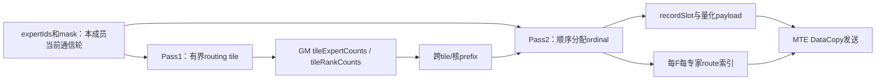

| 中间数据 | 逻辑形状/容量 | 存放 | 生成与消费 |
| --- | --- | --- | --- |
| routing tile | tileTokens×topk及mask | UB | 两遍扫描各次按tile读入 |
| tileExpertCounts | numTiles×moeExpertNum | GM | Pass1产生、Prefix消费 |
| tileRankCounts | numTiles×numFfnRanks | GM | Pass1产生、Prefix消费 |
| tile前缀 | 与counts同量级，可验证后原位复用 | GM | Prefix产生、Pass2消费 |
| rank record引用/专家ordinal | 不超过成员轮次token×topk级别 | GM或直接写最终路由表 | Pass2生成，不重扫历史前缀 |
| 量化payload ring | 少量hidden记录 | UB | 与routing tile独立，完成DataCopy后复用 |
| F专家route表 | counts/prefix界定的成员来源列表 | 通信/本地GM | 轮次首次准备，后续计算直接按游标切片 |

阶段间同步使用本地kernel/核间依赖；跨卡ready始终在最终payload/routes/counts完成后发布，不借用EP/DeepEP的URMA队列协议。

### 5.3.6 GMM内部workspace与显式输出张量

选定A5 `GroupedQmmTiling`主路径的GetWorkspaceSize返回SYS_WORKSPACE_SIZE=16 MiB；FP8/MX输入支持需满足该路径的dtype/format等约束。其他basic API或预处理路径可能不同，最终以实际选定接口的返回值为准。这里不把多个算子的scratch简单相加。

GMM显式输出不是其内部scratch：

```text
gmm1OutputBytesBF16 = maxExpertRowsPerCompute × (2×intermediateSize) × 2
gmm2OutputBytesBF16 = maxExpertRowsPerCompute × hiddenSize × 2
```

上述示例32768行：GMM1输出256 MiB、GMM2输出448 MiB；262144行：2 GiB与3.5 GiB。输入、scale及激活张量按真实pipeline生命周期规划。允许物理上复用现有GMM1+SwiGLU+量化融合算子，不强求逻辑五步对应五个kernel。

## 5.4 三场景与TP配置的目标容量汇总

以下先用TP=CP=1作为基准：H=7168、K=R=8、8A/8F、每DP单通信轮次32k、BF16返回。忽略表外控制和路由区。此表A rank与DP一一对应，不直接套用于同样卡数但DP更少的TP/CP部署：

| 场景/后端 | A单卡payload | F单卡payload | 系统payload总量 |
| --- | --- | --- | --- |
| 纯P、MegaMoE，单槽 | 3.725586 GiB | 无大接收payload | 29.804688 GiB + F metadata |
| 纯P、Distributed去重，单槽 | 3.75 GiB | 1.875 GiB | 45 GiB |
| 纯D、MegaMoE，128 token、M=2 | 29.804688 MiB | 无大接收payload | 238.4375 MiB + metadata |
| 纯D、Distributed不去重，128 token、M=2 | 30 MiB | 120 MiB | 1200 MiB |
| 4P+4D、MegaMoE | P同上、D同上 | 无大接收payload | 约14.902344 GiB +119.21875 MiB +metadata |
| 4P+4D、Distributed，P去重/D不去重 | P 3.75 GiB、D 30 MiB | 1020 MiB | 约23.085938 GiB |

混部Distributed的F单卡：`4×32768×7680 + 4×2×128×8×7680 = 1020 MiB`。数字采用decode非去重record也按7680B预算；实际可裁剪record但须重新计算。

同样4P卡+4D卡，若P改为DP2TP2、每P DP轮次总计32k并均匀分片，D仍DP4TP1、128 token、M=2：

| 项目 | MegaMoE | Distributed（P去重、D不去重） |
| --- | --- | --- |
| P单物理成员容量 | 16k owner token | 16k owner token |
| P单卡payload | 约1.862793 GiB | 1.875 GiB |
| F单卡接收payload | 无大接收区，metadata另计 | `4×16384×7680 + 4×2×128×8×7680 = 540 MiB` |
| 单P DP轮次最坏专家行数 | 262144 | 262144 |

内存减少来自DP逻辑轮次预算在两个唯一token owner间分配，不是TP自动压缩相同token副本。若每P物理成员仍预留32k，应用窗口回到前表的P部分容量；若还允许每DP实际发送64k，计算行数上界也翻倍。

当逻辑Prefill整批为256k或1M时，以上通信窗口不随整批增大，只增加轮数。普通HBM输入、输出及topk路由仍随真实owned token数增长。例如1M、H=7168的完整单份BF16 hidden约14 GiB，可按owner分散在成员上；若框架后续要求复制，副本另计，不能宣称整个模型HBM与BS无关。

若保留整批combine区，A将分别需要30/120 GiB（Distributed，256k/1M）。这正是本方案选择小返回窗口和A并发收发的原因。

本节只汇总前文布局结果。实际进程总HBM还需加入4.4的metadata、5.2/5.3的计算张量和内部workspace、权重、完整输入输出以及后端实际分配余量；不把不同口径的“通信内存”相加或比较。

## 5.5 Device选层与未来跨层的改造边界

首版scheduler限制一个layer，LayerWeightViews[layerId]引用框架原来按层组织的TensorList/scale。计算kernel在device读取layerId并绑定原专家权重地址，不经host选module，不改权重HBM排布。

同层不限制SelectedDpEntries来自几个DP或同DP几个Decode microbatch；它们通过MemberViews映射为同层专家行。Attention TP/CP只影响来源/返回视图，不改变F纯EP的权重分片。未来跨层与当前跨microbatch是两个独立能力，不能为了首版单层而禁止同DP多microbatch聚合。

当前CAMAsync layered从一个标量layer_index选择全次调用的层，是单层device选层，不是跨层GMM；其现有量化/架构分支也不能自动代表A5 MXFP8已可复用。

未来多层扩展：

```text
computeGroupIndex → (layerId, localExpertId, rowRange, weight/scale view)
```

同编号不同层专家必须是不同group。GMM tile和通算基本流水可以保留，但专家遍历、counts/prefix、同步flags、去重身份、权重基址都需适配；不能说只扩大wave flags即可。按最大active计算组规划资源，不按全部模型层×专家常驻扫描。

首版数据格式含LayerGroups且numSelectedLayers=1；未来才扩展消费者及group容量。新增层号尽量通过source entry旁路传递，若原32B MetaInfo不够，必须明确ABI修改而非假定存在空字段。非法层号报错，不静默回落layer0。

# 第六部分：执行约束、实施与验证

这一部分集中列出哪些条件保证协议可执行，哪些仍需平台和性能验收。它们不替代前文的具体字段与状态契约。

## 6.1 图执行、初始化和生命周期

- F固定图单位为scheduler+一次计算/返回；可一次捕获固定数量该单位减少提交开销。host while重复下发，不读本次选层、source或实际行数。
- scheduler在内部处理就绪的零route条目（空Done/ACK）后继续扫描；有实际任务才发布Active.valid=1并返回。shutdown/错误返回时Active.valid=0，后续固定图节点必须device侧no-op，不能使用上次Active或让旧GMM再次执行；compute_completion只在有效任务成功后提交。
- scheduler在device按DP/microbatch检查全成员到齐，graph不依赖host读取ready bitmap；maxActiveMemberViews和group list按最大物理来源容量固定。
- 第二层轮数由设备游标决定，不要求每个graph恰好完成一个模型层或整批。scheduler可等待有效任务，但需要shutdown/错误出口。
- A图包含有事件约束的send/recv并发节点，内部device循环处理实际轮数；不在Python .item()后动态创建输出shape。
- DP成员的共同轮次计划、token owner和可选token map在发布前就绪；A侧必要TP/CP集体通信遵守一致的层/microbatch顺序，不能因某成员本轮0 token就独立跳过需要全组参与的布局恢复。
- output、Active、Pending、weight view及通信窗口地址稳定；输入/返回交替状态跨图replay持久保存，不能每次回放复位。
- 捕获/预热不得永久消费真实请求的credit；使用隔离的warmup状态或可恢复初始化，正式运行前统一重置。
- graph replay时counts改变可行的前提是GMM从device group list读取实际长度；host tiling按最大容量、统一shape和dtype规划。零专家/尾轮需显式覆盖。
- 显式区分kernel结束、远端写完成、输入consumed、返回round done和完整microbatch完成。不得用一次stream同步代替所有跨卡协议。

## 6.2 实施顺序

1. 固定运行时/源码基线，先执行附录D的状态发布、交替位、A双流进度及窗口注册门禁；不能推迟到全部算子完成之后。
2. 单层、单DP/TP1、单通信轮：分别跑通两条后端的A/F拆分，保留原数值路径。
3. Distributed显式去重/非去重安全布局和tile histogram/prefix，确认无逐route前缀回扫；旧小BS对照后放宽512至32k。
4. DP成员注册/owner规范化、TP/CP到齐、独立scheduler、A先发布同层多mb的调度及跨DP Decode组batch，验证Pending和专家内切片。
5. 32k第一层窗口与小combine区，A并发send/recv，producer-write credit闭环。
6. Prefill多个microbatch单槽、Decode多槽、纯P/纯D/4P4D共享F。
7. 固定图replay、device选层、预热/退出和压力测试；最后评估性能门槛。

## 6.3 正确性、容量与性能验收

- 每条合法owner route恰好计算和返回一次；DP/member/microbatch/slot/交替位/layer/round不串数据，同号token不跨条目合并。
- DP2TP2、TP1/2/4和目标CP布局；成员不连续、token分片不均匀/非连续、DP轮次32k与每成员32k两种容量配置分别校验。
- 成员晚到、成员本轮0 token、对某F零route、整DP对某F零route；ready不误判、元数据不提前覆盖；零route完整空Done/ACK，无空GMM。
- token命中同F多个专家、不同F、空source、无本地expert、极端专家倾斜。
- 第二层切在单专家内部；同通信轮的多次combine不会等待A提前释放整个返回区。
- 第一层尾轮、单轮快路径、32k/256k/1M逻辑容量；大索引和64位字节偏移。
- F快慢不同、A消费慢、credit延迟、不同F轮数不同，系统无等待环。
- M=2/3 Prefill单槽和Decode独立槽；metadata保留未选中任务与首次ready时间。
- 同DP mb0+mb1组成一个Decode任务，再与其他DP聚合；每条目独立到齐、独立返回和进度提交，容量按所有成员和条目累加。
- PureP/PureD/PD混部、同层聚合和非法跨层选择检查。
- graph重复执行不残留旧flags，捕获无真实状态污染，shutdown可打断等待。
- dispatch启停去重精度一致；不启用未经确认的F partial combine或权重前移改变数值语义。
- Distributed路由准备随BS扩展的时间与GM/UB峰值；去重关闭仍使用线性前缀，F的多次计算分轮不重复扫描整record区。
- 实测并分别报告通信窗口、metadata、计算张量、内部scratch、权重和实际进程峰值，不只报告某一payload区。

## 6.4 主要约束与待验证事项

| 约束/假设 | 验证或实现责任 |
| --- | --- |
| A5按角色注册不同大小窗口 | 假设可行，需确认实际分配、远端地址与生命周期 |
| AF边界唯一token owner且hidden完整 | 框架适配，分别验证TP/CP实际布局和恢复collective |
| A send/recv必须共同推进 | 验证AIV核配额、kernel并发、跨stream图事件，不能只证明有两个stream |
| 小返回窗口及credit | 首版选择前预检，不在计算后正常等待credit；测量空完成及调度成本 |
| 初版单phase/单layer | scheduler保证；同DP多Decode microbatch允许，跨层消费者后续扩展 |
| 专家相关payload不能无条件去重 | 首版MXFP8专家无关；扩格式时重新校验 |
| 原生index/tag/容量边界 | 大容量显式校验，不能截断route或以旧tag替代异步身份 |
| 小BS性能 | MegaMoE保留收益门；Distributed显式选择，AUTO需新的实测阈值 |
| 图与服务退出 | warmup状态隔离、replay交替状态正确、等待有错误/退出机制 |

最终可交付的设计不是“所有配置都已支持”的声明：两个后端都需要独立正确性、内存峰值和性能基线。原生实现可借鉴不等于新组合已验收。

# 附录A：源码基线与证据边界

| 仓库 | 本地分析基线 |
| --- | --- |
| ops-transformer | `8d46ac50deabb544f59f56f5b82a995159907c03` |
| vLLM-Ascend | `be0b61da22778b043eb2369b5f922b2a39ddc46d` |
| DeepEP-Ascend | `3b25377d04b24fc6154698ded78a2bcb2c59afff` |
| 当前AFD CAMAsync checkout | `7cb0aebf4b036ca6466bf01153ec89282a9eff03`；本地有修改，审查实际工作树 |
| DeepGEMM-Ascend | `8491bbb4b8c02a094a2318965f50c70438a3e73c` |
| afd-plugin PR #408 历史参考 | `08b4fc4c15c08b600f25277e0f62a16bdd1d3dcb`；当前对象库无此对象，本次未重验 |

参考仓库：[ops-transformer](https://github.com/Ascend/ops-transformer)、[DeepEP-Ascend](https://github.com/deepseek-ai/DeepEP-Ascend)、[AFD PR #408](https://github.com/vllm-project/afd-plugin/pull/408)。以下能力陈述限定这些基线，不代表所有 CANN 发行包。

“源码支持”“框架已集成”“实机已验证”是不同证据。本文没有新增实测性能结论；不以仓库发布顺序证明成熟度，也不直接用不同口径的带宽结果做性能排名。

# 附录B：原接口参数组与内部函数流程

供开发查阅。参数组来自固定源码，不替代运行时完整schema；新AFD接口在5.1，不直接改旧上游签名来冒充兼容。

## B.1 MegaMoE原接口和阶段入口

以下为原生op定义的参数组，不是逐字ACLNN函数签名：

```text
输入：context, x, topk_ids, topk_weights,
      weight1[], weight2[], weight_scales1/2, bias1/2,
      x_active_mask, scales,
      shared_weight1/2[], shared_weight_scales1/2, shared_bias1/2, mask_buffer
输出：y, expert_token_nums
关键属性：moe_expert_num, ep_world_size, ccl_buffer_size,
          num_max_tokens_per_rank, max_recv_token_num,
          dispatch_quant_mode/out_dtype, combine_quant_mode,
          topo_type, comm_alg, topk_weights_type, combine_comm_mode,
          activation及参数、权重transpose/interleave等
```

现有权重TensorList表达本算子可计算的专家权重，不意味着原生已经能按scheduler逐任务选择任意模型层。

原A5 A8W8主要流程及函数定位：

```text
MegaMoeA8W8Wave::Process → 基类ProcessWave
    输入量化/预量化打包、路由mask/计数准备
    PrepareMoeCountAndDedupTables
    ProcessMoeExpertStages
        PrepareDispatchWave
        ProcessGmm1Wave
        ProcessGmm2AndCombineWave
            GMM2 + combine发送
    source侧Unpermute/输出
```

这是阶段对照，真实AIC/AIV0/AIV1交错、wave-ahead/lag与模板分支以源码为准，不把它们改成简单串行调用。去重通过stage文件接入；workspace通过同源布局初始化。

## B.2 Distribute V2原接口和阶段入口

当前vLLM-Ascend Python入口：`torch_npu.npu_moe_distribute_dispatch_v2`、`torch_npu.npu_moe_distribute_combine_v2`。Python关键字与公开ACLNN历史头文件细节可能有扩展差异，实施时按固定运行时schema核对，不把头文件旧注释当成A5完整dtype能力。

| 接口 | 核心输入 | 输出/控制 |
| --- | --- | --- |
| DispatchV2 | x, expertIds, scales, xActiveMask, expertScales | expandX, dynamicScales, assistInfoForCombine, expertTokenNums, epRecvCounts, tpRecvCounts, expandScales |
| CombineV2 | expandX, expertIds, assistInfoForCombine, epSendCounts, expertScales, mask等 | xOut |
| 两者属性 | groupEp/epWorldSize/epRankId, moeExpertNum, TP/共享专家参数, globalBs, quantMode/commQuantMode, commAlg等 | tiling和窗口配置 |

默认A5 MTE Dispatch：

```cpp
AlltoAllDispatch();
SetStatus();
WaitDispatch();
LocalWindowCopy();
SetExpertTokenNumsA5();
```

发送内部：`SendToMoeExpertLoop → CalTokenSendExpertCnt → ProcessToken`，按expert/source写远端窗口；接收`LocalWindowCopy`转成专家输入并生成source/token/topk辅助定位。

A5 MTE Combine：

```text
send AIV：BuffInit → SetWaitTpStatusAndDisPatch
all AIV：AlltoAllBuffInitAndMaskCal → LocalWindowCopy
```

实际send/recv核会交错执行。发送子函数包括`ExpertAlltoAllDispatchInnerCopyAdd`、打包和DataCopy发送；接收完成本地结果整理与权重reduce。目标保留各自职责内逻辑，拆掉本角色不承担的部分。

# 附录C：关键源码索引

下列路径相对分析仓库根目录，便于在其他机器复核；行号以固定基线为准。

| 内容 | 源码 |
| --- | --- |
| vLLM-Ascend V2调用 | `vllm_ascend/ops/fused_moe/token_dispatcher.py` |
| 框架MC2容量截断 | `vllm_ascend/ascend_forward_context.py` |
| MegaMoE接口 | `mc2/mega_moe/op_host/mega_moe_def.cpp` |
| MegaMoE容量/去重门控/最终workspace | `mc2/mega_moe/op_host/op_tiling/arch35/mega_moe_tiling.cpp` |
| MegaMoE A8W8 wave | `mc2/mega_moe/op_kernel/arch35/mega_moe_wave_a8w8.h` |
| MegaMoE基类ProcessWave | `mc2/mega_moe/op_kernel/arch35/mega_moe_arch35.h` |
| 去重读取与扇出 | `mc2/mega_moe/op_kernel/arch35/stage/mega_moe_token_dispatch_dedup.h` |
| 去重描述符与record | `mc2/mega_moe/op_kernel/arch35/common/mega_moe_peermem.h` |
| 原workspace布局 | `mc2/mega_moe/op_kernel/arch35/common/mega_moe_workspace.h` |
| A5 Distribute selector | `mc2/moe_distribute_dispatch_v2/op_host/op_tiling/arch35/moe_distribute_dispatch_v2_tiling_arch35.cpp` |
| 默认dispatch流程与窗口偏移 | `mc2/moe_distribute_dispatch_v2/op_kernel/moe_distribute_dispatch_v2.h` |
| A5 combine MTE | `mc2/moe_distribute_combine_v2/op_kernel/arch35/moe_distribute_combine_v2_a5_mte.h` |
| 双半区状态 | `mc2/moe_distribute_dispatch_v2/op_kernel/moe_distribute_v2_base.h` |
| V2公开ACLNN接口 | `mc2/moe_distribute_{dispatch,combine}_v2/op_api/aclnn_moe_distribute_{dispatch,combine}_v2.h` |
| MoeEP窗口保守规划 | `mc2/common/op_host/op_tiling/moe_ep_window_layout.cpp` |
| MoeEP Direct payload | `mc2/moe_ep_dispatch/op_kernel/moe_ep_dispatch.h` |
| A5 GMM scratch | `gmm/grouped_matmul/op_host/op_tiling/arch35/grouped_quant_matmul_tiling.cpp` |
| MoeEP分组统计与去重计数 | `mc2/moe_ep_dispatch/op_kernel/moe_ep_dispatch.h`中的CalSendCnt |
| DeepEP histogram和跨核前缀 | `deep_ep/include/deep_ep/impls/ep/dispatch.hpp` |
| A2F/F2A参考实现 | `mc2/attention_to_ffn/op_kernel/attention_to_ffn.h`、`mc2/ffn_to_attention/op_kernel/ffn_to_attention.h` |
| DeepEP协议和buffer | `README.md`、`csrc/buffers/ep.hpp`、`deep_ep/include/deep_ep/comm/handle.hpp`、token layout文件 |
| 本项目CAMAsync TP到齐/聚合与分轮 | `csrc/npu/ascend_kernels/afd_async_dispatch_recv/op_kernel/afd_async_dispatch_recv.h`中的WaitFromAttn、DispatchRecv |
| 本项目device层地址视图 | `csrc/npu/ascend_kernels/utils/op_kernel/layered/layered_tensor_addr.h` |

# 附录D：实施契约、平台门禁和后续优化

## D.1 Mask、地址和输出

首版active_mask仅None或一维bool[ownedTokenCount]，有效token可非连续，由member_token_map定位；二维[token,topk]、特殊专家ID和无效expert哨兵显式拒绝。每个有效token有K个有效且不同的专家ID；inactive不发送route，最终output行写0。全inactive成员仍发布共同轮的空counts/Ready。

send/recv引用同一稳定mask；mask、expert_scales和token映射保持到recv结束。Ledger保存本地view/偏移，不必深拷贝；A普通HBM指针不能被当作F可访问远端地址。未来二维mask必须同时修改路由、完成判定及逐topk归并。API之外的所有record字段、offset、alignment和整数宽度在实施前由同源布局函数锁定。

## D.2 Decode多microbatch可达调度

当前CAMAsync在send(mb1)前调用recv(mb0)。F若强制等待两个mb，会与A形成等待环。新框架必须使mb1准备/发布不依赖mb0接收完成：

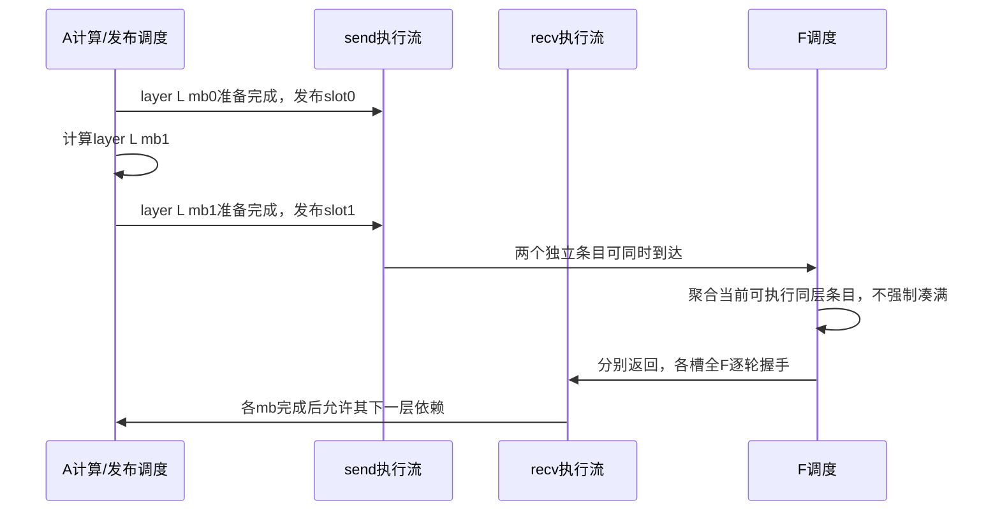

Decode单通信轮的dispatch_send在发布DMA完成后返回，不等待最终Consumed；这样同一send执行流能继续发布mb1。最终输入ACK由各mb的recv收尾等待，窗口仍由长期AfdContext持有。不得把“发布已完成”解释为槽可覆盖。若改成send内等待最终ACK，则必须另行设计可并发的每槽发送流和资源预算，不能沿用本图。

每mb有独立task_state、mask引用、输出、send/recv事件及D物理槽，M=2/3统一用数组。F仅有mb0也可计算；若设置聚合等待窗口，必须有限并有超时执行路径。recv等待不能占用唯一可发布mb1的资源，须实机验证事件图/AIV配额。P单槽仍在上一mb全输出及输入ACK结束后交接，不能套用D多槽时序。各TP/CP成员须维持共同mb/layer及collective顺序。

## D.3 状态所有权、初始化和退出

| 状态 | 唯一更新者 | 初值/推进 |
| --- | --- | --- |
| Ready/Consumed/Done | 各方向固定生产者，独占消息块 | INVALID=2；正常0/1，消费者不清字 |
| A输入槽 | A send | 首次Free，首发0不等不存在ACK；后续全F ACK后翻位 |
| F InputSlotState | 唯一scheduler/串行完成路径 | expected=0，inFlight=false；接收锁定，ACK流程后翻位 |
| F ReturnSlotState | 唯一scheduler/串行完成路径 | expected=0，未占用；全部成员credit匹配才占用；Done提交后推进 |
| A返回槽 | A recv | 启动前首轮credit0写完；全F Done及消费/清理后翻位 |
| Pending/Active/Completion | scheduler及串行完成路径 | 无多writer竞态；Active完成前不覆盖 |

初始化控制区、counts、record状态、静态地址并建立启动依赖；graph replay不重置。warmup使用隔离状态或通信完全排空后统一重置，不能只重置单端。MicrobatchComplete同时要求全输出及最后输入ACK；错误退出不得伪造成功ACK。

实施前须定义device可轮询错误/退出状态、唯一写入者、对端传播和host可读结果；所有等待循环检查终止条件。停止新请求后排空或一致abort，再销毁graph/窗口。具体错误码、传播ABI和超时策略尚未实现，必须在首个多卡原型前锁定。

## D.4 硬件和运行时准入门禁

1. 锁定950型号、驱动/固件、CANN、torch_npu、安装算子包及其源码对应关系。官方9.1文档、DeepEP的9.2验证环境、skill中A3/8.5示例不能互换。
2. 每类消息列出payload完成、跨核汇合、MTE3/远端完成、独立bit发布、GM→UB完成、scalar比较及UB复用的精确事件。SyncAll或32B DataCopy不是完整跨卡证明。
3. uint32状态、独立至少32B控制块；具体stride按后端隔离要求。bit-only避免复合快照，仍需状态字原子可观察性及远端发布顺序的API依据和litmus。证明不成立则不得按当前原语上线。
4. 验证不同角色窗口大小、注册、远端地址及销毁生命周期；对称get_symm_buffer不证明非对称能力。
5. 验证A send/recv核数预算、等待时另一kernel实际进度、跨stream图事件。现有CAM收发均按全AIV launch，不能直接复用tiling后宣称双流并发。可采用已验证的逐轮有限kernel回退，但须明确其框架依赖与性能。
6. 固定shape/dtype、最大输出/workspace、device group list和层地址视图。明确custom op mutation/alias、副作用及图节点依赖，防止编译消除/重排；先测单轮/双轮replay，再扩展循环。

官方：[950 DataCopyPad UB→GM](https://www.hiascend.com/document/detail/en/CANNCommunityEdition/910/API/ascendcopapi/docs/en/api/SIMD-API/basic_api/memory_vector_compute/data_move/DataCopyPad_UBToGM.md)、[DCache控制](https://www.hiascend.com/document/detail/en/CANNCommunityEdition/910/API/ascendcopapi/docs/en/api/SIMD-API/C-API/cache_ctrl/asc_dcci.md)。页面支持类型、对齐及缓存范围核查，不代表提供了完整跨卡协议证明。

## D.5 两后端的具体改造边界

MegaMoE拆开ffnExpertWorldSize和numSourceLanes；原epWorldSize同时用于来源counts/prefix、UB、地址及dedup prepass，不能直接替换成A+F或member×mb。保留GMM tile、三角色wave及主要WorkspaceLayout分区；容量/偏移由同源函数重算。权重、scale、activation属性同构；非法layer进入错误路径，不能沿用当前layered回落layer0。

Distributed按专家route间接表读取rank紧凑record，再生成专家连续计算输入。两种模式均替换原expert×B固定payload读取。sourceExpertOrdinal如与route顺序重复可后续删减，首版明确解码。各DMA tile检查对应重载blockCount/blockLen/stride与地址宽度，不能仅删除512检查。DataAsFlag保留固定1/消费清0，与控制交替位独立，清零完成先于credit。

## D.6 DeepGEMM参考边界

`D:/Code/refs/DeepGEMM-Ascend` HEAD为`8491bbb4b8c02a094a2318965f50c70438a3e73c`。`csrc/apis/mega_moe.hpp`有对称workspace；`deep_gemm/include/deep_gemm/comm/mega_moe.hpp`有epoch、双signal、全rank barrier及远端atomic；可参考先数据后通知、事件配对及内存复用，不能把全rank协调照搬为独立F调度。运行时要求独立核验，不与ops-transformer同名MegaMoE混为一版。

## D.7 验收反例与简化边界

覆盖0参与/1零route/0再参与、mb/layer/round跨迭代重复、Done/credit延迟、零token成员、全空DP、不同F分段数、TP/CP晚到、P共享槽交接、D M=2/3、graph重复replay/warmup、非法层及shutdown。每条有效route恰好一次，inactive输出0；状态机测试不替代A5发布litmus及资源进度测试。

首版保留完整RoundLedger：1M/32k仅32描述/mb；不未经积压上界证明缩成一个当前轮。静态phase、DP/member、后端格式由注册表推导，可保留校验冗余但不得形成两个权威来源。Pending与Active职责不同，允许compact引用减少拷贝，不整体合并。

后续可评估：可靠整轮Done后移除DataAsFlag（返回15360→14336B，32k×8省0.25GiB）；稀疏每F返回ABP（必须在下一实际参与轮已知且前一物理槽轮消费后定向授权，不能在上次F完成后预授未来任意轮）；有限结果buffer的compute-ahead；rank partial combine（独立精度验收）。均非首版已验证能力。

## D.8 讲解主线

先讲文首决策/闭环、第三部分架构、第四部分协议，再讲双后端改造与容量；第二部分原生长分析作证据查阅。开发交接沿接口→物理布局→状态转移→kernel事件→验收。图示分开标出输入、返回及workspace三种可复用时刻，不以一个Done混称。

# 修订记录

| 日期 | 修改人 | 内容 |
| --- | --- | --- |
| 2026-10-15 | Codex | 新建通用双后端设计；整合三场景、四类现状、producer-write协议、两层分轮、小返回窗口、容量公式和接口流程对照 |
| 2026-10-15 | Codex | 统一DP/物理成员身份与TP/CP边界，贯通多microbatch、容量/接口/状态机，并细化线性路由准备算法 |
| 2026-10-15 | Codex | 按场景→原生机制/容量→总体架构→数据协议→双后端改造→验证重组；补充四类布局容量外推、结构生命周期及贯穿示例 |

| 2026-10-15 | Codex | 统一为物理槽交替位握手；明确32位状态/32B控制消息、Inbox与提交块、独立输入和返回生命周期，增加变量速查与0→1→0示例 |

| 2026-10-16 | Codex审查修订 | 新建v2副本：全F返回握手、物理槽Inbox、credit预检、mask闭环、Decode可达调度、统一record布局和平台准入；原稿保留 |
