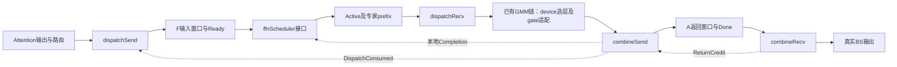

# DeepEP-AFD 算子详细设计交付索引

本组文档细化[五算子总设计](../a5_async_afd_deepep_operator_design_v1.md)，供开发人员直接在 DeepEP-Ascend 基线上改造。总设计和整体架构文档保持原样。本次只新增设计文档，不新增算子代码，不创建独立算子工程。

## 阅读顺序与交付件

1. [公共契约](common_contract.md)：变量、ABI、wire layout、控制原语、位握手、图和错误边界。
2. [dispatchSend](dispatchSend/design.md)：A侧去重发布，按tile重构上游dispatch，固定通信窗口。
3. [ffnScheduler接口](ffnScheduler/design.md)：DP到齐、Active/Completion、专家prefix、两种credit策略；内部调度算法尚未确定。
4. [dispatchRecv](dispatchRecv/design.md)：从上游copy epilogue改造，按当前片route展开。
5. [combineSend](combineSend/design.md)：从上游combine发送队列改造，逐route直发并提交完成。
6. [combineRecv](combineRecv/design.md)：从上游reduce epilogue改造，A侧逐route FP32加权归并。

图中的控制边不表示host串行等待。A收发必须能并发；F执行链按当前Active串行，COMPUTE_AHEAD可在combine处等待credit并占住单workspace。

## skill执行与要求对应

主skill：[ascendc-operator-design](C:/Users/puxiaokun/.agents/skills/ascendc-operator-design/SKILL.md)。使用其design-template、general-tiling-principles、index-tiling、reduction-tiling；辅助参考本地api-best-practices的搬运/流水线/通信/算术资料，以及tiling、图模式和算子审查规则。没有启动模型端到端优化流程，没有执行code-gen。

| skill要求 | 四个通信算子的交付位置 | ffnScheduler |
| --- | --- | --- |
| 完整函数声明、参数、dtype | 各文档§1，host与device入口 | §1完整接口 |
| 计算逻辑与具体API序列 | 各文档§2，公共契约§4展开新增helper | 只定义可观察行为，内部API序列未交付 |
| 两级tiling及结构体 | 各文档§3 | 按用户要求暂不设计 |
| UB逐buffer、份数、系数、例算 | 各文档§3 | 按用户要求暂不设计 |
| Workspace公式与生命周期 | 各文档§4、公共契约 | 输出ABI已定义，私有workspace待内部设计 |
| FP16/BF16处理 | 搬运按位；combineRecv FP32乘加后RN转BF16；不支持FP16 | 整数/状态控制，无半精度数学 |
| 性能和实现检查清单 | 各文档§5—7 | §6接口验收与后续门禁 |
| 源码依据与实施位置 | 各文档§8、公共契约§6 | 明确为新增能力，不伪称原生已有 |

交付路径对skill的适配：skill示例路径为`ascend-kernel/csrc/ops/<op>/design.md`，本任务明确只写独立设计文档、后续直接改DeepEP，因此保留逐算子`design.md`形态，存入当前docs目录；不生成无关项目骨架。公开名遵用户指定lowerCamelCase，内部保持DeepEP snake_case/模板命名。图预分配使用void out接口，替代模板的单Tensor返回示例。以上是任务约束下的显式适配，不声称逐字遵循示例路径和示例函数。

同名接口检查：当前NumPy无这五个公开名称；本机未安装torch，官方文档限定域检索未找到对应名称，尚未做torch运行时检查。不得把它记录成已执行的torch检查。四个通信文档覆盖设计交付结构，但目标平台API和协议门禁未验收，不能直接标为生产实施无阻断。scheduler按用户缩小的范围交付接口，**不标记为完整skill DoD通过**。

## DeepEP基线与复用策略

检出commit：`3b25377d04b24fc6154698ded78a2bcb2c59afff`，目录`D:/Code/refs/DeepEP-Ascend`，本轮再次用git rev-parse确认。源码引用均针对这个本地commit，不推断其他分支或A3行为等于A5。

| 算子 | 原生基础 | 必要改造 |
| --- | --- | --- |
| dispatchSend | dispatch_impl、simt_persistent_worker、deduplicate、HcommJetty | A/F非对称寻址，有限tile路由表、独立发布/完成，删除全rank等待 |
| dispatchRecv | dispatch_copy_epilogue_impl | 以ActiveSegment替代完整流遍历，保留stage搬运/SF stride，输出4列回源metadata |
| combineSend | combine_impl、load_meta_issue_wqe、HcommJetty | 删除rank内归并与hidden镜像，逐route写回，末片完成提交 |
| combineRecv | combine_reduce_epilogue_impl、RingReducer | 去掉rank-partial去重归并；固定topk顺序FP32乘权，分轮输出完整BS |

代码计划位置位于DeepEP的`impls/afd/`、`layout/afd/`、`csrc/kernels/afd/`、`csrc/buffers/afd.hpp`，复用原JIT与资源管理；原EP路径保持独立。逐请求CQE及tile drain是首版简化选择，可能降低原生峰值吞吐；后续可恢复batch WQE/multi-SGE，但必须保留完成覆盖和源buffer生命周期证明。不会声称所有底层逻辑原样复用。

## 算术核对

以下通过独立Python表达式复算，单位B。U示例253952仅为预算演示，实际读取runtime UB容量。

| 项目 | 参数 | 结果 |
| --- | --- | ---: |
| dispatchSend UB，BF16 | E64/N8/K8/T256/M128 | 19232 |
| dispatchSend UB，FP8 | 同上，M352 | 21024 |
| dispatchSend业务workspace，BF16 | C32768/J128/单slot | 6366016 |
| dispatchSend业务workspace，FP8 | 同上 | 13706048 |
| dispatchRecv UB，FP8 | T4/D7680 | 62464 |
| dispatchRecv UB，BF16 | T4/D14848 | 119808 |
| combineSend UB | T128/N_A8/R8 | 5440 |
| combineRecv UB | h7168/K8 | 100704 |
| Active allocation | L8/R8 | 2624 |
| Completion allocation | L8/R8 | 800 |
| ExecutionState allocation | L8 | 64 |
| A每槽返回预留 | C32768/K8/stride15360 | 4026531840（3.75GiB） |

业务workspace不含传输队列/注册资源；W_transport逐实际allocation计量并检查总预算。BF16/FP8输入通信预留、完整BS普通HBM、当前GMM片workspace、返回预留分别计账；不能将它们相互抵销。ActiveSegment实际stride32，较总设计24B简写增加8LR字节，已显式标注。

## 实施前门禁及状态

已决定：接口与命名、有限窗口/两级分轮、P单槽/D多槽、全F闭合、输入/返回独立位、A侧最终乘权、单workspace COMPUTE_AHEAD默认、PRECHECK共接口可选、NOOP/CONTROL/ABORT区别、输入ACK由末片提交且recv最终收尾。

仍需平台验证：

- A5目标CANN/toolchain能编译并运行所选DeepEP路径；保留芯片、软件版本及运行日志。
- URMA drain对远端可见性和后续UBMEM控制提交的顺序保证；控制缓存可见性、32B搬运和复用litmus。
- A/F非对称region/offset、GMM2输出直接作为注册URMA源；不得用隐式QH镜像绕开预算。
- A send/recv等待kernel可共存、F全域错误终止可执行、图capture/replay保持事件DAG与持久位。
- combineRecv新向量primitive具体重载、原地算术与事件可编译；FP8 SF布局与GMM兼容。BF16先验收，FP8不能仅因可搬运就默认计算可用。

仍需设计：scheduler私有状态/资源查询、选择算法、公平性、核内实现和预算；这部分按用户要求留在下一阶段。其他通信算子的上下游契约已列明，其平台门禁未通过前不能宣称实现已验证。

本轮校验仅包括文档结构、签名一致性、链接、公式和输入文档保持不变；没有NPU编译、性能或精度运行结果。

## 容量澄清与验收用例

32k/256k maxBS指单Attention rank完整事务容量；单lane窗口C_m独立配置，DP容量为成员求和，无固定32k合计上限。字段和轮次以common_contract.md为准。F预留按所有注册来源槽求和，A按自身槽求和，Q/Q_alloc只控制单计算片。scheduler/combine尚无完整实现，以下用例先验证模型与接口，不能称设备调度已通过：

| 用例 | 必须检查 |
| --- | --- |
| 同DP双owner各32k窗口/32k实际 | 一轮DP64k，每lane边界仍32k |
| 双owner各256k实际/32k窗口 | 共8轮，每轮64k，A各自输出归并256k |
| 异构窗口、实际长度不等 | 共同最大轮数；耗尽成员逐轮发布0并参加ACK/credit |
| K=8集中一个F | 双32k窗口524288route，a=1/Q=32768时16片，workspace不增长 |
| 单owner回归 | 原32k一轮/256k八轮及mask/inactive行为保持 |
| TP复制与CP不相交分片 | TP owner唯一；非owner仍控制到齐；CP各自完整H |

单lane配置零容量应拒绝，零长度事务应接受；字节大小/总route/前缀先uint64检查，保留int32/uint32编码、UB、DMA及编译族真实限制。
