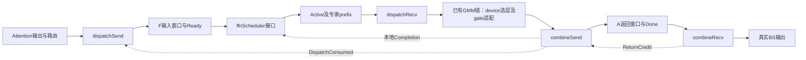

# DeepEP-AFD 算子详细设计交付索引

本组文档细化[五算子总设计](../a5_async_afd_deepep_operator_design.md)，供开发人员直接在 DeepEP-Ascend 基线上改造。当前五算子开发实现及设备验收状态见[设计入口](../README.md)。

## 阅读顺序与交付件

1. [公共契约](common_contract.md)：变量、ABI、wire layout、控制原语、位握手、图和错误边界。
2. [dispatchSend](dispatchSend/design.md)：A侧去重发布，按tile重构上游dispatch，固定通信窗口。
3. [ffnScheduler接口](ffnScheduler/design.md)：DP到齐、Active/Completion、专家prefix、两种credit策略；本文档范围为接口；当前内部实现见代码仓说明。
4. [dispatchRecv](dispatchRecv/design.md)：从上游copy epilogue改造，按当前片route展开。
5. [combineSend](combineSend/design.md)：从上游combine发送队列改造，逐route直发并提交完成。
6. [combineRecv](combineRecv/design.md)：从上游reduce epilogue改造，A侧逐route FP32加权归并。

图中的控制边不表示host串行等待。A收发必须能并发；F执行链按当前Active串行，COMPUTE_AHEAD可在combine处等待credit并占住单workspace。

## 设计范围

四个通信算子的文档按 Ascend C 算子设计模板组织接口、算法、tiling、UB、workspace 和验证门禁。ffnScheduler 文档只覆盖接口和可观察契约，不能作为完整内部设计交付。最初的 skill 执行记录保留在本地归档。

## DeepEP基线与复用策略

原生参考commit：`3b25377d04b24fc6154698ded78a2bcb2c59afff`，目录`D:/Code/refs/DeepEP-Ascend`。源码引用针对这个固定commit，不推断其他分支或A3行为等于A5。

| 算子 | 原生基础 | 必要改造 |
| --- | --- | --- |
| dispatchSend | dispatch_impl、simt_persistent_worker、deduplicate、HcommJetty | A/F非对称寻址，有限tile路由表、独立发布/完成，删除全rank等待 |
| dispatchRecv | dispatch_copy_epilogue_impl | 以ActiveSegment替代完整流遍历，保留stage搬运/SF stride，输出4列回源metadata |
| combineSend | combine_impl、load_meta_issue_wqe、HcommJetty | 删除rank内归并与hidden镜像，逐route写回，末片完成提交 |
| combineRecv | combine_reduce_epilogue_impl、RingReducer | 去掉rank-partial去重归并；固定topk顺序FP32乘权，分轮输出完整BS |

代码位置位于DeepEP的`impls/afd/`、`layout/afd/`、`csrc/kernels/afd/`、`csrc/buffers/afd.hpp`，复用原JIT与资源管理；原EP路径保持独立。当前发送路径已采用有界批量 WQE 构建，仍保留逐 WR CQE 和 tile drain；具体实现边界见代码仓说明，不声称全部原生流水已恢复。

## 算术核对

以下通过独立Python表达式复算，单位B。U示例253952仅为预算演示，实际读取runtime UB容量。

| 项目 | 参数 | 结果 |
| --- | --- | ---: |
| dispatchSend UB，BF16 | E64/N8/K8/T256/M128 | 19232 |
| dispatchSend UB，FP8 | 同上，M352 | 21024 |
| dispatchSend业务workspace，BF16 | C32768/J128/单slot | 6366016 |
| dispatchSend业务workspace，FP8 | 同上 | 13706048 |
| dispatchRecv UB，FP8 | T4/D7680 | 62464 |
| dispatchRecv UB，BF16 | T4/D14848 | 119808 |
| combineSend UB | T128/N_A8/R8 | 5440 |
| combineRecv UB | h7168/K8 | 100704 |
| Active allocation | L8/R8 | 2624 |
| Completion allocation | L8/R8 | 800 |
| ExecutionState allocation | L8 | 64 |
| A每槽返回预留 | C32768/K8/stride15360 | 4026531840（3.75GiB） |

业务workspace不含传输队列/注册资源；W_transport逐实际allocation计量并检查总预算。BF16/FP8输入通信预留、完整BS普通HBM、当前GMM片workspace、返回预留分别计账；不能将它们相互抵销。ActiveSegment实际stride32，较总设计24B简写增加8LR字节，已显式标注。

## 实施前门禁及状态

已决定：接口与命名、有限窗口/两级分轮、P单槽/D多槽、全F闭合、输入/返回独立位、A侧最终乘权、单workspace COMPUTE_AHEAD默认、PRECHECK共接口可选、NOOP/CONTROL/ABORT区别、输入ACK由末片提交且recv最终收尾。

仍需平台验证：

- A5目标CANN/toolchain能编译并运行所选DeepEP路径；保留芯片、软件版本及运行日志。
- URMA drain对远端可见性和后续UBMEM控制提交的顺序保证；控制缓存可见性、32B搬运和复用litmus。
- A/F非对称region/offset、GMM2输出直接作为注册URMA源；不得用隐式QH镜像绕开预算。
- A send/recv等待kernel可共存、F全域错误终止可执行、图capture/replay保持事件DAG与持久位。
- combineRecv新向量primitive具体重载、原地算术与事件可编译；FP8 SF布局与GMM兼容。BF16先验收，FP8不能仅因可搬运就默认计算可用。

scheduler 内部已有开发实现，独立设计文档仍以接口为主。CPU 检查不能替代设备验收；平台门禁通过前不能宣称实现已验证。

## 容量澄清与验收用例

32k/256k maxBS指单Attention rank完整事务容量；单lane窗口C_m独立配置，DP容量为成员求和，无固定32k合计上限。字段和轮次以common_contract.md为准。F预留按所有注册来源槽求和，A按自身槽求和，Q/Q_alloc只控制单计算片。以下用例用于模型和设备验收，不能因已有开发实现便称设备调度已通过：

| 用例 | 必须检查 |
| --- | --- |
| 同DP双owner各32k窗口/32k实际 | 一轮DP64k，每lane边界仍32k |
| 双owner各256k实际/32k窗口 | 共8轮，每轮64k，A各自输出归并256k |
| 异构窗口、实际长度不等 | 共同最大轮数；耗尽成员逐轮发布0并参加ACK/credit |
| K=8集中一个F | 双32k窗口524288route，a=1/Q=32768时16片，workspace不增长 |
| 单owner回归 | 原32k一轮/256k八轮及mask/inactive行为保持 |
| TP复制与CP不相交分片 | TP owner唯一；非owner仍控制到齐；CP各自完整H |

单lane配置零容量应拒绝，零长度事务应接受；字节大小/总route/前缀先uint64检查，保留int32/uint32编码、UB、DMA及编译族真实限制。
