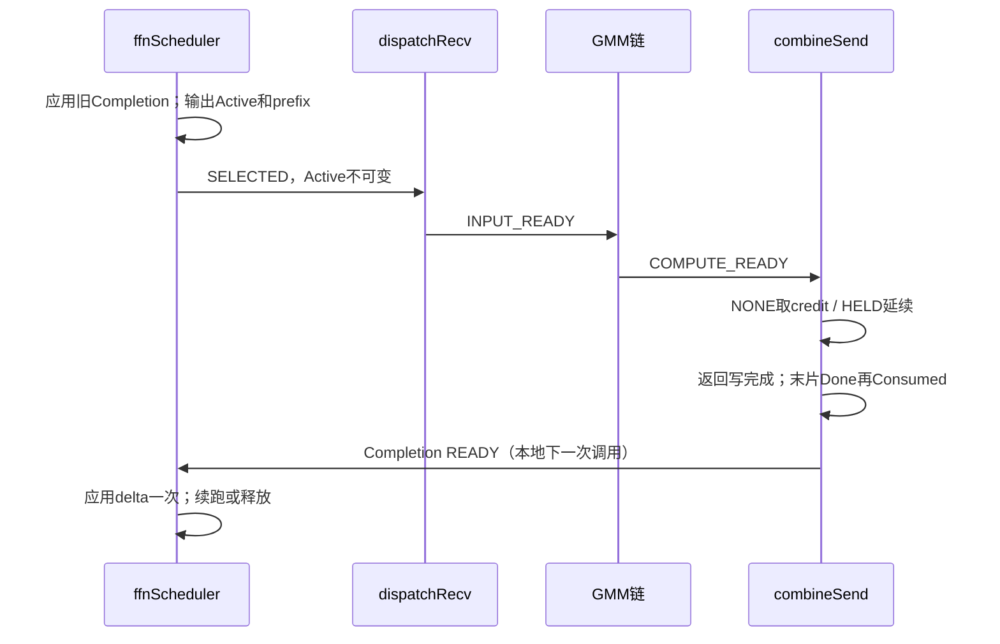

# ffnScheduler 接口设计

本轮冻结接口与首版内部实现。使用单AIV执行有限的元数据扫描，按到齐组选择phase/layer并输出有界Segment；不遍历token或搬运hidden。DeepEP原生没有独立AF scheduler，新增部分明确隔离在layout/afd/scheduler.hpp和impls/afd/ffn_scheduler.hpp。开发沿现有DeepEP JIT/owner接入，不创建独立模板工程；设备编译和功能/性能验收仍需A5环境。

必须同时阅读[公共ABI](../common_contract.md)。以下是AFD新增能力，DeepEP原生没有与之等价的独立scheduler。

## DP容量、异构成员与有界选片

DP是到齐/选中单位，不是32k容量单位。固定成员表所有成员包括零长度发布均到齐后，才能选中该DP条目。Pending每成员保存消费游标与首次到齐时间；不能按固定32768分配DP整轮token数组。成员lane容量C_m可不同，整轮总route按各成员计数求和，用uint64中间量并检查现有ABI；单lane表仍最多C_m*K。Active容量保持按L、L*R配置，与本轮总token数无关。

选片同时约束sum_e n_e≤Q及sum_e align_a(n_e)≤Q_alloc；host保持Q_alloc≥Q。同DP两个owner各32k、K=8集中到本F时总524288条route，a=1、Q=Q_alloc=32768形成16片；padding非平凡时需按实际专家分布选片，不能只用ceil(total/Q)。entry.is_final只有本F该DP所有成员route均耗尽才成立。短成员零route不缩小成员表，不允许在其他成员尚未结束时整体ACK。

接口仍支持COMPUTE_AHEAD以及PRECHECK，Continuation跨片持有授权，新增待处理行数不新增workspace。内部scheduler按本文实现，CPU模型验证不等于Ascend C设备验证。


## 1. 完整接口与参数

```cpp
void ffnScheduler(
    const at::Tensor& context, const at::Tensor& control_buffer,
    at::Tensor& workspace, at::Tensor& active,
    at::Tensor& execution_state, at::Tensor& completion,
    at::Tensor& psum_num_recv_tokens_per_expert,
    at::Tensor& num_unaligned_recv_tokens_per_expert);
```

```cpp
__global__ __vector__ void ffn_scheduler_impl(
    __gm__ const AFDContextLayout* context, __gm__ void* control_buffer,
    __gm__ void* workspace, __gm__ AFDActive* active,
    __gm__ AFDExecutionState* execution_state,
    __gm__ AFDCompletion* completion,
    __gm__ int* psum_num_recv_tokens_per_expert,
    __gm__ int* num_unaligned_recv_tokens_per_expert,
    const int rank_idx);
```

| 参数 | 方向/类型/容量 | 所有权与约束 |
| --- | --- | --- |
| context | in uint8 固定布局 | 静态DP成员、phase、lane/slot、合法layer族、R/K/Q/Q_alloc/a及调度模式；图外创建 |
| control_buffer | in uint8 | 只轮询F本地Ready/credit；不在此发送Consumed/Done；device签名沿总设计void*，语义只读 |
| workspace | in/out uint8 | 持久调度状态，唯一writer是scheduler；不能与四算子的scratch重叠；精确布局见第7节 |
| active | out uint8 | 64B header及Entry/Member/Segment，容量`64+32L+32L+32LR`；详见公共契约 |
| execution_state | in/out uint8 | `32+A32(4L)`；初始化本次stage、错误码、各entry授权状态；后续算子推进 |
| completion | in/out uint8 | `32+32L+32L+A32(4LR)`；消费上次READY后准备下次ARMED |
| psum_num_recv_tokens_per_expert | out int32[R] | 当前片各专家padding行数的exclusive-end prefix |
| num_unaligned_recv_tokens_per_expert | out int32[R] | 当前片各专家有效route行数 |
| rank_idx | device int | 静态本F编号，由Context注入，不作动态任务输入 |

L是本F已注册(member,slot)数；R是本F专家数；Q为有效专家行上限，Q_alloc为padding后物理行上限，a为专家行对齐。所有count与prefix必须可用int32表示。两个prefix只描述当前Active，不返回全事务动态shape。host函数返回只表示提交完成。

图外owner调用`scheduler_workspace_bytes(L,R)`分配并清零私有持久workspace。大小与偏移见第7节；图replay不得重新初始化。四个通信算子不读取此布局，只共享Active/Completion。实际kernel增加`buffer`参数读取F本地count表，因现有Context只保存相对偏移，不能由control_buffer推导payload基址。

## 2. 必须满足的选择与发布条件

以下约束由第7节的有限扫描实现：

1. 同DP同microbatch同layer同通信轮的全部Attention物理成员到齐后，才能选其任何route；TP/CP成员身份取Context，不能只数相等Ready位。
2. 一个Active只允许一种phase和一个layer；允许跨DP或同DP不同microbatch聚合。每个聚合条目仍独立维护成员和完成状态。
3. 只输出尚未完成的连续route子段；有效行≤Q，padding后行≤Q_alloc；不能因为只选部分route就提前通知Consumed。
4. Active.valid最后发布；发布前header/所有表/两个prefix/ExecutionState/Completion初始化全部可见。发布后直到本执行链结束不可修改。
5. 收到上一Completion READY后，必须将其消费进度应用且仅应用一次，再发现同槽下一轮；ACK后禁止从可能被覆写的Inbox取补充字段。
6. 无任务输出NOP；零route完整DP输出CONTROL或WORK里的零行entry，不能用NOP吞掉其握手。

对每专家e：有效行c_e，物理行p_e=align_a(c_e)，prefix[e]=sum(p_j,j≤e)。所有Segment目的区间互不重叠且落在对应专家有效区内；padding不得被当作route。Active.num_expanded_tokens=sum(c_e)，num_padded_tokens=prefix[R-1]。

## 3. Active、执行状态与完成接口

| 输出情形 | Active | ExecutionState | Completion | 下游行为 |
| --- | --- | --- | --- | --- |
| 无可选任务 | valid=0,kind=NOP，count=0 | EMPTY | EMPTY | 四阶段不读旧任务/旧prefix，直接一致返回 |
| 有效数据片 | valid=1,kind=WORK | SELECTED | ARMED | recv→INPUT_READY→GMM2完成置COMPUTE_READY→send |
| 仅零route条目 | valid=1,kind=CONTROL | SELECTED | ARMED | recv置INPUT_READY，GMM跳过，send仍获取credit并提交 |
| 参数/层非法 | valid=0,kind=ABORT | ABORTED+error | 不产生成功READY | 所有下游不解引用任务地址；进入域失败流程 |
| 上次完成可应用 | 先保持旧Active | COMMITTED | READY | 应用delta，处理条目结束，再允许覆盖旧Active |

NOP/ABORT两prefix均清零；不得依赖旧count。WORK和CONTROL都必须有至少一个entry。混合Active中零行entry合法，kind仍为WORK。Completion中每member R维delta为真实消费行数，padding不计；entry.is_final必须由本F该条目的全部成员剩余route决定，不能从某个Segment末尾推断。

本地状态接口顺序：`EMPTY → ARMED → READY → EMPTY`。READY消费后释放旧Active所有权；同一流串行执行，不引入额外completion generation。发现ARMED未完成时不得覆盖Active；报STATE_ORDER并停止该链，不能把它当NOP。这个顺序不是跨F barrier。

## 4. credit策略共用接口

Context选择 `COMPUTE_AHEAD` 或 `PRECHECK`，两者共享上述参数与结果布局。**首版默认COMPUTE_AHEAD，保留用户已接受的先算后等。**

| 条件 | COMPUTE_AHEAD | PRECHECK |
| --- | --- | --- |
| 新条目无credit | 可输出WORK，grant=NONE | 不选，可选其他已授权候选 |
| 全成员剩余route为零 | 两种策略均先核对全部member credit；不足则留Pending并扫描其他组 | 同左 |
| 新条目credit已可用 | 可由combineSend取得；不要求scheduler预取 | 被选后记录HELD；未被选不占grant |
| Continuation | 继承HELD，不二次消耗 | 同左 |
| 计算完成但credit未到 | combineSend等待，x和单workspace保留 | 正常不发生；仍核验身份 |
| 被阻塞后绕过 | 不允许用同workspace覆盖x | 只能在选择之前绕过，不能抢占已运行Active |

HELD不是把credit位写成新值；它是本F对该条目“当前预期bit已匹配且尚未最终归还”的本地所有权记录。credit翻位由A recv完成；F不能修改A的位推进。owner由entry及members快照确定。

Continuation只能来自已完成前片的Completion。非末片保留输入引用与grant；末片combineSend先结束返回DMA与输入引用，发Done→Consumed，将FINISHED写入Completion。scheduler消费后删除条目并切换lane期待输入位。不得在ACK后再次读取Inbox再决定是否FINISHED。

## 5. 接口例子与时序

DP0有TP2（成员A0/A1），两个Decode microbatch各占独立slot。mb0仅A0发布，mb1两成员已发布：mb0不允许进入Active；mb1允许。mb0随后到齐时，二者同phase/layer可聚合，也可分别选，接口不强制等待凑齐M=2。

例：R=2,a=16,Q=64,Q_alloc=80，本片c=[17,20]，输出prefix=[32,64]，有效行37、物理行64。专家0有效[0,17)、padding[17,32)，专家1有效[32,52)、padding[52,64)。不同entry的Segment按专家区间依次排放；有效行≤64不代表物理行可忽略。



Q=32768、某完整DP在本F有70000条route时，可输出32768/32768/4464三片（a=1示例）；grant跨三片保持，只有第三片Done/Consumed。其他F独立决定片数，不协调scheduler轮次。

## 6. 图、错误及接口验收

图replay不得初始化持久Pending/期待位或重置Completion。所有地址和容量图外固定，实际layer和行数为device数据。GMM必须按Active.valid/kind及合法layer gate，不得执行非法层或空旧任务；ABORT通过独立域错误机制传播，不能发伪ACK解锁其他设备继续计算。

接口测试以人工构造Active/Completion和状态fixture验证，不依赖尚未选定的内部调度算法：

- TP/CP缺任一成员不得选；同DP M=2/3独立到齐；跨DP同层可聚合。
- Q与Q_alloc分别越界拒绝；非法layer不读权重；padding metadata=-1。
- grant NONE/HELD/FINISHED跨片闭合；PRECHECK未选项不占授权；COMPUTE_AHEAD阻塞保留x。
- READY只消费一次；Consumed后Inbox被下一轮覆写，旧Completion仍可独立应用。
- NOP无通知、CONTROL全F握手、WORK混零条目、域错误全核一致退出。

设备验收仍须验证控制消息可见性、所有C API重载、图持久状态、最大注册lane规模下调度延迟；CPU模型不覆盖这些平台事实。


## 7. 首版内部算法、Tiling和私有布局

### 7.1 资源与接口

```cpp
template<int N,int E,int K,int L,int NL,int Q,int QA,int A,bool PRECHECK>
__global__ __vector__ void ffn_scheduler_impl(
    __gm__ void* buffer, __gm__ const AFDContextLayout* context,
    __gm__ void* control_buffer, __gm__ void* workspace,
    __gm__ AFDActive* active, __gm__ AFDExecutionState* execution_state,
    __gm__ AFDCompletion* completion, __gm__ int* psum_num_recv_tokens_per_expert,
    __gm__ int* num_unaligned_recv_tokens_per_expert, const int rank_idx);
```

N是F数，E总专家数，R=E/N，K为top-k，L为注册来源槽数，NL合法层表长度，Q/QA分别对应有效/物理片上限，A对应专家对齐a。PRECHECK=false为默认先算后等。要求QA>=max(Q,A)、R<=512。单AIV执行，其他block若误下发直接返回，无跨核join。调度权由同stream串行kernel持有。

私有GM allocation只包含：

| 区域 | 偏移/大小 | 用途 |
|---|---|---|
| AFDSchedulerState | 0 / 32B | uint64 tick、last_phase、has_phase；tick为本地年龄排序，不是wire generation |
| AFDPendingLane[L] | 32 / 96L | valid、expected_input_bit、grant_state、first_seen及完整64B Inbox快照 |
| totals[L,R] | 32+96L / A32(4LR) | 新Ready到来时快照每专家总route数 |
| cursors[L,R] | totals末尾 / A32(4LR) | Completion后更新的有效消费数 |

总大小为`32+96L+2*A32(4LR)`，由同名C++size helper计算。初始化全部零，初始期待输入bit=0，而F Ready块初始为1。无全事务hidden镜像、DP token数组或Q行任务描述。初始化仅图外执行。

UB为256B结构搬运临时区及五个A32(4R)向量：counts、consumed、当前片rows、prefix、completion delta；总计`256+5*A32(4R)`。host以实际UB容量检查；不能以静态R上限替代该检查。元数据按R维整块搬运，输入Ready和credit按独立32B搬运，Inbox按64B搬运；沿用现有recv_load/recv_store的MTE2→S、S→MTE3和MTE3→S同步，不新造一套同步抽象。私有不可变快照/表标量查找沿用recv_read的DCache bypass。不存在GMM，也不需要BF16数学模板。

### 7.2 状态、到齐和选择

1. 如果Completion=READY，先全量校验member唯一性、delta边界、连续entry成员区间及FINISHED对应全部route已耗尽，再应用delta；不从旧Inbox恢复任何字段。FINISHED清除Pending.valid并翻expected_input_bit；HELD续片保持输入位、快照和授权。READY清为EMPTY，第二次应用不可能通过COMMITTED/READY门禁。ARMED未完成重入视为STATE_ORDER，发布ABORT，不能覆盖为正常NOP。
2. 对空Pending读取本地InputReady32B，仅匹配期待位时快照Inbox及R维count。校验layer、轮号、单lane容量、返回bit和route总量。已有Pending不重新读取Inbox。prefix/count细节一致性继续由dispatchRecv校验，在通过前不会产生成功输入ACK。
3. 分组键为`(dp,phase,microbatch,layer,round,num_comm_rounds)`。一个静态member的不同slot不增加成员数；必须为每个静态member找到恰好一个匹配Pending。缺员等待，重复member报错。最小lane编号为组leader，仅用于本F本地枚举，不引入F leader。
4. 在完整候选组中，上次phase之外有候选时优先选另一phase，满足连续phase上限1。phase内选择first_seen最早的组，并采用其layer；年龄是本F首次发现该组任一成员的kernel调用序号，不是全局时钟或时延保证。PRECHECK过滤未获得全部member credit的候选；COMPUTE_AHEAD只对有剩余route的组允许先算后等。全组零route必须先核对credit，即使它将被聚合进WORK Active也不能跳过。单个零route成员属于非空DP组时仍按整组WORK处理。Continuation的HELD免重复credit取得。
5. 首组优先，随后按循环lane序聚合同phase/layer的其他到齐组，支持同DP多个microbatch和跨DP。每(member,expert)最多一个连续Segment。route_begin为该专家prefix起点加cursors，而非专家内相对下标；dst_row_begin先记录专家内有效行偏移，全部选择完再加当前片专家padding prefix。
6. 每次取行同时限制Q和QA。令当前专家有效行c、已padding行p=align_a(c)、当前总物理行P，则还能容纳`floor((p+QA-P)/a)*a-c`行，同时不能超过Q剩余额度。零进度且尚有route的组不输出、不占grant；真正零route到齐且credit齐备的组输出CONTROL或WORK中的零行entry。QA>=a保证非空候选能取得至少一行。
7. 写表、prefix、execution SELECTED、completion ARMED全部完成，最后写Active有效header。若无候选则NOP并清prefix；异常ABORT并清prefix。所有失败进入域失败流程，不通过伪ACK继续。

| Pending阶段 | 输入引用 | grant | 下一步 |
|---|---|---|---|
| 空，期待bit b | 无 | NONE | Ready=b后快照 |
| 到齐但未选择 | 持有 | NONE/HELD | 等同组/预算/策略 |
| Active/ARMED | 持有 | NONE或HELD | recv/GMM/send，同workspace不可抢占 |
| READY非末片 | 持有 | HELD | 应用delta，续片 |
| READY末片 | 已由send结束引用并ACK | FINISHED | 仅凭Completion释放，期待bit翻转 |

控制组数最多L，Segment最多LR，计数处理O(LR)。当前成员身份搜索没有新增静态索引表，最坏存在O(L^3)元数据比较；它不随token数增长，但大L下可能成为明显瓶颈，必须实测。后续可在host预构建DP/member索引，把group检查降为有界成员查找，不改变wire协议、Pending或Active ABI。首版不承诺调度延迟数值。

### 7.3 GMM后device gate

`mark_compute_ready_impl(active,execution_state)`由owner在实际GMM2之后同stream下发：WORK的INPUT_READY→COMPUTE_READY；CONTROL保持INPUT_READY；NOP/ABORT无动作；其他阶段报STATE_ORDER。它只标记顺序，不计算、不证明GMM输出正确，也不能替代GMM。

### 7.4 复用边界和验证

原生DeepEP在collective内完成全事务计数/prefix，没有此独立调度器。复用其专家prefix和连续route区间语义，继续使用dispatchRecv现有低层搬运/cache helper；不保留不适用于独立AF的全rank barrier。变量count/prefix/route_begin与已有算子对应。其余Pending、到齐、credit、Completion和device gate为AFD必要新增，不能凭名称声称原生已有。

CPU规格模型覆盖同DP双microbatch、缺员、两个32k owner热点F形成16片、padding约束、两种credit策略、八轮零尾、交替位循环、重复Completion拒绝、phase/layer边界及重复member。仍需A5编译和设备fixture验证，尤其32B控制可见性、图replay与真正异步通信。
